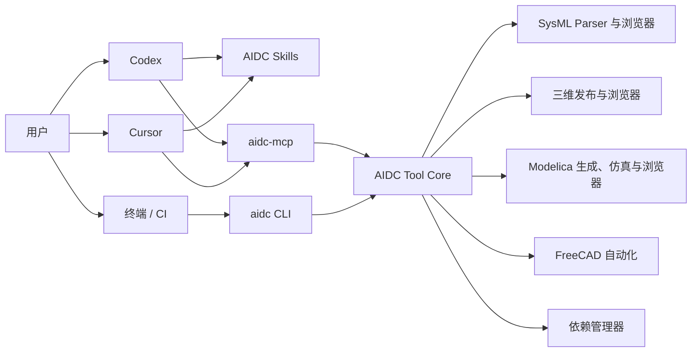

# AIDC AI 工具插件化与正式发行实施计划

版本：V1.1  
状态：P0–P3 已执行；公开发行仍受供应链闸门阻断
日期：2026-10-12

## 1. 定位修正

AIDC 现阶段不建设统一的独立桌面工作台。SysML 浏览器、三维模型浏览器、Modelica 浏览器、FreeCAD 自动化和模型转换能力，继续作为 Codex、Cursor 等 AI 工具可调用的本地插件和工程工具。

正式化后的产品名称暂定为 **AIDC Engineering Tools**，产品形态由四部分组成：

1. `aidc`：面向用户、脚本和 CI 的统一命令行入口。
2. `aidc-mcp`：面向 Codex、Cursor 和其他兼容 AI 主机的标准 MCP 服务。
3. AIDC Skills：面向 AI 的机器人需求、架构、CAD、Modelica 等开发流程说明。
4. 独立浏览器：由 CLI 或 AI 工具按需启动，用于查看 SysML、三维模型和 Modelica 模型。

统一的是安装、命令、协议、依赖和诊断，不统一三个浏览器的产品界面。用户仍在自己熟悉的 AI 工具中工作，只有需要审查模型时才打开对应浏览器。



## 2. 产品目标

### 2.1 启动入口清晰

用户只需要认识三个入口：

- 在 AI 工具中调用 AIDC 插件或使用自然语言任务；
- 在终端运行 `aidc <command>`；
- 从 AI 工具或 CLI 按需打开某个独立浏览器。

不要求用户进入源码目录运行 PowerShell、npm、Python 或查找某个服务端口。

### 2.2 安装简单

- 提供一个 `AIDC-Tools-Setup.exe`，默认按用户安装，不要求管理员权限。
- 安装核心 CLI、MCP、Skills、静态浏览器资源和必要内部服务。
- FreeCAD、OpenModelica 等大型依赖采用按需安装的受管运行时包。
- 同时提供离线完整包，满足无网络环境。

### 2.3 尽量零配置

- 用户不配置 PATH、Python、Node.js、`OPENMODELICAHOME`、服务端口或浏览器工程环境变量。
- `aidc integrate codex`、`aidc integrate cursor` 生成或更新宿主接入配置。
- 工程和文件通过命令参数、文件选择器或 AI 上下文传入。
- 高级用户可以注册外部 FreeCAD/OMC，但默认使用经过验证的受管版本。

### 2.4 依赖管理清晰

- 每个依赖有版本、来源、许可证、哈希、能力、健康检查和升级策略。
- 应用按能力请求依赖，不硬编码版本目录。
- `aidc deps` 负责状态、安装、修复、切换和清理。
- AI 主机能够通过 MCP 查询依赖状态并引导用户完成缺失依赖安装。

## 3. 当前问题

### 3.1 入口分散

| 能力 | 当前入口 | 正式化问题 |
|---|---|---|
| SysML 浏览器 | `sysml-browser/start-browser.ps1` | 使用固定端口、Vite 和本地 Node 依赖 |
| 三维浏览器 | `npm run dev:model3d` | 通过环境变量选择工程，属于开发模式 |
| Modelica 浏览器 | 分别启动 Project Server 和 Web 前端 | 用户需要理解 Python、OMC、工程目录和端口 |
| FreeCAD | 快捷方式或直接运行便携版 | 多个脚本硬编码版本目录 |
| 三维转 Modelica | PowerShell/Python 脚本 | 强依赖仓库结构，不适合由不同 AI 主机稳定调用 |
| Skills | 源码目录中的独立技能 | 缺少版本、安装和宿主适配管理 |

### 3.2 开发工作区不能直接作为产品发行

当前目录同时包含源码、`node_modules`、FreeCAD 源码、FreeCAD 运行时、下载缓存、Python 虚拟环境、构建产物、样例和测试结果。正式发行版必须通过组件清单构建，不能复制整个仓库。

当前工作区体积基线：

| 内容 | 当前约占用 | 正式化处理 |
|---|---:|---|
| FreeCAD Runtime | 1,978 MB | 重建为受管 CAD Pack |
| OpenModelica 1.27.1 | 8,868 MB | 审计并重建最小 OMC Runtime Pack |
| OMC Python/FMPy 环境 | 192 MB | 合并到受管 Modelica Runtime |
| SysML Parser Runtime `dist` | 549 MB | 精简为 Core 内部服务 |
| 根 `node_modules` | 207 MB | 不进入正式发行版 |
| FreeCAD MCP `.venv` | 58 MB | 可选 AI Integration Pack |

### 3.3 路径和环境耦合

当前实现存在以下开发期约定：

- 固定 4173、4174、4185、4186、47321、47331 等端口；
- `AIDC_MODEL3D_PROJECT_DIR` 等环境变量；
- 直接设置 `OPENMODELICAHOME`；
- `FreeCAD_1.1.3-Windows-x86_64-py311` 和 `tools/openmodelica/1.27.1` 等版本化路径；
- PowerShell 脚本按仓库相对位置查找工具。

这些约定可以保留在开发模式中，但正式 CLI/MCP 必须通过运行时解析器和请求参数获取路径与端口。

## 4. 正式产品组成

### 4.1 `aidc` 统一 CLI

CLI 是稳定的自动化边界，也是 MCP 和各 AI 宿主适配层复用的核心入口。

```text
aidc
├─ doctor                         # 系统、依赖和宿主接入诊断
├─ deps status|install|repair     # 依赖管理
├─ integrate codex|cursor         # 安装或检查 AI 宿主接入
├─ sysml open|parse|validate      # SysML 工具
├─ model3d open|publish|export    # 三维模型工具
├─ modelica open|validate|generate|simulate|package
├─ freecad open|publish|check     # FreeCAD GUI/无界面能力
├─ browser list|status|stop       # 独立浏览器进程管理
└─ version                        # CLI、协议和组件版本
```

要求：

- 交互模式输出易读文本；`--json` 输出稳定机器可读结果。
- 成功、业务失败和环境失败使用稳定退出码。
- 标准输出只放结果，日志和进度写到标准错误或日志文件。
- 长任务返回任务 ID，可查询、取消并获取产物。
- 所有产物返回绝对路径、类型、版本和内容摘要。
- CLI 不执行任意字符串命令，只调用已注册能力。

### 4.2 `aidc-mcp` 标准服务

`aidc-mcp` 使用 stdio 作为默认传输，避免要求用户配置固定端口。它暴露面向工程任务的工具，而不是简单映射内部脚本。

第一版工具域：

| 工具域 | 代表能力 |
|---|---|
| `system` | 版本、依赖状态、诊断报告、能力列表 |
| `sysml` | 打开、解析、校验、查询模型、启动浏览器 |
| `model3d` | 发布 CAD、打开工程、导出装配包、精确校核 |
| `modelica` | 校验装配、生成模型、编译仿真、比较和打包 |
| `freecad` | 打开文档、运行受控自动化、导出标准格式 |
| `artifacts` | 查询任务产物、日志和浏览地址 |

MCP 返回结构化结果和可追踪任务 ID。需要人工审查时返回本机浏览地址，并由宿主打开相应页面。浏览器是结果查看器，不是所有能力的前置界面。

### 4.3 AIDC Skills

Skills 负责告诉 AI 如何正确组合工具和解释工程边界，包括：

- 需求与验收定义；
- 机器人系统架构；
- 初步 CAD 装配；
- 机器人 Modelica 模型开发；
- 三维装配发布与 Modelica 转换；
- 后续训练和闭环验证。

Skills 不保存可执行依赖路径，不直接启动开发脚本。它们调用稳定 MCP 工具或 `aidc` 命令，并明确何时需要用户审查、仿真证据或硬件证据。

Skills 按版本作为 Core 的资源安装，并为不同宿主生成轻量适配描述。业务正文保持一份，避免 Codex 和 Cursor 各维护一套工作流。

### 4.4 独立浏览器

三个浏览器继续独立存在：

- SysML 浏览器；
- 三维模型浏览器；
- Modelica 浏览器。

正式版由 `aidc` 或 MCP 按任务启动：

```powershell
aidc sysml open D:\project\architecture.sysml
aidc model3d open D:\project\model3d
aidc modelica open D:\project\modelica
```

运行管理器自动选择本机端口、启动后端、等待健康检查并打开默认浏览器。用户不需要先启动服务器，也不需要记住 URL。重复打开同一工程时优先复用兼容实例。

### 4.5 宿主适配

| 宿主 | 接入内容 | 用户入口 |
|---|---|---|
| Codex | MCP 配置、AIDC Skills、必要的插件元数据 | 安装后在任务中直接调用技能或工具 |
| Cursor | MCP 配置、规则/命令说明、技能索引 | 在项目会话中调用 AIDC 工具 |
| 其他 MCP 主机 | 通用 stdio MCP 配置片段 | 指向 `aidc-mcp` 可执行文件 |
| CI/脚本 | `aidc --json` | 无界面自动校验、生成和仿真 |

宿主适配器只能负责注册和发现，不复制核心业务实现。

## 5. 安装与目录设计

### 5.1 安装形态

提供：

1. **在线安装器**：小体积引导程序，安装 Core，并按需下载 CAD/Modelica 包。
2. **离线完整包**：包含批准的全部运行时，适合隔离网络。
3. **便携开发包**：只用于开发和 CI，不作为普通用户默认方式。

安装器使用 WiX Toolset Burn，支持组件下载、哈希校验、修复、升级、回滚和卸载。默认按用户安装；只有系统级策略或运行时明确要求时才申请管理员权限。

### 5.2 安装组件

| 组件 | 默认 | 内容 |
|---|---|---|
| AIDC Core | 必装 | `aidc`、`aidc-mcp`、Skills、运行管理器、三个浏览器静态资源、SysML Runtime |
| CAD Pack | 按需/建议 | FreeCAD、发布器、精确校核和 CAD 自动化 |
| Modelica Pack | 按需/建议 | OMC、AIDCRobotics、Project Server、生成器和仿真工具 |
| AI Integration Pack | 可选 | FreeCAD MCP 等额外 AI 接入能力 |
| Samples Pack | 可选 | 只读示例工程 |

当 AI 第一次调用缺失能力时，MCP 返回 `dependency_missing` 和可安装的组件 ID。宿主可显示说明，用户执行一次安装操作即可，不要求自行寻找下载地址。

### 5.3 目录

```text
%LocalAppData%/AIDC/
├─ bin/                      # aidc、aidc-mcp、运行管理器
├─ components/               # Core 内部服务和浏览器资源
├─ runtimes/                 # 受管 FreeCAD、OMC、Python
├─ integrations/             # Codex、Cursor、通用 MCP 适配模板
├─ skills/                   # 已安装技能
├─ cache/                    # 可安全清理的下载和转换缓存
├─ state/                    # 任务、进程和组件状态
└─ logs/                     # 日志

%UserProfile%/Documents/AIDC Projects/
└─ <project>/                # 用户工程，不随卸载删除
```

配置只保存少量产品状态。模型参数、姿态、仿真配置和生成覆盖继续保存在工程内。

## 6. 依赖管理

### 6.1 依赖锁文件

新增 `distribution/dependencies.lock.json`，每个依赖记录：

- ID、版本、平台和架构；
- 官方来源、许可证和第三方声明；
- 下载地址、大小和 SHA-256；
- 安装/解压方式和相对入口；
- 提供的能力，如 `cad.gui`、`cad.headless`、`modelica.compile`；
- 协议、ABI 和兼容版本；
- 健康检查、修复和卸载动作。

运行时解析器根据能力返回可执行入口。业务代码不接触具体安装目录。

### 6.2 FreeCAD

- 首版锁定已经验证的 FreeCAD 1.1.3 Windows x64 官方便携包。
- CAD Pack 内的 GUI、`FreeCADCmd` 和 Python 使用同一套运行时。
- 依赖管理器返回能力入口，现有脚本中的版本化硬编码路径全部删除。
- 新版本先并行安装，再执行 FCStd 打开、STEP/STL 导出、三维发布和精确校核；全部通过后切换活动版本。
- `FreeCAD/` 源码与 `FreeCAD-downloads/` 只保留在开发/供应链环境。

### 6.3 OpenModelica

- 首版锁定已验证的 OpenModelica 1.27.1 x64、Modelica 3.6、MSL 4.1.0。
- 对当前约 8.9 GB 目录做文件使用追踪和许可证审计，构建可重复的最小 OMC Runtime Pack。
- Runtime Pack 必须覆盖编译、链接、仿真、FMU 导出、AIDCRobotics 接触运行时和便携打包。
- `OPENMODELICAHOME` 只设置到子进程环境，不修改用户系统环境。
- 高级用户可以注册外部 OMC，但必须通过版本、编译和仿真健康检查；默认使用受管版本。

### 6.4 Python、Node.js 和原生运行时

- Node.js、npm、Vite 和 TypeScript 只用于开发与 CI。正式版只携带生产静态资源。
- 通用 Python 服务使用一个受管 Python Runtime Pack，不调用系统 Python。
- FreeCAD 自带 Python 只执行 FreeCAD API 任务。
- SysML Parser 以签名原生 EXE 发布，不要求 CMake 或 Visual Studio。
- Visual C++ Runtime 等系统前置由安装器检测和安装。

### 6.5 用户操作

```powershell
aidc deps status
aidc deps install cad
aidc deps install modelica
aidc deps repair openmodelica
aidc doctor --report D:\temp\aidc-diagnostics.zip
```

普通用户不输入依赖路径。注册外部安装放在 `aidc deps register --advanced ...`，并明确标为高级功能。

## 7. 进程、端口与安全

浏览器和后台服务由内部运行管理器负责：

- 从可用端口池动态分配，仅监听 `127.0.0.1`；
- 每次会话生成令牌，浏览器请求携带令牌；
- 启动后必须通过健康检查才返回成功；
- 记录启动者、宿主、工程和子进程树；
- AI 主机退出或任务结束时按策略回收空闲服务；
- `aidc browser status|stop` 可以查看和关闭实例；
- 不允许 MCP 把任意文本拼接为 PowerShell、Python 或 shell 命令；
- 文件访问限定在用户明确提供的工程和受管目录内；
- 日志默认脱敏，不记录模型全文、令牌或用户凭据。

## 8. 现有目录的正式化归属

| 当前目录/文件 | 正式发行处理 |
|---|---|
| `.codex-runtime/`、`.pytest_cache/` | 开发缓存，不发行 |
| `doc/` | 用户文档择选进入 Core；设计资料留在源码仓库 |
| `FreeCAD/` | 上游源码，不发行 |
| `FreeCAD-downloads/` | 供应链缓存，不发行 |
| `FreeCAD-runtime/` | 重建为 CAD Pack |
| `freecad-mcp/` | 可选 AI Integration Pack |
| `model3d-viewer/` | 三维静态前端、公共契约和工具服务 |
| `modelica-browser/` | Modelica 静态前端、服务、生成器和 AIDCRobotics |
| `node_modules/` | 开发依赖，不发行 |
| `reference-parser-p0/` | Parser 参考/构建输入，不单独发行 |
| `samples/` | 可选 Samples Pack |
| `skills/` | Core 内置技能源，按宿主安装适配 |
| `sysml-browser/` | SysML 静态前端 |
| `sysml-parser-runtime/` | Core 内部原生服务 |
| `sysml-standard-library/` | 版本锁定的 Core 资源包 |
| 根 `package.json` 和锁文件 | 开发与 CI 使用，不发行 |
| `启动 FreeCAD 1.1.3.lnk` | 由安装器/CLI 提供稳定入口，不维护版本化快捷方式 |

## 9. 实施阶段

### P0：产品契约与供应链基线（1–2 周）

执行结果：已完成。机器可读交付位于 [`distribution/`](../distribution/README.md)，包括 CLI/MCP 契约、组件清单、依赖锁文件、CycloneDX SBOM、供应链闸门和干净 Windows 验收基线。P0 允许进入 P1 内部开发，但公开二进制发行继续由 AIDC 自身许可、参考 Parser 许可、OMC 包和 Python 运行时等闸门阻断。

交付：

- `aidc` CLI 命令树、退出码和 JSON 输出契约；
- MCP 工具清单、请求/响应 Schema 和错误模型；
- 组件清单、依赖锁文件、许可证清单和 SBOM；
- 工程格式与产物类型清单；
- FreeCAD、OMC、Python、SysML Runtime 的最小发行审计；
- 干净 Windows 虚拟机基线。

验收：任一能力都能明确映射到 CLI、MCP、依赖和产物，不再以某个仓库脚本作为正式接口。

### P1：统一 CLI 与运行管理器（2 周）

执行结果：已完成。统一入口位于 `aidc.py`、`cli/` 与 `bin/aidc.cmd`，运行管理实现位于 `aidc_core/`。当前版本支持组件发现、稳定 JSON 结果、依赖状态、诊断、任务记录、动态端口、健康检查、本机会话令牌、同工程实例复用、进程树回收，以及 SysML、三维模型和 Modelica 三个浏览器的统一打开与关闭。`distribution/scripts/build_cli.ps1` 可生成内部验收用 `aidc.exe`；公开分发仍须等待 P0 供应链闸门关闭。

验收记录：CLI 契约测试 6 项通过；SysML 既有测试 39 项通过；三个浏览器均由统一 CLI 在不同动态端口成功启动，未携带会话令牌的请求被拒绝，同工程重复打开均复用原实例，显式停止后 6 个受管根进程全部回收；PyInstaller 6.16.0 生成的 `aidc.exe` 已完成版本、诊断、SysML 打开、状态查询和停止验证。验收不依赖用户配置环境变量或固定端口。

交付：

- `aidc.exe` 命令框架；
- 组件发现、任务 ID、结构化输出和日志；
- 动态端口、健康检查、进程树和服务复用；
- `doctor`、`browser` 和基础 `deps status`。

验收：使用一个 CLI 可按需打开三个独立浏览器并正确回收服务；不需要环境变量或固定端口。

### P2：现有工具发行化（2–3 周）

执行结果：已完成内部发行验收。`distribution/scripts/build_portable.ps1` 统一构建三套前端生产资源和四个单文件服务组件，`assemble_portable.py` 生成带 SHA-256 文件清单的 `distribution/out/aidc-portable/`。运行管理器优先解析 `components/` 发行布局；三维浏览器改为静态资源与工程 `generated/` 叠加托管，不再启动 Vite；Modelica Project Server 和生成器不再调用系统 Python；SysML Parser 固定为 0.8.1 运行时。统一 CLI 已实现 SysML 校验、三维发布/装配导出、Modelica 校验/生成/打包和 FreeCAD 打开/检查。旧 PowerShell 入口仅作为开发包装器转调 CLI。

验收记录：发行目录包含 267 个经清单记录的文件且不存在 `node_modules`；将 PATH 收缩为 Windows `System32` 后，SysML 校验、三维装配导出、Modelica 生成/校验/打包均成功，SysML、三维模型和 Modelica 三个浏览器分别返回 HTTP 200，三维浏览器能从工程叠加层读取模型清单和姿态预设，运行进程命令中没有 npm、Vite 或外部 Python。生成的 Modelica 工程内置版本锁定的 AIDCRobotics 依赖，可跨盘移动。缺少 OMC 时浏览器使用带 `OMC_UNAVAILABLE` 诊断的只读源码索引；编译仿真和 FreeCAD CAD 能力由 P3 Runtime Pack 解锁。公开二进制发布仍受 P0 许可证门禁约束。

交付：

- 三套前端生产资源由运行管理器托管；
- SysML Parser、Modelica Project Server、CAD 发布器和精确校核改成稳定服务入口；
- `aidc sysml/model3d/modelica/freecad` 命令；
- 删除发行路径对 npm、系统 Python和仓库布局的依赖；
- 已有对应 CLI 的 PowerShell 脚本保留为开发包装器并转调 CLI。

验收：删除发行目录中的 `node_modules` 后，所有正式能力仍可运行。

### P3：依赖管理和安装器（2–3 周）

执行结果：已完成 P3 工程实现与内部验收。新增 `aidc.runtime-pack/1.0` 自包含包格式和在线目录，FreeCAD、OpenModelica 和 Python 统一安装到产品目录 `runtimes/` 且不修改系统 PATH。依赖管理器支持显式离线包或已发布 URL，执行断点下载、包及逐文件 SHA-256 校验、路径越界防护、预安装健康检查、事务切换、安装收据、破损修复、升级快照和回滚。统一 CLI 增加 `deps install/verify/repair/rollback/uninstall`，Modelica 仿真已接入受管 OMC 绝对路径。

安装交付包含用户级原子安装/升级脚本、在线 SHA-256 引导脚本、离线整包构建器和保留用户工程/状态的卸载脚本。Core 升级时会继承已安装 Runtime Pack；默认卸载会把 Runtime Pack 移到可恢复目录。

验收记录：伪运行时完成“安装→篡改检出→修复→并行升级→回滚→卸载”全链路，非法 ZIP 路径被拒绝；产品安装器完成两次原子安装并保留 Runtime Pack，失败升级可恢复原 Core 和运行时，卸载后用户状态与运行时仍可恢复；在 PATH 仅保留 Windows `System32` 时，本机 OpenModelica 1.27.1 完成 Modelica 编译仿真，FreeCAD 1.1.3 完成 212 对象工程检查和五个三维发布产物生成；冻结版 `aidc.exe` 也在隔离 PATH 下通过受管目录完成 OMC 仿真和 FreeCAD 检查。

发布边界：安装机制和工程能力已完成，但三个官方 Runtime Pack 二进制未纳入 Git，也未标记为可公开下载。OpenModelica 安装包 SHA-256、OSMC-PL 使用模式，FreeCAD 第三方 notices，Python wheel lock 及三者的完整许可清单仍是 P0 公开发布门禁。因此可以使用已审核的内部 `.aidcpack` 完成干净机安装，在线目录在门禁关闭前不会自动下载未审核第三方包。

交付：

- FreeCAD CAD Pack、OMC Runtime Pack 和 Python Runtime Pack；
- 安装、校验、健康检查、修复、并行升级和回滚；
- 在线安装器、离线完整包和卸载器；
- 依赖缺失的结构化错误与一键安装流程。

验收：干净机器不配置 PATH、Python、FreeCAD 或 OMC 即可完成 CAD 发布和 Modelica 编译仿真。

### P4：MCP 与 Skills 产品化（2 周）

交付：

- `aidc-mcp` stdio 服务；
- 系统、SysML、三维、Modelica、FreeCAD、产物六类 MCP 工具；
- Skills 版本清单、安装位置和工具引用规则；
- 长任务进度、取消、日志和产物返回。

验收：MCP 不依赖具体 AI 主机，在协议测试客户端中完成全部核心调用。

### P5：Codex、Cursor 与通用 MCP 适配（1–2 周）

交付：

- `aidc integrate codex`；
- `aidc integrate cursor`；
- 通用 MCP 配置模板和接入检查；
- 宿主升级后的兼容性验证流程；
- 接入卸载和恢复备份。

验收：Codex 和 Cursor 均可发现工具、调用同一核心能力、打开浏览器并获取产物；核心实现没有宿主专属分支。

### P6：端到端发布验收（2 周）

在 Codex、Cursor 和 CLI 三条入口分别验证：

1. 打开 SysML 文件、解析并启动浏览器审查架构。
2. 打开机器鸭三维工程，执行发布、运动/干涉查看并导出 `.aidc-assembly`。
3. 导入装配，生成 Modelica 模型并运行 OMC 仿真。
4. 使用受管 FreeCAD 打开工程、无界面发布和精确校核。
5. 测试依赖缺失/损坏、端口占用、服务崩溃、中文/空格路径、离线运行和升级回滚。
6. 验证卸载不删除用户工程，宿主配置可以安全移除或恢复。

总体预计 10–14 周。OMC 最小化和第三方再发行许可是 P0 的阻断项，未解决前不能把完整开发目录直接打包。

## 10. 验收指标

### 10.1 安装与接入

- 一个安装器完成 Core 安装；CAD/Modelica 包按需安装。
- 不要求 Git、Node.js、Python、CMake 或 Visual Studio。
- `aidc integrate codex` 和 `aidc integrate cursor` 后即可使用，不要求手写 JSON 路径。
- 在线安装支持哈希校验和断点；离线包可完全断网使用。

### 10.2 启动与配置

- 用户只使用 AI 宿主、`aidc` CLI 或按需打开的独立浏览器。
- 普通用户手工配置的路径、端口和环境变量数量为 0。
- 不出现多余终端窗口；服务启动失败在 30 秒内返回可操作诊断。
- 任务结束或显式停止后没有无归属后台进程。

### 10.3 协议与自动化

- CLI `--json`、MCP Schema 和退出码具有版本并通过契约测试。
- 相同请求在 Codex、Cursor 和 CLI 中得到一致产物。
- 长任务可查询进度、取消，并能定位日志。
- 工具拒绝未注册命令和越权路径。

### 10.4 依赖

- FreeCAD、OMC、Python、SysML Runtime 均有锁定版本、来源、哈希、许可证和健康检查。
- 正式代码不存在版本化绝对路径和仓库外相对路径。
- 依赖支持安装、修复、并行升级、回滚和清理非活动版本。
- 发布包具有 SBOM 和第三方许可清单。

### 10.5 工程闭环

- SysML 浏览、三维发布、装配导出、Modelica 生成与 OMC 仿真形成完整可重复链路。
- FreeCAD GUI 和无界面自动化使用同一受管版本。
- 工程和产物使用稳定 ID、schema 和版本关联。
- 任何步骤失败都返回具体组件、阶段、错误码和日志路径。

## 11. 风险与控制

| 风险 | 影响 | 控制措施 |
|---|---|---|
| Codex/Cursor 接入方式变化 | 适配失效 | 核心只依赖 MCP；宿主适配独立小版本并持续验收 |
| MCP 工具过细或直接暴露脚本 | AI 难以稳定组合 | 按工程任务设计高层工具，内部脚本不成为公共 API |
| OMC 包过大或遗漏文件 | 安装体积或运行失败 | P0 调用追踪、场景白名单、完整离线包回退 |
| FreeCAD/OMC 再发行许可不清 | 无法公开分发 | 完成许可证审计；必要时由安装器从官方源下载 |
| 后台服务残留或端口冲突 | 用户体验差 | 运行管理器、动态端口、进程树、租约和健康检查 |
| AI 获得过宽本机权限 | 安全风险 | 能力白名单、路径范围、结构化参数、禁止任意 shell |
| 工程格式升级破坏旧项目 | 用户数据不可用 | schema 版本化、只读预检、备份和显式迁移 |
| 开发入口和正式入口行为不同 | 回归遗漏 | 开发脚本转调同一 Core；CI 同时验证 CLI、MCP 和发行包 |

## 12. 目标源码布局

P0 完成后再逐步调整，避免先搬目录导致已有验收失效：

```text
AIDC/
├─ cli/                         # aidc 命令入口
├─ mcp/                         # aidc-mcp 与工具 Schema
├─ core/                        # 任务、产物、运行时和进程管理
├─ apps/
│  ├─ sysml-browser/
│  ├─ model3d-browser/
│  └─ modelica-browser/
├─ services/
│  ├─ sysml-parser/
│  ├─ modelica-project/
│  └─ geometry-check/
├─ packages/                    # 公共契约与业务库
├─ integrations/
│  ├─ codex/
│  ├─ cursor/
│  └─ generic-mcp/
├─ skills/
├─ distribution/
│  ├─ manifests/
│  ├─ dependencies.lock.json
│  ├─ wix/
│  ├─ licenses/
│  └─ scripts/
├─ tests/
│  ├─ contract/
│  ├─ e2e/
│  └─ clean-vm/
├─ samples/
└─ doc/
```

大型运行时进入制品库或受控下载缓存，不提交到产品源码模块。开发者通过 bootstrap 命令恢复环境，普通用户只通过安装器或 `aidc deps` 获取。

## 13. 第一批任务

1. 定义 `aidc` 命令、退出码、任务和产物 JSON Schema。
2. 定义 `aidc-mcp` 的首批工具 Schema，优先覆盖查询、打开和现有闭环。
3. 创建 `distribution/component-manifest.schema.json` 和 `dependencies.lock.json`。
4. 为 SysML Runtime、FreeCAD、OMC、Python、AIDCRobotics 和三个浏览器建立组件清单。
5. 实现运行时能力解析器，替换脚本中的 FreeCAD/OMC 版本化路径。
6. 实现最小 `aidc doctor`、`aidc deps status` 和 `aidc sysml open` 垂直切片。
7. 使用通用 MCP 测试客户端接入该垂直切片，再分别验证 Codex 和 Cursor。
8. 对 OMC 1.27.1 做最小运行时追踪和再发行许可审计。
9. 在干净 Windows 虚拟机建立 CLI、MCP、安装器和三维到 Modelica 闭环流水线。

P0 评审必须确认：公共接口以 CLI/MCP 为准、各 AI 主机只维护适配层、FreeCAD/OMC 的发行方式合规、用户无需配置路径和端口。确认后再实施目录调整和正式安装器。

## 14. 明确暂缓事项

以下内容不属于当前产品化范围：

- 统一的 AIDC 独立桌面工作台；
- 把三个浏览器合并为一个界面；
- 自建 AI 对话界面或模型服务；
- 替代 Codex、Cursor 的工程编辑、版本控制和任务管理能力；
- 为统一 UI 而重写现有 React 浏览器。

当 CLI、MCP、依赖管理和跨宿主闭环稳定后，再根据真实使用数据评估是否需要独立工作台。
