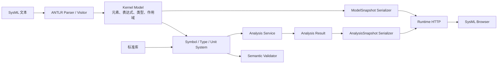

# SysML 参数分析内核化重构计划

状态：P0–P6 首轮实施完成（Kernel 0.5.1）
规划日期：2026-10-14
适用范围：`sysml-parser-runtime`、仓内 SysML `engine`、ModelSnapshot/AnalysisSnapshot 契约和 SysML 浏览器

## 1. 结论

当前参数分析的分层确实不合理。语法解析位于仓内 `engine/`，但表达式结构化、单位与量纲、参数引用解析、计算调用、依赖排序和约束求值主要位于 Runtime 层：

- `src/ModelSnapshotAdapter.cpp` 从模型对象再次提取字符串，并构造表达式 AST、CalculationModel 和关系投影；
- `src/AnalysisEngine.cpp` 直接消费 JSON `ModelSnapshot`，内置少量单位表、类型到量纲映射、表达式求值、Calculation 调用和 Constraint 判断；
- `src/RuntimeServer.cpp` 负责解析后再实例化上层 `AnalysisEngine`。

这使 `ModelSnapshot` 同时承担了跨进程契约和内核内部语义模型两种职责。每增加一个单位、表达式或分析语义，都要在 Runtime 层追加特殊规则。此前模型出现 14 条“Unsupported unit”错误，就是这一边界问题的直接表现。

目标架构是：

1. `engine/` 提供完整的只读 SysML 语义与参数分析能力；
2. Parser、名称解析、类型与单位系统、表达式、Calculation、Analysis 和 Constraint 共用同一套类型化模型；
3. Runtime 只负责进程、HTTP、取消、超时和请求编排；
4. Adapter 只把内核结果序列化为稳定的 ModelSnapshot/AnalysisSnapshot；
5. 浏览器继续只消费 JSON，不执行公式，也不依赖 C++/Qt 对象。

本次是职责迁移，不更换 C++17、ANTLR4 和 Qt Core 技术路线，也不修改现有 SysML 模型来迁就软件实现。

## 2. 当前问题

### 2.1 同一语义被实现两次

Parser 已经生成类型化 `Element` 对象，但 Adapter 又从文本属性构造一套 JSON CalculationModel；分析器随后再从 JSON 恢复参数、表达式、单位和依赖关系。执行链为：

```text
SysML 文本
  -> ANTLR Parser
  -> engine 类型化对象
  -> ModelSnapshotAdapter 二次语义投影
  -> JSON CalculationModel
  -> Runtime AnalysisEngine 重新解释 JSON
  -> AnalysisSnapshot
```

JSON 适合作为稳定输出契约，不适合作为内核内部计算模型。当前方式丢失了静态类型、符号身份、作用域和标准库声明之间的直接联系，也使错误定位和能力扩展变得困难。

### 2.2 单位系统是手写白名单

`AnalysisEngine.cpp` 当前通过一个局部 `QHash` 登记单位，并手工维护 `expectedDimensions()`。这种实现存在四个问题：

- 不能从 SysML 标准库中的 QuantityKind、Unit 和类型关系获得事实；
- 组合单位、幂、前缀和别名需要逐项补代码；
- 类型检查只比较字符串末段，例如 `ISQ::force`；
- Parser、标准库索引和分析器可能对同一个类型给出不同解释。

### 2.3 表达式没有成为内核模型的一部分

当前表达式 AST 由 `ModelSnapshotAdapter` 构造，属于输出投影。正确方向应是 Parser/Visitor 生成内核表达式节点，名称解析器绑定引用，类型检查器为节点标注类型和量纲，序列化器再输出 AST。

### 2.4 Runtime 承担了领域规则

Runtime 层应当是可替换的传输壳。目前 `AnalysisEngine` 既知道 HTTP 输出结构，又知道 SysML Calculation/Analysis/Constraint 的业务语义。未来加入跨文件模型、标准库升级、集合表达式或外部求解器时，会进一步扩大耦合。

## 3. 目标分层



### 3.1 `engine/core/model`

保留 SysML 元素所有权模型，并补齐以下内核类型：

- 表达式节点：字面量、引用、调用、一元、二元和后续集合表达式；
- 符号引用：未解析引用、已绑定元素 ID、候选与诊断；
- 类型引用：数据类型、QuantityKind、Unit、可空性和多重性；
- CalculationDefinition、CalculationUsage、AnalysisCase 和 Constraint 的结构化字段；
- 精确 SourceSpan，避免 Adapter 通过文本搜索反推位置。

这里存放语义事实，不存放 HTTP 或 JSON 契约字段。

### 3.2 `engine/core/semantic`

新增独立语义层，建议包含：

```text
engine/core/semantic/
  SemanticModel.*
  SymbolTable.*
  NameResolver.*
  TypeSystem.*
  UnitSystem.*
  ExpressionChecker.*
  SemanticDiagnostic.*
```

职责包括作用域、限定名、跨文件符号、类型归属、单位定义、量纲推导和表达式静态检查。该层只依赖 model、infrastructure 和 Qt Core，不依赖 Runtime、HTTP、浏览器或 JSON Schema。

### 3.3 `engine/core/analysis`

新增参数分析服务：

```text
engine/core/analysis/
  AnalysisService.*
  DependencyPlanner.*
  ExpressionEvaluator.*
  ConstraintEvaluator.*
  QuantityValue.*
  AnalysisResult.*
```

分析服务接收已经完成名称和类型解析的 `SemanticModel`，返回类型化 `AnalysisResult`。它负责：

- 参数依赖图和稳定求值顺序；
- 循环、缺值、除零和非有限值诊断；
- Calculation 实参与形参绑定；
- SI 基值运算和声明单位显示；
- Constraint 判定、目标、实际值和余量；
- 为以后接入外部求解器保留接口，但首轮只实现确定性只读求值。

### 3.4 `src` Runtime 适配层

Runtime 最终只保留：

- `RuntimeServer`：HTTP、并发、取消、超时、安全边界；
- `ModelSnapshotSerializer`：内核模型到 ModelSnapshot；
- `AnalysisSnapshotSerializer`：内核分析结果到 AnalysisSnapshot；
- Runtime 级健康状态、能力暴露和标准库路径装配。

`src/AnalysisEngine.*` 在切换完成后删除。`ModelSnapshotAdapter` 中的表达式解析、Calculation 语义组装和名称猜测也应删除，只保留无业务判断的序列化代码。

## 4. 单位和量纲的正确实现

单位支持不能继续靠遇到报错后追加字符串。建议采用三层来源：

1. **内核基础量纲**：长度、质量、时间、电流等维度向量，以及乘、除、幂运算；
2. **版本化标准库目录**：构建时从已锁定的 `sysml.library` 提取 QuantityKind、Unit、换算因子、前缀和别名，生成可审计的单位目录；
3. **用户模型声明**：名称解析后允许模型引用标准库单位，并为后续自定义单位预留注册入口。

首轮不要求 Parser 完整加载 94 个标准库文件形成巨大对象图。可以增加受版本和摘要约束的 `StandardLibrarySemanticIndex`：它是标准库语义索引，不是 Runtime 正则白名单。索引生成器应输出来源文件、限定名、量纲、比例和偏移，并由测试核对标准库版本。

单位表达式需要按结构解析：

- 前缀：`kW`；
- 乘积：`N*m` 或标准语法对应形式；
- 商：`m/s`；
- 幂：`m/s^2`；
- 无量纲；
- 仿射单位预留偏移字段，避免以后温度单位无法表达。

求值器内部统一使用 SI 值和量纲向量，展示单位由声明类型或模型显式单位决定。单位符号只是显示和解析入口，不能作为类型系统本身。

## 5. 稳定接口

对浏览器维持现有 HTTP 操作：

- `POST /parse` 返回 ModelSnapshot；
- `POST /analyze` 返回 AnalysisSnapshot，并携带解析/语义诊断；
- `GET /health` 和 `GET /capabilities` 暴露 Runtime、Kernel、Schema 和标准库版本。

内部增加与 JSON 无关的 C++ 接口：

```cpp
ParseResult ParserService::parse(const DocumentInput& input);
SemanticResult SemanticService::resolve(ParseResult&& parsed,
                                         const WorkspaceContext& workspace);
AnalysisResult AnalysisService::analyze(const SemanticModel& model,
                                        const AnalysisRequest& request);
```

ModelSnapshot 和 AnalysisSnapshot 仍是对外稳定契约，但由 Serializer 读取内核对象生成。内核对象不得反向依赖这两个 JSON Schema。

诊断按阶段统一：`syntax`、`linking`、`type`、`unit`、`evaluation`、`constraint`。每条诊断携带稳定代码、严重级别、SourceSpan 和关联元素；浏览器不根据英文消息猜测类别。

## 6. 分阶段实施

### P0：冻结现状和迁移验收基线

目标：保证重构只改变内部职责，不改变已支持模型的可见行为。

工作：

1. 冻结当前 ModelSnapshot、AnalysisSnapshot、诊断和 `/capabilities` 输出；
2. 建立覆盖金刚模型、最小 Calculation、单位换算、循环、缺值、除零和约束的黄金用例；
3. 把当前 17 个结果、4 个约束以及常见单位作为黑盒验收基线；
4. 明确允许变化的非语义字段和排序规则；
5. 记录性能基线和内存上限。

完成门禁：同一输入可重复生成一致结果；新旧路径可逐字段比较。

### P1：建立内核语义 API

目标：使 `engine/` 能直接产出 `SemanticModel`。

工作：

1. 新增 `semantic` 模块、符号表、诊断和 WorkspaceContext；
2. 把表达式 AST 从 Adapter 投影提升为内核 model 类型；
3. Visitor 直接构造表达式和 Calculation/Analysis/Constraint 结构；
4. 建立名称绑定，停止在求值阶段按简单名称猜测元素；
5. 保持旧 Adapter 可读取新内核对象，以便双路径验证。

完成门禁：解析后不依赖 JSON 即可遍历表达式、绑定引用并输出类型诊断。

### P2：迁入类型、单位和量纲系统

目标：从标准库语义建立通用单位能力。

工作：

1. 实现 Dimensions、QuantityType、UnitDefinition 和 UnitExpression；
2. 生成并加载带版本摘要的标准库语义索引；
3. 支持前缀、乘除、整数幂、比例和显示单位转换；
4. 实现表达式静态量纲检查和结果类型推导；
5. 删除 Runtime 中的 `units()`、`expectedDimensions()` 和 preferred-unit 白名单。

完成门禁：新增标准单位不需要修改 Runtime；模型中的 `m/s^2`、`kW`、`N.m` 等由同一单位系统解析。

### P3：迁入分析执行引擎

目标：`engine/core/analysis` 直接对 SemanticModel 求值。

工作：

1. 迁移依赖图、拓扑求值、Calculation 调用和局部参数；
2. 迁移 Constraint 判定与余量；
3. 用类型化 Value 代替 QJsonObject 作为中间值；
4. 增加稳定、可取消的 AnalysisRequest；
5. 让 AnalysisResult 保留参数和表达式的内核身份及源码位置。

完成门禁：内核 C++ 测试在不启动 HTTP、不构造 JSON 的情况下完成全部参数分析。

### P4：收缩 Adapter 和 Runtime

目标：Runtime 只做编排和序列化。

工作：

1. 拆分 `ModelSnapshotSerializer` 和 `AnalysisSnapshotSerializer`；
2. `/parse` 调用 ParserService + SemanticService + Model serializer；
3. `/analyze` 在同一 SemanticModel 上追加 AnalysisService，再序列化结果；
4. 删除 Adapter 中的表达式解析和 Calculation 二次建模；
5. 删除 `src/AnalysisEngine.*`。

完成门禁：`src/` 不再包含单位表、量纲规则、表达式求值或约束业务逻辑。

### P5：切换、兼容和性能验证

目标：正式启用内核路径并删除旧路径。

工作：

1. 在开发期保留 `legacy|kernel` 测试开关，仅用于自动化对照；
2. 对全部语料执行新旧快照等价测试；
3. 浏览器验证需求表、参数分析表、架构图、属性面板和源码跳转；
4. 验证大模型耗时、取消、并发和内存；
5. 冻结证据后删除 legacy 路径和开关。

完成门禁：生产构建只有 kernel 路径，浏览器无兼容分支。

### P6：维护规则和扩展点

目标：阻止语义再次上移到 Runtime 或前端。

工作：

1. 扩展 `engine/MAINTENANCE.md` 和自动门禁；
2. 禁止 `engine/` 引用 Runtime、HTTP、浏览器和 JSON Schema；
3. 禁止 Runtime 新增单位、类型、表达式和约束规则；
4. 内核版本变化必须更新维护摘要、能力矩阵和行为测试；
5. 为集合、`sum/min/max`、条件表达式、工作区跨文件链接和外部求解器建立插件接口。

完成门禁：CI 可以通过源码边界扫描发现错误分层。

## 7. 测试策略

测试按层划分，避免只用浏览器截图验证语义：

| 层 | 重点 |
|---|---|
| Parser | 语法节点、SourceSpan、表达式结构 |
| Semantic | 名称绑定、作用域、类型、标准库符号、单位表达式 |
| Analysis | 依赖图、单位换算、量纲、函数调用、约束和错误传播 |
| Serializer | 内核对象到 JSON Schema 的确定性映射 |
| Runtime | HTTP、取消、超时、请求大小和并发 |
| Browser | 展示、筛选、选择、源码定位，不验证公式正确性 |

关键用例至少包括：

- 相同量纲不同单位的加减和比较；
- 复合单位及乘除后量纲推导；
- Calculation 嵌套调用与形参绑定；
- 限定名、同名参数和跨作用域引用；
- 缺值、未知单位、类型冲突、循环和除零；
- Constraint 的 pass/fail、目标和余量；
- 标准库版本变化导致的可诊断不兼容；
- 当前金刚完整模型的结果与约束基线。

## 8. 版本和兼容策略

- `engineVersion`：Parser、模型、语义、单位或分析行为变化时递增；
- `runtimeVersion`：HTTP 服务与发行包装变化时递增；
- `schemaVersion`：ModelSnapshot/AnalysisSnapshot 字段发生不兼容变化时递增；
- `standardLibrary.release/commit`：决定标准类型和单位事实；
- AnalysisSnapshot 增加 `kernel`、`unitCatalog` 和 `semanticCapabilities` 元数据时先采用向后兼容的可选字段。

本轮应优先保持 Schema 0.1 兼容。只有现有契约无法表达内核诊断或多分析请求时，才设计 0.2，并提供明确迁移说明。

## 9. 风险控制

| 风险 | 控制措施 |
|---|---|
| 重构期间结果发生静默变化 | P0 冻结黄金输出，P1–P5 始终运行双路径对照 |
| 标准库无法被现有 Parser 完整加载 | 使用版本化语义索引，保留来源和摘要，不回退到 Runtime 手写白名单 |
| 内核 API 被 JSON 契约反向塑形 | 内核只暴露 C++ 类型，Serializer 单向依赖内核 |
| 一次迁移范围过大 | 先表达式和单位，再分析执行，最后收缩 Runtime |
| 临时兼容层长期保留 | P5 设置删除门禁，生产构建禁止 legacy 开关 |
| Qt 类型继续扩散 | 首轮允许 engine 使用 Qt Core；新语义 API 不使用 Qt Network/Gui/Widgets，后续再评估值类型去 Qt 化 |

## 10. 不在本轮处理的事项

- 不把公式执行迁移到浏览器；
- 不引入 Python/Java 作为第二个生产 SysML 内核；
- 不实现模型编辑或写回；
- 不为当前金刚模型修改参数以掩盖分析结果；
- 不在第一轮实现通用符号计算、优化器或仿真求解器；
- 不同时重写 HTTP、CLI 或浏览器架构。

## 11. 推荐执行顺序

按 **P0 → P1 → P2 → P3 → P4 → P5 → P6** 顺序执行。P0–P3 完成前不再向 `src/AnalysisEngine.cpp` 增加新业务能力；确有生产阻断时只允许最小兼容修复，并必须同时增加待迁移测试。

最关键的验收标准是：未来增加一个标准单位、修正一种表达式类型规则或加入新的约束语义时，只修改 `engine/` 及其测试；Runtime 和浏览器无需理解该语义。

## 12. 实施结果

2026-10-14 已按本计划完成首轮内核化：

- `engine/core/semantic` 承接标准库符号索引、单位目录、复合单位解析和量纲规则；
- `engine/core/analysis` 承接表达式求值、Calculation 调用、依赖图、单位换算和 Constraint 判断；
- `engine/services` 承接模型快照投影以及 parse/analyze 内核门面；
- `src/` 删除 `AnalysisEngine`、`ModelSnapshotAdapter` 和 `StandardLibraryIndex`，只保留 HTTP Runtime；
- CMake 新增 `aidc_sysml_semantic`、`aidc_sysml_analysis`、`aidc_sysml_kernel` 和 `aidc_sysml_services` 分层 target；
- 维护门禁会拒绝 Runtime 中重新出现单位目录、表达式求值和 Calculation 投影；
- 单位表达式不再仅依赖完整字符串白名单，支持乘、除和整数幂组合；
- 参数引用优先使用 Adapter 已绑定的稳定元素 ID，其余引用使用唯一限定路径；同名引用不再按 `QHash` 遍历顺序随机覆盖。

迁移验证发现并修复了旧实现的非确定性缺陷：金刚模型中多个部件都具有 `planningMass`，旧求值器按简单名称保存到 `QHash`，不同进程可能选中不同部件。Kernel 0.5.1 按 `jingangV1.powerSystem.planningMass`、`jingangV1.phoneSystem.planningMass` 等限定路径绑定后，两个全新进程生成完全一致的 AnalysisSnapshot。当前模型得到 17 项结果、4 项约束全部通过、0 条分析错误；按模型声明计算的规划质量为 `15.318 kg`，续航为约 `2.0833 h`。

当前 AnalysisService 仍接收 Kernel Service 生成的 CalculationModel 投影，这是为了保持 Schema 0.1 与现有浏览器完全兼容。该 JSON 只在 `engine/` 内部流转，Runtime 和浏览器不参与语义判断。后续若 Parser 模型层增加稳定的表达式对象所有权，可在不改变 HTTP 契约的情况下把内部载体替换为纯 C++ SemanticModel。
