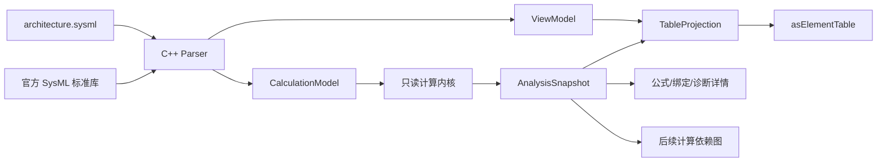
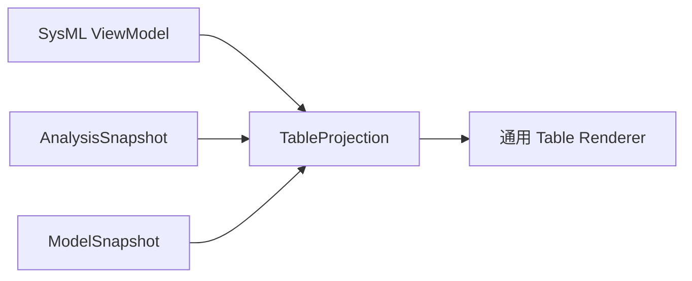

# SysML 参数计算与分析：实施规划

版本：V0.5　｜　状态：C0—C4 已完成　｜　更新日期：2026-09-18

> 架构修订（2026-10-14）：现有 C2 能力已完成业务闭环，但其实现位于 Runtime 适配层，职责边界需要调整。后续重构以[《SysML 参数分析内核化重构计划》](SysML参数分析内核化重构计划.md)为准：单位、量纲、表达式、Calculation 和 Constraint 求值归属仓内 SysML `engine`，Runtime 只负责调用、传输和序列化。

## 1. 结论

系统方案阶段不能只记录“目标质量、当前质量、目标续航、当前续航”几个固定值。工程师真正需要的是一条可检查的计算链：

> 已知哪些设计输入，使用什么公式和假设，得到什么核心参数，结果是否满足需求，修改一个输入后哪些结论会变化。

因此原计划中的“预算表”应调整为 **参数计算与分析**。质量、续航、峰值功率和控制周期都是分析结果，不应由用户重复填写“当前估算值”。SysML v2 负责表达参数、`calc def`、计算调用、分析上下文和约束；SysML 内核负责单位检查和确定性求值，并通过本地 Runtime 对外提供结果；SysML 浏览器负责只读展示、追溯和诊断。

装配交接表只是从模型提取已有信息的记录视图，不涉及计算内核。本轮先不实现，待核心参数分析闭环完成后再安排。

## 2. 这一能力在机器人方案阶段解决什么问题

参数分析服务于方案决策，而不是为了展示更多字段。首版应帮助工程师回答四组问题：

1. **质量是否闭合**：各子系统和部件质量相加后，整机是否低于上限，还剩多少余量；
2. **能量和续航是否闭合**：电池可用能量、各子系统平均功率和任务占空比能否支持目标续航；
3. **峰值供电是否可行**：多个执行器同时动作时，峰值电流和峰值功率是否超过电池、BMS、稳压器和线束能力；
4. **控制时序是否可行**：采样、通信、计算和执行延迟相加后，是否满足控制周期和停止响应要求。

首版完成后，用户应能从“续航不少于 `2 [h]`”追到电池能量、可用比例、各子系统功耗、续航公式、计算结果和约束结论，而不是只看到一个手工填写的 `currentEstimatedEndurance`。

## 3. `VehicleMode.sysml` 给出的参考和当前差距

本次核对了 [`VehicleMode.sysml`](../samples/VehicleMode.sysml)。示例已经展示了 SysML v2 参数分析所需的主要表达层次：

| 层次 | 示例写法 | 作用 |
|---|---|---|
| 参数类型 | `Scenario`、`ISQ::mass`、`timePerDistance` | 规定输入、输出及量纲 |
| 可复用计算 | `calc def FuelConsumption` | 声明输入、中间量、公式和返回值 |
| 计算调用 | `FuelConsumption(f_a, f_b, tpd_avg)` | 把模型中的实际参数绑定到计算定义 |
| 分析上下文 | `analysis fuelEconomyAnalysis` | 指定被分析对象、目标、输入和最终结果 |
| 约束 | `constraint { ... }` | 表达方程或通过条件 |
| 方案权衡 | `analysis ... : TradeStudy` | 对候选方案应用评价函数并选择结果 |

该文件适合作为语法覆盖参考，但不适合直接作为首版验收模型。它包含采样函数、集合、递归导入、权衡分析以及当前 Parser 尚未支持的语法。

对当前 Runtime 0.5.0 的实测结果是：完整文件没有输出 `CalculationDefinition`、`CalculationUsage` 或 `AnalysisCase` 元素，只识别出部分普通 Action 和 Attribute，并产生 `calc` 语法错误及后续级联诊断。这说明标准模型库中存在 Calculation 元模型定义，并不等于参考 C++ Parser 已经能够解析和执行用户模型中的计算。

必须补齐两层能力：

- Parser 将 `calc def`、计算调用、参数绑定、表达式、返回值、分析和约束转换为稳定语义模型；
- 计算内核按依赖顺序求值并处理单位、缺值、循环依赖和运行错误。

不能在前端用文本正则提取公式，也不能使用 JavaScript `eval` 直接执行 SysML 源码。

## 4. 建模契约

### 4.1 信息记录位置

首版继续只维护一个 `architecture.sysml`，不新增预算 CSV、JSON 或数据库。文件内部按职责组织：

```text
RobotArchitecture
├── RequirementsTrace       需求 ID 和分析目标引用
├── SystemArchitecture      系统、部件、端口、连接和原始设计参数
├── Calculations            可复用 calc def
└── AnalysisCases           对当前机器人配置执行的分析及约束
```

- **原始参数**记录在其真实所属对象上。例如电池额定能量属于电池，计算平台平均功率属于计算平台，执行器峰值电流属于执行器类型或实例；
- **公式**记录为 `calc def`，不得在浏览器代码中固化“续航等于能量除以功率”等机器人业务规则；
- **实际调用和参数绑定**记录在分析上下文中，说明当前配置使用哪些输入；
- **目标和通过条件**来自需求或分析约束；
- **计算结果**由 Runtime 生成。除非需要与外部实测值对比，否则不在模型中再手填一份“当前估算值”。

### 4.2 参数的最小信息

每个参与计算的参数至少具有：

| 信息 | 说明 |
|---|---|
| 稳定身份 | 由 SysML 元素和特征路径确定，不另造表格 ID |
| 名称 | 例如 `batteryEnergy`、`averagePower`、`endurance` |
| 角色 | 输入、中间量、输出、目标或实测对照值 |
| 类型与单位 | 使用标准类型和 ISQ 单位，禁止只写无单位数字 |
| 数值来源 | 型号资料、实测、需求、计算或明确假设 |
| 源码位置 | 可从结果返回到定义、绑定和输入值 |

来源说明可以先用 `doc` 或少量来源属性表达；它不参与数值计算。

### 4.3 首版核心计算链

| 分析 | 主要输入 | 主要计算 | 输出与校核 |
|---|---|---|---|
| 整机质量 | 各部件数量和质量 | 部件质量汇总、必要的装配附加量 | 总质量、质量余量、是否低于上限 |
| 能量与续航 | 电池额定能量、可用比例、各子系统平均功率 | 可用能量、平均功率合计、能量除以功率 | 预计续航、续航余量、是否达到 `2 [h]` |
| 峰值供电 | 执行器峰值电流、并发系数、电子设备峰值功率、电压 | 峰值电流和峰值功率合成 | 电池/BMS/电源余量和越限项 |
| 控制时序 | 采样周期、总线传输、计算延迟、执行延迟 | 端到端延迟和周期占用 | 控制周期余量、停止响应是否满足要求 |

关节扭矩、结构强度、热平衡和动态仿真很重要，但需要更多几何、工况和求解器能力，放在第二阶段。

### 4.4 建模边界

首版只支持确定性的标量代数计算：

- 数值字面量和带单位数量值；
- 特征引用和实际参数绑定；
- `+`、`-`、`*`、`/`、幂、括号和比较；
- 简单 `sum`、`min`、`max`，仅在 Parser 能给出明确集合语义时开放；
- 单返回值以及少量具名输出；
- 无循环的计算依赖图；
- 约束通过、未通过和无法计算三态结果。

首版不支持：采样函数、微分/积分、状态演化、递归计算、随机分析、优化求解、通用 TradeStudy、外部脚本执行和任意用户函数。这些语法应显示“尚不支持”，不能静默给出结果。

## 5. 软件方案

### 5.1 总体数据流



浏览器仍然不修改 SysML。用户刷新或重新打开文件时，Runtime 重新解析和求值。AI 通过文本编辑修改输入、公式和分析定义；软件只执行模型中已经声明的计算并呈现结果。

### 5.2 Parser 与中间模型

在现有 ModelSnapshot 旁增加通用计算投影 `CalculationModel`，至少包含：

| 对象 | 必要内容 |
|---|---|
| `CalculationDefinition` | 名称、输入、输出、局部量、表达式、源码位置 |
| `CalculationUsage` | 所用定义、实参绑定、所在分析、源码位置 |
| `AnalysisCase` | 被分析对象、目标、计算调用、输出和约束 |
| `Parameter` | 类型、量纲、单位、值、角色、所属元素 |
| `Expression` | 结构化 AST、运算符和特征引用，不只保存文本 |
| `Constraint` | 左右表达式、比较符、严重级别和需求引用 |

现有通用 Element 和 Relationship 继续用于树、属性和源码定位；计算投影只增加求值需要的结构，不创建第二套事实源。

### 5.3 只读计算内核

计算内核放在 localhost Runtime 一侧，浏览器不自行解释公式。其职责为：

1. 解析实际参数绑定，形成计算依赖有向图；
2. 检查必需输入、类型和量纲；
3. 按拓扑顺序执行计算；
4. 对兼容单位进行换算，结果保留显示单位；
5. 检测循环依赖、除零、溢出、未支持表达式和缺失输入；
6. 计算约束状态和余量；
7. 为每个结果保留从输出到公式、绑定和原始输入的追溯链。

建议新增只读 `/analyze` 接口，输入为已解析模型或文件会话标识，输出 `AnalysisSnapshot`。`/parse` 继续只返回语义快照，避免解析成功与计算成功混为一个状态。

### 5.4 `AnalysisSnapshot` 结果契约

每个结果至少返回：

- 分析、计算定义和调用的元素 ID；
- 参数 ID、名称、角色、数值、单位和量纲；
- 结果状态：`computed`、`missing-input`、`unit-error`、`unsupported`、`cycle` 或 `runtime-error`；
- 公式的规范化显示文本；
- 直接输入及其来源元素；
- 关联约束、目标值、余量和通过状态；
- 定义、调用、输入和约束的源码位置；
- Runtime 使用的计算内核版本。

未计算出的结果没有数值。前端不得把类型名、表达式文本或零当作替代值。

## 6. 结合 SysML View 的浏览器设计

### 6.1 决策：先支持 Table

参数分析首先实现 **SysML Table View**，随后再实现计算依赖图。原因是：

1. 方案阶段首先要核对输入、结果、单位、目标、余量和状态，这些信息天然适合表格；
2. 表格不依赖 ELK 路由和图形布局，能够先验证 Calculation、Analysis、单位和约束语义是否正确；
3. SysML 官方库已经定义了 `GridView`、`TabularRendering` 和 `asElementTable`；
4. `asElementTable` 的标准语义正是“每个暴露元素一行，按有序 `columnView` 渲染各列”；
5. 表格稳定后，计算依赖图可以复用同一 View、Expose 和选择联动基础。

Table 不是硬编码的“参数分析页面”。SysML View 决定看哪些元素以及怎样呈现，AnalysisSnapshot 提供求值后的值和状态，通用表格渲染器负责显示。

### 6.2 官方 SysML View 映射

官方标准模型库提供了以下语义：

| SysML 概念 | 参数分析中的职责 |
|---|---|
| `view def` | 定义可复用的参数分析视图规则 |
| `view` | 在当前机器人配置中实例化具体视图 |
| `expose` | 选择需要成为表格行的分析输出、参数或约束 |
| `GridView` | 声明矩形网格类视图 |
| `render asElementTable` | 指定采用元素表格呈现 |
| `columnView` | 有序定义每一列怎样从行元素取得内容 |
| Viewpoint | 后续约束某类评审必须看到哪些信息；不作为首版前置 |

首版模型应在语义上形成如下结构，具体可解析文本写法由 C0 契约样例冻结：

```text
ParameterAnalysisTableViewDefinition
├── specializes StandardViewDefinitions::GridView
├── rendering = Views::asElementTable
└── ordered columnViews
    ├── 参数名称
    ├── 角色
    ├── 当前值
    ├── 单位
    ├── 目标
    ├── 余量
    ├── 状态
    └── 来源

coreParameterAnalysisTable : ParameterAnalysisTableViewDefinition
└── expose 质量、续航、峰值供电和控制时序的分析输出/约束
```

不使用 `asRequirementTable`、`asParameterTable` 这类项目私有渲染名称作为核心契约。若业务需要“需求表”等专用名称，应把它定义为 `asElementTable` 的专业化或视图定义，而不是在前端根据字符串分支。

### 6.3 当前 Parser 基线

实测参考项目的 `test_view.sysml`：

- 能生成 `ViewDefinition`、`ViewUsage`、`ExposeStatement` 和 `ViewRenderingMember`；
- 参考 Parser 内部也保存 `renderMethod` 和暴露元素；
- 当前 Runtime 0.5.0 的 ModelSnapshot 虽能看到上述元素，却没有投影 `renderingKind`、暴露目标、列视图和 View 继承结果；
- Runtime 的 capabilities 中也没有 `view.*` 能力声明；
- 浏览器当前的 `BrowserViewDefinition` 是前端插件注册表，并非 SysML 模型中的 ViewDefinition，二者需要通过统一投影衔接，不能混为一个概念。

因此第一步不是直接编写 React 参数表，而是补齐 `ViewModel` 契约。

### 6.4 ViewModel 与 TableProjection

在 Runtime 输出中增加通用 `ViewModel`：

| 字段 | 含义 |
|---|---|
| `viewId` / `definitionId` | ViewUsage 与 ViewDefinition 的稳定元素 ID |
| `viewKind` | General、Interconnection、Grid、Browser 或专业化结果 |
| `renderingKind` | 首版识别 `element-table`，以后扩展 tree/interconnection |
| `exposedElementIds` | `expose` 解析后的有序行对象集合 |
| `columns` | 从有序 `columnView` 得到的列 ID、标题、单元格视图和源码位置 |
| `diagnostics` | 未解析 expose、未知 rendering、无列和不支持过滤表达式 |

表格渲染前由通用投影器合成 `TableProjection`：



- ViewModel 决定行、列和顺序；
- ModelSnapshot 提供名称、类型、所属元素和源码；
- AnalysisSnapshot 为分析参数补充当前值、单位、目标、余量和计算状态；
- Table Renderer 只负责排序、筛选、列宽、状态样式、选择和源码定位。

表格投影不得根据 `targetMass`、`currentPower` 等字段名猜列，也不得把参数分析业务规则写进 React 组件。

### 6.5 首个参数分析表

首个验收视图只做一张 **核心参数分析表**：

| 参数 | 角色 | 当前值 | 单位 | 目标 | 余量 | 状态 | 来源 |
|---|---|---:|---|---:|---:|---|---|

表格每行对应 View 暴露的一个分析输出或约束结果：

- “当前值”来自 Calculation Runtime；
- “目标”和“余量”来自关联 Constraint；
- “状态”取 `computed`、`pass`、`fail`、`missing-input`、`unit-error`、`unsupported`、`cycle` 或 `runtime-error`；
- “来源”可追到输入参数、计算定义和源码；
- 点击行同步模型树、右侧属性查看与源码位置。

表格列完全由 SysML View 驱动。每个 `columnView` 的名称是稳定业务键，列内 `label : String` 是用户可见表头；列的存在、顺序和标题均由模型声明。Runtime 将 `key` 与 `label` 投影到 `ViewModel`，浏览器不维护中文表头字典。修改标题、调整语言或增删列只需修改模型。

### 6.6 后续视图顺序

1. **C4A 元素表格**：实现 `GridView + asElementTable + expose + columnView`；
2. **C4B 计算详情**：复用表格行选择，在属性查看中显示公式、绑定和诊断；
3. **C4C 计算依赖图**：使用 Graphical/Interconnection 类 View 表达“输入—计算—输出—约束”；
4. **C5 扩展**：关系矩阵、候选方案比较表、预定义工况切换和 Viewpoint 检查。

未声明 SysML View 时，浏览器可以继续显示模型树和属性，但不自动伪造一张业务表。规范金刚样例必须显式声明核心参数分析 Table View。

## 7. 分阶段实施计划

### C0：机器人计算契约与最小测试模型

状态：已完成（2026-09-18），详见[《C0：机器人计算契约与最小测试模型实施报告》](C0_机器人计算契约与最小测试模型_实施报告.md)。

工作：

- 从 `VehicleMode.sysml` 提取计算语法覆盖清单；
- 为金刚样例建立最小的质量、续航、峰值供电和控制时序计算；
- 冻结输入、输出、单位、绑定、约束和诊断契约；
- 定义首个 `GridView + asElementTable` 参数分析视图、暴露行和有序 columnViews；
- 为每条计算准备独立手算基准。

交付：`calculation-contract.sysml`、`parameter-analysis-table.sysml`、金刚计算样例 V0、能力矩阵和期望结果。

退出条件：每项结果都有明确业务问题、公式、输入来源、单位和手算答案；Table View 明确行、列、顺序和呈现方式；不再保留手填的重复估算结果。

### C1：Calculation 与 View Parser 语义投影

状态：已完成（2026-09-18），详见[《C1：Calculation 与 View Parser 语义投影实施报告》](C1_Calculation与View_Parser语义投影_实施报告.md)。

工作：

- 扩展参考 C++ Parser，使其识别首版 `calc def`、调用、输入、返回、表达式、analysis 和 constraint 子集；
- 解析实际参数绑定、特征路径和源码范围；
- 使用官方标准模型库解析 `Real`、ISQ 数量类型和单位；
- 输出 `CalculationModel`；
- 投影 ViewDefinition、ViewUsage、`expose`、`GridView`、`asElementTable` 和有序 `columnView` 为 `ViewModel`；
- 增加 `view.definition`、`view.usage`、`view.expose` 和 `view.table` 能力标记；
- 对超出子集的语法给出稳定能力诊断。

退出条件：最小模型解析错误为 0；所有计算定义、调用、参数、AST、约束，以及 Table View 的渲染方式、暴露对象、列顺序和源码位置可通过黑盒测试读取；`VehicleMode.sysml` 中不支持的高级部分被明确报告。

### C2：单位感知的只读计算内核

状态：已完成（2026-09-18），详见[《C2：单位感知的只读计算内核实施报告》](C2_单位感知的只读计算内核_实施报告.md)。

工作：

- 建立值、单位和量纲类型；
- 构建依赖图和拓扑求值；
- 实现首版运算符和函数；
- 实现单位换算、约束余量和三态结论；
- 实现缺值、单位错误、循环、除零和未支持表达式诊断；
- 输出 `AnalysisSnapshot` 和 `/analyze` 接口。

退出条件：四类机器人核心计算与手算一致；修改任一输入后所有受影响结果同步变化；错误不会产生伪数值。

### C3：金刚核心参数分析样例

状态：已完成（2026-09-18），详见[《C3：金刚核心参数分析样例实施报告》](C3_金刚核心参数分析样例_实施报告.md)。

工作：

- 将现有 `currentPlannedMass`、`currentEstimatedEndurance` 等手工估算迁移为计算输出；
- 给部件质量、电子设备功耗、电池能量、执行器峰值和时序参数补充真实来源或明确假设；
- 建立需求目标与计算结果约束；
- 在样例中显式声明核心参数分析 Table View；
- 记录仍缺少的输入和需要实测的参数。

退出条件：质量、续航、峰值供电和控制时序至少各有一条完整可追溯计算链；模型没有互相矛盾的重复结果。

### C4：参数分析浏览 MVP

状态：已完成（2026-09-18），详见[《C4：参数分析浏览 MVP 实施报告》](C4_参数分析浏览MVP_实施报告.md)。

按 Table 优先顺序实施：

- **C4A**：注册通用 SysML View 入口，实现 `ViewModel + ModelSnapshot + AnalysisSnapshot → TableProjection`，并完成 `asElementTable`、列顺序、排序、筛选、状态样式和空值诊断；
- **C4B**：实现表格行与模型树、属性查看、计算详情和源码定位联动；
- **C4C**：在 Table 验收通过后实现计算依赖图。

退出条件：用户从模型树打开已声明的核心参数 Table View，无需阅读源码即可核对四项核心结果如何得出、是否满足需求，以及哪个输入造成未通过或无法计算；未声明或无法解析的 View 有明确诊断。

### C5：后续扩展

在 C0 至 C4 稳定后，再按业务价值选择：关系矩阵、预定义工况切换、多个候选配置比较、关节扭矩与热计算、外部求解器、TradeStudy，以及装配交接表。浏览器中的临时输入和交互式 What-if 不进入首版。

## 8. 验收用例

1. 把电池可用能量降低 10%，预计续航随之降低，续航余量和约束状态同步更新；
2. 将一个部件质量单位从 `g` 改为 `kg` 后仍得到正确总质量；把质量误写成时间单位时返回量纲错误；
3. 删除计算所需的执行器峰值电流后，峰值供电显示缺失输入，并能定位到对应部件；
4. 制造 A 依赖 B、B 依赖 A 的模型，Runtime 报告循环路径且不返回伪结果；
5. 从续航结果可逐级查看平均功率、电池可用能量、原始部件参数、公式和源码；
6. 使用不支持的采样函数或 TradeStudy 时显示能力诊断，其他可支持分析仍正常计算；
7. 模型声明 `GridView + asElementTable` 后可从模型树打开表格，行来自 `expose`，列顺序来自 columnViews；
8. 未声明 Table View 时不自动生成业务表；未知 rendering 或无法解析的 expose 显示诊断；
9. 关闭或刷新浏览器不会改变 SysML 文件，重复计算结果一致。

## 9. 关键决策

| 决策 | 原因 |
|---|---|
| 先做参数计算，后做装配交接表 | 前者决定方案是否成立，后者只是已有信息的提取视图 |
| 结果由公式生成，不手填“当前估算” | 避免输入变化后出现过期或冲突结果 |
| 计算内核位于 Runtime | 统一解析、类型、单位和诊断，避免前端形成第二套语义 |
| 首版限制为确定性标量计算 | 覆盖机器人方案的核心闭合问题，同时控制 Parser 和求值器风险 |
| 以金刚最小模型验收，以 VehicleMode 做覆盖参考 | 金刚对应真实业务；VehicleMode 的高级语法超出当前能力和首版需求 |
| 所有视图只读 | 保持“AI/文本编辑模型，软件浏览和分析”的产品边界 |
| Table 作为首个 SysML View Rendering | 与官方 `asElementTable` 语义一致，先验证数据和计算正确性，再增加依赖图 |
| 行列由 View 声明 | 避免浏览器按业务字段名生成固定表格，使同一渲染器可服务需求、参数和后续矩阵视图 |

## 10. 下一步

C0、C1、C2、C3、C4 已完成。下一项工作应进入 **C5 方案分析扩展选择**：优先根据实际方案评审需求选择预定义工况、候选配置对比或关系矩阵。浏览器继续消费 SysML View 声明与 Runtime 结果，不在前端保存临时业务数据。
