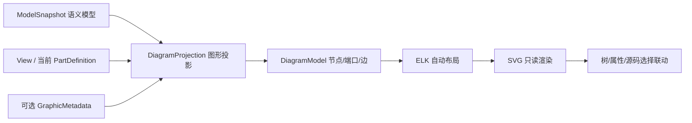

# SysML 图形视图与布局信息：调研及实施建议

版本：V1.0　｜　日期：2026-09-18　｜　状态：P2 输入

## 1. 结论

当前架构图显示不正确，直接原因是浏览器只拥有 SysML 语义元素和关系，却用固定网格临时摆放节点：PartUsage 按三列排列，PortUsage 放在画布左右两侧，Connection 使用一条简单贝塞尔曲线。它没有建立“某张图应该显示哪些元素、部件如何嵌套、端口属于哪个部件、端口在部件哪一侧、连线如何绕过节点”的图形模型。

工程软件通常不会仅凭语义模型保存一张完整图，也不会把坐标当成部件本身的业务属性。常见做法是：

1. **语义模型**保存部件、端口、连接和需求等工程事实；
2. **视图定义**决定某张图展示什么、使用什么呈现方式；
3. **表示与布局数据**按“图”保存节点位置、尺寸、端口位置、折点和显隐；
4. 缺少表示数据或模型发生变化时，使用**自动布局**创建可读的初始图；
5. 用户调整过的节点保持固定，新增加的节点增量排布。

结合本项目“SysML 文本由 AI 编辑、浏览器只读”的产品边界，P2 应采用以下方案：

- 由 SysML 语义和当前查看上下文生成一张 `DiagramModel`；
- 使用 ELK Layered 自动计算部件、嵌套部件、边界端口和正交连线；
- 首版不要求 AI 编写像素坐标；
- 兼容读取参考项目的 `@GraphicMetadata`，但不把它定为唯一长期格式；
- 后续支持正式 SysML v2 `view`、`expose`、`filter` 和 `render`，解决“显示什么”；
- 只有将来提供图形编辑与保存时，才引入按 View 保存的人工布局数据。

## 2. 需要区分的四层信息

### 2.1 语义模型

语义模型回答工程问题：

- 系统由哪些部件组成；
- PartUsage 的类型是什么；
- 端口属于哪个部件；
- 哪两个端口连接；
- 接口传递什么；
- 数量、单位、约束和需求是什么。

`architecture.sysml` 已经包含这部分信息。它足以生成图，但不能单独决定最终版面。

### 2.2 视图语义

视图语义回答“画哪张图”：

- 视图的上下文是整机还是某个子系统；
- 展示一层还是递归展示；
- 展示部件、端口、连接中的哪些类型；
- 使用互连图、树、表格还是矩阵；
- 是否过滤电源、控制、机械等接口。

SysML v2 正式提供 View、Viewpoint 和 Rendering。官方 `StandardViewDefinitions.sysml` 定义了 `GeneralView`、`InterconnectionView`、`GridView`、`BrowserView` 等标准视图；`Views.sysml` 定义了 `asTreeDiagram`、`asInterconnectionDiagram` 和 `asElementTable` 等呈现方式。[OMG SysML v2 语言规范](https://www.omg.org/spec/SysML/2.0/Language/PDF)也明确说明 View 可以包含模型提取条件及 Rendering，并允许对符号、样式和布局作进一步规定。

例如，后续可以在同一个 SysML 文件中声明：

```sysml
view systemInterconnection : StandardViewDefinitions::InterconnectionView {
    expose JingangNative10::**;
    render asInterconnectionDiagram;
}
```

这段模型表达“显示什么、用什么类型的视图显示”，仍不等于每个节点的像素坐标。

### 2.3 图形表示

图形表示回答“语义元素在这张图上如何出现”：

- 同一个部件是否显示；
- 显示为节点、嵌套容器、端口还是标签；
- 节点显示哪些 compartment；
- 一个语义元素在多张图中的多个图形实例；
- 某个连接在当前图中的路径对象。

一个 PartUsage 可以同时出现在整机图、电源图和控制图中，三张图的位置和显隐不同。因此图形表示必须属于 View，不能只属于 PartUsage。

### 2.4 布局与样式

布局保存：

- 节点 `x/y/width/height`；
- 嵌套坐标系；
- 端口所在边、顺序和偏移；
- 连接折点、正交路由和标签位置；
- 固定、隐藏、折叠和层级展开状态。

颜色、字体和线宽属于样式。业务模型一般只应保存有业务含义的视觉分类，例如“安全关键接口”；普通颜色和字体应来自主题或图形类型默认值。

## 3. 参考项目的处理办法

参考项目已经实现了一套可工作的自定义方案，核心是把 `@GraphicMetadata` 注解附着到 Part、Port 和 Connection：

```sysml
part microcontroller : MCU {
    @GraphicMetadata {
        graphicX = 322.27;
        graphicY = 88.54;
        graphicWidth = 92.08;
        graphicHeight = 129.22;
    }
}

connect analogToDigital.digitalOut to microcontroller.dataIn {
    @GraphicMetadata {
        routingStyle = "Manhattan";
    }
}
```

相关实现位于参考项目：

- `parser/src/annotation/AnnotationParser.cpp`：从元素查找 `GraphicMetadata` 注解并转换为图形元数据；
- `PartGraphicMetadata`：位置、尺寸、形状、颜色、标签和嵌套显示；
- `PortGraphicMetadata`：位置、所在边、偏移、方向、大小和连接点；
- `ConnectionGraphicMetadata`：路径类型、折点、路由方式、箭头和标签；
- `GraphicViewWidget.cpp`：优先读取元数据，没有时创建默认大小和默认端口位置；
- `test_architecture_view.sysml`：完整保存部件位置、端口位置和 Manhattan 路由的样例。

其数据范围如下：

| 对象 | 主要字段 |
|---|---|
| Part | `graphicX/Y/Width/Height`、旋转、层次、形状、标签、显隐 |
| Port | `graphicX/Y`、`portPosition`、`portOffset`、方向、大小、连接点 |
| Connection | `pathType`、`pathPoints`、`routingStyle`、箭头、端口、标签 |

### 3.1 可以复用的部分

- Parser 已能解析注解及键值；
- 元数据字段覆盖了节点、端口和连接的基本表示需求；
- Manhattan 路由适合部件互连图；
- 缺少元数据时存在默认显示逻辑；
- 图形对象移动后可以把数据写回 Annotation。

### 3.2 不宜直接照搬的部分

1. **元数据附在语义元素上，而不是某张 View 上。** 一个部件出现在两张图时只能保存一套位置。
2. **字段过多。** 颜色、字体、是否可移动等工具状态污染业务 SysML 文件。
3. **绝对坐标要求人工或图形编辑器产生。** 不适合让 AI 从零猜测数百个像素值。
4. **缺省布局较弱。** 参考项目旧的通用 `DiagramScene::hierarchicalLayout()` 实际回退为简单网格；架构视图中也存在较多针对嵌套缩放和默认位置的补偿代码。
5. **`GraphicMetadata` 没有显式 View ID。** 无法稳定支持整机图、单腿图、电源图等多图共存。
6. **属于参考项目扩展。** 其他 SysML 工具不会自动理解这些字段。

因此，参考项目适合作为**兼容输入格式和字段参考**，不适合作为 AIDC 的最终图形数据架构。

### 3.3 当前 Runtime 黑盒验证

使用 Runtime 0.4.0 实际解析参考项目测试文件，结果如下：

| 文件 | 结果 | 对 P2 的含义 |
|---|---|---|
| `test_architecture_view.sysml` | 0 错误；解析出 42 个 Annotation，42 个均保留 `annotationName=GraphicMetadata` 和 `metadataAssignments` | GraphicMetadata 的位置、端口和样式键值已经进入 ModelSnapshot，P2 无需再写源码正则 |
| `test_view.sysml` | 0 错误；解析出 2 个 ViewpointDefinition、7 个 ViewDefinition/Usage 和 1 个 ViewRenderingMember | View 元素骨架已经存在，但 Filter、Expose 和 Rendering 的完整目标关系尚未进入可直接查询的属性，G4 仍需补 Runtime 适配 |

图形样例仍有 21 条关系或类型告警，View 样例有 9 条告警。因此“能解析元素”不能等同于“已完整支持图形视图语义”。P2 可以直接开始 GraphicMetadata 兼容，正式 View 仍按 G4 单独验收。

## 4. 其他工具的做法

| 工具 | 处理方式 | 对本项目的启示 |
|---|---|---|
| MagicDraw / Cameo | 明确区分 Model Element 与 PresentationElement；一个模型元素可以有多个 symbol/path，PresentationElement 提供 bounds、子表示和样式属性。[官方说明](https://docs.nomagic.com/spaces/MD190SP1/pages/38044768/Presentation%2Belements%2Bsymbols) | 表示实例必须按图保存，不能把坐标当作语义元素唯一属性 |
| SysON / Sirius Web | Diagram 是模型元素的表示；提供 Arrange All、网格、辅助线、固定和显隐。Smart Edges 在前端动态计算，文档明确其精确布局不持久化。[官方图表文档](https://doc.mbse-syson.org/sirius-web/user-manual/features/diagram.html) | 自动布局和持久布局可以并存；某些路由可只在浏览器临时计算 |
| SysON Diagram Description | 支持 `AUTO_LAYOUT`、`AUTO_UNTIL_MANUAL` 和方向配置；用户开始移动或缩放后停止自动布局。[官方说明](https://doc.mbse-syson.org/sirius-web/v2026.9.0/studio-maker-guide/features/diagram-description.html) | 将来提供编辑器时采用“自动到首次人工调整”的状态机 |
| Cameo Systems Modeler | Display Parts/Ports 可选择嵌套部件、端口和布局选项。[官方说明](https://docs.nomagic.com/MT/2026x/magic-cyber-systems-engineer---cameo-systems-modeler/displaying-parts-and-ports-272733928.html) | 图形投影要先选择上下文和显示深度，再进行布局 |
| Enterprise Architect | 提供树、Digraph、Spring、Box 等自动布局；复杂图自动排布后再人工微调。[官方说明](https://www.sparxsystems.com/enterprise_architect_user_guide/17.2/modeling_fundamentals/layoutadiagram.html) | 自动布局是创建可读初始图的标准能力，人工坐标是后续优化 |
| IBM Rhapsody | Populate Diagram 自动加入相关元素并排布；已有元素位置保持不变，只给新增元素安排位置。[官方说明](https://www.ibm.com/docs/en/engineering-lifecycle-management-suite/design-rhapsody/10.0.3?topic=diagrams-automatically-populating-diagram-when-you-create-it) | 模型变化后应做增量布局，避免每次刷新整图跳动 |

这些工具虽然存储格式不同，但产品行为高度一致：语义元素与图形表示分离；一张图选择部分模型；缺少坐标时自动布局；人工调整后持久化该图的表示数据。

## 5. 布局引擎选择

当前图是包含嵌套部件、显式端口和跨层连接的工程框图，推荐 **ELK Layered / elkjs**。

[Eclipse Layout Kernel](https://eclipse.dev/elk/)本身只计算位置和尺寸，不负责渲染，适合继续使用现有 SVG/React 视图。其 Layered 算法原生支持：

- 显式 Port；
- Compound/层次节点；
- 跨层级连接；
- 直线、正交线和样条；
- 节点、端口、边标签；
- 连接折点输出。

[ELK Layered 官方说明](https://eclipse.dev/elk/reference/algorithms/org-eclipse-elk-layered.html)特别指出，正交路由可以遵守任意端口约束，适合 block diagram 和电路图；这与机器人系统部件—端口—连接图匹配。

不建议继续扩充当前固定网格。Graphviz 可以生成优秀的层次图，但 ELK 对嵌套节点、边界端口和 Web 端 JSON 数据的控制更直接。Mermaid 适合文档图，不适合作为可选择元素、同步属性和源码的工程图内核。

## 6. AIDC 推荐数据流



### 6.1 DiagramProjection

输入一个查看上下文，例如 `JingangNative10`，生成：

- 根画布：当前 PartDefinition 或选中的 ViewUsage；
- 节点：其直接 PartUsage；
- 嵌套：按 owner 关系构造；
- 类型：沿 `typeId` 读取 PartDefinition；
- 端口：实例自身端口，加上类型定义端口的实例投影；
- 边：只接受已解析的 Connection 端点；
- 过滤：默认一层，可选择递归深度和接口类别。

这里必须先解决“typed part 的端口投影”。只把定义端口画在独立定义上，或只画实例局部声明端口，都会造成连接找不到正确边界端口。

### 6.2 DiagramModel

它是浏览器内部的派生数据，不保存为新的业务事实源：

```ts
interface DiagramModel {
  viewId: string;
  contextElementId: string;
  nodes: DiagramNode[];
  ports: DiagramPort[];
  edges: DiagramEdge[];
  layoutSource: 'auto' | 'graphic-metadata' | 'mixed';
}
```

每个图形对象保留 `semanticElementId`。用户点击图形时仍通过同一个 ID 联动模型导航、属性和源码。

### 6.3 自动布局规则

首版固定规则即可：

- 算法：`elk.layered`；
- 方向：整机互连图默认从左到右；组成图可从上到下；
- 路由：`ORTHOGONAL`；
- 层次：包含子节点；
- 端口约束：固定所在边、保持模型顺序；
- 输入端口优先左侧，输出端口优先右侧，双向端口由连接方向决定；
- 电源、控制和反馈可分组排序，但不以颜色代替语义；
- 使用稳定 ID 和固定随机种子，保证同一文件重复打开位置一致；
- 模型新增节点时尽量保持旧节点相对顺序。

### 6.4 参考 GraphicMetadata 兼容

Runtime 应把 Annotation 名称和 assignment 原样放入 ModelSnapshot。DiagramProjection 仅识别一组最小字段：

| 对象 | 首版读取字段 |
|---|---|
| Part | `graphicX/Y/Width/Height` |
| Port | `portPosition`、`portOffset`、`graphicX/Y` |
| Connection | `routingStyle`、`pathPoints` |

若一张图所有关键对象都有合法位置，则采用元数据布局；部分对象有位置时，把已有对象固定，让 ELK 布置缺失对象；没有元数据时全部自动布局。颜色、字体、可编辑状态等字段首版忽略，由浏览器主题统一决定。

由于参考格式没有 View ID，兼容元数据只对所选 PartDefinition 的默认架构图生效。正式多视图不能继续共用这一套坐标。

## 7. 分阶段实施建议

### G0：图形契约与测试模型

状态：已完成（2026-09-18），详见[《G0：图形契约与测试模型实施报告》](G0_图形契约与测试模型_实施报告.md)。

- 用金刚整机、单腿和电源子系统定义三张验收图；
- 冻结 DiagramModel；
- 明确实例端口投影规则；
- 增加参考 `@GraphicMetadata` 最小兼容样例。

退出条件：每张图能明确列出应该出现的部件、端口和连接。

### G1：正确的图形投影

状态：已完成（2026-09-18），详见[《G1：正确的图形投影实施报告》](G1_正确的图形投影_实施报告.md)。

- 从 ModelSnapshot 构造嵌套部件；
- 解析 typed part 的类型端口；
- Connection 映射到实例边界端口；
- 端口不再作为画布左右两列的独立节点。

退出条件：即使所有对象坐标为空，图的内容和归属也正确。

### G2：ELK 自动布局

状态：已完成（2026-09-18），详见[《G2：ELK 自动布局实施报告》](G2_ELK自动布局_实施报告.md)。

- 接入 elkjs；
- 支持层次节点、固定端口边、正交线和折点；
- 稳定排序、缩放、适配画布；
- 增加“重新布局”和方向选择。

退出条件：金刚整机图没有节点重叠，端口位于所属部件边界，连线不穿过普通节点，重复打开布局稳定。

### G3：参考元数据兼容

状态：已完成（2026-09-18），详见[《G3：参考元数据兼容实施报告》](G3_参考元数据兼容_实施报告.md)。

- Runtime 验证 Annotation assignments；
- 浏览器读取最小位置字段；
- 混合布局时固定已有节点；
- 非法坐标显示诊断并回退自动布局。

退出条件：参考项目 `test_architecture_view.sysml` 的主要位置和路由意图可以重现。

### G4：正式 SysML View

- Parser Runtime 补齐 ViewDefinition、ViewUsage、Expose、Filter 和 Rendering；
- 模型导航允许打开显式 View；
- 支持 InterconnectionView、Tree 和 Table；
- 同一语义元素可在多张 View 中拥有不同的表示。

退出条件：用户不再依赖“选择某个 PartDefinition 就猜一张图”，模型可以明确声明需要交付的评审视图。

## 8. 对现有 P2 的调整

P2 架构浏览 MVP 应先完成 G0、G1 和 G2，再制作部件表、接口表和预算表的联动。当前架构图不能只在已有 SVG 上调整 CSS 或坐标公式，因为问题位于数据投影和布局层。

P2 首版仍保持软件只读：

- 可以自动布局、重新布局、缩放和定位；
- 不把自动布局结果写回 SysML；
- 不提供拖拽后保存；
- 不让 AI 生成大量绝对坐标；
- `architecture.sysml` 仍是业务事实源。

将来若需要人工精调并保存，优先按 SysML View 保存表示数据。是否使用同文件元数据或独立 view 文件，应在图形编辑功能立项时决定，不能把参考项目的元素级单坐标格式直接固化。
