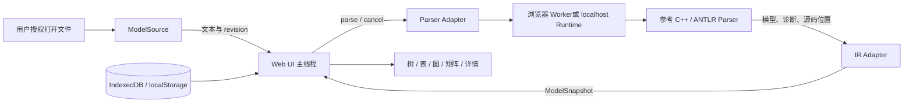
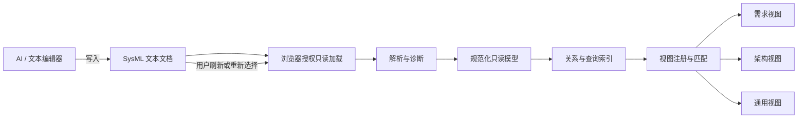
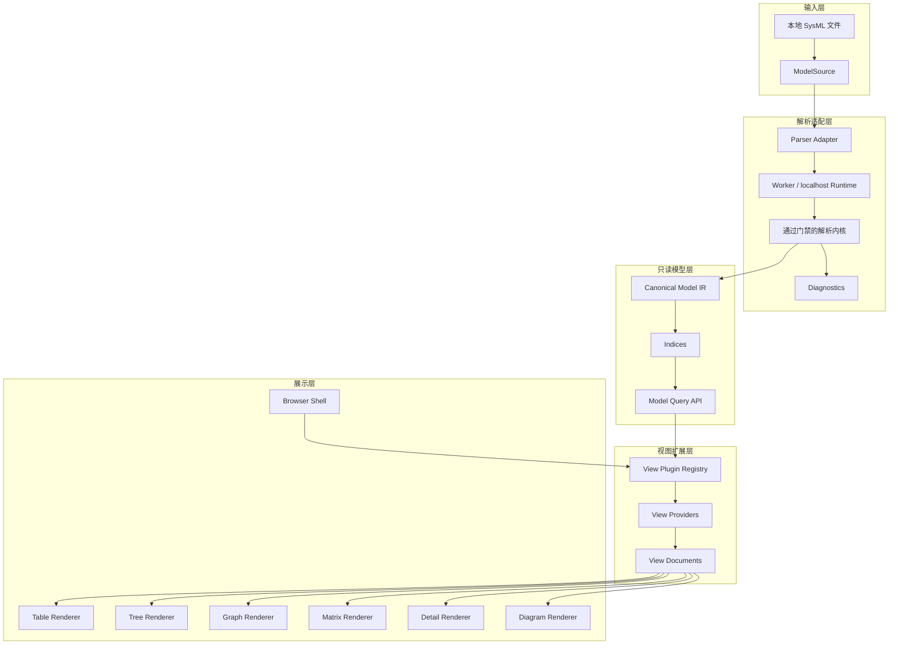

# SysML 浏览器详细设计

设计日期：2026-09-17　｜　版本：V1.1　｜　状态：VehicleMode 示例与需求约束关系已实现

## 1. 文档目标

本文定义一个只读 SysML v2 浏览器的详细设计。首个业务用途是浏览机器人需求模型，但核心架构必须能够继续增加架构、接口、行为、状态机、验证和其他 SysML 模型视图。

产品形态类似 Web 浏览器：

- `.sysml` 文本文档相当于 HTML 源码。
- SysML Parser 相当于 HTML Parser。
- 规范化只读模型相当于 DOM。
- 表格、树、关系图、矩阵和架构图相当于不同的渲染视图。
- AI、业务技能、文本编辑器和 Git 都在浏览器之外工作。

浏览器不编辑 SysML、不调用 AI、不执行技能、不封装 Git、不审批需求，也不保存第二份业务事实。

## 2. 设计目标与非目标

### 2.1 设计目标

1. 打开一个 SysML v2 文本文档并显示基础文件信息。
2. 将模型元素、属性、关系和源码位置转换为统一只读模型。
3. 首期提供需求表格、需求树、追溯图、详情和验证矩阵。
4. 通过插件式视图框架增加架构模型视图，无需修改解析核心和应用外壳。
5. 未被专用视图支持的元素仍能通过通用树、通用表和详情页浏览。
6. 外部编辑文件后能够重新加载，并保持可解释的选择与导航状态。
7. 解析失败时显示诊断信息，尽可能保留可浏览的有效部分。
8. 所有视图都能定位到同一模型元素及其 SysML 源码。

### 2.2 非目标

- SysML 文本编辑、格式化、代码补全和保存。
- AI 对话、提示词、技能加载和内容生成。
- Git 提交、分支、合并、tag 和审批。
- 完整 SysML 建模器或图形化建模工具。
- CAD、仿真、BOM 和测试文件管理。
- 需求质量、安全或合规业务检查。
- 将解析结果作为新的权威数据源持久化。

## 3. 软件形态与运行方式

### 3.1 形态决定

产品确定为**Web 单页应用（SPA），并具备 PWA 安装能力**。用户通过浏览器打开 `.sysml` 文件，Web 前端负责浏览交互。首期解析内核采用参考项目的 C++/ANTLR Parser，通过稳定 Parser Adapter 接入；官方 SysML v2 Pilot Implementation 不作为生产运行时。

选择 Web 的业务原因是：

- 用户通过链接即可进入，不需要安装和升级传统桌面程序。
- 表格、树、关系图、矩阵和详情等浏览组件更容易统一组合。
- 同一套界面以后可以读取本地文件、HTTP 文件或 SysML API，视图插件无需重写。
- PWA 可以提供桌面入口和离线静态资源，同时仍保持 Web 的交付方式。
- 软件职责仍然只有浏览；AI 和文本编辑器直接修改 SysML 源文件。

首期不采用 Electron 或 Qt 桌面外壳。为减少一次性改造，参考 Parser 先作为独立 localhost Runtime 运行，复用现有 Qt Core、ANTLR Runtime 和模型构建代码；Web 前端不直接链接 C++ 类型。待需求浏览流程稳定后，再评估去除 Qt 依赖和编译 WASM。Pilot 只在研发和 CI 环境参与差异测试。

### 3.2 确定技术栈

| 层 | 决定 | 说明 |
|---|---|---|
| 应用 | React＋TypeScript SPA | 实现应用外壳、状态和插件宿主；版本由项目锁文件固定 |
| 前端构建 | Vite | 构建静态资源和前端 Worker |
| 解析内核 | 参考项目 C++/ANTLR Parser | 首期复用现有语法、ModelBuilder 和测试模型；只承诺已验证能力 |
| 解析适配 | localhost Parser Runtime＋Parser Adapter | C++ 输出规范化 IR JSON，前端不依赖 Qt/C++ 对象 |
| 前端后台任务 | Dedicated Web Worker | 浏览器内解析、大型 View Document、搜索或图布局不占用 UI 主线程 |
| 数据 | 内存中的 ModelSnapshot | 源文件是唯一业务事实，不建立模型数据库 |
| 本地偏好 | localStorage / IndexedDB | 只保存主题、列宽、布局、最近文件句柄等非业务状态 |
| 发布 | 本机 localhost 应用包 | 启动器同时启动静态 Web 页面和 C++ Parser Runtime；不能把 `file://` 作为正式运行方式 |
| 首选浏览器 | 当前企业版 Microsoft Edge / Google Chrome | 完整支持本地文件句柄路径；其他现代浏览器使用兼容路径 |

### 3.3 本地文件访问

浏览器不能像桌面程序一样任意读取磁盘，因此文件访问必须由用户动作发起：

1. 首选路径使用 `showOpenFilePicker()` 获得用户授权的只读文件句柄。
2. 不支持该 API 时，退化为 `<input type="file">` 或拖放读取文件快照。
3. 首选路径可在用户点击刷新时重新读取同一文件；兼容路径提示用户重新选择或拖入文件。
4. 应用只申请读取权限，不申请写权限，不修改源文件。
5. 最近文件句柄可以保存在 IndexedDB；再次使用前仍以浏览器权限结果为准。
6. 前端把文本和文件逻辑 URI 交给 localhost Parser Adapter，模型不离开本机。

文件来源统一抽象，避免页面组件直接调用浏览器 API：

```typescript
interface ModelSource {
  id: string;
  label: string;
  read(signal?: AbortSignal): Promise<{
    uri: string;
    text: string;
    revision: string;
  }>;
  canReload(): boolean;
}

// MVP
class LocalFileHandleSource implements ModelSource {}
class FileSnapshotSource implements ModelSource {}

// 后续扩展
class HttpReadOnlySource implements ModelSource {}
class SysMLApiSource implements ModelSource {}
```

### 3.4 浏览器内运行架构



Parser Adapter 使用有版本的只读协议：`parse`、`cancel`、`capabilities` 和健康检查。传输对象只包含文本、逻辑 URI、版本信息、纯数据 IR 和诊断，不向 UI 暴露具体内核对象。

### 3.5 部署与离线边界

- 首期使用启动器在 `localhost` 提供 Web 前端和无状态 C++ Parser Runtime，SysML 内容留在本机。
- 后续 WASM 方案：C++ Parser 去除 Qt 依赖并通过完整回归后，可把 Runtime 移入 Web Worker。
- 可安装 PWA：缓存应用壳、字体和渲染资源；默认不把用户 SysML 内容写入 Service Worker Cache。
- 首期没有模型数据库、多人协作和云端模型存储；localhost Runtime 请求完成后丢弃模型内容。
- PWA 离线解析能力取决于最终内核；不能在内核通过门禁前承诺完全离线。
- 后续若需要团队共享，只新增只读 `HttpReadOnlySource` 或 `SysMLApiSource`；模型查询和视图插件保持不变。

### 3.6 典型使用过程

1. 用户或 AI 在外部编辑器中修改 `requirements.sysml` 或其他 `.sysml` 文件。
2. 用户在 SysML 浏览器中打开文件。
3. 浏览器解析文本，构建只读模型、关系索引和源码映射。
4. 浏览器根据模型内容列出可用视图。
5. 用户在模型树、表格、关系图、矩阵和专用图之间切换。
6. 用户选择任一元素，其他视图同步定位。
7. 用户可跳转到源码行或外部 URI。
8. 外部文件变化后，用户点击刷新或重新选择文件，浏览器重新解析并刷新所有派生视图。



## 4. 参考项目分析

参考项目：`D:\Document\7.AWorks\BlockSim\2.Development\SysML`。

### 4.1 已有可复用思路

| 参考能力 | 对应实现 | 可复用价值 |
|---|---|---|
| 文本解析包装 | `parser/src/parser/SysMLParser.h` | parseText、parseFile 和诊断接口可作为服务 API 设计参考，不复用其生产解析结果 |
| 元模型基类 | `core/model/Element.h` | Element、所有权、子元素、关系和类型信息适合构造统一只读模型 |
| 文件资源抽象 | `core/infrastructure/Resource.h` | Resource 表达文件、URI 和根元素，可保留只读子集 |
| 模型服务 | `services/model/ModelService.h` | 已有打开文件、按类型查找和限定名查找的思路 |
| 通用模型树 | `ui/tree/ModelTreeModel.h` | 已验证由元素所有权关系生成树形视图的方式 |
| 视图注册 | `ui/mid_windows/ViewRegistry.h` | 元素类型到多个视图类型的注册机制符合扩展方向 |
| 视图工厂 | `ui/mid_windows/ViewFactory.h` | 工厂注册创建器的方式可转化为 View Provider 注册机制 |
| 需求表格 | `ui/mid_windows/requirement/RequirementTableModel.h` | 已包含需求列表、列映射和过滤器的实践 |
| 架构图 | `ui/mid_windows/architecture/` | 已有 Part、Port、Connection 的 Scene/Item 分层和嵌套显示经验 |
| 测试模型 | `tests/TestCases/*.sysml` | 覆盖需求、关系、架构、接口、状态机、表达式等，可转成浏览器回归夹具 |

### 4.2 不直接沿用的部分

1. 参考项目同时承担编辑、序列化和建模，目标范围比本浏览器大。
2. `ViewFactory::createView` 对 `ViewUsage` 和需求表格存在特殊分支，继续扩展会形成越来越大的类型判断。
3. ViewRegistry 与 ViewFactory 分别保存映射和创建器，默认视图来源不唯一。
4. 视图直接接收 C++ `Element*`，使 UI 与具体元模型类和 Qt 对象生命周期耦合。
5. RequirementTableModel 包含 RequirementDefinition 查找、字段解释和过滤，数据选择与 UI 表格混在同一类。
6. ModelTreeModel 内部通过 `shouldDisplayElement` 过滤类型，新增元素类型可能要求修改核心树代码。
7. Element 暴露 `getChildParts`、`getPorts` 等架构专用便捷方法，使通用基类逐渐承载特定视图知识。
8. 参考项目的语法支持经历逐步扩展，旧设计文档不能当作当前完整支持清单；必须以实际 Parser、测试和样例验证。
9. 项目 README 中许可证仍为待定。本文复用设计经验和测试思路，不默认复制源代码。

### 4.3 建议复用方式

- 复用测试模型、界面经验和元模型知识；解析器只用于差异分析，不进入生产链路。
- 将 Qt/C++ 元模型通过 Adapter 转换为稳定的浏览器 IR。
- 将现有需求表格和架构图拆成“数据选择 Provider”和“纯渲染 Renderer”。
- 用统一 View Plugin Registry 取代 ViewUsage 特判和分散映射。
- 保留通用模型树作为兜底视图。
- 浏览器新实现坚持只读，排除 EditService、Serializer 和图形编辑交互。

## 5. 总体架构

### 5.1 逻辑分层



### 5.2 关键原则

- **单向数据流**：文件 → 解析 → IR → 索引 → View Document → Renderer。
- **只读**：任何 UI 操作都不改变 IR 和源文件。
- **解析器隔离**：UI 不直接依赖 ANTLR Parse Tree、Qt QObject 或官方 API 对象。
- **视图无业务存储**：视图只保存临时筛选、展开和布局状态。
- **能力发现**：插件根据模型能力声明是否可用，不在主程序中写类型分支。
- **通用兜底**：未知元素始终可以在通用树和详情页中显示。
- **源码可追踪**：每个可见元素尽量关联 SourceSpan。
- **语义正确优先**：解析内核必须通过标准语料、项目语料和跨文件语义门禁，不因来源标签豁免。
- **无状态解析**：Parser Runtime 不把文本或 ModelSnapshot 持久化为新的业务事实源。
- **主线程轻量**：解析和大型前端计算不能阻塞 UI 主线程。

## 6. 规范化只读模型 IR

### 6.1 为什么需要 IR

参考项目的 UI 直接消费 `Element*`。这种方式在单一 Qt 桌面应用中简单，但会让视图依赖具体类、内存所有权和 Parser 实现。规范化 IR 为候选解析内核与 Web 视图建立稳定边界，使内核选型和替换不影响业务视图。

### 6.2 核心对象

```typescript
type ElementId = string;

interface ModelSnapshot {
  documentUri: string;
  revision: string;
  roots: ElementId[];
  elements: Map<ElementId, ModelElement>;
  relationships: Map<ElementId, ModelRelationship>;
  diagnostics: Diagnostic[];
}

interface ModelElement {
  id: ElementId;
  metaclass: string;
  declaredName?: string;
  qualifiedName?: string;
  ownerId?: ElementId;
  ownedElementIds: ElementId[];
  propertyValues: Record<string, Value>;
  metadata: Record<string, Value>;
  documentation?: string;
  source?: SourceSpan;
}

interface ModelRelationship {
  id: ElementId;
  metaclass: string;
  sourceIds: ElementId[];
  targetIds: ElementId[];
  ownerId?: ElementId;
  propertyValues: Record<string, Value>;
  source?: SourceSpan;
}

interface SourceSpan {
  uri: string;
  startLine: number;
  startColumn: number;
  endLine: number;
  endColumn: number;
}

interface Diagnostic {
  severity: "error" | "warning" | "info";
  code: string;
  message: string;
  source?: SourceSpan;
}
```

### 6.3 标识策略

优先使用 Parser 或 SysML API 提供的稳定元素 ID。若文本模型没有稳定 ID，浏览器生成仅用于本次快照的复合 ID：

`documentUri + metaclass + qualifiedName + source.startLine`

复合 ID 不能写回文件，也不能作为跨版本永久引用。刷新后恢复选中项时按以下顺序匹配：

1. 稳定元素 ID。
2. qualifiedName＋metaclass。
3. 源码附近的结构指纹。
4. 无匹配时清空选择并提示元素已变化。

### 6.4 未知元素保留

Parser Adapter 不应丢弃未识别的属性和关系。无法规范化的内容放入 `propertyValues` 或 `metadata`，并保留 metaclass 和源码位置。这样新增 SysML 元素在专用视图实现前仍可由通用详情页展示。

## 7. 解析内核与 Parser Adapter

### 7.1 接口

```typescript
interface SysMLParserClient {
  id: string;
  supportedVersions(): string[];
  parse(request: ParseRequest): Promise<ModelSnapshot>;
}

interface ParseRequest {
  requestId: string;
  entryUri: string;
  documents: Array<{
    uri: string;
    text: string;
  }>;
  languageBaseline: string;
  previousSnapshot?: ModelSnapshot;
  signal?: AbortSignal;
}
```

### 7.2 实现选择

需要区分三个概念：

1. **OMG SysML 2.0 规范**是最终标准依据，包含语言规范、抽象语法 XMI、JSON Schema、标准库和示例，但没有发布可直接嵌入浏览器的标准 Parser SDK。
2. **Systems Modeling Community 的 SysML v2 Pilot Implementation**是随官方 Release 持续发布的 Java/Xtext 参考实现，包含文本语法、EMF 元模型、链接、标准库和验证逻辑。本文将其简称为“官方 Pilot 内核”，但它本身仍是 Pilot Implementation，不等同于规范。
3. **本地参考项目**是 C++/Qt/ANTLR 自研实现，适合复用界面经验和测试样例，不具备标准权威性。

官方 SysML API and Services 规定模型仓库的项目、分支、提交、元素和查询接口，不能代替 `.sysml` 文本到语义模型的解析。Pilot、API Service 和规范必须分别评估，不能因为仓库位于 Systems-Modeling 组织下就视为可直接产品化的 SDK。

### 7.3 Pilot Implementation 可行性核查

本次核查基于 2026-09-17 时的官方发布说明、公开问题和仓库 `master` 源码静态检查。结论如下：

| 维度 | 核查证据 | 判断 |
|---|---|---|
| 文本语法广度 | Xtext Grammar 覆盖 SysML、KerML 和表达式，并持续跟随官方 Release | 高，适合研究标准语法 |
| 完整语义实现 | 2026-08 发布说明仍记录缓存派生值问题，且说明需要额外 parse post-processing 修正 Xtext Grammar 的表达限制 | 中，不能等同于完整规范实现 |
| 跨文件模型 | 公开问题 #778 证明顶层 Package 短名跨文件引用失败并产生级联误诊断 | 不满足本项目多文件扩展要求 |
| 标准库一致性 | 公开问题 #753 显示 Interactive 与新版标准库组合时，简单 Part 模型也可能误报；更换旧库才恢复 | 版本组合脆弱，必须严格配套 |
| Headless API | 存在 `SysMLInteractive` 和 StandaloneSetup，可在 Java 中调用 | 技术上可调用，但不是稳定服务 SDK |
| 构建与依赖 | Parser 和 Interactive 仍以 `eclipse-plugin` 打包，使用 Tycho/OSGi、Xtext、EMF、Xtend、UML2，要求 Java 21 | 集成与维护成本高 |
| 并发与隔离 | `SysMLInteractive` 使用静态 Injector/单例和可变 ResourceSet、索引、当前 Resource、计数器；未提供请求隔离 | 不适合直接包装成并发无状态服务 |
| 生命周期 | 成功解析的 Resource 会加入共享索引；上游缓存族仍在持续修正 | 长期运行时的资源回收与一致性需自行重构 |
| Web/浏览器 | 官方主要交付 Eclipse 插件和约 120 MB Jupyter Kernel；没有浏览器 Parser、LSP 或 WASM 产物 | 不满足纯 Web 本地解析目标 |
| API 稳定性 | 月度 Pilot 发布持续修改语法、约束、缓存和后处理，当前版本已面向 SysML 2.1 Beta | 不具备生产 SDK 的兼容承诺 |
| 源码映射 | Xtext Node Model 能提供节点文本和位置 | 可用，是少数可直接复用能力之一 |
| 许可证 | EPL-2.0 已明确 | 可评估，但仍需核对分发和修改文件边界 |

“语法覆盖较广”只说明 Pilot 是有价值的参考实现，不代表它满足浏览器产品的稳定性、隔离性和部署要求。尤其是需求表和追溯矩阵会把解析结果当作业务事实呈现，跨文件引用误判或标准库错配不能作为普通界面缺陷接受。

### 7.4 选型结论

结论分为四层：

| 用途 | 决定 |
|---|---|
| 生产解析运行时 | **No-Go**，不直接采用 Pilot Implementation |
| 规范辅助理解 | 可使用，但规范文本和规范机器可读文件优先级更高 |
| 兼容性对照 | 可作为多个对照实现之一，不能当作唯一真值 |
| 官方语料来源 | 使用其 Release 样例、标准库和回归模型构建测试集 |

结合当前目标是先跑通需求浏览业务闭环，首期明确采用**参考项目 C++/ANTLR Parser＋localhost Runtime＋规范化 IR Adapter**。这是分阶段实施决定，不表示参考 Parser 已完整符合 SysML 2.0。

采用边界如下：

- 直接复用现有 Grammar、ModelBuilderVisitor、C++ 元模型和测试样例，先不做 WASM 移植。
- 从参考工程中抽出只读解析入口，不启动 Qt UI，不链接编辑、序列化和图形场景模块。
- Runtime 每次请求建立独立解析会话，输出 IR JSON 后释放模型对象，不向前端暴露 `Element*`。
- 首期能力清单按测试冻结；Requirement、satisfy、verify、derive、refine 等未通过夹具的能力不能在 UI 中假装可用。
- 未支持语法必须返回 `unsupported-syntax` 或 `unsupported-semantics` 诊断，并尽量保留通用节点，禁止静默丢弃。
- Parser 缺口按需求浏览的业务优先级补齐；每次补齐同时增加官方语料和金刚语料回归。
- 参考项目许可证待定的问题必须在对外分发前解决；内部原型阶段记录代码来源和修改范围。
- Pilot 保留为差异测试对象。出现分歧时回到规范条文、规范 XMI/JSON Schema 和最小复现模型裁决。

后续只有在以下触发条件出现时才重新选型：参考 Parser 无法可靠表达需求核心关系、补齐成本超过替换成本、许可证不能解决，或需要纯浏览器部署而 Qt/C++ 无法合理迁移。

### 7.5 参考 Parser 阶段门禁

参考 Parser 进入每个实施阶段前必须满足对应门禁：

- 覆盖冻结的 SysML/KerML 版本，不混用 SysML 2.0 正式版和 2.1 Beta 语义。
- 加载配套标准库，并验证版本不匹配时能明确拒绝。
- 正确解析多文件 Package、import、qualified name、short name 和循环依赖诊断。
- 完整产出 Requirement、satisfy、verify、derive、refine、Part、Port、Connection 和 View 所需 IR。
- 所有元素和关系具有稳定 ID 策略及源码区间。
- 对语法错误和未解析引用返回结构化诊断，不静默丢元素。
- 支持取消、超时、内存上限、重复加载和请求隔离。
- 提供可自动化调用的稳定 localhost API，并能固定版本和离线构建。
- 内部原型记录许可证风险；任何对外分发前必须取得明确许可。
- 通过官方语料、金刚语料、参考项目语料、变异测试和跨实现差异测试。

门禁按阶段执行：P1 至少通过通用元素和源码定位；P2 必须通过需求及追溯关系；P3 必须通过 Part、Port、Connection。只生成 AST、只通过单文件样例或只宣称“完整支持 SysML v2”均不构成通过。

### 7.6 错误恢复

Parser Adapter 返回 Snapshot 和 Diagnostics，而不是遇到第一个错误就失败。至少区分：

- 文件不可读。
- 词法/语法错误。
- 元素构建失败。
- 引用无法解析。
- 不支持的语法。
- Adapter 内部错误。

错误应带行列。若 Parser 能产生部分模型，浏览器显示“部分加载”状态并允许浏览有效元素；若根模型不可用，则只显示错误页和源码片段。

## 8. 索引与查询服务

### 8.1 必备索引

| 索引 | 用途 |
|---|---|
| byId | 元素详情与跨视图选择 |
| byMetaclass | 查找需求、Part、Port、Action、State 等 |
| byQualifiedName | 引用解析与搜索 |
| childrenByOwner | 通用模型树与组合结构 |
| incomingRelationships | 向上追溯、被满足、被验证 |
| outgoingRelationships | 向下分配、满足和验证 |
| fullText | 名称、正文、文档和 metadata 搜索 |
| sourceInterval | 源码行到元素、元素到源码 |

### 8.2 查询 API

```typescript
interface ModelQuery {
  getElement(id: ElementId): ModelElement | undefined;
  childrenOf(id: ElementId, filter?: ElementFilter): ModelElement[];
  elementsOfType(types: string[]): ModelElement[];
  incoming(id: ElementId, relationshipTypes?: string[]): ModelRelationship[];
  outgoing(id: ElementId, relationshipTypes?: string[]): ModelRelationship[];
  search(query: string, filter?: ElementFilter): SearchResult[];
  sourceAt(line: number, column: number): ModelElement[];
}
```

视图 Provider 只能通过 ModelQuery 读取模型，不能依赖 Parser 对象或遍历 UI 控件。

## 9. 可扩展视图框架

### 9.1 View Plugin

每种视图由一个 View Provider 和一个通用 Renderer 组成。Provider 负责选择模型数据并生成 View Document；Renderer 只负责显示。

```typescript
interface ViewPlugin {
  manifest: ViewManifest;
  isApplicable(context: ViewContext): boolean;
  build(context: ViewContext, query: ModelQuery): Promise<ViewDocument>;
}

interface ViewManifest {
  id: string;
  title: string;
  version: string;
  kind: "table" | "tree" | "graph" | "matrix" | "detail" | "diagram";
  supportedMetaclasses?: string[];
  priority?: number;
}

interface ViewContext {
  snapshotRevision: string;
  scopeElementId?: ElementId;
  selectionIds: ElementId[];
  filters: Record<string, Value>;
}
```

### 9.2 View Document

View Document 是 Provider 与 Renderer 的稳定协议：

| 类型 | 核心数据 |
|---|---|
| TableDocument | columns、rows、cell value、elementId、sort/filter metadata |
| TreeDocument | roots、children、label、elementId、badges |
| GraphDocument | nodes、edges、elementId、relationshipId、group |
| MatrixDocument | rows、columns、cells、row/column elementId |
| DetailDocument | sections、fields、links、source span |
| DiagramDocument | nodes、ports、edges、groups、layout hints |

Renderer 不判断 RequirementDefinition 或 PartUsage；它只解释 View Document。需求和架构语义留在 Provider。

### 9.3 注册与匹配

应用启动时向单一 ViewPluginRegistry 注册插件。打开模型或改变选择后：

1. Registry 调用每个插件的 `isApplicable`。
2. 返回按 priority 排序的可用视图。
3. 用户选择视图，或使用该 scope 的默认视图。
4. Provider 根据 ModelQuery 构建 View Document。
5. 对应 Renderer 渲染。

核心程序不写 `if elementType == RequirementDefinition` 一类分支。

### 9.4 插件打包

首期插件可与应用一起编译，但目录和依赖保持独立。后续可增加 manifest 驱动的动态加载。插件不得：

- 修改 ModelSnapshot。
- 写源文件。
- 直接访问 Parser。
- 保存业务事实。
- 覆盖其他插件的 ID。

## 10. 首期需求视图插件

### 10.1 Requirement Table

默认列：

| 列 | 数据来源 |
|---|---|
| ID | reqId 或项目 metadata；缺失时显示浏览会话 ID |
| 名称 | declaredName |
| 正文 | requirement statement/documentation |
| 类型 | stakeholder/system/interface/subsystem metadata |
| 状态 | status metadata |
| 专业 | allocation/owner metadata |
| 变体 | applicability metadata |
| 验证 | verify 关系和 Verification Case 状态摘要 |

列定义由 RequirementTableProvider 管理；表格 Renderer 只处理通用列、排序和筛选。

### 10.2 Requirement Tree

树的默认父子规则按优先级选取：

1. 显式 derive/refine 关系。
2. ownership 或 package 层级。
3. metadata 中的 parent requirement ID。
4. 没有父项的需求放入“未分组”。

树节点显示类型、状态、专业和验证覆盖 badge。一个需求有多个逻辑父项时，树以主父项显示，其他关系在详情和关系图中显示。

### 10.3 Traceability Graph

节点可包含需要、需求、Part/Action、Verification Case 和外部证据引用。边至少支持 derive、refine、satisfy、verify、allocate 和 dependency。默认只展开选中元素的一跳，避免大模型一次绘制全部关系。

### 10.4 Verification Matrix

- 行：RequirementDefinition/RequirementUsage。
- 列：Verification Case 或验证方法。
- 单元格：verify 关系、状态、外部证据链接。
- 筛选：未覆盖、未执行、失败、按专业、按变体。

矩阵只呈现模型已有数据，不推断需求已经通过。

### 10.5 Requirement Detail

详情页由通用 Section 组成：

- 基本信息。
- 正文与约束。
- metadata。
- 上游来源。
- 下游分配和 satisfy。
- Verification Case 与证据 URI。
- 所有入边/出边。
- 源码位置。

## 11. 架构模型扩展设计

架构视图是扩展性验收项，不等需求视图完成后再重新设计核心。

### 11.1 Architecture Structure Tree

支持 Package、PartDefinition、PartUsage、PortDefinition、PortUsage、InterfaceUsage、ConnectionUsage 等结构。使用 ownership 和 typing 构造层级，显示 definition/usage 区别。

### 11.2 Architecture Diagram

ArchitectureProvider 产生 DiagramDocument：

- Part/PartUsage → node。
- PortUsage → node.port。
- Connection/Interface → edge。
- ownership → group/nesting。
- documentation/attribute → detail section。

布局优先级：

1. 模型中明确的标准视图或项目 metadata。
2. 浏览器会话中的临时布局。
3. 自动布局。

只读浏览器不把坐标、颜色或折线路径写回 SysML。临时布局只属于 UI 会话状态，删除后不影响模型。

### 11.3 与参考项目的关系

参考项目 `ArchitectureScene`、`PartGraphicsItem`、`PortGraphicsItem` 和 `ConnectionGraphicsItem` 的 Scene/Item 分层可作为渲染参考。但新架构中 Provider 生成 DiagramDocument，Renderer 不直接访问 `Element*`，也不包含编辑对话框。

### 11.4 后续视图

| 模型领域 | 可增加的插件 |
|---|---|
| 行为 | Action Flow、Activity Graph |
| 状态 | State Machine、Transition Table |
| 接口 | Interface Matrix、Port/Flow Table |
| 分配 | Requirement-to-Part、Function-to-Part Matrix |
| 参数 | Constraint/Parameter Table、依赖图 |
| 验证 | Verification Coverage、Evidence Status |
| 通用 | Element Table、Ownership Tree、Relationship Explorer |

新增上述插件不得修改 ModelSnapshot、ModelQuery 和现有需求插件。

## 12. 应用外壳与交互

### 12.1 页面布局

| 区域 | 内容 |
|---|---|
| 顶栏 | 产品标识、文件名、加载状态、刷新、打开文件和 Runtime 设置 |
| 左侧 | 模型导航树；节点主按钮、更多按钮和右键菜单用于打开适用视图 |
| 中央 | 当前表格、树、图、矩阵或源码视图；显示当前模型上下文 |
| 右侧 | 固定属性查看器；显示当前元素业务字段、模型属性、关系和源码位置 |
| 底部 | 解析诊断、警告和性能信息 |

不再设置独立的全局视图侧栏。视图与模型上下文绑定：节点行提供主视图打开按钮，更多按钮和右键菜单列出该元素类型适用的全部视图。Package 根据其子树包含的需求或架构元素提供集合视图；Requirement、Part、Port、Interface 和 Connector 提供各自专用视图。普通元素至少可进入源码，属性通过右侧页签查看。

### 12.2 统一选择

应用维护只读 SelectionState：

```typescript
interface SelectionState {
  primaryId?: ElementId;
  selectedIds: ElementId[];
  originViewId?: string;
}
```

任何视图选择元素后，通过 SelectionBus 通知其他视图。其他视图可高亮、定位或保持当前范围，不应重新解释元素身份。

### 12.3 导航

- 点击模型节点 → 选中元素，并供属性查看页签读取。
- 节点主按钮 → 打开该类型的默认视图。
- 节点更多按钮或右键菜单 → 打开所有适用视图或属性查看。
- 元素 → 源码行。
- 关系 → 源端与目标端。
- 外部 URI → 系统默认处理器或受控应用入口。
- 浏览历史 → 后退/前进。

### 12.4 只读保证

- 前端不提供编辑控件。
- Parser/IR API 不暴露 mutate/save。
- 文件以只读方式打开。
- 临时筛选、列宽、展开和布局保存到浏览器偏好区，不能写进 SysML 文件。
- 自动刷新只重新加载，不进行格式化。

## 13. 文件刷新与缓存

### 13.1 刷新过程

1. 用户点击刷新；若来源不支持重新读取，则提示重新选择或拖入文件。
2. ModelSource 读取完整文本并计算 revision hash。
3. 取消上一轮未完成解析。
4. Parser Adapter 生成新 Snapshot。
5. 原子替换当前 Snapshot 和索引。
6. 按稳定 ID/qualifiedName 恢复 scope、选择、筛选和展开状态。
7. 重建当前 View Document。

解析失败时保留上一份成功快照作为“旧版本预览”，页面必须明显标注它不是当前文件内容，并同时显示当前错误。

### 13.2 缓存边界

- 可缓存 Parser 输出和索引，key 为 file URI＋content hash＋parser version。
- View Document 可按 snapshot revision＋view id＋scope＋filter 缓存。
- 缓存可以随时删除和重建。
- 缓存不包含浏览器创建的业务字段。

## 14. 性能设计

首期目标规模由 PoC 实测后冻结，建议先验证：

| 场景 | 初始目标 |
|---|---|
| 文件规模 | 10 MB 或 10,000 个元素 |
| 首次解析与显示 | 常规开发机上 ≤ 3 秒 |
| 搜索响应 | ≤ 300 ms |
| 表格滚动 | 采用虚拟化，不一次创建全部行组件 |
| 图展开 | 默认一跳，节点超过阈值时提示缩小范围 |
| 文件刷新 | 不阻塞 UI；显示加载状态；旧视图原子替换 |

实现策略：后台解析、列表虚拟化、图按需展开、索引预计算、取消过期请求。性能目标是设计假设，必须用金刚模型和参考项目大样例验证。

## 15. 安全与健壮性

- 文档内容、名称、documentation 和 URI 都视为不可信数据。
- HTML 渲染必须转义，禁止模型文本直接注入脚本。
- 外部 URI 跳转显示目标，并限制允许的协议。
- 超长文本、深层递归、循环关系和巨大图必须有限额。
- Parser 在独立 Worker 或本地 Runtime 中运行，异常不得破坏 UI 状态；Runtime 应支持超时、取消和恢复。
- 解析超时、内存上限和取消必须可配置。
- 诊断日志不得静默包含敏感模型全文。
- Content Security Policy 禁止任意脚本执行；Worker 和静态资源只从受控同源加载。
- localhost Parser Runtime 默认只接受回环地址和同源请求，限制请求体、文件数、解析时间和内存，且不记录模型正文。
- Service Worker 默认不缓存 SysML 文本和解析结果。

## 16. 推荐工程结构

```text
sysml-browser/
├── apps/
│   └── web/                    # React SPA、PWA 配置和应用外壳
├── services/
│   └── parser-cpp/             # 参考 Parser 只读封装、会话隔离和 IR JSON 输出
├── packages/
│   ├── model-source/           # 本地文件与后续远程来源
│   ├── parser-contract/        # Adapter API、版本与 ModelSnapshot Schema
│   ├── parser-client/          # localhost 通信、取消、超时和能力发现
│   ├── model-ir/               # types、normalization、source-map
│   ├── query/                  # indices、model-query
│   ├── view-sdk/               # plugin-api、view-documents、registry
│   ├── renderers/              # table、tree、graph、matrix、detail、diagram
│   └── plugins/
│       ├── generic
│       ├── requirements
│       └── architecture
├── vendor/
│   ├── reference-parser/       # 固定参考项目 commit、补丁和来源记录
│   └── pilot-fixtures/         # Pilot/Release 测试语料，不作为生产依赖
└── tests/
    ├── fixtures
    ├── language-conformance
    ├── differential
    ├── parser-contract
    ├── view-contract
    └── end-to-end
```

前端 TypeScript 包使用工作区统一管理。C++ Parser Runtime 与前端发布匹配的 IR Schema 和能力清单。参考项目固定到明确 commit，所有本地补丁单独记录；Pilot 不进入生产依赖和发布包。

## 17. 测试策略

### 17.1 Parser Contract

所有候选 Parser Adapter 对同一夹具应输出满足 IR 契约的结果：

- roots 和 ownership 正确。
- metaclass、名称和限定名正确。
- source span 可定位。
- 关系源端/目标端正确。
- 未知属性不会静默丢失。
- 错误包含行列和严重级别。
- 跨文件引用和标准库引用可解析。
- `GET /capabilities` 返回的内核、规范、标准库和 IR 版本与发布清单一致。

### 17.2 View Contract

每个插件使用固定 ModelSnapshot 测试，不依赖真实 Parser：

- applicable 判断。
- View Document 的 elementId 完整。
- 筛选和 scope 行为。
- 空模型、缺字段、循环关系和外部引用。
- 未知元素不导致插件崩溃。

### 17.3 Renderer Contract

Renderer 使用通用 View Document 测试：

- 大表虚拟化。
- 深树展开。
- 图节点阈值。
- 矩阵空行/空列。
- 文本转义。
- 点击元素触发统一 Selection。

### 17.4 参考项目夹具

优先纳入以下本地样例：

- `test_requirement_definition.sysml`
- `test_requirement_table.sysml`
- `test_relationships_comprehensive.sysml`
- `test_architecture_view.sysml`
- `test_interface_port_connector.sysml`
- `Vehicle.sysml`
- 状态机 phase 1–4 测试文件

夹具来自参考项目时记录来源版本；不把测试文件中的非标准扩展自动当成 SysML v2 标准语法。

## 18. 实施阶段

### 18.1 P0：参考 Parser 基线与能力盘点，3–5 天

**执行状态（2026-09-17）：已完成，有条件通过。** 详细证据见《参考 Parser P0 基线与能力盘点》和 `AIDC/reference-parser-p0/`。Parser 可构建，核心测试 4/4 通过，自带 Parser 测试 6/8 通过；6 个代表性模型中 3 个无语法错误。稳定 ID、SourceSpan、verify/derive/refine、完整 satisfy 和许可证仍是进入需求浏览 MVP 前的阻断项。

- 固定本地参考项目当前 commit `9bfba0bced98b7586bab8a6d45746064aff70fe1`，保存构建环境和第三方依赖版本。
- 构建 `sysml_parser` 并运行现有 Parser 测试，记录可重复的基线结果。
- 选择金刚需求样例、参考项目需求样例和一个架构样例，逐项核对元素、关系、诊断和源码位置。
- 建立 `parser-capabilities.json`：语法/语义能力、状态、测试夹具和已知限制。
- 建立 `parser-gaps.md`：Requirement、Verification、satisfy、verify、derive、refine、metadata 和跨文件引用缺口。
- 定义 ModelSnapshot JSON Schema v0.1 和 Parser Contract，不沿用 Qt `Element*` 作为接口。
- 记录参考项目许可证未定风险和实际复用文件清单。

通过条件：参考 Parser 可稳定构建；至少能解析基础 Package、RequirementDefinition/Usage 和 ownership；所有发现的缺口均进入能力清单或诊断，不用推测结果填充 IR。

实际判定：构建与基础对象条件通过；完整需求浏览条件未通过。P1 先完成 Adapter、SourceSpan、确定性 ID、结构化诊断与最小需求追溯子集，再实现 localhost 接口。

### 18.2 P1：C++ 只读 Parser Runtime，约 1 周

**执行状态（2026-09-17）：Runtime MVP 已完成，P1 有条件通过。** 已实现 loopback HTTP `parse/cancel/capabilities/health`、ModelSnapshot Adapter、确定性 ID、结构化诊断、保守 SourceSpan、协作式取消、请求限制和 Release 免安装包。100 次确定性解析、两路并发、错误模型、取消、Origin 限制和真实夹具均已通过黑盒验证。详见《C++ 只读 Parser Runtime P1 实施报告》。

- 抽取 Parser、只读元模型和必要 Qt Core 依赖，排除 UI、编辑、Serializer 和图形模块。
- 实现 `parse`、`cancel`、`capabilities`、`health` 四个 localhost 接口。
- 每次请求创建独立解析会话，完成后释放 Resource、Element 和索引对象。
- 将 C++ 模型转换为 ModelSnapshot JSON，包含 Element、Relationship、Diagnostic 和 SourceSpan。
- 对未实现的 Visitor 路径增加明确诊断，禁止返回“解析成功但元素缺失”。
- 限制为回环地址访问，增加请求大小、超时和内存保护。

通过条件：同一文件连续解析 100 次结果一致且无持续内存增长；两个并发请求互不污染；错误模型返回结构化行列诊断。

实际判定：Runtime 工程门禁通过。SourceSpan 仍是名称级保守定位；verify/derive/refine、完整 satisfy、标准库和跨文件解析继续作为 Parser 能力缺口，不由 Runtime 猜测补全。

### 18.3 P2：Web 通用浏览内核，约 1 周

**执行状态（2026-09-17）：已随 P3 完成。** 已实现 React 应用外壳、Parser Client、文件打开/拖放/刷新、ModelSnapshot、ModelQuery 索引、统一选择、模型导航、详情、源码定位、解析诊断和能力显示。当前需求插件建立在这些通用边界上；View SDK 的独立动态打包留到出现第二个架构插件时再固化。

- React 应用外壳、ModelSource、Parser Client、文件打开和刷新。
- ModelSnapshot、索引和 ModelQuery。
- 通用模型树、通用元素表、通用详情和解析诊断面板。
- View SDK、Registry 和通用 Renderer。
- 显示 Parser commit、能力版本和当前模型涉及的未支持能力。

通过条件：用户可以在浏览器中打开 `.sysml` 文件，查看通用树和详情并定位源码；未知元素不会导致整份文件不可浏览。

### 18.4 P3：需求浏览 MVP，约 1–2 周

**执行状态（2026-09-17）：MVP 已完成，P3 有条件通过。** 已交付需求表格、需求树、单跳追溯图、验证矩阵、详情、源码视图和筛选，随附机器人需求样例端到端解析为 6 条需求、25 个元素、12 个关系、0 个错误。表格、树、详情和源码定位通过验收；关系视图对 `verify/derive/refine` 等 Parser 缺口明确显示“暂不支持”。因为工作区暂无金刚需求基准文件，且参考 Parser 未提供完整需求追溯语义，原定关系数量对比门禁尚未满足。详见《SysML 需求浏览器 P3 实施报告》。

- 先补齐需求浏览所必需的 Parser 缺口和 Parser Contract 夹具。
- 实现需求表格、需求树、追溯图、Verification Matrix 和详情页。
- 实现类型、状态、专业、变体和验证覆盖筛选。
- 对关系缺失区分“模型中没有”和“Parser 尚不支持”。
- 用金刚需求模型完成跨视图导航和源码定位回归。

通过条件：金刚目标样例中的需求数量、层级、satisfy/verify/derive/refine 关系与人工基准一致；未支持项在界面中明确显示。

### 18.5 P4：架构扩展验证，约 1–2 周

**执行状态（2026-09-17）：已完成，有条件通过。** Runtime 0.2.0 将参考 Parser 的 ConnectStatement 规范化为 Connection 关系；Web 端新增架构树、架构图、结构上下文选择、架构摘要和机器人架构样例。视图改为自动发现 `*.view.tsx` 插件，架构扩展未修改 ModelSnapshot Schema、ModelQuery 和需求 Provider。自带样例 4/4 条连接端点完整；参考大型样例解析 12 条连接，其中 1 条因模型上下文缺少目标部件而保持未解析并诊断。需求到架构的 satisfy/allocation 仍受 Parser 能力限制。详见《SysML 架构扩展验证 P4 实施报告》。

- 补齐 Part、Port、Connection 所需 Parser 能力。
- 实现结构树、只读架构图、自动布局和按需展开。
- 实现需求到架构的 satisfy/allocation 交叉导航。

通过条件：新增架构插件不修改 Parser Contract、ModelQuery、需求插件和应用外壳，证明 IR 和视图框架不局限于需求。

### 18.6 P5：加固与后续优化

- 扩大官方 Release、金刚和参考项目回归语料。
- 评估移除 Qt Core 后编译 WASM；只有功能与性能回归通过才替换 localhost Runtime。
- 按业务优先级增加状态机、活动、接口和参数视图。
- 在对外分发前解决参考项目许可证问题；无法解决时触发解析内核替换。

## 19. MVP 验收标准

1. 能打开参考项目的需求和架构样例以及金刚 `requirements.sysml`。
2. 能显示模型树、通用详情和解析诊断。
3. 需求插件能显示表格、需求树、追溯图和验证矩阵。
4. 架构插件能显示 Part、Port、Connection 的结构树和只读图。
5. 同一元素在所有视图中使用同一 ElementId，并能定位源码。
6. 外部修改文件后刷新，视图与当前文件一致。
7. 语法错误显示行列；存在部分模型时允许浏览有效内容。
8. 未知元素能进入通用视图，不导致整个文件加载失败。
9. 浏览器不会修改源文件。
10. 新增一个示例 View Plugin 时无需修改核心 Registry、Query 和 Renderer。
11. 应用以 localhost 单机包运行，前端、参考 Parser commit、IR Schema 和能力清单版本一致。
12. Edge/Chrome 可通过文件句柄重新加载；不支持文件句柄的浏览器可通过文件选择或拖放完成浏览。
13. 解析在 localhost C++ Runtime 中执行，大文件解析期间 UI 仍可响应并能取消请求。
14. 金刚目标需求样例、参考项目代表性需求样例和一个架构样例通过 Parser Contract 测试。
15. localhost Runtime 请求完成后不持久化模型正文，日志中不出现模型内容。
16. 页面显示 Parser 能力与已知限制；不支持的语法或语义不会被表示成“模型中不存在”。

## 20. 关键设计决定

| 编号 | 决定 | 理由 |
|---|---|---|
| ADR-001 | 浏览器只读 | AI 已适合文本编辑，避免重复建设编辑器和写回链路 |
| ADR-002 | 单一 SysML 文本事实源 | 防止视图数据库与文本漂移 |
| ADR-003 | Parser 与 UI 之间使用规范化 IR | 隔离 Qt/C++、ANTLR 和官方 API 的变化 |
| ADR-004 | Provider 与 Renderer 分离 | 业务语义选择和通用显示可以独立扩展 |
| ADR-005 | 单一 View Plugin Registry | 避免 Registry、Factory 和特殊分支多处决定视图 |
| ADR-006 | 架构插件进入首轮扩展性验证 | 尽早证明框架不是需求专用 |
| ADR-007 | 未知元素使用通用兜底视图 | SysML 语法扩展时保持可用 |
| ADR-008 | UI 会话状态不写入模型 | 保持只读边界和文本事实源纯净 |
| ADR-009 | 产品采用本地优先 Web SPA，并提供 PWA 安装能力 | 降低分发和升级成本，统一多类可视化，并保留后续远程来源扩展能力 |
| ADR-010 | 首期使用无状态 localhost C++ Parser Runtime | 最快复用现有 Parser，同时保持 Web UI 与 C++/Qt 解耦 |
| ADR-011 | Pilot Implementation 不作为生产解析内核 | 缺少稳定 Headless SDK、并发隔离和浏览器运行形态，且存在跨文件与版本组合问题 |
| ADR-012 | 文件句柄为首选、文件选择与拖放为兼容路径 | 在浏览器安全边界内兼顾本地刷新能力和跨浏览器可用性 |
| ADR-013 | 首期采用参考 C++ Parser | 先跑通需求浏览闭环，按能力清单逐步补齐，不宣称完整 SysML 2.0 支持 |
| ADR-014 | 参考 commit、能力清单、IR Schema 和语料一起锁定 | 防止 Parser 修改导致同一模型产生不可解释的视图差异 |
| ADR-015 | Pilot 仅用于语料和差异测试 | 利用其标准跟踪价值，同时隔离其运行时和稳定性风险 |
| ADR-016 | WASM 移植推迟到业务 MVP 后 | 先避免 Qt 解耦拖慢需求浏览，待回归基线稳定后再优化部署 |

## 21. 尚需验证的问题

1. 参考 C++ Parser 与正式 SysML 2.0 的语法差异范围，以及 Verification Case、verify、derive、refine 的补齐工作量。
2. SourceSpan 的新增实现能否覆盖错误恢复生成的元素，并保持跨版本稳定定位。
3. 项目自定义 metadata 的标准表达和 Parser 保留方式。
4. 架构图位置采用自动布局是否足够，是否需要只读解释项目已有 GraphicMetadata。
5. 目标严格锁定正式 SysML 2.0，还是允许采用 Release 中 SysML 2.1 Beta 已批准但尚未最终发布的变更。
6. 金刚需求模型的预计元素数量、文件大小和关系规模。
7. 外部 URI 需要支持哪些协议和本地应用跳转方式。
8. 企业实际允许的 Edge/Chrome、localhost 端口、安全策略和 PWA 安装策略。
9. localhost Runtime 使用便携压缩包、安装器还是容器交付；是否需要随用户登录自动启动。
10. 参考项目许可证由谁确认，内部原型和对外分发分别允许到什么范围。

## 22. 资料依据

- [需求与验收定义：业务流程与 SysML 浏览器方案](需求与验收定义_深度调研与实施方案.md)
- [OMG SysML v2 概览](https://www.omg.org/sysml/sysmlv2/)
- [SysML 2.0 Language Specification](https://www.omg.org/spec/SysML/2.0/Language/PDF)
- [SysML v2 Release](https://github.com/Systems-Modeling/SysML-v2-Release)
- [SysML v2 Pilot Implementation](https://github.com/Systems-Modeling/SysML-v2-Pilot-Implementation)
- [官方 Pilot 的 SysML Xtext Grammar](https://github.com/Systems-Modeling/SysML-v2-Pilot-Implementation/blob/master/org.omg.sysml.xtext/src/org/omg/sysml/xtext/SysML.xtext)
- [SysML v2 Release 发布记录](https://github.com/Systems-Modeling/SysML-v2-Release/releases)
- [Pilot 2026-08 发布说明：缓存与解析后处理仍在调整](https://github.com/Systems-Modeling/SysML-v2-Pilot-Implementation/releases/tag/2026-08)
- [Pilot Issue #753：SysMLInteractive 与标准库组合问题](https://github.com/Systems-Modeling/SysML-v2-Pilot-Implementation/issues/753)
- [Pilot Issue #778：跨文件顶层 Package 短名无法解析](https://github.com/Systems-Modeling/SysML-v2-Pilot-Implementation/issues/778)
- [Pilot Issue #571：LSP/Tree-sitter 支持仍是开放请求](https://github.com/Systems-Modeling/SysML-v2-Pilot-Implementation/issues/571)
- [SysML v2 API and Services](https://github.com/Systems-Modeling/SysML-v2-API-Services)
- [React：Using TypeScript](https://react.dev/learn/typescript)
- [MDN：showOpenFilePicker](https://developer.mozilla.org/en-US/docs/Web/API/Window/showOpenFilePicker)
- [MDN：Using Web Workers](https://developer.mozilla.org/en-US/docs/Web/API/Web_Workers_API/Using_web_workers)
- [MDN：WebAssembly](https://developer.mozilla.org/en-US/docs/WebAssembly)
- [Vite：Web Workers](https://vite.dev/guide/features.html#web-workers)
- 参考项目 README：`D:\Document\7.AWorks\BlockSim\2.Development\SysML\README.md`
- 参考项目 Parser：`parser/src/parser/SysMLParser.h`
- 参考项目视图框架：`ui/mid_windows/ViewRegistry.*`、`ViewFactory.*`
- 参考项目需求视图：`ui/mid_windows/requirement/`
- 参考项目架构视图：`ui/mid_windows/architecture/`
- 参考项目测试夹具：`tests/TestCases/`

本文是详细设计方案。Web 产品形态和“首期采用参考 C++ Parser＋localhost Runtime”已经冻结；Pilot 不作为生产运行时。P0 已形成参考 Parser 能力与缺口清单；P1 需补齐 Adapter、SourceSpan、确定性 ID、结构化诊断和最小需求追溯子集。性能目标和许可证分发范围仍需继续验证。

## 23. VehicleMode 示例与需求约束实现状态（2026-09-17）

浏览器 0.3.0 将默认需求示例替换为参考项目的 `tests/TestCases/VehicleMode.sysml`。Runtime 0.3.0 将参考 Parser 已识别的 `RequireStatement`、`AssertStatement`、`AssumeStatement` 和 `ConstraintStatement` 适配为显式关系：关系源为语句 owner，目标为约束语句元素，关系属性保留原始表达式。需求属性查看器同时显示约束表达式和关系类型，追溯视图把名称含 `constraint` 的关系作为可浏览边。

该示例端到端解析得到 408 个元素、15 条需求、104 条关系，其中 5 条为约束关系（3 条 `RequirementConstraint`、1 条 `AssertConstraint`、1 条 `Constraint`）。参考 Parser 对完整示例仍报告 97 个错误和 200 个警告，说明其语法覆盖并不完整；浏览器保留诊断计数，但在已有可用元素时不自动展开诊断抽屉，用户仍可浏览成功构建的部分模型。此处的 `requirement.constraint = supported` 仅指 Adapter 能完整输出参考 Parser 已识别的约束语句，不扩大 Parser 本身的语法能力边界。
