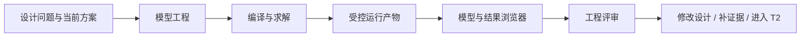
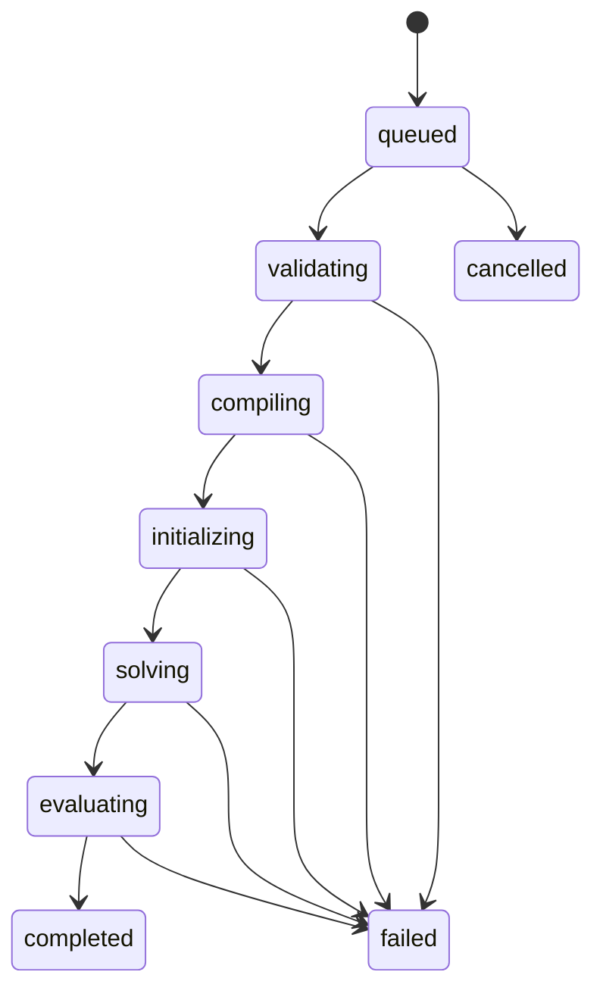
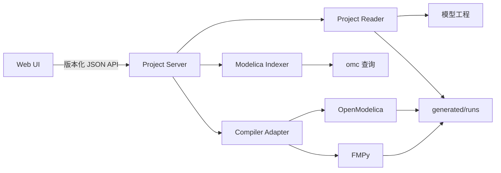

# T1：模型工程与浏览 MVP 详细设计

## 1. 本阶段要解决的问题

T0 已证明 OpenModelica、原生求解、FMI 2.0 导出和 FMPy 独立复跑可以工作。T1 不继续增加物理复杂度，而是把这条计算链变成可以由团队理解、复查、替换项目和重复运行的工程产品。

T1 解决三个问题：

1. **模型的数据放在哪里、谁负责。** 模型源码、参数来源、验证场景、接口、证据和判定必须属于模型工程，不能散落在脚本和浏览器代码中。
2. **一次计算怎样被复查。** 每次运行必须说明使用了哪个模型版本、参数、场景、编译器、求解设置和平台，并保留指标、判定、诊断及曲线引用。
3. **工程师怎样读懂结果。** 浏览器以设计问题为入口，将模型、参数证据、场景、曲线、判定和诊断放到同一上下文中，而不是只展示一组波形。

T1 在整个设计流程中的位置如下：



T1 的直接产物是一个规范化模型工程、一个只读浏览器和一套可重复验收样例。T1 不证明单关节模型已经符合真实机器人，也不代替 T2 的参数校准和台架对照。

## 2. 产品边界

### 2.1 T1 必须具备

- 打开符合契约的模型工程，读取工程元数据和目录。
- 展示 Modelica 包、模型、组件、端口与连接的层次，并可跳转源码位置。
- 展示参数值、单位、领域、来源证据、可信等级、适用修订和缺口。
- 展示场景对应的设计问题、输入、参数覆盖、求解设置、输出和判定阈值。
- 展示运行状态、运行清单、关键指标、曲线、判定和诊断。
- 允许从场景创建运行任务；任务只能通过后端的受控编译器适配器执行。
- 更换模型工程时，不修改或重新构建浏览器代码。
- 同一模型内容、场景和工具版本可以重建同一报告，并能识别内容漂移。

### 2.2 T1 不做

- 不做 Modelica 拖拽建模器、方程编辑器或通用 IDE。
- 不在浏览器中实现 Modelica 编译、DAE 展开或数值积分。
- 不做三维模型显示，也不驱动 CAD 模型运动。
- 不与 SysML 浏览器或三维模型浏览器合并为一个软件。
- 不做整机十轴、足地接触、批量训练、参数优化和实时硬件在环。
- 不允许浏览器把参数、场景、判定或评审结论仅保存在 LocalStorage、IndexedDB 或前端源码中。
- 不把 `generated/` 当作模型事实源，不允许人工编辑生成结果冒充重新计算。

## 3. 核心设计原则

1. **工程自描述。** 模型工程根目录有唯一入口 `model-project.json`，其余资源均由相对路径引用。
2. **事实与产物分离。** `modelica/`、`parameters/`、`scenarios/`、`interfaces/`、`evidence/` 是事实源；`generated/` 可删除并重建。
3. **浏览器无模型私有知识。** 前端不出现 `AIDCT0.SingleJointProbe`、`jointAngle` 等项目专有常量。
4. **判定结构化。** 通过、不通过和证据不足来自结构化规则与运行结果，不从报告文字反向推断。
5. **结果可追溯。** 每个结果都指向模型摘要、参数集、场景、工具版本、命令、平台和文件哈希。
6. **诊断保真。** UI 提供中文解释，同时保留编译器原始信息、阶段、退出码、文件和行号。
7. **读取安全。** 所有资源路径必须解析在模型工程根目录内；运行入口不接受工程文件提供的任意 shell 命令。
8. **接口优先。** 前后端只依赖版本化 JSON 契约，后续替换 OpenModelica 或前端框架不改变模型工程。

## 4. 角色与关键任务

| 角色 | 在 T1 中的主要任务 | 浏览器首先回答的问题 |
|---|---|---|
| 系统负责人 | 选择设计问题、查看结论和证据缺口 | 这个场景回答什么问题，当前能否做设计决定？ |
| 机械设计 | 检查惯量、齿比、阻尼、限位和载荷 | 参数来自哪里，适用于哪个 CAD 修订？ |
| 电气设计 | 检查电机、电源、电流和保护参数 | 峰值电流和电压是否超限，参数是否实测？ |
| 控制设计 | 检查控制律、周期、饱和和响应 | 求解设置和控制参数是什么，响应为何失败？ |
| 模型维护者 | 修改文本模型、参数和场景并重跑 | 哪个文件和哪一行导致检查或初始化失败？ |
| 评审人 | 复查运行清单、曲线、指标和结论 | 结果能否复现，是否存在版本或证据漂移？ |

## 5. 模型工程规范

### 5.1 目录结构

```text
model-project/
├─ model-project.json                 # 工程唯一入口
├─ modelica/
│  └─ <RootPackage>/
│     ├─ package.mo
│     ├─ Components/
│     ├─ Assemblies/
│     └─ Experiments/
├─ parameters/
│  ├─ parameter-sets.json             # 参数集清单
│  └─ <parameter-set-id>.json         # 参数台账和证据引用
├─ scenarios/
│  ├─ index.json
│  └─ <scenario-id>.scenario.json
├─ interfaces/
│  └─ <interface-id>.interface.json
├─ evidence/
│  ├─ index.json                      # 证据元数据及外部引用
│  └─ local/                          # 允许入库的小型证据
├─ baselines/
│  └─ <baseline-id>/
│     ├─ baseline.json
│     └─ metrics.json
├─ reports/
│  └─ decisions/                      # 人工评审和设计决定
└─ generated/
   ├─ index/                          # 可重建的模型结构索引
   └─ runs/
      └─ <run-id>/
         ├─ run-manifest.json
         ├─ summary.json
         ├─ diagnostics.json
         ├─ series.csv
         ├─ report.md
         └─ logs/
```

`results/` 不再作为与 `generated/` 平级的另一类运行产物。T1 迁移后，每次运行全部进入 `generated/runs/<run-id>/`，避免报告、曲线和日志互相失配。需要长期受控的少量结果提升到 `baselines/`，并记录其来源 `run-id`。

### 5.2 工程入口 `model-project.json`

```json
{
  "schemaVersion": "1.0",
  "projectId": "aidc.single-joint.probe",
  "name": "单关节计算链路探针",
  "revision": "T1-demo-r1",
  "description": "机械、电气、控制闭环的最小可执行模型",
  "modelica": {
    "rootPackageFile": "modelica/AIDCT0/package.mo",
    "rootPackage": "AIDCT0",
    "defaultExperiment": "AIDCT0.SingleJointProbe",
    "languageVersion": "3.6",
    "libraries": [
      { "name": "Modelica", "version": "4.1.0" }
    ]
  },
  "catalogs": {
    "parameterSets": "parameters/parameter-sets.json",
    "scenarios": "scenarios/index.json",
    "evidence": "evidence/index.json"
  },
  "defaultParameterSet": "probe-nominal",
  "defaultScenario": "position-step",
  "generatedRoot": "generated",
  "owners": [
    { "role": "model", "name": "待指定" },
    { "role": "review", "name": "待指定" }
  ]
}
```

约束：

- `projectId` 跨路径稳定，文件夹改名不改变身份。
- 工程内引用一律使用相对路径和 `/`，禁止盘符、UNC 路径和 `..` 越界。
- `schemaVersion` 决定读取规则；浏览器遇到不支持的主版本必须拒绝加载并明确诊断。
- 工具版本不写死在工程入口中，由运行清单记录实际版本。

### 5.3 参数集与参数证据

参数记录必须同时说明数值和可信度：

```json
{
  "schemaVersion": "1.0",
  "parameterSetId": "probe-nominal",
  "name": "探针名义参数",
  "appliesTo": {
    "modelRevision": "T1-demo-r1",
    "cadRevision": null,
    "electricalRevision": null
  },
  "parameters": [
    {
      "id": "motor.armatureResistance",
      "modelicaPath": "AIDCT0.SingleJointProbe.armatureResistance.R",
      "domain": "electrical",
      "name": "电枢电阻",
      "value": 2.0,
      "unit": "Ohm",
      "status": "assumed",
      "confidence": "D",
      "sourceEvidenceIds": ["EV-T0-ASSUMPTIONS"],
      "owner": "electrical",
      "validRange": { "min": 0.1, "max": 20.0 },
      "note": "仅用于链路探针，不代表目标舵机"
    }
  ]
}
```

参数状态固定为：

- `verified`：实测或受控资料已验证。
- `referenced`：来自可追溯手册、图纸或供应商资料。
- `estimated`：通过计算或相似对象估算。
- `assumed`：为推进模型临时假设。
- `missing`：场景需要但尚无可用值。

可信等级采用 A—D：A 为受控实测，B 为受控设计资料，C 为可解释估算，D 为假设。浏览器不能把 `missing` 当作数值零；含关键缺失参数的判定必须是“证据不足”。

### 5.4 证据索引

```json
{
  "schemaVersion": "1.0",
  "evidence": [
    {
      "id": "EV-T0-ASSUMPTIONS",
      "title": "T0 探针参数说明",
      "type": "engineering-note",
      "uri": "local/T0-参数说明.md",
      "revision": "1",
      "date": "2026-10-07",
      "checksum": "sha256:<digest>",
      "owner": "model",
      "reviewStatus": "draft"
    }
  ]
}
```

大文件可以使用受控外部 URI，但索引必须保留标题、修订、校验值和访问状态。浏览器只打开引用，不自动复制外部文件。

### 5.5 场景契约

```json
{
  "schemaVersion": "1.0",
  "scenarioId": "position-step",
  "name": "单关节位置阶跃",
  "designQuestion": "计算链路能否一致复现电流、转矩和位置响应？",
  "experimentClass": "AIDCT0.SingleJointProbe",
  "parameterSetId": "probe-nominal",
  "simulation": {
    "startTime": 0.0,
    "stopTime": 2.0,
    "outputInterval": 0.00025,
    "relativeTolerance": 1e-7,
    "solver": "dassl"
  },
  "inputs": [
    {
      "variable": "referenceAngle",
      "kind": "step",
      "startTime": 0.2,
      "initial": 0.0,
      "value": 0.5,
      "unit": "rad"
    }
  ],
  "parameterOverrides": [],
  "outputs": [
    { "variable": "jointAngle", "unit": "rad", "role": "response" },
    { "variable": "armatureCurrent", "unit": "A", "role": "load" },
    { "variable": "jointTorque", "unit": "N.m", "role": "load" }
  ],
  "checks": [
    {
      "id": "CS-ANGLE-NRMSE",
      "label": "CS 角度轨迹一致性",
      "source": "comparison.coSimulation.jointAngle.normalizedRmse",
      "operator": "lte",
      "limit": 0.01,
      "severity": "error"
    }
  ],
  "requiredEvidence": ["EV-T0-ASSUMPTIONS"]
}
```

判定规则使用固定算子 `lt/lte/gt/gte/between/abs-lte/relative-lte` 和已注册指标，不允许在 JSON 中嵌入 JavaScript、Python 或 shell 表达式。

### 5.6 接口契约

接口文件描述变量的业务语义，而不只是 FMU 名字：

- 稳定变量 ID、显示名和 Modelica/FMU 变量名。
- 输入/输出/参数方向。
- 数据类型、SI 单位、显示单位和正方向。
- 采样约定、离散/连续属性、允许范围。
- 是否允许在 SIL、训练或批处理环境覆盖。
- 缺失、NaN、越界和复位行为。

T1 只展示接口并校验结果变量是否齐全，不承担 T3 的训练接口交付。

## 6. 运行产物契约

### 6.1 运行 ID 与状态

运行 ID 使用 `YYYYMMDD-HHmmss-<scenario-id>-<sourceDigest8>`。状态机如下：



阶段名称属于稳定契约。前端可以翻译显示，但不能用日志文本猜测状态。

### 6.2 `run-manifest.json`

运行清单至少包含：

- `runId`、`projectId`、`scenarioId`、`parameterSetId`。
- 开始和结束时间、状态、失败阶段、进程退出码。
- 模型事实源摘要 `sourceDigest`，及组成摘要的文件清单和 SHA-256。
- Git 提交号、工作区是否有未提交修改；无 Git 时明确记录 `git.available=false`。
- 操作系统、架构、主机标识的非敏感摘要。
- OpenModelica、MSL、FMPy、Python 和适配器版本。
- 编译、求解、FMU 类型和通信步长。
- 标准输出、标准错误和原始日志相对路径。
- 产物清单、大小和校验值。

复现的定义是：`sourceDigest + scenario + parameterSet + toolchain + solverSettings` 相同。时间戳、临时目录和主机名不参与结果内容相等判断。

### 6.3 `summary.json`

```json
{
  "schemaVersion": "1.0",
  "runId": "20261007-150000-position-step-a1b2c3d4",
  "status": "completed",
  "conclusion": "pass",
  "metrics": [
    {
      "id": "finalJointAngle",
      "label": "末端角度",
      "value": 0.48887,
      "unit": "rad",
      "method": "last"
    }
  ],
  "checks": [
    {
      "id": "CS-ANGLE-NRMSE",
      "status": "pass",
      "actual": 0.000181,
      "operator": "lte",
      "limit": 0.01,
      "unit": "relative",
      "evidence": ["series.csv", "run-manifest.json"]
    }
  ]
}
```

`conclusion` 只能为 `pass`、`fail`、`insufficient-evidence`、`not-evaluated`。运行成功不等于业务通过；求解完成但关键参数缺失时应为 `insufficient-evidence`。

### 6.4 时序数据

T1 统一接受 UTF-8 CSV：首列 `time`，后续列使用接口契约中的稳定变量 ID。单位来自接口契约，不写进列名。曲线 API 负责按显示范围降采样，原始 CSV 不因界面缩放而改变。

后续数据量明显增大时可增加 Arrow/Parquet 适配器，但 T1 不同时维护多个主格式。

### 6.5 诊断

```json
{
  "schemaVersion": "1.0",
  "diagnostics": [
    {
      "stage": "compiling",
      "severity": "error",
      "code": "OMC-COMPILE-001",
      "title": "模型编译失败",
      "message": "中文可操作解释",
      "rawMessage": "OpenModelica original output",
      "source": {
        "path": "modelica/AIDCT0/package.mo",
        "line": 42,
        "column": 5
      },
      "exitCode": 1,
      "logRef": "logs/omc.log"
    }
  ]
}
```

## 7. 浏览器产品设计

### 7.1 软件形态

新建独立软件 `AIDC/modelica-browser/`。它与 `model3d-viewer/`、`sysml-browser/` 并列，名称、路由和构建产物均独立。三者可以以后从 AIDC 工作台跳转，但不共享业务状态。

```text
AIDC/modelica-browser/
├─ apps/web/                         # React + TypeScript 浏览器
├─ services/project-server/          # 本地只读工程服务与任务编排
├─ packages/contracts/               # JSON Schema + TypeScript 类型
├─ packages/project-reader/          # 路径、摘要、目录和结果读取
├─ packages/modelica-indexer/         # omc 查询结果转模型结构索引
├─ packages/omc-adapter/              # 受控编译/运行适配器
├─ scripts/verify-t1.ps1
└─ README.md
```

前端不能直接读取本地任意文件。启动器接收一个模型工程根目录，服务端只暴露该根目录下通过校验的资源。

### 7.2 页面信息架构

```text
项目栏
├─ 工程名称 / 修订 / sourceDigest
├─ 当前场景 / 参数集 / 运行
└─ 运行状态 / 总结论

左侧：模型与资源导航
├─ 模型层次
├─ 参数
├─ 场景
├─ 接口
├─ 证据
└─ 历史运行

主区：当前上下文
├─ 概览
├─ 参数与证据
├─ 场景定义
├─ 曲线与指标
├─ 判定
└─ 诊断与源码
```

默认首页不是模型树，而是“当前场景概览”：设计问题、模型修订、参数证据覆盖率、最新运行状态、结论和未解决问题。模型树用于定位原因，不代替业务入口。

### 7.3 关键交互

**打开工程**

1. 启动器选择或传入工程目录。
2. 服务端验证入口、Schema、路径边界和必需目录。
3. 加载成功后返回工程摘要；失败则停留在诊断页，不显示部分伪成功数据。

**选择模型组件**

1. 左侧树选择组件。
2. 主区显示组件类型、端口、连接、参数及源码位置。
3. 点击参数显示证据、可信等级和适用修订。
4. 点击源码位置由 Codex/系统默认编辑器打开对应文件；浏览器自身保持只读。

**选择场景和运行**

1. 场景页先显示设计问题、参数缺口、输入和判定规则。
2. 关键文件缺失或 Schema 错误时禁用运行并显示原因。
3. 用户运行后，前端订阅结构化状态，不轮询解析日志文字。
4. 完成后自动打开结论页；失败后自动打开诊断页。

**查看结果**

1. 顶部先显示 `通过/不通过/证据不足`。
2. 指标卡显示实际值、限值、余量、单位和计算方法。
3. 曲线默认只加载场景声明的输出，支持变量搜索、同单位叠加、游标和区间缩放。
4. 每条判定可反向定位相关曲线、参数和证据。

### 7.4 视觉语义

- 绿色仅表示业务判定通过。
- 红色表示业务失败或阻断性诊断。
- 橙色表示证据不足、假设参数、接近限值或警告。
- 灰色表示尚未运行或不适用。
- 编译成功、运行成功使用状态图标和文字，不借用绿色“通过”结论。
- 所有数值同时显示单位；相对误差明确显示为百分比或无量纲。

## 8. 服务端与 API

### 8.1 进程边界



Project Server 不持有模型数据库；重新启动后从工程文件恢复全部业务状态。内存只保存任务进度、CSV 索引和短期缓存。

### 8.2 T1 API

| 方法 | 路径 | 作用 |
|---|---|---|
| GET | `/api/v1/project` | 工程摘要、修订、摘要和完整性状态 |
| GET | `/api/v1/model/tree` | 模型、组件、端口和连接索引 |
| GET | `/api/v1/source?path=&line=` | 读取工程内允许的文本源码片段 |
| GET | `/api/v1/parameters?set=&component=` | 参数、证据与缺口 |
| GET | `/api/v1/scenarios` | 场景列表 |
| GET | `/api/v1/scenarios/{id}` | 场景完整契约和预检查 |
| GET | `/api/v1/interfaces` | 接口契约 |
| GET | `/api/v1/evidence` | 证据索引与可访问状态 |
| GET | `/api/v1/runs` | 历史运行列表 |
| GET | `/api/v1/runs/{id}` | 清单、摘要和诊断 |
| GET | `/api/v1/runs/{id}/series` | 变量、时间范围与降采样后的时序 |
| POST | `/api/v1/runs` | 对已声明场景创建受控运行任务 |
| POST | `/api/v1/runs/{id}/cancel` | 取消尚未完成的任务 |
| GET | `/api/v1/tasks/{id}/events` | SSE 状态和诊断事件 |

`POST /runs` 只接收 `scenarioId`、`parameterSetId` 和允许的参数覆盖。服务端根据适配器配置生成命令，不接受客户端传入可执行文件、命令行或工作目录。

### 8.3 模型结构索引

T1 不在浏览器中自行解释完整 Modelica 语法。索引器调用 `omc` 的类、组件和连接查询生成 `generated/index/model-structure.json`：

- `getClassNames` 获取包和模型层次。
- `getComponents` 获取组件、类型、可见性和源位置。
- `getComponentAnnotations/getDiagramAnnotation` 获取组件 `Placement` 和图幅坐标系。
- 对每个组件类型调用 `getIconAnnotation`，并读取直接及继承连接器的 `Placement`；标准库必须在索引阶段由工程依赖声明加载。
- `getConnectionCount/getNthConnection` 获取连接。
- 从 Modelica 连接注解读取 `Line(points=...)` 路径。
- 编译器无法提供的信息标为 `unavailable`，不猜测。

索引记录源文件摘要。源码变化后摘要失配，服务端自动重建；索引失败不会修改源码。

需要在组件连接视图显示的模型必须在 `.mo` 事实源中定义图形语义：每个图形组件声明 `Placement(transformation(...))`，模型声明 `Diagram(coordinateSystem(extent=...))`，每条需要保持设计走线的连接声明 `Line(points=...)`。无 `Placement` 的参数、输出和内部辅助声明仍保留在结构索引中，但不作为图形节点；浏览器不会为缺失位置的声明自动生成工程布局。

组件外观由其类型的 `Icon` annotation 决定。索引器把标准库或工程库中的 `Line`、`Polygon`、`Rectangle`、`Ellipse`、`Text` 图元及连接器位置转换为稳定结构，浏览器按实例 `Placement` 进行平移、缩放和旋转。只有类型确实没有可用 `Icon` 时才显示明确的通用回退框，禁止按类型名称在前端手工仿制标准库图标。

## 9. 软件与模型的责任划分

| 内容 | 模型工程负责 | 浏览器负责 |
|---|---|---|
| 模型层次与连接 | `.mo` 源码 | 索引并展示 |
| 组件位置、图幅和连接路径 | Modelica `Placement`、`Diagram`、`Line` 注解 | 按索引坐标绘制，不改写布局 |
| 参数值和单位 | 参数集和模型默认值 | 校验、筛选、关联证据 |
| 参数来源与可信度 | 参数台账、证据索引 | 显示缺口和风险 |
| 场景及阈值 | 场景契约 | 预检查、提交任务、展示判定 |
| 运行工具选择 | 工程兼容性声明和服务器配置 | 选择已安装适配器，不执行任意命令 |
| 曲线与指标 | 运行产物 | 查询、降采样和可视化 |
| 业务结论 | 结构化检查 + 人工评审 | 展示，不私自改写 |
| 页面布局、主题和临时选择 | 不负责 | 可保存在会话内；不属于工程事实 |

浏览器允许保存纯界面偏好，如侧栏宽度和主题；不得把参数修改、场景修改、阈值、人工结论和证据状态保存在浏览器私有存储中。

## 10. 可重复性与内容摘要

事实源摘要按以下规则计算：

1. 从工程入口解析事实源文件集合。
2. 文本统一按 UTF-8 读取，换行规范化为 LF。
3. 路径转为相对工程根目录的 `/` 形式并排序。
4. 对每个文件计算 SHA-256，再对 `relativePath + digest` 有序列表计算总摘要。
5. `generated/`、编辑器临时文件、日志和时间戳不参与摘要。

报告必须打印 `projectId`、工程修订、`sourceDigest`、`scenarioId`、`parameterSetId`、工具链和求解设置。复跑后若指标在容差内但二进制哈希不同，仍可判断为数值可复现；两者必须分别报告。

## 11. 第二工程与通用性验收

除 T0 单关节工程外，T1 必须增加一个独立的“直流电机开环”或“RLC 电路”样例工程。它应具有不同的根包、参数、场景、变量和判定。浏览器使用同一构建产物完成以下操作：

1. 启动时指定工程 A，完整显示模型、参数、场景、运行和结果。
2. 停止服务并指定工程 B，无需改前端源码、Schema 或条件分支。
3. 将工程 B 复制并改名到另一目录，仍能加载和运行。
4. 故意制造一个 Schema 错误，浏览器显示文件、JSON 路径和修复提示。
5. 故意制造一个 Modelica 编译错误，浏览器显示 `compiling` 阶段、退出码、源码行和原始日志。
6. 删除 `generated/` 后一条命令重建运行和报告。
7. 检查浏览器存储中不存在模型参数、场景、结果或评审结论。

## 12. 验收标准

### 12.1 模型工程

- 根入口、参数、场景、接口、证据和运行产物均通过 JSON Schema 校验。
- T0 工程迁移到第 5.1 节结构，事实源和生成物完全分开。
- 所有关键参数均有状态、可信等级和证据引用；缺失项不会默认为零。
- 每次运行生成完整清单、摘要、诊断、曲线、日志和报告。
- 删除 `generated/` 后可由一条命令重建。

### 12.2 浏览器

- 显示模型、参数、场景、接口、证据、曲线、判定与诊断。
- 模型组件、参数、曲线、判定和源码之间可以互相定位。
- 10 万点、20 条曲线的结果通过服务端降采样后，常用交互保持流畅。
- 项目专有名称不出现在浏览器源代码和构建配置中。
- 工程切换不需要重新构建浏览器。
- 页面刷新或服务重启后，业务状态由工程恢复。

### 12.3 可重复性

- 同一事实源摘要、参数、场景和工具链复跑，全部业务判定一致。
- 报告包含完整运行清单引用和事实源摘要。
- 编译、初始化、求解和判定错误均含阶段、退出码、日志和可用源码位置。
- Windows 本地环境可一条命令启动工程服务和浏览器，并可一条命令执行验收。

## 13. 实施拆分

### T1.1 契约与工程迁移

- 建立 JSON Schema、TypeScript 类型和契约测试。
- 将 T0 工程迁移为标准模型工程。
- 增加参数证据、场景、接口、证据索引和运行清单生成。
- 增加第二样例工程。

**完成标志：** 两个工程均通过同一验证命令，删除生成物后可重建。

**执行结果（2026-10-07）：已通过。** 已建立 JSON Schema Draft 2020-12 契约和 TypeScript 类型；将单关节闭环探针迁移为标准模型工程；新增具有不同根包、参数、变量和判定的直流电机开环工程。两个工程由同一个 `modelica-browser/tools/project_tool.py` 完成契约校验、事实源摘要、OpenModelica 运行、指标计算、结构化判定、运行清单、诊断和报告生成。验收脚本仅复制事实源到无 `generated/` 的新目录后重建两个工程，重建摘要一致且 Markdown 报告逐字节一致。统一入口为 `modelica-browser/scripts/verify-t1-1.ps1`，证据见 `modelica-browser/results/T1.1-契约与工程迁移验收报告.md`。

### T1.2 Project Server 与编译适配

- 实现受限路径读取、工程摘要、内容摘要和资源 API。
- 实现 OpenModelica/FMPy 适配器和统一阶段状态。
- 实现模型结构索引和 SSE 任务事件。

**完成标志：** 不启动前端也可通过 API 加载两个工程、运行场景并读取结果。

**执行结果（2026-10-07）：已通过。** 已实现本地 Project Server、受限工程读取、事实源摘要、运行历史与时序 API、omc Scripting API 模型结构索引、OpenModelica 编译/原生求解适配、FMPy 能力与 FMI 2.0 产物检查、异步任务和 SSE 阶段事件。相同服务构建分别打开单关节闭环与直流电机开环工程，完成 `queued → validating → compiling → initializing → solving → evaluating → completed` 全阶段运行，业务判定均通过；曲线变量筛选和最大点数降采样通过 HTTP 实测，源码接口拒绝 `..` 越界。统一验收入口为 `npm run verify:modelica:t1-2`，证据见 `modelica-browser/results/T1.2-Project-Server与编译适配验收报告.md`。

### T1.3 浏览器 MVP

- 实现工程概览、模型、参数、场景、结果、判定、诊断页面。
- 实现变量搜索、曲线缩放、指标与证据联动。
- 实现错误状态和空状态，不用虚构数据填充。

**完成标志：** 业务用户可以从设计问题追溯到结论、曲线、参数和证据。

**执行结果（2026-10-07）：已通过。** 已建立独立的 `modelica-browser/apps/web` React + TypeScript 浏览器，并由 Project Server 同源托管。最终界面采用三栏模型工作台：左侧模型树，中间组件连接图与 Modelica 文本，右侧当前选择的属性参数和仿真结果。组件选择按 Modelica 路径显示对应参数；仿真结果按运行管理变量，变量节点可打开独立曲线弹窗。生产包在两个不同模型工程上通过相同构建验收，包内不含任一工程名称或场景名称；浏览器实测完成组件参数映射、文本视图和变量曲线，全程无控制台错误。统一入口为 `npm run verify:modelica:t1-3`，证据见 `modelica-browser/results/T1.3-浏览器MVP验收报告.md`。T1 整体仍需完成 T1.4 通用性与复现验收。

### T1.4 通用性与复现验收

- 自动执行两个工程切换、重建、故障注入和存储检查。
- 生成 T1 验收报告和屏幕证据。
- 将通过的运行提升为受控 baseline。

**完成标志：** 满足第 12 节全部条目，主规划中的 T1 才可标记完成。

**执行结果（2026-10-08）：已通过，T1 完成。** 同一生产构建自动切换两个不同根包的工程及任意改名副本，完成干净重建、真实 OMC 双次复跑和逐点数值对比，两个工程的最大绝对误差与最大相对误差均为 0。验收覆盖 Schema 与 Modelica 编译故障定位、服务重启状态恢复、浏览器私有存储检查，以及 20 条曲线各 100,000 点的降采样压力测试；通过运行已提升为各工程 `results/baseline.json` 引用的受控 baseline。当前 v2 工程采用 `model-project.json + modelica/ + results/` 最小结构，模型参数与仿真设置写入 Modelica 文件，运行产物统一保存在 `results/`。统一入口为 `npm run verify:modelica:t1-4`，全 T1 入口为 `npm run verify:modelica:t1`；证据见 `modelica-browser/results/T1.4-通用性与复现验收报告.md`、`modelica-browser/results/T1.4-通用性与复现验收屏幕证据.jpg` 和 `modelica-browser/results/T1-模型工程与浏览MVP总体验收报告.md`。

## 14. 建议的工程路径与命令

建议软件路径：

```text
AIDC/modelica-browser/
```

建议模型工程路径：

```text
AIDC/samples/modelica-t0-single-joint/
AIDC/samples/modelica-t1-dc-motor/
```

建议最终命令形态：

```powershell
# 校验并重建一个模型工程
.\AIDC\modelica-browser\scripts\run-project.ps1 `
  -Project .\AIDC\samples\modelica-t0-single-joint `
  -Scenario position-step

# 启动浏览器并打开指定模型工程
npm run dev:modelica -- `
  --project .\AIDC\samples\modelica-t0-single-joint

# 执行 T1 双工程与故障诊断验收
npm run verify:modelica:t1
```

命令中的工程路径属于启动参数，不写入浏览器构建产物。正式实现时保留 Windows PowerShell 入口，并让底层 Node/Python 命令可在 Linux CI 复用。

## 15. T1 之后如何进入 T2

T1 完成后，T2 不再修改工程组织和浏览器私有数据，而是在同一契约下替换探针参数和场景：引入真实舵机、电池、传动、摩擦和控制参数；补充台架证据；运行第 8 节场景；量化预测误差；形成真实设计决定。T1 的价值是使 T2 把精力放在模型可信度和业务结论上，而不是继续寻找文件、解释脚本和手工拼报告。
