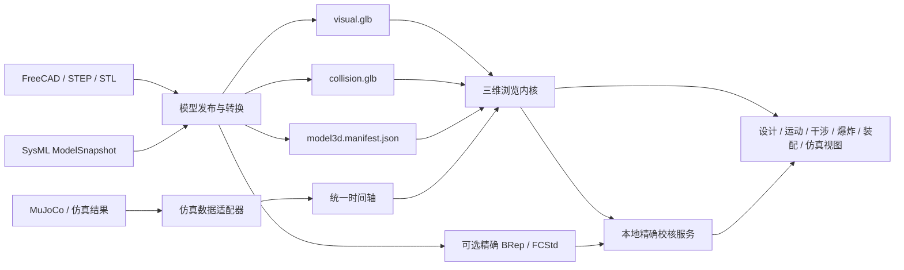
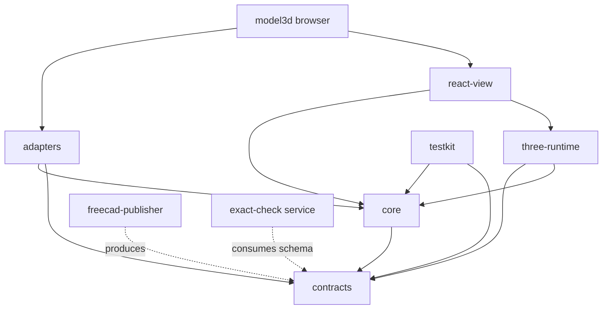

# 机器人三维模型浏览器实施规划

版本：V0.1  
日期：2026-09-19  
状态：待实施

## 1. 产品定位

建设面向机器人设计过程的三维模型浏览器，在一个浏览端中贯通总体设计、机械装配和仿真结果查看。它读取 CAD 发布出的浏览模型和工程元数据，不替代 FreeCAD 的参数化建模、工程图和正式制造校核。

浏览器必须回答以下问题：

- 当前机器人由哪些部件组成，部件来源、版本和属性是什么；
- 选中的部件在哪里，与 SysML 架构、CAD 对象和仿真刚体如何对应；
- 各舵机在零位、限位和给定角度下如何带动机械结构运动；
- 当前姿态有哪些潜在干涉，哪些结果已经由精确几何核验；
- 装配如何展开、按什么顺序安装、零件沿什么路径进入；
- 仿真或实机记录中的关节、基座、接触和状态数据如何驱动三维模型回放。

定位为“可审查、可追溯的工程浏览器”。第一阶段不提供零件草图、拉伸、布尔、材料强度计算和制造放行功能。

## 2. 使用场景

### 2.1 设计浏览

- 打开机器人三维模型包、GLB/glTF，或提交 FCStd/STEP 进入本地转换流程；
- 旋转、平移、缩放、框选、标准视角、正交/透视切换和一键适配；
- 按装配树选择、隐藏、隔离、半透明、线框和着色显示；
- 查看部件 ID、版本、几何来源、质量、材料、父装配和 SysML 关联；
- 测量点距、边长、包围盒和夹角，建立剖切面和保存视点；
- 从三维部件定位到 SysML 架构节点，并从模型树反向高亮三维部件。

### 2.2 运动与姿态浏览

- 显示关节轴、零位、方向和上下限；
- 使用滑块、数值输入或虚拟舵机控制单个及多个关节；
- 提供复位、预设姿态、左右镜像、关键帧和姿态对比；
- 超过软限位时警告，超过硬限位时拒绝执行；
- 显示运动轨迹、扫掠范围和上一姿态的半透明残影。

### 2.3 干涉查看

- 姿态变化时运行网格级快速干涉预警；
- 在模型树和视口中标红碰撞部件，显示接触区域、最小距离和发生姿态；
- 支持排除同一刚体、允许接触对、紧固件与其孔等已知关系；
- 对选中的可疑部件提交 FreeCAD/OpenCascade 精确干涉校核；
- 报告必须区分“网格预警”“精确确认”“允许接触”和“未核验”。

### 2.4 爆炸图与装配模拟

- 按整机、模块或选中装配层级生成爆炸图；
- 支持自动爆炸方向、人工调整、距离滑块、动画和复位；
- 显示部件序号、名称、数量、紧固件及 BOM 标注；
- 按装配步骤播放进入路径、旋转、固定、工具方向和中间状态；
- 使用残影、轨迹和扫掠体说明装入与拆出过程；
- 区分“演示路径”和“已完成间隙/工具校核的工程路径”。

### 2.5 仿真数据浏览

- 读取时间序列文件并映射到基座位姿、关节角、关节速度、力矩、接触和事件；
- 提供播放、暂停、单步、循环、倍速、时间跳转和关键事件定位；
- 同步显示曲线、当前数值、关节限位、接触点、力矢量和轨迹；
- 支持 MuJoCo `qpos` 记录、规范化 JSON/CSV，以及后续 WebSocket 实时流；
- 仿真通道按稳定 ID 映射，不能依靠数组位置或显示名称猜测关节。

## 3. 总体技术路线



核心采用现有 React 应用承载 UI，Three.js 作为独立三维内核。动画循环、场景对象和 GPU 资源不放入 React 状态逐帧更新；React 只管理命令、选择、面板和持久化状态。首版使用 WebGL2，暂不以 WebGPU 作为上线前提。

三维能力作为 `sysml-browser` 的 `model3d` 插件接入，复用现有模型树、属性面板、前进后退和 View 注册机制。三维内核保持独立包边界，后续可以嵌入其他页面。

### 3.1 目标工程目录

现有 `sysml-browser`、`sysml-parser-runtime`、FreeCAD Runtime 和样例目录暂不迁移。新增 `model3d-viewer` 工作区，使三维内核可以独立开发、测试和发布，同时由现有浏览器消费：

```text
AIDC/
├── package.json                         # V0 新增：前端 npm workspaces 总入口
├── package-lock.json                    # V0 统一生成的前端依赖锁文件
├── sysml-browser/                       # 现有产品应用
│   ├── src/
│   │   └── plugins/
│   │       ├── model3d.view.tsx         # 三维 View 注册与应用上下文桥接
│   │       └── model3d.integration.ts   # cadRef、选择、属性和历史适配
│   └── public/
│       └── model3d/                     # 仅放随应用发布的小型内置资源
├── sysml-parser-runtime/                # 现有 C++ Parser Runtime，不引入三维依赖
├── model3d-viewer/                      # 新增：三维能力工作区
│   ├── README.md                        # 开发、测试、发布和目录边界
│   ├── THIRD_PARTY_NOTICES.md           # Three.js、转换及碰撞依赖来源
│   ├── package.json                     # 三维包脚本与依赖版本
│   ├── tsconfig.base.json
│   ├── vite.config.ts                   # 独立浏览器与测试共享配置
│   ├── packages/
│   │   ├── contracts/                   # 纯类型、Schema、版本和错误码
│   │   │   ├── src/
│   │   │   │   ├── model-package.ts
│   │   │   │   ├── kinematics.ts
│   │   │   │   ├── collision.ts
│   │   │   │   ├── assembly.ts
│   │   │   │   └── simulation.ts
│   │   │   └── schemas/                 # 发布后的 JSON Schema
│   │   ├── core/                        # 与 UI/Three.js 无关的领域状态和命令
│   │   │   └── src/
│   │   │       ├── model-session/
│   │   │       ├── scene-index/
│   │   │       ├── navigation/
│   │   │       └── validation/
│   │   ├── three-runtime/               # Three.js 场景与高频循环
│   │   │   └── src/
│   │   │       ├── loader/
│   │   │       ├── viewport/
│   │   │       ├── selection/
│   │   │       ├── measurement/
│   │   │       ├── kinematics/
│   │   │       ├── collision/
│   │   │       ├── explode/
│   │   │       ├── assembly/
│   │   │       └── timeline/
│   │   ├── adapters/                    # 外部格式到统一契约
│   │   │   └── src/
│   │   │       ├── sysml/
│   │   │       ├── mujoco/
│   │   │       ├── csv/
│   │   │       ├── json/
│   │   │       └── websocket/
│   │   ├── react-view/                  # 工程浏览 UI 与 Three.js 内核桥接
│   │   │   └── src/
│   │   │       ├── Model3DView.tsx
│   │   │       ├── panels/
│   │   │       ├── toolbar/
│   │   │       └── state/
│   │   └── testkit/                     # 模型构造器、冻结姿态和断言工具
│   ├── apps/
│   │   └── browser/                     # 独立三维模型浏览器产品
│   │       ├── src/
│   │       └── public/fixtures/
│   ├── tools/
│   │   ├── freecad-publisher/           # FCStd/STEP → 网格、manifest、BRep 索引
│   │   │   ├── src/
│   │   │   ├── tests/
│   │   │   └── run-freecad-publisher.ps1
│   │   └── asset-pipeline/              # GLB 合并、优化、压缩与哈希
│   │       ├── src/
│   │       └── tests/
│   ├── services/
│   │   └── exact-check/                 # FreeCAD/OpenCascade 精确校核服务
│   │       ├── src/
│   │       ├── tests/
│   │       └── run-exact-check.ps1
│   ├── tests/
│   │   ├── contracts/
│   │   ├── kinematics/
│   │   ├── collision/
│   │   ├── browser-integration/
│   │   ├── end-to-end/
│   │   └── performance/
│   ├── fixtures/                        # 小型、手工可核验的测试模型
│   │   ├── one-joint/
│   │   ├── collision-pairs/
│   │   └── assembly-path/
│   ├── docs/                            # 契约说明、开发和发布文档
│   ├── scripts/                         # 全工作区验证和发布入口
│   ├── results/                         # 本地测试报告，不作为模型事实源
│   └── dist/                            # 构建产物
└── samples/
    └── jingang-10axis-system-design/
        ├── architecture.sysml           # 现有 SysML 唯一源
        ├── layout/                      # 现有 FreeCAD/CAD 唯一源
        └── model3d/                     # 金刚三维浏览样例配置
            ├── publish.config.json      # 指向 layout 中的源文件
            ├── assembly.sequence.json   # 装配步骤源
            ├── simulation/              # 小型回放输入与通道映射
            ├── expected/                # 冻结姿态、包围盒和碰撞预期
            ├── generated/               # 本地生成，不手工编辑
            │   ├── model3d.manifest.json
            │   ├── visual.glb
            │   ├── collision.glb
            │   └── exact/
            └── release/                 # 经验证后形成的可发布模型包与校验和
```

根 `AIDC/package.json` 只管理 JavaScript/TypeScript 工作区：

```json
{
  "private": true,
  "workspaces": [
    "sysml-browser",
    "model3d-viewer/apps/*",
    "model3d-viewer/packages/*",
    "model3d-viewer/tools/asset-pipeline"
  ]
}
```

Python/FreeCAD 工具和精确校核服务不伪装成 npm 包，由各自脚本启动；根验证脚本统一调用 npm、Python 和 FreeCAD 检查。

V0 建立根 workspace 后，以 `AIDC/package-lock.json` 作为前端唯一锁文件；现有 `sysml-browser/package-lock.json` 在依赖一致性和构建门禁通过后移除。C++ Runtime 继续使用 CMake，FreeCAD Python 使用已冻结的 FreeCAD Runtime，不将二者塞入 npm 生命周期。

根脚本建议固定为：

| 命令 | 作用 |
| --- | --- |
| `npm run dev:browser` | 在 4173 端口启动独立 SysML 浏览器 |
| `npm run dev:model3d` | 在 4174 端口启动独立三维模型浏览器 |
| `npm run test:model3d` | 运行契约、内核和 React 单元测试 |
| `npm run test:model3d:e2e` | 运行浏览器集成与端到端测试 |
| `npm run publish:model3d:jingang` | 调用 FreeCAD 发布器生成金刚模型包 |
| `npm run verify:model3d` | Schema、单测、构建、样例哈希和集成门禁 |

根脚本只做编排，具体逻辑保留在各包或 `model3d-viewer/scripts/` 中，避免把长命令堆入 `package.json`。

### 3.2 包依赖方向



依赖规则：

- `contracts` 不依赖 React、Three.js、浏览器 DOM 或 FreeCAD；
- `core` 不导入 React 和 Three.js，保证契约、命令和状态可独立单元测试；
- `three-runtime` 不读取 SysML，也不直接调用应用导航；
- `react-view` 通过明确的 props/commands 使用内核，不访问 FreeCAD 文件；
- `sysml-browser` 与 `model3d browser` 分别构建和运行，只通过稳定工程 ID、模型包 URI 或显式跳转参数协作；
- 发布工具只能生成契约规定的数据，不能生成浏览器专用的隐藏状态；
- 精确校核服务返回版本化报告，不直接操纵前端场景。

禁止 `three-runtime → react-view`、`packages → sysml-browser` 和前端直接导入 FreeCAD Python 模块等反向依赖。

### 3.3 源文件、生成物与发布物

| 类别 | 目录 | 是否手工编辑 | 是否进入版本控制 |
| --- | --- | --- | --- |
| CAD/SysML 事实源 | `samples/.../layout`、`architecture.sysml` | 是 | 是 |
| 发布与装配配置 | `samples/.../model3d/*.json` | 是 | 是 |
| 小型测试夹具 | `model3d-viewer/fixtures` | 是 | 是 |
| 本地生成模型 | `samples/.../model3d/generated` | 否 | 默认否 |
| 经审核发布包 | `samples/.../model3d/release` 或制品库 | 否 | 清单和校验和必须保存；二进制按大小策略决定 |
| 构建与测试输出 | `dist`、`results`、`coverage`、`.cache` | 否 | 否 |

`generated` 每次由 `publish.config.json` 重建，禁止人工修补 GLB 或 manifest。`release` 必须包含源模型版本、发布工具版本、schema 版本、资源哈希和验证报告。

### 3.4 各阶段的目录落点

| 阶段 | 主要新增目录或文件 |
| --- | --- |
| V0 | `contracts`、`freecad-publisher`、独立 `browser`、金刚 `model3d/`、根 workspace |
| V1 | `three-runtime/loader|viewport|selection|measurement`、`react-view`、浏览器插件 |
| V2 | `three-runtime/kinematics`、`tests/kinematics`、冻结姿态夹具 |
| V3 | `three-runtime/collision`、`services/exact-check`、碰撞夹具与报告 schema |
| V4 | `three-runtime/explode|assembly`、`assembly.sequence.json`、装配路径夹具 |
| V5 | `three-runtime/timeline`、`adapters/csv|json|mujoco`、样例回放数据 |
| V6 | `adapters/websocket`、实时协议和录制测试 |
| V7 | `asset-pipeline`、性能测试、缓存与发布脚本 |

目录在 V0 一次建立基本骨架，后续阶段只填充对应模块；不要提前生成空的业务包和重复 README。

## 4. Microduck 参考结论

### 4.1 可以复用的模式

Microduck 已验证以下实现方式可行：

- 使用合并后的 GLB 承载显示网格，避免逐个 STL 请求；
- 使用独立 `kinematics.json` 保存刚体树、局部位姿、关节轴和限位；
- 为每个刚体建立 Three.js `Group`，关节值只修改子刚体局部旋转；
- 保存初始四元数，使用“初始四元数 × 轴角旋转”计算姿态；
- 用 `OrbitControls` 完成便捷浏览，用射线拾取模型；
- 将 MJCF 的 +Z 向上坐标在根节点统一转换为 Three.js 显示坐标；
- MuJoCo WASM 计算物理状态，Three.js 只消费位姿并绘制；
- 几何和材质共享，复制姿态残影时不重复占用完整网格内存。

参考实现：

- `Jingang/archive/microduck/microduck-simulator/app/src/game/duck.js`
- `Jingang/archive/microduck/microduck-simulator/app/src/game/game.js`
- `Jingang/archive/microduck/microduck-simulator/app/public/robot/mjlab/kinematics.json`
- `Jingang/archive/microduck/microduck-simulator/app/public/robot/mjlab/microduck.glb`

### 4.2 需要改造成通用能力的部分

- 不保留固定机器人、固定 14 关节和固定 `qpos` 下标；全部按 manifest 中的 ID 映射；
- 不把 MJCF 当作唯一模型来源；FreeCAD、STEP、SysML 和仿真模型都通过发布管线汇合；
- 不把显示网格直接视为精确干涉依据；另建碰撞代理和 BRep 精确校核；
- 不使用硬编码的网格名称、关节名称、颜色和根坐标转换；
- 不把游戏场景、策略推理、视觉特效和机器人工程审查耦合到同一模块；
- 不依赖外部 CDN 才能打开本地工程模型。

## 5. 三维模型包契约

浏览器的主输入不是裸 FCStd，而是一个可版本化的三维模型包。开发态可以使用目录，交付态可以封装为 `.robot3d.zip`，包内结构保持一致：

```text
robot-model/
├── model3d.manifest.json       # 身份、层级、关节、来源和资源索引
├── visual.glb                  # 合并后的显示网格与材料
├── collision.glb               # 可选简化碰撞网格
├── assembly.sequence.json      # 可选装配步骤与路径
├── simulation.schema.json      # 可选仿真通道约定
├── exact/                      # 可选 FCStd/STEP/BRep 精确校核资源
└── thumbnails/                 # 可选预览图
```

### 5.1 坐标与单位

- 工程数据统一使用米、弧度、秒；源模型的原始单位写入 manifest；
- 机器人坐标统一为 `+X` 向前、`+Y` 向左、`+Z` 向上；
- Three.js 坐标转换只在场景根节点完成，业务数据不反复换轴；
- 四元数顺序固定为 `[x, y, z, w]`，manifest 明确声明；
- 每个导入器必须提供坐标与单位测试样例。

### 5.2 身份与层级

每个可选择部件至少包含：

- `componentId`：与 SysML、CAD、BOM 和验证记录一致；
- `bodyId`：运动学刚体 ID；
- `parentBodyId`：父刚体；
- `nodeName`：GLB 节点名；
- `partNumber`、`revision`、`geometryStatus` 和 `sourceHash`；
- `selectable`、`visible`、`collisionGroup` 和 `allowedContacts`。

一个刚体可包含多个部件，一个部件不得同时挂到两个运动刚体。显示名称允许变化，稳定 ID 不允许随导出顺序变化。

### 5.3 关节契约

每个关节至少包含：

```json
{
  "jointId": "ACT-L-KNEE-PITCH",
  "type": "revolute",
  "parentBodyId": "leftUpperLeg",
  "childBodyId": "leftLowerLeg",
  "origin": { "xyz": [0, 0, 0], "quat": [0, 0, 0, 1] },
  "axis": [0, 1, 0],
  "zeroOffset": 0,
  "limit": { "lower": -1.2, "upper": 1.2, "velocity": 4.0 },
  "drive": { "channel": "leftKnee.position", "sign": 1, "scale": 1 }
}
```

首版支持 `fixed`、`revolute` 和 `prismatic`。关节轴位于关节局部坐标系；姿态计算必须覆盖非单位初始四元数、正负方向、零偏和层级累计变换。

### 5.4 装配与爆炸契约

每个可装配部件可定义：

- 爆炸方向、距离、分组和顺序；
- 装入起点、路径关键帧和最终装配位姿；
- 紧固件、工具方向、允许间隙和前置步骤；
- 路径来源：`AUTO_SUGGESTED`、`MANUAL_DEMO` 或 `ENGINEERING_VERIFIED`。

自动爆炸只生成展示建议，不能自动升级为工程验证路径。

### 5.5 仿真数据契约

统一时间序列包含 `time`、可选基座位姿、按 `jointId` 命名的关节通道、接触、力和事件。适配器负责把 MuJoCo `qpos`、CSV 列名或 WebSocket 消息映射为统一帧：

```json
{
  "time": 1.25,
  "base": { "position": [0, 0, 0.22], "quaternion": [0, 0, 0, 1] },
  "joints": { "ACT-L-KNEE-PITCH": 0.42 },
  "contacts": [{ "a": "foot-left", "b": "ground", "point": [0.1, 0.04, 0] }],
  "scalars": { "ACT-L-KNEE-PITCH.torque": 0.31 }
}
```

数据缺失时保持上一值或回到默认值的策略由通道 schema 声明，不能在播放器中隐式猜测。

## 6. 内部模块划分

| 模块 | 职责 |
| --- | --- |
| `model-loader` | GLB/glTF、模型包、转换任务和资源生命周期 |
| `scene-index` | `componentId`、刚体、网格、SysML 节点的双向索引 |
| `viewport` | 相机、灯光、地面、拾取、选择轮廓和截图 |
| `visibility` | 隐藏、隔离、透明、线框、剖切和显示方案 |
| `measurement` | 距离、角度、包围盒和标注 |
| `kinematics` | 刚体树、关节限位、手动驱动、姿态和关键帧 |
| `collision-preview` | BVH、碰撞组、允许接触和实时网格预警 |
| `exact-check-client` | 将当前姿态和部件对提交给 FreeCAD/OpenCascade |
| `explode` | 层级爆炸、方向编辑、动画和 BOM 标注 |
| `assembly-player` | 装配步骤、安装路径、工具/间隙状态和报告 |
| `timeline` | 文件回放、插值、倍速、单步和事件索引 |
| `simulation-adapters` | MuJoCo、JSON、CSV 和后续实时流适配 |
| `model3d-view-plugin` | 与 SysML 浏览器、历史导航、属性面板集成 |

### 6.1 浏览与历史语义

- 单击三维部件只改变选择和属性面板，不进入子装配，也不新增历史记录；
- 双击部件执行聚焦；只有部件明确关联可浏览子装配时，才允许双击进入；
- 打开另一模型或进入子装配时写入稳定位置 `{modelId, contextBodyId, viewId}`；
- 相机旋转、缩放、透明度和关节拖动不连续写浏览历史；离开条目时保存一份视图状态快照；
- 后退/前进恢复模型、上下文、选中件、相机、显示方案和当前姿态；
- 大型姿态或仿真数组存放在按历史条目键控的状态仓库中，导航条目只保存稳定键，避免历史对象过大。

## 7. 干涉检测分层

### 7.1 浏览器实时预警

使用包围盒宽阶段加 BVH 三角网格窄阶段，随关节姿态更新受影响刚体。结果适合交互提示和筛选可疑部件，目标是在拖动舵机时保持可用帧率。

碰撞规则必须支持：

- 同一刚体内部默认忽略；
- 相邻关节允许接触对；
- 按碰撞组启用或禁用；
- 静态环境、机器人自碰撞和装配路径碰撞分别显示；
- 对每个结果保存模型版本、姿态、算法和精度等级。

### 7.2 精确工程校核

精确校核在本地服务中打开同版本 FCStd/STEP/BRep，应用当前刚体世界变换后执行 OpenCascade 相交、距离或公共体积计算。浏览器只展示结果，不自行把 GLB 网格结果标成精确结论。

精确报告至少包含：部件对、姿态、公共体积或最小距离、容差、几何来源版本、时间和状态。缺少 BRep 或版本不一致时，状态显示“无法精确核验”。

## 8. 分阶段实施

### V0：产品契约与技术样机

**状态：已于 2026-09-19 完成。** 已交付四类版本化契约、FreeCAD GLB 发布器、金刚十轴模型包、Three.js 刚体树样机、冻结姿态/关节验收、格式基线和单命令发布门禁。实施事实与验收结果见《V0：三维模型浏览器产品契约与技术样机实施报告》。

工作：

- 冻结本规划中的场景、坐标、ID、关节、模型包和仿真帧契约；
- 编写 FreeCAD 初步发布脚本，将金刚样例输出为 `visual.glb + manifest`；
- 从 Microduck 提取一个不含游戏逻辑的 Three.js 刚体树样机；
- 验证十个舵机的轴、方向、零位、限位和层级变换；
- 对 GLB、逐 STL 和浏览器直接解析 STEP 做性能与复杂度对比。

交付：契约 schema、金刚模型包、最小 Three.js 样机、转换与基准报告。

退出条件：金刚装配可加载；19 个 `componentId` 可追溯；十个舵机在基准姿态与 FreeCAD 结果一致；坐标和单位测试全部通过。

### V1：基础浏览 MVP

**状态：已完成并于 2026-09-21 调整为独立软件。** 三维浏览器独立构建和运行，支持模型包及裸 GLB/glTF、本地资源加载、物理树双向选择、相机与显示控制、视点/截图、状态恢复和 GPU 资源清理。SysML 浏览器不再加载三维运行时。

工作：

- 建立独立 `model3d-viewer/apps/browser` 应用和产品入口；
- 通过模型包 URI、稳定工程 ID 或显式跳转参数接收外部上下文，不嵌入 SysML 浏览器；
- 实现模型包和裸 GLB/glTF 打开、加载进度与错误信息；
- 实现相机、标准视角、适配、正交/透视、模型树和选择同步；
- 实现隐藏、隔离、透明、线框、属性查看、截图和视点保存；
- 完成 GPU 资源释放、重复打开和前进后退状态恢复。

交付：可独立启动、构建和部署的三维模型浏览器软件。

退出条件：金刚样例连续打开/关闭不泄漏明显资源；选择和树双向同步；历史导航返回时恢复模型、选择、相机和显示状态。

### V2：舵机驱动与运动学浏览

**状态：已于 2026-09-19 完成。** 已在 V1 三维 View 中交付模型驱动的十轴控制、三类关节求值、工程角度与限位提示、中性复位、姿态预设/保存/插值播放、残影、选中关节轨迹和导航姿态恢复，并用冻结非对称姿态验证关键刚体世界变换。实施与验收证据见《V2：舵机驱动与运动学浏览实施报告》。

工作：

- 实现 `fixed/revolute/prismatic` 刚体树求值；
- 增加关节列表、滑块、数值输入、零位、限位和全局复位；
- 支持姿态预设、姿态保存、插值播放、残影和轨迹；
- 建立关节方向、零偏、父子关系和限位的自动测试。

交付：金刚十轴手动运动浏览和姿态管理。

退出条件：任意舵机只带动其子运动链；达到限位时提示正确；已冻结测试姿态与参考变换在容差内一致。

### V3：实时干涉预警与精确校核

工作：

- 生成简化 `collision.glb`，建立碰撞组和允许接触规则；
- 使用 Web Worker 构建 BVH，并只更新受运动影响的刚体对；
- 高亮碰撞对，提供结果列表、定位、过滤和姿态快照；
- 建立本地 FreeCAD/OpenCascade 精确校核接口；
- 统一预警、确认、允许接触和无法核验的状态语义。

交付：实时网格干涉视图、精确校核入口和报告。

退出条件：人工构造的穿透、间隙、接触和忽略对样例全部判定正确；浏览器结果不会被误标为 BRep 精确结果。

### V4：爆炸图与装配模拟

工作：

- 实现按装配层级自动爆炸、人工方向编辑、动画、复位和 BOM 标注；
- 定义并读取 `assembly.sequence.json`；
- 实现步骤列表、进入路径、关键帧、残影、工具方向和中间状态；
- 将路径扫掠接入实时干涉，并允许选中步骤提交精确校核；
- 输出装配步骤截图或审查记录。

交付：金刚模块爆炸图和至少一个模块的装配/拆卸演示。

退出条件：爆炸后部件归位无累计误差；步骤可前进、后退和跳转；演示路径与工程已验证路径标签清楚。

### V5：仿真文件驱动回放

工作：

- 实现统一时间轴、通道 schema、线性/阶梯插值和缺失值策略；
- 增加规范化 JSON/CSV 和 MuJoCo `qpos` 适配器；
- 同步显示基座、关节、接触、力矢量、轨迹、事件和数值曲线；
- 支持倍速、单步、循环、区间播放和事件定位；
- 保存数据源哈希、模型版本和通道映射。

交付：仿真结果驱动的三维回放视图。

退出条件：同一记录重复播放结果确定；暂停、跳转和单步没有时间漂移；关节映射不依赖数组位置。

### V6：实时仿真与装配联动

工作：

- 定义 WebSocket 实时帧和重连协议；
- 接入 MuJoCo WASM 或外部仿真进程的实时状态；
- 增加时钟同步、缓冲、丢帧、背压和录制；
- 允许仿真姿态触发实时干涉预警和事件标记；
- 首版 MuJoCo WASM 使用单线程路径，多线程作为需要隔离响应头的可选增强。

交付：实时仿真三维监视和可回放记录。

退出条件：断开与恢复可见；慢消费者不拖死仿真；记录文件可以由 V5 确定性重放。

### V7：工程化与大模型优化

工作：

- 增加 meshopt/Draco、纹理压缩、LOD、实例化、按模块懒加载和缓存；
- 建立模型包 schema 迁移和兼容检查；
- 完善错误恢复、遥测、权限、本地文件处理和离线资源；
- 建立 Chrome/Edge、不同显卡和大装配基准；
- 补齐无障碍、快捷键和用户操作文档。

交付：可用于日常评审的稳定版本和性能报告。

退出条件：在约定参考工作站上达到模型加载、选择响应、持续帧率和内存预算；所有资源能够离线加载并正确释放。

## 9. 优先级与 MVP 边界

建议按 **V0 → V1 → V2 → V3 → V4 → V5 → V6 → V7** 实施。

第一版可验收 MVP 为 V0—V2：能够打开金刚模型包、与 SysML 互相定位、便捷浏览并手动驱动十个舵机。V3—V4形成设计与装配评审闭环，V5—V6形成仿真闭环。不要在基础坐标、层级和 ID 契约尚未稳定时先做物理仿真或复杂装配动画。

## 10. 测试策略

### 10.1 契约测试

- JSON Schema 校验模型包、关节、装配步骤和仿真帧；
- 检查资源路径、哈希、单位、坐标和稳定 ID；
- 缺失网格、重复 ID、循环刚体树和未知关节类型必须给出明确错误。

### 10.2 数学与运动学测试

- 单关节正负方向、零偏、限位和非单位初始姿态；
- 多级父子变换、固定关节和左右镜像；
- FreeCAD、manifest、Three.js 与 MuJoCo 的冻结姿态对照。

### 10.3 干涉测试

- 明确穿透、明确间隙、表面接触、允许接触和同刚体忽略；
- 快速网格结果与精确 BRep 结果并列显示；
- 运动过程中首次碰撞时刻和部件对可重复。

### 10.4 浏览器集成测试

- 打开、关闭、切换模型、前进后退和刷新恢复；
- 模型树、三维选择和属性面板同步；
- 大文件取消加载、损坏文件、低显存和 WebGL 上下文丢失恢复。

### 10.5 性能基准

基准报告记录硬件、浏览器、模型版本、三角面数、部件数、GLB 大小、加载时间、首次可交互时间、持续帧率、选择延迟、BVH 构建时间和峰值内存。性能目标在 V0 实测后冻结，避免脱离样例规模预设数字。

## 11. 主要风险与控制

| 风险 | 控制方法 |
| --- | --- |
| FCStd 无法在浏览器直接可靠解析 | 以离线/本地发布管线生成 GLB 和 manifest，FCStd 作为精确源保留 |
| 显示网格被误作精确 CAD | 所有干涉结果携带精度等级，精确结论只由 BRep 服务产生 |
| 关节方向与仿真不一致 | 坐标、四元数和关节契约冻结，并使用参考姿态做跨工具测试 |
| 大模型加载慢 | 合并资源、压缩、LOD、实例化、懒加载和 Web Worker |
| React 状态导致动画卡顿 | 60 Hz 场景循环留在 Three.js 内核，UI 低频订阅快照 |
| 装配动画被误认为工艺验证 | 路径明确标注来源和验证状态，自动路径默认为演示 |
| 仿真格式不断增加 | 统一帧模型，格式差异封装在适配器，不进入渲染内核 |
| 模型版本与仿真数据错配 | 模型、数据、映射都记录版本和哈希，不匹配时阻止静默播放 |
| MuJoCo WASM 接口仍在演进 | 放在 V6 并封装为适配器；MVP 先消费已生成的仿真记录 |

## 12. 技术选型结论

- **前端框架**：继续使用 React + TypeScript + Vite；
- **三维内核**：Three.js，使用 `GLTFLoader` 和 `OrbitControls`；
- **运行时格式**：GLB/glTF 2.0，工程元数据放在版本化 manifest 中；
- **CAD 源**：FreeCAD FCStd/STEP/BRep，不在浏览器中充当日常渲染格式；
- **快速碰撞**：简化碰撞网格 + BVH，必要计算移入 Web Worker；
- **精确校核**：本地 FreeCAD/OpenCascade 服务；
- **动力学**：优先消费外部仿真结果，后续可接官方 MuJoCo WASM；
- **压缩**：V7 根据实测选择 meshopt 或 Draco，不在 V0 过早绑定；
- **集成形式**：`sysml-browser` 内的三维 View 插件，加独立可测试的三维内核包。

## 13. 外部技术依据

- [glTF 2.0 Specification](https://registry.khronos.org/glTF/specs/2.0/glTF-2.0.html)：运行时场景、节点层级、网格、材料和动画格式；
- [Three.js GLTFLoader](https://threejs.org/docs/pages/GLTFLoader.html) 与 [OrbitControls](https://threejs.org/docs/pages/OrbitControls.html)：模型加载与相机交互；
- [Three.js WebGLRenderer](https://threejs.org/docs/pages/WebGLRenderer.html)：首版 WebGL2 渲染基线；
- [MuJoCo JavaScript/WASM bindings](https://github.com/google-deepmind/mujoco/blob/main/wasm/README.md)：后续浏览器动力学接入；
- [FreeCAD 文件能力](https://www.freecad.org/features.php)：FCStd、STEP、STL 等工程源与发布格式；
- [Khronos meshopt compression](https://github.com/KhronosGroup/glTF/blob/main/extensions/2.0/Khronos/KHR_meshopt_compression/README.md) 与 [Google Draco](https://github.com/google/draco)：后续模型压缩候选。
