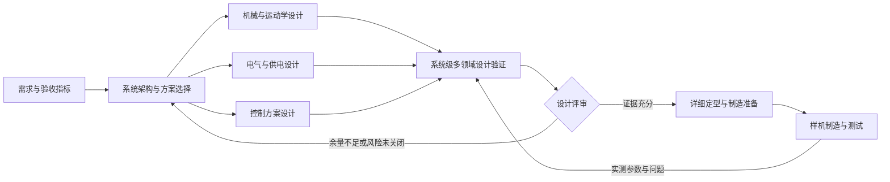
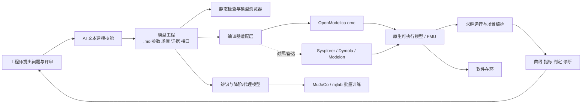

# 机器人多领域联合仿真：业务规划与 Modelica 调研

调研日期：2026-09-23  
修订日期：2026-10-07  
适用范围：AIDC 机器人系统设计、方案论证与样机前验证；工具建设须能接到后续控制训练与在环验证  
文档性质：先定义业务，再按要求选型；编译器与求解器未冻结

## 1. 当前阶段到底要做什么

三维模型浏览器解决了“机器人由哪些物理部件组成、装配关系是什么、几何形态如何查看”的问题。下一阶段需要解决的是：

> **当机械结构、电源、电路、舵机、传感器和控制器同时工作时，这个机器人方案能不能按预期运行？**

当前阶段定义为 **机器人系统级多领域设计验证**。它不是为了制作动画，也不是为了先建设复杂仿真平台，而是要在投入详细设计、采购和样机制造之前，用可以重复的模型与场景检查跨专业方案。

这个阶段应回答：

1. 舵机能否在目标姿态和运动中提供所需转矩与速度，余量是多少？
2. 多个舵机同时动作时，电池和供电母线是否会过流、压降或功率不足？
3. 机械负载、传动、电气限制与控制参数放在一起后，响应是否稳定？
4. 限位、限流、低电压、延迟和传感器误差出现时，控制行为是否可接受？
5. 目标动作需要多少峰值功率和能量，续航预算是否可信？
6. 各专业使用的参数是否一致，哪些来自实测，哪些只是估算？
7. 当前方案能否进入详细定型和样机制造，还是需要修改设计或补充试验？

本阶段的直接产物不是“一个会动的三维机器人”，而是 **可执行的系统模型、受控验证场景、参数证据、结果报告和设计决策**。

## 2. 为什么现在需要做

机械、电气和控制分别设计并不等于整机能够成立。很多机器人问题只在专业交界处出现：

- 静态转矩满足要求，但运动加速度和传动损耗使舵机实际过载。
- 单个舵机正常，但十轴同时启动造成母线压降，控制器复位或关节失力。
- 控制器在理想执行器上稳定，加入死区、摩擦、饱和与延迟后产生振荡。
- 电池容量看似足够，但峰值电流、内阻和温升限制了实际可用能量。
- CAD、原理图、控制代码和采购表记录了不同版本的齿比、限位或额定参数。
- 样机出现问题后，无法判断是结构、执行器、电气、控制还是传感器造成的。

如果这些问题到整机装配后才发现，修改通常会同时影响结构件、电路、线束、软件和采购。本阶段的价值是提前暴露跨专业问题，并把“感觉可行”转成可复查的设计依据。

## 3. 在整个设计流程中的角色

### 3.1 所处位置

多领域联合仿真位于 **系统架构与专业初步设计之后，详细定型、制造准备和样机验证之前**。样机测试完成后，实测参数还会返回模型，持续修正预测能力。



它在流程中承担四个角色：

| 角色 | 作用 |
|---|---|
| 方案校核器 | 把机械、电气和控制方案放在同一工况下检查，发现局部正确但整机不成立的问题 |
| 设计权衡工具 | 比较舵机、减速比、电池、控制参数、质量分配等候选方案 |
| 专业接口基线 | 统一关节、器件、参数、单位、信号和版本，减少团队间口头约定 |
| 验证证据生产器 | 形成可重复场景、结果和结论，为设计评审和后续实测提供基线 |

### 3.2 与现有流程环节的关系

结合 AIDC 全流程规划，本阶段主要覆盖环节 06、07，并产出能被后续环节复用的物理模型，而不是一次性仿真报告：

- **环节 06：工程分析与参数辨识**——整理负载、执行器、电池和传感器参数，识别未知量。
- **环节 07：机器人模型与场景构建**——建立用于系统行为验证的统一模型和工况。多领域模型是这里的系统行为源，刚体/接触场景仍可由 MuJoCo 等引擎承担。
- **环节 08：控制算法与训练**——先用可解释的基础控制验证被控对象和约束；批量训练需要同一套执行器、供电和限制，而不是另写一套不可对照的简化公式。
- **环节 09：软件在环与硬件在环**——后续把控制软件接到同一物理模型或由其导出的 FMU/简化接口。

它不替代机械详细设计、电路设计、控制软件开发或实物测试，而是把这些工作连接成一条可验证的系统链。批量强化学习仍以接触动力学引擎为主；多领域模型负责把电气、热、饱和与保护变成训练和在环可用的约束与接口。

## 4. 当前阶段目标

当前目标不是建立完整整机仿真，而是形成一条可信的最小验证闭环：

> **以一个代表性关节为对象，把需求工况、机械负载、舵机、电源、传感器和基础控制放到同一模型中，产生可解释、可重复、可与实测对照的结果。**

单关节已经包含多领域系统的核心矛盾，规模又足够小，便于确认参数和测量方法。如果单关节的转矩、电流、速度和能量都无法解释，直接扩展到十轴只会增加错误来源。

### 4.1 要完成的工作

1. 选择髋关节或负载最大的关节，明确动作、负载和验收指标。
2. 汇总结构质量与惯量、关节几何、舵机、减速器、电池、供电、传感器和控制参数。
3. 区分厂家资料、CAD 推导、估算、台架测量和整机实测，登记置信度与缺口。
4. 建立机械负载、舵机、电气和基础控制的完整闭环模型。
5. 用静态保持、阶跃响应、周期运动、负载变化和低电压场景覆盖关键问题。
6. 对每个场景给出是否通过、余量、限制条件和处理建议，而不只是输出曲线。
7. 明确以后用什么台架数据校准模型，以及误差达到什么程度才可支持设计判断。
8. 由机械、电气和控制共同评审参数、场景、结果与设计决定。

### 4.2 完成标志

- 有明确的关节对象和三到五个设计场景。
- 每个关键参数都有单位、来源、版本和可信等级。
- 模型同时给出位置、速度、转矩、电流、电压、功率和能量等结果。
- 结果能够解释限位、饱和、压降和负载变化。
- 至少一类关键结果与手册数据或台架实测完成对照。
- 每个场景有通过、条件通过、不通过或证据不足的结论。
- 形成明确的设计决定，例如保留或更换舵机、调整减速比、修改电池方案、限制动作或补充测试。
- 机械、电气和控制负责人认可结论的适用范围。

## 5. 当前阶段不做什么

- **不做仿真驱动三维模型运动。** 三维模型浏览器继续用于 CAD 装配结构查看，两项工作暂不集成。
- 不从十轴整机、步态或跌倒仿真开始。
- 不追求照片级或动画级仿真展示。
- 不替代 FreeCAD 的机械设计和 KiCad 的电路设计。
- 不直接交付生产控制器或嵌入式控制代码。
- **当前阶段不开展**复杂足地接触、地形、碰撞和强化学习训练；但物理模型、编译和求解必须按第 11 节要求预留交接，避免以后推倒重来。
- 不追求一次建立永久正确的数字孪生模型。
- 不在参数证据不足时宣称模型已经验证。
- **不把某套商业 GUI 绑定为唯一仿真平台。** 本机可安装 Sysplorer 作对照，工具链选型以能否满足编译、求解和后续训练要求为准。

这些能力可以进入后续路线，但不是当前阶段的完成条件。

## 6. 谁使用、怎样使用

| 参与角色 | 提供什么 | 获得什么 |
|---|---|---|
| 系统负责人 | 需求、场景、方案边界和评审结论 | 跨专业风险、方案余量和阶段放行依据 |
| 机械设计 | 质量、惯量、几何、负载、限位、传动与摩擦 | 关节载荷、峰值转矩和结构参数变化的系统影响 |
| 电气设计 | 电池、母线、驱动器、保护和测量信息 | 峰值/持续电流、压降、功率、能量与保护触发情况 |
| 控制设计 | 控制目标、周期、控制律、饱和、滤波与延迟 | 稳定性、响应时间、过冲和执行器限制 |
| 测试与标定 | 台架条件、测量数据、误差和环境信息 | 待测参数、标准测试场景和模型校准结果 |
| 项目评审 | 成本、周期和风险优先级 | 可比较的方案结论、未关闭问题和决策记录 |

典型业务流程：

1. 系统负责人提出一个需要决策的问题，例如“当前髋关节舵机是否满足起身动作”。
2. 各专业提交与问题有关的参数和证据。
3. 建模人员建立或更新联合模型，并登记假设。
4. 测试人员定义可重复场景和判定指标。
5. 运行场景并产生结果、余量和异常说明。
6. 跨专业评审结论，决定保留方案、修改设计或补充测试。
7. 设计或实测更新后重复运行，确认问题是否关闭。

## 7. 输入、输出和交接关系

### 7.1 输入

| 输入类别 | 典型内容 | 最低要求 |
|---|---|---|
| 需求与工况 | 目标动作、负载、速度、响应时间、续航、环境和故障条件 | 可量化，能转成场景和判定条件 |
| 机械设计 | 质量、质心、惯量、连杆尺寸、关节轴、限位、减速比 | 标明 CAD 修订和推导方法 |
| 执行器 | 转矩、速度、电流、齿比、效率、摩擦和温升限制 | 厂家数据与实测数据分开登记 |
| 电气设计 | 电池电压、容量、内阻、母线、驱动限制和保护阈值 | 标明器件型号、连接方案和版本 |
| 控制设计 | 控制目标、周期、增益、滤波、限幅和延迟 | 能说明输入、输出和约束 |
| 测试数据 | 空载速度、负载电流、阶跃响应、电池压降 | 保留测试条件、仪器和原始记录 |

### 7.2 输出

| 输出 | 用途 |
|---|---|
| 系统模型基线 | 保存当前机械、电气、执行器与控制关系及适用范围 |
| 参数与证据台账 | 说明参数来源、可信程度和待测项 |
| 标准场景集 | 保证不同方案和版本在相同条件下比较 |
| 结果与余量报告 | 展示峰值、稳态、边界、异常和判定 |
| 设计问题清单 | 登记过载、压降、振荡、参数缺失和模型限制 |
| 设计决策记录 | 说明采用或否决方案的依据和影响范围 |
| 后续试验需求 | 将模型不确定性转成具体台架或样机测试 |

### 7.3 交给下一阶段的内容

- 已确认或带限制条件的执行器、电池、传动与控制方案。
- 关键器件的峰值和持续工作边界。
- 需要写入控制软件的限位、限流和保护要求。
- 机械、电气详细设计需要使用的载荷和功率边界。
- 样机必须测量的信号、工况和验收指标。
- 尚未关闭的假设和风险，避免被误当成已验证结论。
- **可版本管理的物理模型源码**、参数台账和场景定义，供控制、训练和在环复用。
- **可无界面编译与运行的产物**（至少能导出或等价于 FMU/可执行仿真），以及输入、输出、参数接口清单。
- 从多领域模型提取、并经对照的 **训练用简化执行器/供电模型**（或明确“尚未简化、训练暂用占位模型”）。

## 8. 首批验证场景

| 场景 | 业务问题 | 主要观察量 | 可能产生的决定 |
|---|---|---|---|
| 静态保持 | 最不利姿态能否持续承载 | 转矩、电流、压降、损耗、温升趋势 | 舵机/齿比是否足够，是否限制保持时间 |
| 位置阶跃 | 响应是否满足速度、过冲和稳定性 | 位置、速度、电流、饱和、整定时间 | 调整控制参数、动作限制或执行器规格 |
| 周期运动 | 重复运动是否过载或能耗过高 | 峰值/均方电流、机械功、电能和损耗 | 调整动作周期、电池或散热方案 |
| 负载变化 | 负载偏差或外力变化时是否稳定 | 误差、峰值转矩、恢复时间和保护行为 | 增加余量、修改控制或补充传感器 |
| 低电压/限流 | 电池下降或驱动限流时怎样工作 | 母线电压、可用转矩、跟踪误差和故障状态 | 定义低电量策略、保护阈值和降级动作 |

每个场景必须包含目的、初始条件、输入、参数版本、预期现象、通过条件、结果摘要和适用范围。

## 9. 业务对象与管理规则

### 9.1 参数不是散落的数字

每个关键参数至少包含名称、数值、单位、适用对象、来源、证据文件、测量条件、版本、负责人、可信等级和更新时间。

- **A：实测并复核**——受控条件下测得，有原始记录和复核。
- **B：厂家或受控设计数据**——来自手册、CAD 质量属性或正式设计文件。
- **C：计算或合理估计**——方法明确，但尚未实测。
- **D：占位假设**——仅用于让模型运行，不能支持设计放行。

### 9.2 结论必须说明适用范围

“通过”只对特定型号、修订、参数、场景和判定标准有效。单关节静态保持通过，不能外推为整机步行通过；名义电压通过，也不能外推为低电量通过。

### 9.3 场景承载设计问题

场景不能只叫“运行 10 秒仿真”，而应对应明确问题，例如“额定负载下髋关节 30° 阶跃响应”。场景必须可重复，并允许候选方案公平比较。

### 9.4 结果必须导向决定

结果报告至少给出结论、指标限值与余量、异常条件、对各专业的影响，以及建议的设计修改、补测或风险接受决定。

## 10. 分阶段业务路线

### B0：确定验证任务

**目标：** 把“做多领域仿真”改写成若干需要回答的设计问题。

选择代表关节、定义首批场景、确定指标与评审人、列出当前无法回答的问题。

**完成门槛：** 每个场景对应一个真实设计决定，并有明确输入、输出与判定人。

### B1：建立参数和证据基线

**目标：** 统一机械、电气和控制使用的数据，暴露缺失参数。

完成参数收集、单位统一、版本关联、可信度分级和台架测试计划。

**完成门槛：** 关键参数无匿名来源；D 级参数均有风险说明或补测计划。

### B2：完成单关节联合验证

**目标：** 证明机械负载、执行器、电源和基础控制可以形成可信闭环。

运行五类场景，检查能量和限制，与手册或实测对照，形成设计结论。

**完成门槛：** 至少产生一项可执行设计决定；模型误差和适用范围被明确记录；同一场景可无界面复现，并明确训练/SIL 使用 FMU 还是简化模型。

### B3：扩展到子系统

**目标：** 验证单腿或一组关节的负载耦合、共用供电和协调控制。

进入条件是 B2 已通过，且单关节参数不再大量依赖 D 级假设。

**完成门槛：** 能回答同时动作的功率、负载分配和控制耦合问题。

### B4：整机方案权衡

**目标：** 在整机级比较电池、舵机、动作和控制候选方案，形成详细定型输入。

**完成门槛：** 关键需求有对应场景和证据，主要跨专业风险已关闭或被正式接受。

### B5：样机校准与持续回归

**目标：** 使用台架和整机数据修正模型，使其成为设计变更的回归工具。

**完成门槛：** 模型预测误差有量化指标，设计变更后可以重复关键场景并识别退化。

## 11. 联合仿真工具链建设规划

### 11.1 建设目标与边界

工具建设的目标是把“模型文本—可信计算—工程判断—后续复用”连成可重复的流水线，而不是再开发一套通用 Modelica IDE：

> **AI 负责起草和修改文本模型，工程师负责问题、参数和结论；AIDC 自研项目管理与浏览层，复用成熟的编译器、求解器和 FMI 运行时。**

需要自研的部分是机器人研发流程特有的能力：模型工程规范、参数证据、场景与判定、中文浏览、编译器适配、任务编排、结果归档，以及向训练和在环环节交付统一接口。Modelica 编译器、DAE 数值求解器和 FMI 标准实现不自行重写。

三维 CAD 浏览器继续作为独立软件；本阶段不做仿真驱动三维模型运动，也不把图形化拖拽建模作为前置条件。

### 11.2 总体形态与职责划分



| 层 | 职责 | 建设方式 | 不能承担的职责 |
|---|---|---|---|
| 模型工程层 | 保存 `.mo`、参数、场景、证据、接口契约和版本 | AIDC 规范 + AI 技能 + Git | 不保存运行时临时文件作为事实源 |
| 浏览与检查层 | 展示层次、连接、参数来源、场景、曲线、判定和源码诊断 | 自研只读 Web 工具 | 不承担方程编译和数值积分 |
| 编译适配层 | 用统一命令调用不同编译器，输出可执行模型或 FMU | 自研薄适配器 | 不自行实现 Modelica 语义 |
| 求解运行层 | 初始化、积分、事件、参数扫描、失败码和结果输出 | 复用编译器运行时/FMI 运行时 | 不决定业务是否通过 |
| 训练交接层 | 输出统一参数、边界、简化模型及误差报告 | 自研导出契约，复用训练引擎 | 不要求训练引擎直接运行完整 DAE |

### 11.3 模型工程目录与事实源

建议每个机器人模型项目使用以下结构；软件代码和模型数据分开，换机器人时只需切换模型工程：

```text
model-project/
├─ modelica/                 # Modelica 源码，package.mo 为入口
│  ├─ Components/            # 舵机、电池、母线、传感器等可复用组件
│  ├─ Assemblies/            # 单关节、单腿、整机组合模型
│  └─ Experiments/           # 可编译的试验模型
├─ parameters/               # 参数集、单位、来源、可信等级和适用修订
├─ scenarios/                # 初值、输入、停止条件、求解设置、判定阈值
├─ interfaces/               # FMU/训练/SIL 的变量名、方向、单位和采样约定
├─ evidence/                 # 手册、试验记录及其索引；大文件可外部存储
├─ baselines/                # 少量受控基准结果和容差
├─ reports/                  # 评审结论与设计决定
└─ generated/                # FMU、可执行文件、日志、全量曲线；可清理、不可手改
```

`modelica/`、`parameters/`、`scenarios/`、`interfaces/` 和证据索引共同构成事实源；`generated/` 只是可再生物。编译器版本、MSL 版本、编译参数和平台必须写入运行清单，确保结果可追溯。

### 11.4 建模工具：AI 写文本，编译器做事实校验

Modelica 是文本语言，适合由技能按模型契约生成和维护。AI 建模流程必须包含：

1. 读取设计问题、端口契约、参数台账和现有组件，先选择复用对象。
2. 修改 `.mo` 和场景数据，同时登记新增假设、参数来源和适用范围。
3. 运行格式、语法、单位、连接和初始化检查；编译器通过才可提交评审。
4. 运行最小场景并与手算、手册或基准结果比较。
5. 由机械、电气、控制负责人评审物理含义；AI 生成不等于模型已验证。

图形化工具可用于查看和对照，但任何修改只有回写到仓库文本、通过自动检查后才进入基线。首期不建设拖拽建模器；以后若有强需求，也应编辑同一份 `.mo`，不能形成第二套私有模型。

### 11.5 浏览工具：需要自研，但只做工程浏览和任务入口

商业 Modelica 工具擅长建模与求解，却不会天然理解 AIDC 的参数证据、设计问题和阶段放行。建议开发本地 Web 浏览器，首期提供：

- 模型包、组件、端口与连接层次，支持跳转到源码。
- 参数值、单位、来源、可信等级、适用 CAD/电气修订和缺口。
- 场景输入、初值、求解设置、判定阈值与对应设计问题。
- 编译、初始化和求解任务状态；错误显示文件、行号、阶段和原始日志。
- 曲线、峰值、稳态值、余量、能量守恒检查和通过/不通过/证据不足结论。
- 当前结果与基准、另一方案或实测数据的对比。
- 导出运行清单和评审报告。

浏览器只通过统一任务 API 调用后端，不直接依赖某个桌面软件进程。这样可以替换编译器，也能在 Windows 开发机和 Linux 训练机上使用同一界面。

### 11.6 编译、求解和 FMI 运行必须分开理解

- **编译器**解析 Modelica、展开连接、符号化简并生成可执行模型或 FMU。
- **求解器**负责连续状态积分、DAE、一致初始化、刚性系统、零交叉和离散事件。
- **FMU**是模型交换包；FMI 定义接口与生命周期，**不替我们决定所有数值算法**。Model Exchange FMU 通常由宿主选择求解器，Co-Simulation FMU 通常携带自己的求解能力。
- **运行与编排器**负责装载产物、设置参数、喂输入、重复场景、收集结果和错误。
- **训练引擎**负责大量接触动力学环境；完整 Modelica 求解器通常不直接进入每个 GPU 环境。

首选基线路径为：`omc` 编译/原生求解生成参考结果，同时导出 **FMI 2.0 Model Exchange + Co-Simulation** 产物，由 FMPy 做独立无界面复跑。FMI 3.0 在定时执行、结构化变量等方面更强，但首期以生态兼容更广的 FMI 2.0 为验收基线，FMI 3.0 作为加分项。

### 11.7 面向后续环节的物理模型要求

| 编号 | 要求 | 本阶段设计验证 | 批量训练 / SIL 的意义 |
|---|---|---|---|
| M1 | 文本源码可 Git diff；不依赖专有二进制工程作为唯一源 | 可评审、可回退 | 可在 CI 和训练机复现 |
| M2 | 舵机、传动、负载、电池、母线、传感器、控制器组件化 | 可替换方案 | 可抽取执行器或供电子模型 |
| M3 | 使用带单位的物理端口，功率方向与能量平衡可检查 | 防止跨专业接口错误 | 简化前有可信参考 |
| M4 | 方程、参数和场景分离，参数带来源、修订与可信等级 | 便于扫参与比较 | 域随机化范围有依据 |
| M5 | 输入输出契约稳定：名称、方向、单位、采样周期、坐标约定明确 | 浏览与报告一致 | FMU、控制器和训练环境可互换 |
| M6 | 限位、饱和、死区、保护和故障以显式状态/事件表达 | 能解释边界行为 | 训练能学习真实限制 |
| M7 | 模型可复位、可设置初始状态，可多实例运行且无隐藏全局状态 | 场景可重复 | 向量化环境和 SIL 必需 |
| M8 | 支持单组件、单关节、子系统分别编译测试 | 便于定位和校准 | 可选择合适粒度交付 |
| M9 | 可导出 FMU 或等价开放接口；避免工具私有库锁定核心模型 | 后端可替换 | 不把训练/SIL 绑到 GUI |
| M10 | 明确有效范围、未建模项、误差指标和校准数据 | 防止过度解释 | 防止策略跑到模型失真区 |
| M11 | 提供高保真参考模型与训练用简化模型之间的参数映射和误差报告 | 形成工程依据 | 训练效率与物理一致性兼顾 |
| M12 | 关键变量可观测，保护/失效有状态码，数值失败显式返回 | 快速诊断 | 批量作业可剔除坏轨迹 |

面向强化学习时还必须满足三个额外条件：参数批量覆盖不要求重编译、单步/整段运行可以确定性复现、简化模型在规定工况内与参考模型的关键指标误差可量化。训练脚本不得复制一套无人维护的电机公式。

### 11.8 编译器、求解器和运行时的技术要求

| 类别 | 必要要求 | 淘汰条件 |
|---|---|---|
| 编译器 | CLI/稳定 API；支持目标 Modelica 子集和 MSL；错误含源码位置；Windows 可用、Linux 更佳；可锁版本 | 只能手工点 GUI；不能自动构建；核心模型依赖不可导出的私有特性 |
| 导出 | 至少 FMI 2.0 ME 或 CS，最好两者；接口、参数和平台可检查 | FMU 无法在第二个运行时复跑，或许可证禁止内部批量运行 |
| 求解器 | DAE 一致初始化、刚性系统、事件/零交叉、失败码、容差控制、结果可重复 | 失败时静默输出；限位/保护事件丢失；关键场景不收敛 |
| 运行时 | Python/CLI 调用；可复位、改参数、传输入、多实例；输出 CSV/Parquet/Arrow 等开放格式 | 依赖桌面会话；不能批量运行；结果只能在专有界面读取 |
| 性能 | 设计验证快于或接近实时即可；批量训练交付物须达到训练预算 | 强求完整 DAE 达到 GPU 万环境并行，导致模型失真或项目失控 |
| 许可部署 | 明确编译、FMU 分发、运行时、多进程和 CI/服务器条款 | 许可证无法覆盖训练机、CI 或团队并发 |

求解性能必须按用途分层：

1. **参考模型运行时：** 允许变步长隐式求解和完整事件，目标是正确、可解释、可校准。
2. **SIL 运行时：** FMU 或生成代码，目标是固定通信步长、可复位和可持续运行。
3. **训练运行时：** MuJoCo/mjlab 负责接触和刚体动力学；执行器、电源和保护使用经参考模型校准的降阶模型、查表或代理模型。完整 FMU 仅用于离线采样、抽检和少量并行对照。

### 11.9 可选技术与选型结论

| 技术 | 角色 | 优点 | 主要风险 | 当前定位 |
|---|---|---|---|---|
| [OpenModelica](https://openmodelica.org/) `omc` | Modelica 编译器 + 原生仿真运行时 | 开源、CLI/脚本、Windows/Linux、可导出 FMI 1/2/3 | 对部分高级库和复杂模型的兼容性需实测 | **首选基线编译器** |
| [FMPy](https://github.com/CATIA-Systems/FMPy/) | Python FMI 1/2/3 运行与检查 | 支持 ME/CS、跨平台、易接 AIDC 和参数扫描 | 不是 Modelica 编译器；ME 的求解配置需验证 | **首选独立 FMU 验证运行时** |
| [OMSimulator](https://openmodelica.org/doc/OMSimulator/master/OMSimulator/UsersGuide/html/OMSimulator.html) | FMI/SSP 组合与协同仿真 | 适合多 FMU、SSP、CLI/API | 单个模型场景可能比 FMPy 更重 | **多 FMU 阶段候选** |
| [Rumoca](https://github.com/cognipilot/rumoca) | Rust Modelica 前端/符号工作流 | CLI、Python/WASM，面向 CasADi/机器人工作流 | 新工具，语言覆盖和工业案例需验证 | **探索项，不作首期唯一后端** |
| MWORKS.Sysplorer | 商业 Modelica 环境 | 本机已有，适合图形查看和结果对照 | CLI、FMU、批处理许可与跨平台能力需核实 | **对照与备选** |
| Dymola / Modelon Impact | 商业编译和仿真 | 工业 Modelica/FMI 能力成熟，API 较完整 | 成本、许可证和服务器部署约束 | **开源路径失败后的候选** |
| MuJoCo / mjlab | 刚体接触与批量训练 | 训练生态和并行性能适合机器人 | 不编译 Modelica，不适合多领域 DAE 事实源 | **后续训练主引擎** |
| CasADi / JAX / PyTorch | 降阶、优化或代理模型实现 | 易集成训练、可微和批量计算 | 需要明确从参考模型生成/校准，避免双重事实源 | **训练交付实现候选** |

当前选型不以“是否已经安装 Sysplorer”为依据。建议采用：

> **Modelica + MSL 作为高保真文本模型；OpenModelica 作为首选编译/参考求解后端；FMPy 作为独立 FMU 运行和 Python 集成；MuJoCo/mjlab 作为后续批量训练引擎；Sysplorer 只做交叉验证和商业备选。**

OpenModelica 官方文档已给出 `omc` 命令行和 `buildModelFMU()` 路径，并可配置 FMI 1.0、2.0、3.0 及 ME、CS、ME+CS 类型；FMPy 官方仓库说明其支持 FMI 1/2/3、ME/CS 和 Windows/Linux/macOS。这说明开源主链具备进入实测的基本条件，但不能代替对机器人目标模型的兼容性、数值结果和性能验收。

**本地验证进展（2026-10-07）：** 已将 OpenModelica 1.27.1 安装到项目 `tools/openmodelica/1.27.1`。最小动态模型已通过 `checkModel()`、DASSL 原生仿真和 FMI 2.0 ME+CS 导出，并由随包 OMSimulator 以 Co-Simulation 模式独立复跑；Modelica 4.1.0 标准库及 PID 示例检查通过。该结果证明开源链路可用，但尚不代表机器人单关节目标模型已经通过 T0。完整证据见 `tools/openmodelica/README.md`。

### 11.10 分阶段建设与验收

#### T0：计算链路探针

用标准 MSL 建立一个最小单关节机械—电气—控制闭环；`omc` 完成检查、原生仿真和 FMI 2.0 ME+CS 导出；FMPy 复跑同一场景。

**验收：** 三条路径的关键指标在约定容差内一致；编译和求解错误能返回阶段、日志和退出码；全流程可由一条命令执行。

**执行结果（2026-10-07）：已通过。** 已在 `AIDC/samples/modelica-t0-single-joint` 建立可重复执行的探针工程。OpenModelica 1.27.1 完成 MSL 4.1.0 模型检查、DASSL 原生仿真和 FMI 2.0 ME+CS 导出；FMPy 0.3.32 分别以 Model Exchange、Co-Simulation 复跑。相对原生结果，ME 末端角度绝对差为 `9.55e-7 rad`，CS 为 `1.44e-4 rad`；峰值电流相对差分别为 `1.18e-7` 与 `0.00660`，均通过既定阈值。CS 在 1 ms 通信步长下首次暴露出 4.08% 的电流尖峰误差，保持 2% 门槛不变并把通信步长收紧到 0.25 ms 后通过，这一结果同时验证了探针能够暴露数值配置问题。执行入口为 `run-t0.ps1`；报告、JSON 摘要、三路径时序和分阶段日志均保存在工程 `results/` 目录。

#### T1：模型工程和浏览 MVP

落地第 11.3 节目录规范、参数证据、场景契约和运行清单；浏览器展示模型、参数、场景、曲线、判定与诊断。

**验收：** 换一个模型工程无需修改浏览器代码；同一提交和工具版本可复现报告；浏览器不保存私有模型状态。

**详细设计：** 工程入口、目录、参数证据、场景、接口、运行清单、结果、诊断、浏览器信息架构、API、双工程验收和实施拆分见 `T1_模型工程与浏览MVP详细设计.md`。T1 只有在该文档第 12 节验收全部通过后才标记完成。

**执行进展（2026-10-07）：T1.1 已通过。** 版本化契约、TypeScript 类型、单关节工程迁移、第二个直流电机工程、统一校验与运行器、事实源摘要和干净重建验收已完成。正式工程与无 `generated/` 副本的重建摘要一致，报告逐字节一致。Project Server、模型索引和浏览器界面仍属于 T1.2、T1.3，T1 整体尚未完成。

**执行进展（2026-10-07）：T1.2 已通过。** Project Server、omc 模型结构索引、OpenModelica 编译/求解适配、FMPy FMI 检查、受控运行 API、SSE 阶段事件、运行结果查询和曲线降采样已完成，并使用两个不同模型工程通过同一 HTTP 验收。Web 浏览器界面仍属于 T1.3，T1 整体尚未完成。

**执行进展（2026-10-07）：T1.3 已通过。** 已完成独立 Modelica 浏览器的工程概览、模型结构、参数、场景、结果曲线、工程判定和诊断页面；实现源码、证据、指标与曲线的相互追溯、服务端曲线时窗缩放和 SSE 运行进度。相同生产包已在两个不同模型工程上通过无业务常量验收，并在真实浏览器中完成运行与结果刷新。T1 整体仍需完成 T1.4 通用性与复现验收。

**执行进展（2026-10-08）：T1.4 已通过，T1 完成。** 同一生产构建已在两个不同工程及任意改名副本上完成自动切换、干净重建、真实 OMC 双次复跑和逐点数值复现，两个工程误差均为 0；Schema/Modelica 故障注入、服务重启恢复、浏览器存储检查和 20 × 100,000 点曲线压力测试均通过。通过运行已提升为受控 baseline。工程契约已简化为 `model-project.json + modelica/ + results/`，参数和仿真设置以 Modelica 文件为事实源。总体验收证据见 `modelica-browser/results/T1-模型工程与浏览MVP总体验收报告.md`。

#### T2：单关节可信模型

完成第 8 节场景、台架对照、参数校准和设计结论，建立 OpenModelica 与 Sysplorer 的至少一次交叉结果比较。

**验收：** 关键变量误差和适用范围被量化；至少产生一项设计决定；模型与 FMU 接口进入版本基线。

**执行进展（2026-10-08）：T2 模型与工具链验收已通过。** 已针对 Microduck 左髋俯仰代表关节建立飞特 HD-1910-C001 降阶机电模型，使用厂家 4.8/6/7.4 V 速度、堵转转矩和电流点校准，最大相对误差 6.67%。静态保持、位置阶跃、周期运动、负载变化和低电压/限流五类场景均通过；OpenModelica 1.27.1 与 Sysplorer 2026b 的关键终态最大绝对误差为 `1.52e-8`，FMI 2.0 ME+CS 产物由 FMPy 独立复跑通过。模型摘要、五场景运行、FMU 接口和 SHA-256 已写入 `samples/modelica-t2-single-joint/results/t2-baseline.json`。设计决定为：4.8 V 降级采用 0.8 A 限流；2S 满充 8.4 V 与执行器上限重合，整机前必须增加稳压或满充联锁。真实关节惯量、摩擦、电池脉冲内阻和温升仍为 C 级参数，因此硬件定型状态明确为 `hardwareReleaseReady=false`，取得 A 级台架数据前不得外推为实体或整机验证。验收入口为 `npm run verify:modelica:t2`，报告见 `modelica-browser/results/T2-单关节可信模型验收报告.md`。

#### T3：后续环节交接验证

把参考模型导出为 SIL FMU，并生成一个训练用简化执行器/供电模型；在 MuJoCo/mjlab 小批量环境中做一致性抽检。

**验收：** 参数只维护一份；训练模型与参考模型在规定工况内满足误差预算；状态可复位、参数可批量覆盖、坏轨迹有错误标志。

#### T4：子系统与工具选型冻结

扩展到单腿或共用母线，依据 T0—T3 的兼容性、精度、性能、部署和许可证据冻结主后端，同时保留适配器边界。

**验收：** 选型表有实测数据；CI 可无界面构建并运行回归；替换编译器不影响模型工程和浏览器业务接口。

### 11.11 选型决策门槛

只有同时满足以下条件，某编译/求解后端才能成为主链：

1. 能无界面完成目标单关节模型的检查、编译、运行和错误定位。
2. 五类首批场景均稳定求解，结果与手算、实测或第二工具在容差内一致。
3. 能导出并在独立运行时复跑 FMU，或提供等价的开放可执行接口。
4. Windows 开发、Linux/CI 与许可证路径清楚，允许内部批量作业。
5. 能锁定模型、库、编译器、求解参数和接口版本。
6. 后续训练可以复用同一参数和边界，并有参考模型到简化模型的误差报告。

若 OpenModelica 在标准 MSL 单关节模型上通过上述门槛，就不引入商业后端作为主依赖；若在语言兼容、刚性求解或 FMU 质量上失败，再用相同验收集比较 Sysplorer、Dymola 或 Modelon，而不是按品牌或现有安装情况决定。

## 12. 主要业务风险

| 风险 | 后果 | 当前处理方式 |
|---|---|---|
| 没有设计问题就开始建模 | 模型很大但无法支持决策 | B0 先冻结问题、场景和判定人 |
| 参数来源不清 | 结果看似精确但不可信 | 建立证据台账和 A—D 可信度 |
| 一开始追求整机和复杂接触 | 周期长，错误无法定位 | 从代表性单关节开始，逐级扩展 |
| 只看动画或曲线 | 无法判断设计是否通过 | 每个场景必须有指标、限值、余量和结论 |
| 把仿真当作实物验证 | 错误放大模型结论 | 保留台架和样机试验，量化模型误差 |
| 工具选型替代业务规划 | 围绕工具能力做无关功能 | 技术只服务已确认的业务问题 |
| 把 Sysplorer 绑成唯一平台 | 无法上 CI/训练机，模型不可迁移 | 文本为源；编译求解按第 11 节实测 |
| 开源编译器未验证就全面自研浏览 | 浏览器很好但模型跑不起来 | 先完成 T0 最小模型 + CLI/FMU，再扩大浏览 |
| 训练另写一套物理公式 | 设计验证与策略矛盾 | 参数和简化模型必须从同一源导出并对照 |
| 各专业各建一套参数 | 结果不可比较，变更不可追溯 | 建立统一参数基线和版本关系 |

## 13. 建议的下一步

下一步不应立即开发仿真平台，而应先完成 **B0：确定验证任务**。建议召开一次机械、电气、控制和测试共同参加的短评审，形成四项输出：

1. 选择一个代表性关节及其当前设计修订。
2. 从第 8 节选择三到五个首批场景，并写明每个场景要支持的设计决定。
3. 列出场景需要的全部参数、现有来源和缺口。
4. 指定结果判定人，以及通过后将触发的下一项设计工作。

B0 完成后再开展 B1 参数整理，并行完成 **T0：最小文本模型 + 开源编译/FMU 实测**。浏览工具在编译路径跑通一个场景后再开工，避免先做空壳界面。Sysplorer 只用于对照，不作为通过门槛。

建议在 B0 评审之外增加一次工具短评（可与 B0 同一天）：确认开源 `omc` 是否已安装或可安装、Sysplorer 是否具备 CLI/FMU、训练机操作系统，以及单关节模型的仓库目录约定。

## 参考资料

- [Modelica Language Specification](https://specification.modelica.org/)
- [Modelica Standard Library](https://github.com/modelica/ModelicaStandardLibrary)
- [OpenModelica](https://openmodelica.org/)
- [OpenModelica 命令行](https://openmodelica.org/doc/OpenModelicaUsersGuide/latest/introduction.html)
- [OpenModelica FMI 导出](https://openmodelica.org/doc/OpenModelicaUsersGuide/latest/fmitlm.html)
- [OpenModelica 编译器参数](https://openmodelica.org/doc/OpenModelicaUsersGuide/latest/omchelptext.html)
- [OMSimulator](https://openmodelica.org/doc/OMSimulator/master/OMSimulator/UsersGuide/html/OMSimulator.html)
- [FMPy](https://github.com/CATIA-Systems/FMPy/)
- [FMI Standard](https://fmi-standard.org/)
- [SSP Standard](https://ssp-standard.org/)
- [Modelica Association 工具目录](https://modelica.org/tools/)
- [Rumoca](https://github.com/cognipilot/rumoca)
- [MuJoCo](https://github.com/google-deepmind/mujoco)
- [mjlab](https://github.com/mujocolab/mjlab)
- [Sysplorer 2026b 使用手册](https://www.tongyuan.cc/docs/sysplorer/2026b/Help/homepage/Doc/homepage.html)（对照环境，非绑定选型）
