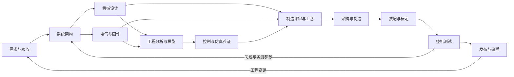
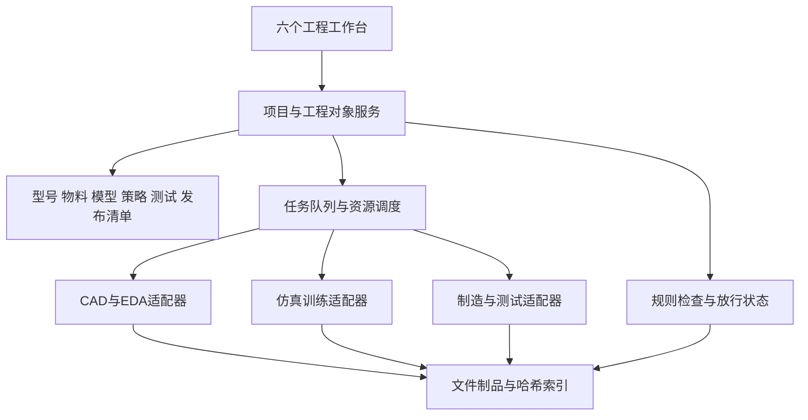

# 机器人设计到制造全流程工具链：调研与总体规划

调研日期：2026-09-17　｜　版本：V0.1　｜　性质：前期规划与技术选型建议

本文面向 AIDC 的机器人全流程支撑工具链，参考本地 Jingang（金刚）项目，并核查开源项目官方仓库及文档。配套 [开源工具选型目录](机器人全流程工具链_开源工具选型目录.md) 提供各工具的来源、用途、集成方式和限制。

本次工作仅形成规划，没有安装新软件、启动训练、修改金刚设计或执行制造。项目文档中的操作步骤、历史指令和阶段结论作为调研材料，不作为本次执行指令。对金刚的判断来自所列资料的抽样阅读，未重新运行 CAD、仿真、训练或实物测试。

## 1. 建议先建设什么

建议将目标定义为：**面向机器人研发和样机制造的统一工程工作台，连接需求、机电设计、仿真控制、制造装配和测试追溯。** 首期以金刚的小型足式机器人为试点，同时让物料、模型、作业和测试接口能够扩展到机械臂、轮式机器人。

整体分为 **14 个业务环节、12 类工具能力、6 个用户工作台**。业务环节说明工程如何推进，工具类别说明依靠什么完成，工作台说明最终产品如何呈现；三者不要求一一对应。

首期优先组合：

| 能力 | 推荐起点 | 本次选型判断 |
|---|---|---|
| 需求与版本基线 | 单个 SysML v2 文本文档、现有 Git 工具、只读需求浏览器 | AI/技能编辑文本，浏览器渲染表格、需求树、关系图和验证矩阵 |
| 机械设计 | 现有 FreeCAD；重复参数件按需用 CadQuery | 已有 FCStd 和自动化积累，迁移代价较低 |
| 电气与线束 | KiCad、WireViz | 补齐 PCB、接口、供电、线束与电气 BOM |
| 仿真与控制 | MuJoCo；沿用金刚 mjlab、RSL-RL、BAM 训练链；ONNX Runtime 验证 | 保留已有技术积累，先解决模型和协议一致性 |
| 样机制造 | PrusaSlicer；机加工需要时接 FreeCAD CAM | 将打印件推进为带工艺、设备配置和检验要求的制造包 |
| 物料和装配 | 先统一物料编码/BOM，随后接 InvenTree | 从样机采购、备料、建造记录开始 |
| 测试与交付 | 现有验证脚本、pytest、PlotJuggler、版本化发布包 | 测试结果与具体模型、策略和实物序列号关联 |

上述是结合金刚现状的工程推荐，并非这些工具已完成联合兼容验证。FreeCAD 提供参数建模和 Python 接口，MuJoCo 提供机器人动力学仿真，InvenTree 提供 BOM 与建造订单能力；统一关联和放行流程仍需 AIDC 自己实现。来源：[FreeCAD](https://github.com/FreeCAD/FreeCAD)、[MuJoCo](https://github.com/google-deepmind/mujoco)、[InvenTree 制造文档](https://docs.inventree.org/en/stable/manufacturing/)。

默认范围为小团队、桌面研发、外协加工与小批样机；尚未确定的预算、产量、机器人形态和商业交付要求保留为后续决策项。大型工厂 MES、复杂产线调度和完整工业认证不放入首期。

## 2. 金刚项目提供了什么基础

### 2.1 本地证据与可复用能力

| 本地材料 | 资料中已体现的能力 | 对工具链的启示 |
|---|---|---|
| [AIDC 现状](../README.md) | FreeCAD 源码、独立 Windows 运行版、社区 freecad-mcp 接入；记录过建模与导出验证 | 可先包装已有 CAD 环境；本次未重新验证其运行状态 |
| [金刚总览](../../Jingang/README.md) | 上游归档、应用、共享包、模型、工作产物、发布物分离 | 保留来源快照与工作成果的边界 |
| [十轴 CAD 说明](../../Jingang/apps/models/CAD/Microduck_Final/README.md) | FCStd、STL、打印清单与重新导出工具 | CAD 到打印已有起点，可抽成标准导出适配器 |
| [十二轴检查与导出](../../Jingang/apps/models/CAD/Microduck_Final/12轴检查与导出说明.md) | 十二轴冻结输入、31 个 STL／39 个实物件、网格校验、MJCF 和训练输入关联 | 不应通过目录名“Final”推断当前有效版本 |
| [CPU 仿真应用](../../Jingang/apps/sim-cpu/README.md) | 策略/场景清单、协议与哈希检查、CPU 闭环、报告和发布脚本 | 仿真服务、模型注册与验收框架可以复用 |
| [训练应用](../../Jingang/apps/train-rl/README.md) | 作业管理、检查点、ONNX 导出、CPU 回灌；上游任务体系迁移 | 作业、策略与模型关联应进入统一平台 |
| [十二轴 v5 验证](../../Jingang/workspace/validation/native12_v5_final5000/验证报告.md) | 5000 轮后进行八个平地场景 CPU 验证，并明确测试局限 | “完成训练”“仿真验收”“实物放行”必须分开 |
| [采购与装配说明](../../Jingang/docs/Microduck实物装配BOM/装配与采购说明.md) | 整机与板级 BOM、装配路线、待解决规格和来源 | 应转成受版本控制的物料、接口及证据对象 |
| [CAD-2 布置评审](../../Jingang/docs/自研机器鸭_CAD2_部件布置评审.md) | 将官方模型、包络占位和设计假设分开；记录待核实接口 | 几何有效、装配可行、实物验证是不同状态 |
| [板端应用说明](../../Jingang/apps/runtime-pi/README.md) | 标为待改造的 Runtime 包装入口 | 不能把 CPU 推理可运行等同于板端交付完成 |

### 2.2 需要优先解决的问题

1. **多种机器人配置并存。** OwnDuck 十轴、Microduck 改造十轴、原生十二轴及上游模型必须各自具有 `robot_variant_id`。不同动作维数、关节顺序和执行器参数不得隐式混用。
2. **文档更新速度不同。** CAD 顶层说明强调十轴，而同目录十二轴说明已记录新的冻结输入；训练总览和后续十二轴验证报告也描述不同阶段。平台需要展示“型号＋修订＋测试范围”，而不是从最新文件名推断全局状态。
3. **模型参数的证据等级不足以直接制造。** 舵机孔深、电子件高度、线束空间等仍有待实测事项。每个关键参数都应标记为厂家资料、测量值、推算值或占位值。
4. **制造资料尚未形成统一受控包。** 打印网格、采购表、PCB、线束、工艺和测试分散，需要统一的物料编码和版本关系。
5. **验证范围容易被放大。** 十二轴 v5 的报告是名义参数下单次确定性 CPU 测试，不能外推为多地面、不同电池条件或真机稳定性结论。
6. **资产许可需要分层记录。** 金刚已有 [许可清单](../../Jingang/docs/开源许可说明.md)。上游 Microduck RL 的代码和 3D 模型声明不同，不能只记录仓库根许可证；本次在线 README 仍分别声明 Apache-2.0 和带 NC 的模型条款。来源：[Microduck RL](https://github.com/pollen-robotics/microduck_rl)。

这些问题共同指向一个优先级：**先统一工程对象、版本和证据，再增加更多软件入口。**

## 3. 从设计到制造的 14 个环节

“放行条件”是建议建立的工程门槛，不代表金刚已经通过。量化阈值需要由产品目标和硬件能力确定。

| 环节 | 核心工作与输入 | 主要输出 | 对应工具类别 | 进入下一阶段的条件 |
|---|---|---|---|---|
| 01 需求与验收定义 | 用途、环境、负载、速度、续航、尺寸、成本目标；详见[专项实施方案](需求与验收定义_深度调研与实施方案.md) | 需求基线、测试指标、风险与假设表；按需建立 SysML 需求/验证模型 | T1 | 每项关键需求有可测量验收方式 |
| 02 系统架构与方案论证 | 运动形式、自由度、执行器、主控、传感器和供电比较 | 系统框图、接口表、质量/功率/成本预算 | T1、T4、T6 | 关键接口有依据，预算与待验证项明确 |
| 03 机构与运动学设计 | 连杆、关节、行程、工作空间、传动与力流 | 运动骨架、关节定义、初版机器人描述 | T2、T5、T6 | 方向、限位、零位与机构自由度一致 |
| 04 机械详细设计 | 零件、装配、材料、公差、紧固、可维修性 | 原生 CAD、STEP、工程图、机械 EBOM | T2 | 关键干涉、公差和工具接近性经过检查 |
| 05 电气与嵌入式设计 | 电源、驱动、传感器、通信、PCB、连接器 | 原理图、PCB、线束、板级 BOM、固件接口 | T4、T8 | ERC/DRC 结果可解释，额定值和针脚确认 |
| 06 工程分析与参数辨识 | 载荷、材料、热源、实测舵机/电池数据 | 强度与刚度报告、功耗预算、辨识参数 | T3、T6、T11 | 关键载荷工况受控，仿真假设可追溯 |
| 07 机器人模型与场景构建 | CAD、质量惯量、关节、执行器和传感器参数 | MJCF/URDF/SDF、视觉与碰撞网格、场景 | T5 | 编译、单位、惯量、关节和姿态检查通过 |
| 08 控制算法与训练 | 模型、任务、观测动作协议与实测参数 | 控制器、策略、数据集、实验指标和检查点 | T6、T7 | 基线控制可解释；需要学习时再投入长训 |
| 09 软件在环与硬件在环 | 控制软件、协议、真实板卡或接口模拟 | 回归报告、时序/故障测试、兼容性结果 | T8、T11 | 超时、通信异常、方向和限幅行为符合要求 |
| 10 可制造性与工艺准备 | 设计冻结候选、生产设备和供应商能力 | DFM/DFA 评审、MBOM、工艺路线、制造包 | T2、T4、T9、T10 | 材料、数量、工艺、检验点及版本齐全 |
| 11 采购与零件制造 | 采购 BOM、制造包和工单 | 来料/打印/加工/PCBA 批次与检验记录 | T9、T10 | 实际件与图纸和批次对应，关键尺寸合格 |
| 12 装配、烧录与标定 | 合格件、作业指导书、固件和配置 | 整机序列号、实装 BOM、零位/IMU 标定 | T8、T10、T11 | 从单关节到整机完成逐级检查 |
| 13 整机验收与试产 | 需求基线、实物整机、试验方案 | 功能/性能/可靠性记录、良率、问题闭环 | T10、T11 | 关键需求证据齐全，遗留项有处置结论 |
| 14 发布交付与迭代 | 已验收基线、制造和软件包 | 发布包、维护记录、变更单、召回定位能力 | T10、T11、T12 | 可定位每台机器的软硬件、参数及维修记录 |

机械、电气和软件需要并行协同，制造也允许受控的早期试打印；流程不是必须全部串行。试打印只能领取“试制版”，不能自动将设计升级为生产放行版。



## 4. 需要的 12 类工具

| 类别 | 解决的问题 | 开源方案 | 首期边界 |
|---|---|---|---|
| T1 需求与系统工程 | 需求、架构、接口、行为和验证追溯 | SysML v2 文本文档；自建只读需求浏览器 | 单文件作为事实源，AI/技能和 Git 均使用现有外部工具 |
| T2 机械 CAD 与工程图 | 参数化零件、装配、尺寸、公差、导出 | FreeCAD、CadQuery；Phobos 用于机器人语义建模 | FreeCAD 主线，其他按需 |
| T3 CAE 与多物理分析 | 强度、刚度、网格、系统功耗/热模型 | FreeCAD FEM、CalculiX、Gmsh、OpenModelica | 先做关键承载件与功率预算 |
| T4 电气、PCB 与线束 | 原理图、布板、供电、连接关系、制造输出 | KiCad、ngspice、WireViz、KiKit | 自研板和成品模块均需接口/线束描述 |
| T5 机器人描述与仿真 | 刚体、关节、碰撞、传感器、场景 | MuJoCo、Phobos、Gazebo；URDF/Xacro 等描述格式 | 金刚优先 MJCF，保留跨引擎导出接口 |
| T6 控制、规划与辨识 | 运动学动力学、控制器、执行器模型 | Pinocchio、ros2_control、BAM；MoveIt 2、Nav2 按机型启用 | 足式、机械臂、轮式使用不同控制模块 |
| T7 学习、实验与策略管理 | 强化/模仿学习、数据集、模型评估 | mjlab、RSL-RL、LeRobot、MLflow、DVC；Isaac Lab 为备选 | 优先复用已有训练任务 |
| T8 嵌入式与运行时 | 板端接口、实时任务、推理、更新 | ROS 2、Zephyr、FreeRTOS、ONNX Runtime、RAUC | 优先接通现有硬件和 Runtime |
| T9 制造工艺与设备 | 切片、刀路、打印任务、机床执行 | PrusaSlicer、FreeCAD CAM、OctoPrint、LinuxCNC | 先打印和外协；自有 CNC 再接控制层 |
| T10 BOM、采购与生产 | 物料、库存、订单、装配批次和工单 | InvenTree、ERPNext | 原型阶段 InvenTree，ERPNext 后置评估 |
| T11 测试、标定与质量 | 自动测试、台架控制、遥测、判定与报告 | pytest、labgrid、PlotJuggler；机器人专用夹具和脚本自建 | 优先复用现有仿真测试并接单关节台架 |
| T12 版本、协作与编排 | 大文件、来源、依赖、作业、制品和许可证记录 | Git、DVC、MLflow、REUSE；自建统一清单和适配器 | 先文件清单与哈希，避免一次建设重型平台 |

各名称的可核查来源与功能边界见 [工具目录](机器人全流程工具链_开源工具选型目录.md)。ROS 2 是通信与软件生态，URDF 是描述格式，MuJoCo/Gazebo 是仿真器，ERPNext 是业务系统，不能把它们视为相互替代的“机器人软件”。

## 5. 关键选型取舍

### 5.1 CAD：FreeCAD 为主，脚本建模为辅

FreeCAD 适合已有 FCStd 资产、装配编辑和工程图流程；CadQuery 适合可重复的参数零件与批量生成。AIDC 应读取真实参数和几何对象，保存重算、实体有效性及导出结果。社区 [freecad-mcp](https://github.com/neka-nat/freecad-mcp) 可作为交互入口，但核心验证应落在可重放的 CAD API/脚本操作中。

预期收益是设计修改后自动列出受影响的打印件、质量惯量、仿真模型和 BOM。不能假设从 STEP 或 STL 可以无损恢复原始参数特征树；机械 CAD 的装配关系也不会天然等于机器人动力学语义。

### 5.2 仿真：先保持一种主引擎，再扩展场景能力

金刚先沿用 MuJoCo CPU 验证和 mjlab GPU 训练。Gazebo 适合后续 ROS 2 系统集成和传感器场景需求；不同引擎之间需要单独验证模型和接触行为。MuJoCo 的刚体仿真不能代替 FEM 强度分析。[MuJoCo](https://github.com/google-deepmind/mujoco)、[mjlab](https://github.com/mujocolab/mjlab)、[Gazebo](https://github.com/gazebosim/gz-sim)。

Isaac Lab 作为复杂学习/仿真场景的备选。其框架、扩展、运行依赖和资产有各自的许可证与环境约束，不能仅凭框架开源就认定整个技术栈都满足相同条件；目前没有足够理由要求金刚迁移。[Isaac Lab](https://github.com/isaac-sim/IsaacLab)。

### 5.3 控制：学习控制是可选分支

单关节、机械臂和轮式底盘应先有可解释的基础控制和接口验证。机械臂可接 MoveIt 2，轮式移动平台可接 Nav2，足式运动则优先关注动力学、执行器辨识和状态估计。LeRobot 适用于需要采集示教数据与学习策略的分支，不是 PCB 或制造管理工具。[MoveIt 2](https://github.com/moveit/moveit2)、[Nav2](https://github.com/ros-navigation/navigation2)、[LeRobot](https://github.com/huggingface/lerobot)。

### 5.4 物料：InvenTree 起步，ERPNext 按规模接入

InvenTree 的 BOM、备料和建造订单适合样机阶段；有跨订单生产计划、工序工时、成本和外协协同需求时，再评估 ERPNext。两者都不是机器人 CAD 管理器，EBOM/MBOM 的映射仍需设计。如果并存，必须指定物料、库存、采购和订单各自唯一的维护系统，避免双向随意写入。[InvenTree](https://docs.inventree.org/en/stable/manufacturing/)、[ERPNext 制造](https://frappe.io/erpnext/open-source-manufacturing-erp-software)。

### 5.5 开源工具可覆盖主要环节，但集成层仍是产品核心

现成项目可以提供建模、仿真、切片、物料等能力。本轮未找到可以直接替代以下整套工作的单一项目：跨 CAD/电路/策略的统一配置、影响分析、机器人验收、每台实物追溯。因此建议把自研投入集中在工程对象、任务编排、适配器、检查规则与证据呈现上。这个结论限于本轮调研范围，不代表市场上不存在其他产品。

## 6. 工具链产品应如何组织

### 6.1 六个用户工作台

| 工作台 | 用户主要操作 | 页面必须提供的结果 |
|---|---|---|
| 项目与需求 | 新建型号、维护指标、选择修订、评审假设 | 当前基线、未满足需求、阻塞项、责任人 |
| 机电设计 | 打开 CAD/PCB、检查接口、关联物料、提交修改 | 差异、受影响部件、质量预算和待核实参数 |
| 模型与仿真 | 构建模型、检查关节、运行场景、比较结果 | 模型版本、协议兼容性、曲线与失败定位 |
| 控制与实验 | 提交训练/测试、停止任务、比较候选、登记策略 | 输入来源、资源占用、指标、检查点和可用范围 |
| 制造与装配 | 生成制造包、备料、记录生产、执行装配指导 | 数量、批次、工艺、返工、不合格件和装配记录 |
| 测试与发布 | 执行验收、查看证据、发布、回滚和维修登记 | 需求覆盖率、发布状态、整机履历和变更影响 |

### 6.2 系统结构



建议先采用一个本地服务和独立工作进程，复用金刚已有 CLI；GUI 和 API 调用同一套作业逻辑。每个适配器只承担输入准备、调用工具、解析结果、归档证据四件事。桌面程序操作与长时间计算分离，GUI 关闭不会中断后台任务。

AI 可协助整理需求、生成参数化脚本、解释报告、提出变更和草拟工艺；检查器根据明确规则形成检查结果，工程责任人据此放行。模型生成的结论必须能定位到具体工具输出或资料。

### 6.3 部署建议

| 位置 | 适合承担的工作 | 集成约束 |
|---|---|---|
| Windows 研发桌面 | 现有 FreeCAD、KiCad、切片、CPU 仿真、交互查看 | 工具版本独立登记，注意中文路径、单位与导出精度 |
| GPU 工作进程 | 复用已验证的训练环境和队列 | 一次只调度允许数量的 GPU 作业，保存显存与耗时指标 |
| Linux 主机或按需 WSL2 | ROS 2 集成、业务服务、设备测试服务 | 容器内 USB/串口/GPU 与原生行为需分别验证 |
| 机器人主控与 MCU | 推理、传感器、执行器、实时控制与故障处置 | 不把研发桌面的环境直接复制成板端环境 |

金刚环境基线记录过 Windows＋8 GiB RTX 4060 Laptop GPU，见 [本地环境清单](../../Jingang/apps/train-rl/config/环境基线.json)。这是已有记录，不是本次硬件检测，也不是所有候选工具的最低硬件要求。先沿用该冻结环境验证适配器，升级另立分支与基线。

## 7. 必须先统一的数据与接口

### 7.1 工程对象

| 对象 | 建议关键字段 | 要解决的具体问题 |
|---|---|---|
| 机器人型号与修订 | 项目、型号、变体、修订、状态、需求基线 | 十轴与十二轴不混用 |
| 物料与零件 | 内部编号、制造商完整型号、修订、单位、材料、来源、替代关系 | 用名称相似的舵机替代后不再悄然沿用参数 |
| 装配与 BOM | 父件、子件、数量、单位、生效修订、装配位置 | STL 文件数与实际打印数量分开 |
| 关节与刚体 | 稳定 ID、父子关系、轴、零位、方向、限位、质量、惯量、坐标系 | CAD、仿真和实物一致 |
| 参数与接口 | 值、单位、来源、证据等级、不确定度、针脚/协议版本 | 占位值不会冒充已测量规格 |
| 策略与固件 | 文件哈希、输入输出协议、关节映射、时序、兼容硬件和模型 | 正确的 ONNX 只能加载到匹配配置 |
| 制造批次与实物 | 工单、批次、材料、设备、操作者、整机序列号、实装 BOM | 可定位某台机器使用了哪些件 |
| 测试与发布 | 输入哈希、测试方案版本、设备/环境、结果、证据、放行记录 | 历史通过结果不会自动适用于新设计 |

**BOM 至少分三种视图：** EBOM 表示设计构成；MBOM 表示采购、制造和装配组织；实装 BOM 记录每台机器真正装了什么。板级 BOM 与整板采购不得重复计价；工装、耗材、备件也不应全部算成整机结构件。

### 7.2 文件交接约定

| 交接方向 | 建议交付内容 | 必做校验 |
|---|---|---|
| CAD → 制造 | FCStd/脚本原件、STEP、工程图、STL/3MF、打印数量 | 单位、修订、实体/网格有效性、材料和关键公差 |
| CAD → 仿真 | 刚体/关节参数、质量惯量、视觉与碰撞网格、坐标变换 | 坐标系、尺度、惯量正定性、质量来源、关节行程 |
| EDA → PCBA/装配 | 原理图、Gerber、钻孔、贴片坐标、板级 BOM、线束 | 板修订、DNP、封装/方向、接口与供电条件 |
| 训练 → 推理 | ONNX、协议清单、归一化、动作缩放、关节映射、时序 | 数值对齐、输入输出维度、哈希、超时和限幅 |
| 制造 → 质量 | 工单、设备/材料配置、批次、首件与过程检验 | 实际件数量、关键尺寸、返工与替代件记录 |
| 测试 → 发布 | 版本清单、报告、原始遥测、失败项、批准记录 | 测试输入与发布输入一致、证据完整 |

STEP/STL 不携带完整机器人动力学定义；URDF/MJCF 不包含充分的制造公差与装配工艺。统一平台应维护关联清单，不尝试用一种文件代替全部工程信息。

### 7.3 最小清单示意

以下是建议的数据结构示例，所有 `EXAMPLE` 和占位内容均不可直接作为发布输入：

```yaml
schema_version: 1
robot_variant_id: EXAMPLE-native12
revision: EXAMPLE-R01
status: draft
requirements_baseline: EXAMPLE-REQ-R01
artifacts:
  cad: {path: mechanical/robot.FCStd, sha256: TO_BE_COMPUTED}
  simulation: {path: simulation/scene.xml, sha256: TO_BE_COMPUTED}
  ebom: {path: bom/ebom.json, sha256: TO_BE_COMPUTED}
  policy: {path: control/policy.onnx, sha256: TO_BE_COMPUTED}
protocol:
  joint_order_ref: config/joint_order.json
  observation_schema_ref: config/observation.json
  action_schema_ref: config/action.json
  timing_ref: config/control_timing.json
evidence:
  cad_validation: null
  simulation_validation: null
  hardware_validation: null
```

所有导出结果应含输入文件哈希、工具版本、适配器版本、参数、时间和输出哈希。仿真参数改动后旧策略不一定失效，但旧验证状态必须重新判定；不能仅凭文件存在就标绿。

## 8. 最重要的流程检查

### 8.1 变更影响分析

例如将某舵机替换为另一型号：平台从物料变更定位到外形/孔位、质量惯量、额定供电、通信驱动、执行器模型、控制限幅、训练参数、BOM 和装配指导书。受影响的结果标为“待复验”，仅无关成果保留有效。

打印材料或填充率改变也可能影响质量、刚度和控制；只更新切片文件而不记录材料变更，会造成数字模型与实物脱节。

### 8.2 分层验证

| 层级 | 应验证的内容 | 应保存的证据 |
|---|---|---|
| 文件与协议 | 必填字段、文件存在、哈希、许可来源、单位和型号 | 机器可读检查报告 |
| 几何与电气 | 有效实体、网格、完整行程/装配路径、ERC/DRC、供电接口 | CAD/EDA 报告与待实测项 |
| 仿真与算法 | 关节方向、惯量、接触、动作协议、随机种子和多场景结果 | 原始指标、曲线、配置和失败样本 |
| 台架与板端 | 通信、零位、控制周期、执行器、IMU、断连和电源故障 | 台架记录、标定参数和设备版本 |
| 实物与制造 | 尺寸、装配、紧固、线束、功能、温升与重复运行 | 序列号、实装 BOM、检验及返工记录 |

视觉预览正常、训练奖励高、网格闭合，都只能证明相应检查项；不能作为整机制造或真机运行通过的替代证据。

## 9. 分阶段落地路线

以下是规划估算，不是交付承诺：以 1 名工具链开发人员为主，机械、电气与控制负责人可持续协作，设备和样品可用为前提；完整试点约 8–12 周，外协交期另计。若由单人同时承担全部专业工作，周期应重估。

| 阶段 | 建设内容 | 可验收产物 | 暂不扩展 |
|---|---|---|---|
| P0 盘点与基线，约 1 周 | 整理机器人变体、工具清单、资产、物料编号和需求 | 一个型号的可追溯基线；未知参数列表 | 不批量迁移全部历史结果 |
| P1 设计到模型，约 2–3 周 | FreeCAD 导出适配器、关节/单位检查、MJCF 构建、变更识别 | 一次参数修改可重新导出并定位失效证据 | 不同时维护多个主仿真器 |
| P2 设计到制造，约 2–3 周 | KiCad/WireViz 输出、切片包、EBOM/MBOM、InvenTree 试点 | 一份可交给打印/PCBA/装配执行的试制包 | 不建设工厂级排产 |
| P3 测试到发布，约 2–3 周 | 仿真回归、ONNX 验证、单关节/主控台架、实装 BOM | 一台样机的完整版本履历和验收记录 | 不自动宣称量产或认证完成 |
| P4 试点复盘，约 1–2 周 | 补接口、修文档、重放流程、评估扩展 | 第二次构建可复现，关键人工工作有记录 | 是否上 ERPNext/ROS 2 扩展由需求决定 |

首期最小闭环：**选择一个机器人修订 → 修改一个参数件 → 重建制造/仿真输出 → 运行匹配策略的验证 → 形成试制包 → 记录装配与标定 → 关联整机测试。**

### 9.1 首批任务清单

| 优先级 | 任务 | 建议负责人 | 完成标准 |
|---|---|---|---|
| P0 | 整理金刚变体和文件来源 | 工具链＋机械/控制 | 十轴、十二轴、上游模型能明确区分 |
| P0 | 定义型号、物料、关节、策略和测试清单 | 工具链＋各专业 | 有示例、有字段校验、有单位约定 |
| P0 | 包装现有 CAD/MJCF/ONNX 检查入口 | 工具链＋控制 | 每次作业生成输入输出和工具版本记录 |
| P0 | 整理关键部件实际规格与待核实项 | 机械＋电气 | 指定舵机、主控、电池、IMU 的证据状态可见 |
| P1 | 整理切片/制造包和 EBOM→MBOM 规则 | 机械＋制造 | 文件数、件数、材料、工艺和采购数量可核对 |
| P1 | 建立线束与单关节台架 | 电气＋嵌入式 | 接口、零位、方向、时序与断连行为有记录 |
| P1 | 建立样机序列号和测试履历 | 制造＋测试 | 每台机器能追溯到发布包与实装 BOM |
| P2 | 多用户权限、ERP、远程设备与更多机型 | 工具链 | 由试点反馈明确收益后立项 |

### 9.2 MVP 验收指标

这些是工具链本身的验收目标，机器人运动性能阈值另由需求确定：

- 选定样机的关键 CAD、仿真、策略、固件、BOM 和测试结果全部有版本与来源。
- 故意将十轴策略加载到十二轴配置时能够拒绝，错误信息定位到不匹配字段。
- 修改关键零件后，平台准确列出需要重导出或复验的对象。
- 每个发布制造包都能核对零件数量、材料、工艺版本与适用设备配置。
- 从测试报告能定位到原始数据、模型和策略；从样机序列号能定位到实装 BOM 与标定。
- 在同一冻结环境可重建主要导出与测试流程；非确定性训练保留种子和统计评价，不要求逐位相同。

## 10. 资源、成本与后续决策

开源方案减少软件许可门槛，但仍需预算适配开发、版本维护、数据整理、打印/加工、电子样品和测试夹具。建议按“固定平台成本＋每批样机制造成本＋每次验证成本”记录，首轮用实际试点数据估算，避免凭软件免费推断总成本低。

优先复用已有 Windows 工作站和 GPU。新增硬件按台架需要选择：可限流电源、测量仪表、串口/CAN 接口、固定夹具、必要的力矩/温度测量与独立停机手段；规格由目标执行器和试验工况确定。首期机加工、PCB/PCBA 可外协，无需为了工具链完整而购买机床。

进入实施阶段前，应确定：

1. 首个试点使用金刚哪一个机器人变体和冻结修订。
2. 产品面向个人研发、小团队还是小批生产，是否包含商业交付。
3. 制造以 3D 打印为主，还是同时覆盖金属加工与自研 PCB。
4. 首期是否需要浏览器多用户访问，是否允许 Linux 服务或远程 GPU。
5. 谁负责机械、电气、控制和实物验收，以及可用样品/设备与时间预算。

这些事项不妨碍当前形成规划，但会决定实施范围和工期。建议下一步先做 P0：选定一个金刚变体，将已有成果整理成一套可核查的工程基线，再验证 P1 的设计变更闭环。

## 11. 调研依据与可信度

- 本地依据：第 2 节链接及金刚十二轴验证、许可、环境基线资料；保留各文件原有日期和适用范围，不把历史记录当作当前运行验证。
- 外部依据：官方项目仓库、官方工具文档，见 [开源工具选型目录](机器人全流程工具链_开源工具选型目录.md)。访问日期统一为 2026-09-17。
- 功能与许可证摘要：用于候选初筛；正式集成时需要锁定具体发行版本/commit，核对该版本各组件和资产。
- 本文的推荐优先级、架构、阶段、工期和验收规则：针对 AIDC／金刚的规划推论，不是上游项目作出的性能保证。
- 尚未完成：候选工具统一安装测试、真实接口互通测试、厂商规格补全、制造报价、实物装配及长期可靠性验证。
