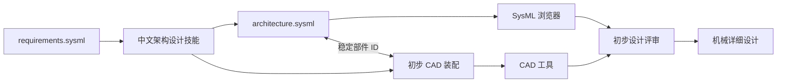
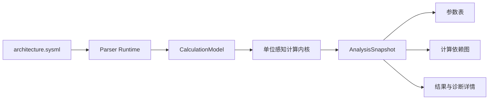
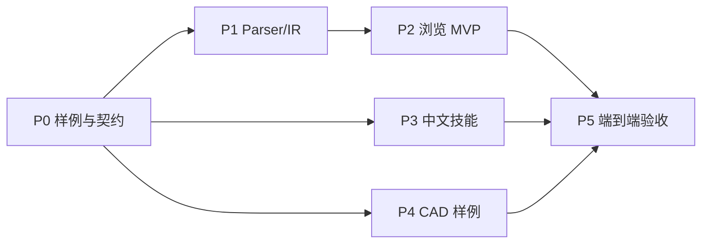

# 机器人系统架构与总体布局：实施计划

版本：V0.8　｜　状态：P2—P4 已完成　｜　更新日期：2026-09-19

## 1. 实施目标

本阶段沿用需求阶段已经确定的产品分工：

- **AI 技能负责业务工作**：读取需求、提出候选方案、完成选型、建立系统架构、参数计算和初步装配交接信息，并创建或修改工程文件。
- **软件负责通用浏览**：解析 SysML 文本，把系统组成、接口、连接和参数分析结果渲染成用户容易理解的视图。
- **样例负责定义和验收产品行为**：使用一个真实的机器人目标配置，贯通“需求输入—AI 设计—SysML 浏览—CAD 总体布局交接”。

首版要实现的业务闭环是：



这不是自动生成完整机器人。首版的完成标准是：AI 能依据已批准需求建立一个可解释的总体方案，用户能通过浏览器看懂系统组成、接口以及核心参数如何计算并是否满足需求，并能通过初步 CAD 装配确认部件可以放置、运动、安装和拆卸。

## 2. 首版范围

### 2.1 包含内容

1. 一个目标机器人只维护一个 `architecture.sysml`。
2. 使用 Package、Part、Port、Connection 和带单位属性表达系统方案。
3. 需求通过稳定 `reqId` 与架构责任建立简单关联。
4. 浏览器优先新增参数分析视图；装配交接表后移，部件与接口继续通过模型导航、架构图和属性查看浏览。
5. 保留现有模型导航、架构图、属性查看和源码定位。
6. AI 技能使用中文编写，指导从需求建立候选方案、参数计算和架构文件。
7. 提供一个金刚目标配置的完整样例。
8. 样例包含与 SysML 部件 ID 对应的初步 CAD 装配。

### 2.2 首版不包含内容

- 在浏览器中编辑或保存 SysML。
- 在浏览器中调用 AI 或执行技能。
- 在浏览器中进行三维 CAD 建模、装配约束或碰撞计算。
- 自动替工程师选择最终方案。
- 自动生成可制造零件、工程图、公差和工艺。
- 完整实现所有 SysML v2 语义。
- 以跨文件 `satisfy`、`allocate` 的完整解析作为首版前置条件。
- 建立第二套模型数据库或把浏览器派生数据保存为事实源。

## 3. 三类交付物

### 3.1 软件功能

软件继续使用现有 Web SysML 浏览器和 C++ Parser Runtime，不另建“架构设计软件”。新增能力均为只读视图。

| 功能 | 用户要解决的问题 | 首版行为 |
|---|---|---|
| 模型导航 | 机器人由哪些层级组成 | 按 Package、PartDefinition、PartUsage、Port、Calculation 和 Analysis 展开；层级以所有权关系为准 |
| 连接图 | 各部件如何协同 | 显示部件、端口和连接，选择节点后同步属性与源码 |
| 参数分析 | 质量、续航、峰值供电和控制时序怎样算出，是否满足需求 | 显示输入、中间量、输出、单位、公式、实际参数绑定、目标、余量和约束状态 |
| 计算依赖图 | 某个结论受哪些参数和公式影响 | 按“输入参数—计算—输出—约束”显示可追溯依赖链 |
| 属性查看 | 当前对象有哪些工程信息 | 对计算显示定义、绑定、输入、输出、公式和诊断；对架构元素继续显示职责、数量属性、接口、关系、外部引用和源码位置 |
| 诊断 | 哪些信息不能可靠解释或计算 | 显式报告未解析语法、缺失输入、单位错误、循环依赖和不支持的表达式，不产生伪数值 |

P2 不实现独立部件表和接口表，也不先实现固定字段的“预算表”。预算是参数计算及约束校核的业务结果，必须来自 SysML 中声明的公式和输入。装配交接表只提取已有信息，本轮后移。

#### 软件应复用的现有能力

- P4 已有架构树和架构连接图；
- 动态视图插件注册；
- ModelSnapshot、ModelQuery、统一元素选择和源码定位；
- 左侧模型导航、右侧属性查看；
- localhost C++ Parser Runtime；
- 单文件打开、刷新和诊断。

#### Parser Runtime 需要补齐的数据

架构层级、typed part、端口、连接、属性值和标准库类型已经由 P1/G1 覆盖。参数分析新增以下契约：

1. `CalculationDefinition`、`CalculationUsage` 和 Analysis 上下文；
2. 输入、局部量、返回值及其类型、量纲和单位；
3. 计算调用的形式参数与实际参数绑定；
4. 结构化表达式 AST、特征引用和源码范围；
5. Constraint 的比较表达式、目标及需求引用；
6. 不支持语法的能力标记和稳定诊断；
7. 供计算内核使用的 `CalculationModel`，以及求值后返回的 `AnalysisSnapshot`；
8. ViewDefinition、ViewUsage、`expose`、GridView、`asElementTable` 和有序 `columnView` 组成的 `ViewModel`。

当前 Runtime 0.5.0 对完整 `VehicleMode.sysml` 的实测没有输出 Calculation 或 Analysis 元素，并在 `calc` 处产生语法错误。因此下一步必须先补 Parser 和计算内核，不能由前端正则读取公式。详细方案见[《SysML 参数计算与分析：实施规划》](SysML参数计算与分析_实施规划.md)。

### 3.2 中文 AI 技能

新增技能目录建议为：

```text
AIDC/skills/robot-system-architecture/
├── SKILL.md
├── agents/openai.yaml
├── references/
│   ├── workflow.md
│   ├── sysml-authoring.md
│   └── preliminary-layout-checklist.md
└── assets/
    └── walking-robot-architecture-example.sysml
```

技能名称和说明均使用中文，正文指导 AI 完成以下业务工作：

1. 读取 `requirements.sysml`，提取会影响系统方案的业务目标和定量门槛；
2. 明确目标机器人配置、系统边界和假设；
3. 形成至少两个完整候选方案；
4. 围绕需求比较运动形式、自由度、执行器、控制器、传感器、供电和通信；
5. 选择方案并说明被否决方案的关键原因；
6. 建立系统、子系统、关键设备、端口和连接；
7. 用 `calc def`、分析调用和约束建立质量、能量/续航、峰值供电和控制时序计算，所有物理量携带单位；
8. 为 CAD 总体布局准备关节、父子装配、固定或运动关系、真实包络来源和安装接口信息；
9. 创建或修改一个 `architecture.sysml`；
10. 在有 CAD 工具时建立初步装配；没有 CAD 工具时输出明确的 CAD 布局任务，不伪造已验证结果；
11. 完成架构和装配交接检查。

#### 技能写作原则

- 聚焦机器人业务，不堆积项目管理字段。
- 不把需求文件改写为设计方案。
- 不因存在某个现成部件就默认它适合当前机器人。
- 不猜测舵机孔位、电池容量、质量、功耗或控制周期。
- 区分厂家数据、实测值、计算值和假设值。
- 无法确认的量保留为待验证项。
- SysML 数值使用显式单位。
- 架构方案必须考虑线缆、紧固空间、维修和装拆路径。
- `architecture.sysml` 与 CAD 装配使用一致的稳定部件 ID。

#### 架构文件的最小内容

默认只写业务需要的信息：

| 对象 | 默认内容 | 按需增加 |
|---|---|---|
| 系统或部件 | 稳定 ID、名称、职责、父子组成 | 数量、质量、平均/峰值功率、成本、CAD 引用 |
| 端口 | 名称、接口类别和方向 | 电压、电流、速率、协议、机械基准 |
| 连接 | 连接两端 | 线束、总线、机械载荷或安全行为说明 |
| 参数分析 | 原始输入、`calc def`、实际参数绑定、输出和单位 | 目标约束、余量、来源和待验证说明 |
| 装配交接 | 父装配、固定/运动、关节或安装接口 | 轴线、零位、限位、包络和维护要求 |

状态、负责人、审批流和进度不是默认字段。

### 3.3 业务样例

首版样例建议使用一个明确的 **金刚十轴双足机器人研究配置**。样例数值必须来自已核实资料、实测或明确标注的研究假设，不能把现有不同版本混成一个机器人。

建议目录：

```text
AIDC/samples/jingang-10axis-system-design/
├── requirements.sysml
├── architecture.sysml
├── layout/
│   ├── jingang-10axis-layout.FCStd
│   └── layout-preview.png
├── evidence/
│   └── source-register.md
└── README.md
```

样例至少覆盖：

- 整机、躯干、左右腿、头部、电源、计算、实时控制和感知子系统；
- 十个执行器及其关节归属；
- 电池、主控、控制板、IMU 和执行器总线；
- 电源、控制、反馈和机械安装接口；
- 整机质量、平均功率、续航、峰值供电和控制时序的可执行计算链；
- 续航需求、停止时间需求等到负责子系统的简单关联；
- 关节轴线、父子装配和固定/运动关系；
- 真实部件包络的来源状态；
- 单腿或髋部高风险安装接口；
- 典型姿态干涉、线束空间和电池/板卡拆出路径检查。

`architecture.sysml` 是浏览器和技能共用的规范样例。浏览器发布包中的示例由该规范样例同步生成，不能长期维护另一份内容相近但不同的副本。

## 4. 软件视图设计

### 4.1 页面布局

保持现有布局：

- 左侧：模型导航；
- 中间：当前业务视图；
- 右侧：属性查看；
- 顶部：文件、刷新和运行时状态；
- 底部或折叠区：解析诊断。

模型导航节点根据类型提供可打开的视图：

| 选择对象 | 可打开视图 |
|---|---|
| 根 Package / 根系统 PartDefinition | 架构树、架构图，以及模型中已声明的参数分析 Table View |
| PartDefinition | 组成树、连接图、相关参数分析 |
| PartUsage | 属性查看、相关参数、源码、CAD 引用 |
| Port / Interface | 属性查看、相关连接、源码 |
| Calculation / Analysis | 参数表、计算依赖图、计算详情、源码 |

### 4.2 信息记录原则

原始设计参数、计算定义、分析调用和约束仍保存在同一个 `architecture.sysml`。浏览器不维护表格数据库，不把计算结果写回源文件，也不要求新增 YAML、CSV 或 JSON 文件。



原始参数记录在真实所属的系统或部件上；公式记录为 `calc def`；当前配置的实际参数绑定和目标校核记录在 Analysis 中；Runtime 生成计算结果和追溯链。手工估算值不能与计算输出并存为两个事实源。

### 4.3 参数计算与分析

首版覆盖四条机器人方案计算链：

| 分析 | 典型输入 | 输出与校核 |
|---|---|---|
| 整机质量 | 部件数量、部件质量、装配附加量 | 总质量、质量余量、质量上限约束 |
| 能量与续航 | 电池能量、可用比例、各子系统平均功率 | 可用能量、平均功率、预计续航和 `2 [h]` 目标约束 |
| 峰值供电 | 执行器峰值电流、并发系数、电压、电子设备峰值 | 峰值电流/功率及电池、BMS、电源余量 |
| 控制时序 | 采样、通信、计算和执行延迟 | 端到端延迟、周期占用和停止响应约束 |

Runtime 负责构建依赖图、单位换算、拓扑求值、约束余量，以及缺值、单位错误、循环和除零诊断。浏览器结合 `ViewModel`、`ModelSnapshot` 和 `AnalysisSnapshot` 生成视图。第一步实现官方 `GridView + asElementTable`：表格行来自 `expose`，列及顺序来自 `columnView`；Table 验收后再实现计算依赖图。

首版限定为确定性标量代数运算，不支持采样函数、积分、状态仿真、递归、随机分析、优化和通用 TradeStudy。完整建模契约、数据结构、视图和 C0—C5 实施顺序见[《SysML 参数计算与分析：实施规划》](SysML参数计算与分析_实施规划.md)。

### 4.4 装配交接表（后续）

装配交接仍有业务价值，但它只是对 PartUsage 的部件 ID、父装配、固定/运动关系、关节或安装接口、包络来源和 CAD 引用进行只读汇总，不构成方案参数计算。该视图推迟到参数分析 C0—C4 完成后再实施；模型中的既有装配属性继续通过模型树、架构图和属性查看浏览。

## 5. 分阶段实施

### P0：样例目标与建模契约

状态：已完成（2026-09-18），详见[《P0：架构样例目标与建模契约实施报告》](P0_架构样例目标与建模契约_实施报告.md)。

工作：

- 从金刚资料中选择唯一十轴目标配置；
- 冻结首版系统、部件、接口、预算和装配交接的最小信息；
- 编写第一版 `architecture.sysml`；
- 逐项验证参考 Parser 支持情况；
- 明确哪些语义首版用简单属性表达。

交付：样例 V0、字段说明、Parser 能力差距表。

退出条件：样例没有混用不同机器人版本；每个字段都对应一个明确浏览用途或 CAD 交接用途。

### P1：Parser Runtime 与 ModelSnapshot 补齐

状态：已完成（2026-09-18），详见[《P1：架构 Parser Runtime 与 ModelSnapshot 补齐实施报告》](P1_架构Parser_Runtime与ModelSnapshot补齐_实施报告.md)。

工作：

- 修正架构层级、typed part、属性值、单位和连接端点解析；
- 在 ModelSnapshot 中保持通用 Element、Relationship 和 Property 结构；
- 增加预算和外部引用的只读查询能力；
- 对不支持语法输出明确诊断。

交付：Runtime 新版本、契约样例、黑盒回归结果。

退出条件：规范样例解析无错误；所有样例部件、接口、连接和预算值可从 ModelSnapshot 读取；不依赖前端文本正则补业务数据。

### P2：架构浏览与参数分析 MVP

状态：主体功能及 P2-R1—R4 全部完成（2026-09-18）。详细审计见[《P2：架构浏览与参数分析 MVP 收尾分析》](P2_架构浏览与参数分析MVP_收尾分析.md)，最终门禁见[《P2-R4：集成回归与样例同步实施报告》](P2-R4_集成回归与样例同步_实施报告.md)。图形阶段 G0—G3、参数阶段 C0—C4 均已完成。

已完成工作：

- `DiagramProjection`、typed part 实例端口和连接投影；
- ELK Layered 层次布局、边界端口、正交路由和稳定重排；
- 参考项目 `@GraphicMetadata` 兼容；
- 模型导航、架构连接图、属性与源码联动。

参数分析按以下子阶段实施：

- **C0 计算与 Table View 契约（已完成）**：冻结四条计算链，并定义显式 `GridView + asElementTable`、暴露行和有序列；
- **C1 Calculation/View Parser（已完成）**：解析计算语义，并投影 ViewDefinition、ViewUsage、`expose`、rendering 和 `columnView`；
- **C2 只读计算内核（已完成）**：实现单位感知求值、依赖排序、余量和错误诊断，提供 `/analyze`；
- **C3 金刚计算样例（已完成）**：把手工 `current*` 估算迁移为计算输出，并补齐输入来源；
- **C4 浏览 MVP（已完成）**：实现通用元素表格、计算详情联动和参数级依赖图。

P2 收尾工作：

- **P2-R1 计算语义依赖图（已完成）**：Runtime 0.8.0 输出稳定形式参数/实际参数绑定和约束目标依赖，浏览器按“输入参数—CalculationDefinition—CalculationUsage—输出参数—Constraint”投影并支持模型选择联动；
- **P2-R2 计算详情完善（已完成）**：显示计算定义、调用、形式参数/实际参数绑定、输入、局部量、返回值、约束和关联诊断；过滤默认标志等无业务意义的内部属性，并统一中文状态；
- **P2-R3 异常状态浏览验收（已完成）**：增加缺少输入、单位错误、循环依赖、不支持表达式和运行错误的浏览样例，确认空值、中文状态、诊断源码定位和依赖图中断标识正确且不显示伪数值；
- **P2-R4 集成回归与样例同步（已完成）**：增加输入变更重算、表/图/源码历史、需求样例回归的自动验收；以正式金刚模型为唯一源，通过脚本同步发布样例并在构建前检查哈希。

交付：CalculationModel、AnalysisSnapshot、ViewModel、TableProjection、Runtime 新版本、显式声明 Table View 的金刚样例、Web 表格/详情视图和回归测试。

退出条件：用户可从模型树打开 SysML 中声明的核心参数 Table View；表格行、列和顺序符合 View；用户无需阅读源码即可解释四项核心结果如何得出、是否满足需求，以及哪个输入造成未通过或无法计算；修改输入后所有下游结果一致更新。原 G4 调整为图形类 View Rendering 的后续阶段；Table View 已纳入 C4A，装配交接表安排在 C4 之后。

### P3：中文架构设计技能（已完成）

已完成工作：

- 已创建 `robot-system-architecture` 技能；
- 已编写业务流程、SysML 写法、布局检查清单和异常场景验收说明；
- 已将唯一规范 `architecture.sysml` 同步为技能资产并校验 SHA-256 一致；
- 已用缺少信息、方案冲突和单位错误三个场景验证未知量、冲突和量纲错误的处理边界；
- 已确认技能交付只包含技能、参考资料和资产，不要求编辑浏览器代码，也不把金刚业务规则固化进软件。

交付：中文 `SKILL.md`、参考资料、资产和 Agent 显示配置。

退出条件：已满足。规范单文件模型经 Runtime 0.8.1 解析为 230 个元素、163 条关系且 0 个解析错误；未知参数、数据来源、最小字段和 CAD 交接边界均已写入技能契约。验收证据见[《中文架构设计技能 P3 实施报告》](中文架构设计技能_P3实施报告.md)。

### P4：初步 CAD 装配样例

状态：已完成（2026-09-19）。方盒包络已退出主模型，详细十轴机械装配已作为初步装配基线；尚未冻结的电子件配置和 HD-1910 实物接口作为机械详细设计输入保留，不再阻断 P4 退出。实施证据见[《初步 CAD 装配样例 P4 实施报告》](初步CAD装配样例_P4实施报告.md)，后续建模方法由[机器人初步 CAD 装配设计技能](../skills/robot-preliminary-cad-assembly/SKILL.md)统一指导。

工作：

- 建立十轴运动骨架和装配层级；
- 导入或建立有来源的关键部件包络；
- 完成单腿或髋部关键接口验证；
- 布置电池、板卡、IMU 和线束空间；
- 检查典型姿态、运动包络、拆出路径、质量和质心；
- 让 CAD 对象与 SysML 部件 ID 对应。

交付：FreeCAD 初步装配、预览图、检查结果、来源登记，以及可复用的初步 CAD 装配设计技能。

退出条件：样例证明部件能够形成合理装配；尚未验证的接口在模型和报告中清楚可见，不能以占位体冒充真实接口。

当前结果：主 FreeCAD 文件保留了 212 个文档对象和 83 个叶级几何对象；30 个打印 STL、39 个实物打印件的尺寸与 SHA-256 已核对，10 个 HD-1910 名义尺寸图重建件和 19 个 SysML ID 映射通过。P4 按初步装配边界退出；Raspberry Pi Zero 2 W / Radxa Zero 3W、RPI Robot HAT / OpenRB-150 的配置冲突，IMU 包络，以及 HD-1910 花键、螺纹、盲孔深度和实物配合，均保持为详细设计未关闭项，制造状态继续为 `NOT_RELEASED`。

### P5：端到端业务验收

按以下路径验收：

1. 给 AI 技能输入需求样例和已知硬件资料；
2. 生成或更新 `architecture.sysml`；
3. 使用浏览器打开并检查组成、连接、接口和核心参数分析；
4. 使用同一部件 ID 检查 CAD 总体布局；
5. 修改一个需求或硬件参数，重新计算并观察参数链和布局影响；
6. 由机械、电气、控制和测试角色完成初步设计评审。

交付：端到端验收记录、问题清单和下一阶段输入包。

退出条件：评审人员能够依据样例决定是否进入机械详细设计，并能指出所有未关闭的系统或装配风险。

## 6. 实施顺序与依赖



P0 是唯一共同前置。浏览器、技能和 CAD 样例都围绕同一个规范样例开发，避免先开发大量通用功能，再发现业务文件无法表达真实装配交接。

建议执行顺序为：**P0 → P1 → P2，同时开展 P3 和 P4，最后 P5**。

## 7. 首版验收指标

### 7.1 样例和 Parser

- 一个根 Package、一个 `architecture.sysml`；
- 样例解析错误为 0；
- 样例中的部件、端口和连接均可定位到源码；
- 连接端点解析完整，无法解析时有明确诊断；
- 所有输入和计算结果显示正确单位；
- 缺失值不按零计算；
- SysML 与 CAD 使用一致的部件 ID。

### 7.2 软件

- 模型导航层级与 SysML 所有权一致；
- 参数分析表来自 SysML ViewModel 与 AnalysisSnapshot；行来自 `expose`、列顺序来自 `columnView`，并可定位回计算定义、调用、输入、约束和源码；
- 表、图、树、属性和源码选择同步；
- 属性面板不显示错误类型值或无意义内部属性；
- 软件不修改源文件，不包含 AI、技能执行和 CAD 编辑能力；
- 原有需求浏览样例继续通过回归。

### 7.3 技能

- 全部用户可见说明使用中文；
- 从需求提取设计驱动因素，而不篡改需求；
- 至少提出两个完整候选方案后再选择；
- 输出单个简洁 `architecture.sysml`；
- 数值带单位，数据来源状态可区分；
- 未知数据不被猜测；
- 输出包含 CAD 总体布局所需的装配交接信息；
- 能使用样例完成一次从需求到初步设计评审的闭环。

### 7.4 初步装配

- 关节轴线、零位、限位和父子关系明确；
- 关键采购件包络有来源；
- 单腿或髋部高风险接口经过几何或样件验证；
- 典型姿态没有未解释的刚体干涉；
- 电池、板卡和维护件存在可行拆出路径；
- 线束具有路由空间和跨关节活动余量；
- 质量、质心和外廓结果可追溯；
- 模型明确标识尚未达到制造放行状态。

## 8. 实施风险与处理

| 风险 | 处理方式 |
|---|---|
| 参考 Parser 无法完整解析 typed part 或嵌套端口 | P0 使用最小样例做门禁；首版采用已验证写法，不在前端猜关系 |
| `satisfy` / `allocate` 关系不可靠 | 首版用稳定需求 ID；Parser 能力成熟后迁移 |
| SysML 文件字段快速膨胀 | 原始输入只记录在真实所属对象；派生结果由计算生成；状态和管理字段默认排除 |
| 架构样例和浏览器样例分叉 | 保留一个规范样例，由构建或同步脚本复制到发布目录 |
| CAD 占位体被误认为真实部件 | 每个包络记录来源状态；属性面板和评审报告显示“已核实/占位/待验证” |
| 浏览器逐渐变成 CAD 软件 | 只显示 CAD 引用和检查摘要，几何编辑和分析留在 FreeCAD |
| AI 编造硬件参数 | 技能要求来源分类，缺失量保留待验证，样例验收检查数值来源 |
| Parser 标准库已加载但不能解析计算语法 | C0 冻结最小子集；C1 以黑盒契约补 Parser，不把标准库存在误判为用户计算可用 |
| 前端和 Runtime 各自解释公式 | 计算只在 Runtime 执行，浏览器只消费 AnalysisSnapshot |

## 9. 下一轮实施建议

P2 的 G0—G3、C0—C4 和 P2-R1—R4、P3 中文架构设计技能、P4 初步 CAD 装配样例及其建模技能均已完成。下一阶段进入 P5 端到端业务验收；电子件配置和真实执行器接口在机械详细设计中继续关闭。Runtime 0.8.x / Browser 0.8.x 基线继续由 `npm run verify:p2` 保护。

机器人三维模型浏览能力作为独立实施线推进，规划见[《机器人三维模型浏览器实施规划》](机器人三维模型浏览器_实施规划.md)。该实施线以 V0—V2 形成基础浏览和舵机驱动 MVP，以 V3—V4 完成干涉与装配评审，以 V5—V6 接入仿真回放和实时数据，不改变 P5 对现有架构与参数分析流程的验收范围。

装配交接表、需求责任视图、候选方案比较、预定义工况、通用图形类 SysML View Rendering 和外部求解器不作为 P2 收尾阻断项，分别进入 P3/P4/C5 或后续视图扩展。P2 仍不增加前端文本正则，也不在浏览器中固化机器人计算公式。
