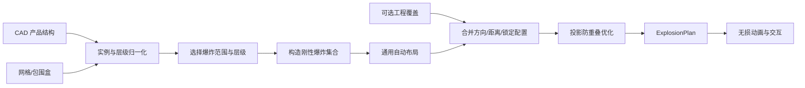

# 通用装配体爆炸图设计规划

版本：V0.1  
日期：2026-09-21  
状态：待实施

## 1. 结论

爆炸图首先是装配体观察功能，目标是让用户看清零件、子总成及其空间关系。它不是拆装工艺仿真，也不应依赖机器人、SysML 或当前金刚样例的专用语义。

软件必须只依赖 CAD 产品结构、零件实例、基准位姿和网格包围信息即可生成可用的爆炸图；模型工程可以提供人工覆盖以获得出版级效果，但人工数据不是启用功能的前提。

当前实现按“部件中心到整机中心”的三维径向方向平移，并使用固定最大距离。该方法可以作为无层级模型的最后兜底，不能继续作为正式算法：它忽略子总成层级、观察方向、零件尺寸和投影遮挡，也会让内置件沿不合理方向穿出外壳。

## 2. 开源实现调研

### 2.1 轻量 Web CAD 查看器

开源项目 `tegos/cad-3d-viewer` 使用 OCCT WASM 读取 STEP 产品树，并为每个顶层节点建立变换节点。运行时爆炸算法计算整机中心和顶层节点中心，将节点沿两者连线径向移出，位移尺度取整机半径的倍数。

优点：

- 不需要专用模型数据；
- 实现简单、可逆，适用于任意包含多个顶层零件的 STEP；
- 位移尺度随模型尺寸变化。

局限：

- 只处理顶层节点；
- 不处理子总成逐级展开；
- 不考虑屏幕投影重叠和拆出路径；
- 中心附近零件方向不稳定；
- 对长条、壳体和嵌套装配效果较差。

参考：<https://github.com/tegos/cad-3d-viewer>

### 2.2 FreeCAD ExplodedAssembly

`JMG1/ExplodedAssembly` 不尝试完全自动推断工程正确的拆卸方向。用户选择一个或多个 Body/Part，再选择参考面，软件使用参考面法向作为移动方向。它支持：

- 多个零件组成同一爆炸组；
- 子爆炸组；
- 每组独立方向、距离、速度和旋转；
- 螺栓组沿轴移动并绕轴旋转；
- 保存初始位姿并无损复位；
- 按步骤正向拆解和反向装配。

这说明成熟 CAD 工具把“方向和分组”视为爆炸视图定义，而不是从几何中心强行猜测。

参考：<https://github.com/JMG1/ExplodedAssembly>

### 2.3 FreeCAD 内置 Assembly Exploded View

FreeCAD Assembly 工作台把爆炸视图保存为装配体下的独立对象。用户为一组零件创建 Move，使用操纵器或精确距离定义爆炸位姿，并排列步骤。爆炸位姿与装配约束位姿分离；Collapsed 可以恢复求解后的装配状态，一个装配体可保存多个爆炸视图。

这一做法适合本项目采用：爆炸状态应是派生显示状态，不修改 CAD 基准位姿；爆炸图也应与装配模拟分开。

参考：<https://github.com/FreeCAD/FreeCAD-documentation/blob/main/wiki/Assembly_Workbench.md>

### 2.4 ExplodeView

ExplodeView 的公开产品说明强调保留 STEP 装配树，支持按零件或子总成配置轴向和距离，并把选择、高亮、BOM 与爆炸交互组合起来。可借鉴其产品形态，但不直接依赖其实现或许可证。

参考：<https://explodeview.com/>

## 3. 产品边界

爆炸图只回答：

- 装配体有哪些集合和零件；
- 零件位于哪个子总成；
- 零件在装配体中的相对位置；
- 如何减少遮挡以便观察、选择和识别。

爆炸图不声明：

- 零件可以沿显示方向真实拆出；
- 工具可以进入；
- 拆装过程中不存在干涉；
- 显示顺序就是制造或维修工艺顺序。

上述工程结论属于“装配模拟”，必须由装配步骤和路径校核提供。

## 4. 总体方案

采用“通用自动布局＋可选人工覆盖”的混合架构：



运行时必须先生成不可变的 `ExplosionPlan`，再由滑块插值显示。拖动滑块时不重新求解方向，避免零件跳动。

## 5. 输入归一化

### 5.1 最小必需数据

- 唯一节点 ID；
- 节点类型：集合或部件；
- 父子关系；
- 部件实例的基准局部变换；
- 部件网格或世界包围盒。

不依赖 SysML ID、机器人关节、功能系统或业务分类。

### 5.2 爆炸集合

默认以所选范围的直接子节点作为爆炸集合：

- 直接子节点为部件时，移动该部件；
- 直接子节点为集合时，整个子树刚性移动；
- 用户进入子集合后，才展开其内部零件；
- 同一层禁止父节点和后代同时作为目标，避免重复位移。

这样可以保证整机先展开成模块，模块再展开成零件，符合装配树的阅读方式。

## 6. 通用自动布局算法

### 6.1 工作平面

自动布局以用户启动爆炸时的相机为依据，建立固定的相机右向量 `R`、上向量 `U` 和观察向量 `V`。爆炸方向主要位于 `R-U` 观察平面，使零件在屏幕上分开，而不是无意义地沿景深方向互相遮挡。

进入爆炸后方向被冻结；用户改变视角不会重新排列。工具栏提供“按当前视角重新布局”。

### 6.2 初始方向

对每个爆炸集合：

1. 计算集合包围盒中心；
2. 将中心投影到观察平面；
3. 使用投影中心相对范围中心的径向方向作为首选方向；
4. 对中心重合或方向过近的集合，按极角排序分配稳定扇区；
5. 如果存在人工方向覆盖，则直接使用覆盖方向；
6. 如果模型提供装配接口轴，可作为模型坐标模式下的候选方向。

所有排序必须使用稳定节点 ID 作为最终决胜项，保证同一模型重复打开得到相同结果。

### 6.3 自适应间距

界面使用无量纲“展开程度”和“间距”控制，不让用户为不同单位、不同尺寸的模型直接填写固定毫米值。

每个集合的完全展开距离由以下因素共同决定：

- 当前范围包围盒对角线；
- 集合在移动方向上的投影尺寸；
- 集合所在层级；
- 同方向集合的轨道序号；
- 用户间距系数。

最小距离应保证完全展开时原始轮廓与爆炸后轮廓之间存在可见间隙。

### 6.4 屏幕空间防重叠

初始布局后，将各集合的八角包围盒投影为屏幕矩形，执行确定性的迭代松弛：

1. 检测爆炸后矩形之间的重叠；
2. 沿各自径向增加距离；
3. 必要时加入少量切向偏移；
4. 保持同一子总成成员相邻；
5. 达到无重叠、最大迭代次数或画布边界后停止。

该过程解决“几何上已经分开，但屏幕上仍然挡住”的核心问题。

### 6.5 锚定策略

默认锚定当前范围本身，不单独移动根节点。用户可将某个直接子集合设为锚点，其他集合相对它展开。自动模式可以建议靠近范围中心且体积最大的集合为锚点，但不得静默改变产品结构。

## 7. 人工覆盖契约

自动算法必须在没有配置时工作。为了保存出版级爆炸图，模型工程可以增加可选文件 `exploded-views.json`：

```json
{
  "schemaVersion": "aidc.model3d.exploded-views/0.1",
  "views": [
    {
      "viewId": "whole-product",
      "name": "整机爆炸图",
      "scopeNodeId": "ROOT",
      "camera": "front",
      "spacing": 1.0,
      "overrides": [
        {
          "nodeId": "HEAD-ASSEMBLY",
          "direction": [0, 1, 0],
          "distance": 0.12,
          "locked": true
        }
      ]
    }
  ]
}
```

覆盖绑定 CAD 产品结构节点，不绑定 SysML 元素。集合覆盖作用于整个子树。

## 8. 交互设计

装配页拆分为两个互斥子模式：

### 8.1 爆炸视图

- 范围：整机或当前集合；
- 层级：当前层、递归两级、全部叶部件；
- 展开程度滑块；
- 间距滑块；
- 按当前视角重新布局；
- 设置/清除锚点；
- 显示引出线；
- BOM 标注；
- 精确归位；
- 保存当前爆炸视图到模型工程。

选择树节点时高亮对应爆炸集合。双击集合进入该子总成爆炸范围。

### 8.2 装配模拟

保留步骤、依赖、关键帧、工具和路径校核功能。进入装配模拟前先退出爆炸状态；进入爆炸视图前先恢复装配序列到装配完成状态。界面不得再出现“爆炸 0%，但模型仍处于拆卸状态”。

## 9. 运行时结构

```ts
interface ExplosionPlan {
  scopeNodeId: string;
  cameraBasis: { right: Vec3; up: Vec3; view: Vec3 };
  entries: ExplosionEntry[];
}

interface ExplosionEntry {
  nodeId: string;
  memberPartNodeIds: string[];
  baseLocalMatrix: number[];
  direction: Vec3;
  distance: number;
  lane: number;
  source: 'AUTO' | 'MODEL_OVERRIDE' | 'USER_OVERRIDE';
}
```

运行时只执行：

```text
displayMatrix = parentWorldInverse × translation(direction × distance × factor) × baseWorldMatrix
```

任何时刻都从冻结的基准位姿计算，禁止在上一帧位置上累加。

## 10. 实施阶段

### E1：状态与界面拆分

**状态：已于 2026-09-21 完成。** 已交付互斥子模式、跨模式精确复位、独立的 `ExplosionRig` 与 `AssemblyRig`，以及基于 CAD 产品结构根集合直接子节点的刚性爆炸。实施与验收证据见[《E1：爆炸图状态与界面拆分实施报告》](E1_爆炸图状态与界面拆分_实施报告.md)。

- 爆炸视图与装配模拟改为互斥子模式；
- 清除当前径向爆炸和装配时间线的状态歧义；
- 爆炸目标改用 CAD 产品结构节点。

### E2：层级感知自动爆炸

**状态：已于 2026-09-21 完成。** 已支持 CAD 集合范围、当前层/递归两级/全部叶部件、相机观察平面稳定方向、模型尺度自适应距离和显式按当前视角重新布局。实施与验收证据见[《E2：层级感知自动爆炸实施报告》](E2_层级感知自动爆炸_实施报告.md)。

- 支持选择范围和逐级展开；
- 实现相机平面方向、稳定扇区和自适应距离；
- 支持集合刚性移动并杜绝父子重复位移。

### E3：可读性优化

**状态：已于 2026-09-21 完成。** 已交付屏幕投影矩形迭代松弛、剩余重叠诊断、BOM 序号、引出线、标注选择联动和按当前视角完整重算。实施与验收证据见[《E3：爆炸图可读性优化实施报告》](E3_爆炸图可读性优化_实施报告.md)。

- 屏幕矩形重叠检测和迭代松弛；
- 引出线、BOM 序号和选中联动；
- 按当前视角重新布局。

### E4：视图持久化

- 增加 `exploded-views.json` 契约；
- 保存命名爆炸视图、锚点和人工覆盖；
- 数据保存在模型工程中，软件工程只保存通用算法和默认参数。

### E5：通用性验收

**状态：已于 2026-09-21 完成。** 已建立机器人、同轴轴系、箱体和无 AIDC 配置第三方 STEP 四类冻结门禁；浏览器可从裸 GLB/glTF 场景层级自动生成产品树，第三方 STEP 可经通用 FreeCAD 转换器生成浏览发布物。实施与验收证据见[《E5：通用装配体爆炸图验收报告》](E5_通用装配体爆炸图验收报告.md)。

至少使用以下装配体进行冻结验收：

- 机器人：多级子总成、左右对称、内置电子件；
- 轴系或减速器：同轴零件、轴承、垫片和紧固件；
- 箱体类装配：外壳、盖板和内部零件；
- STEP 第三方样例：无任何 AIDC 扩展配置。

## 11. 验收标准

- 无扩展配置的多零件 STEP 可以生成爆炸图；
- 默认只展开当前范围的直接子节点；
- 集合移动时所有后代保持相对位姿；
- 不存在父子节点重复位移；
- 0% 时所有节点严格恢复基准矩阵；
- 100% 时目标节点在屏幕空间不存在大面积互相覆盖；
- 相同模型、相机和配置生成确定性相同的布局；
- 切换爆炸视图与装配模拟不会残留上一模式的变换；
- 自动生成结果可由人工方向和距离覆盖；
- 所有保存数据位于模型工程，不写入软件源码或浏览器全局状态。
