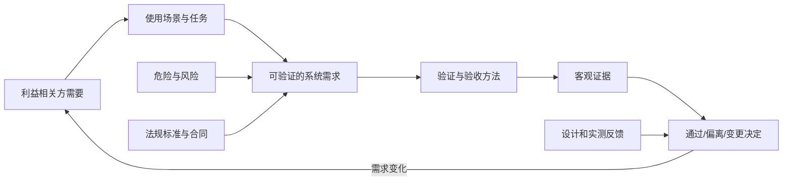
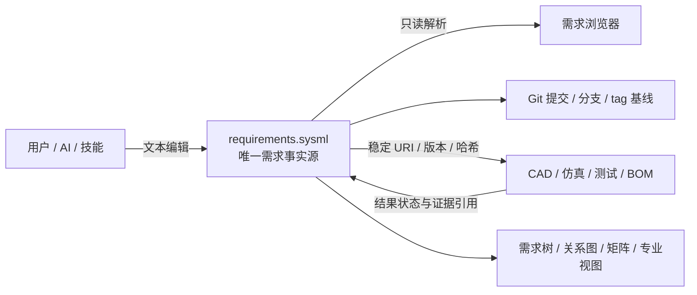
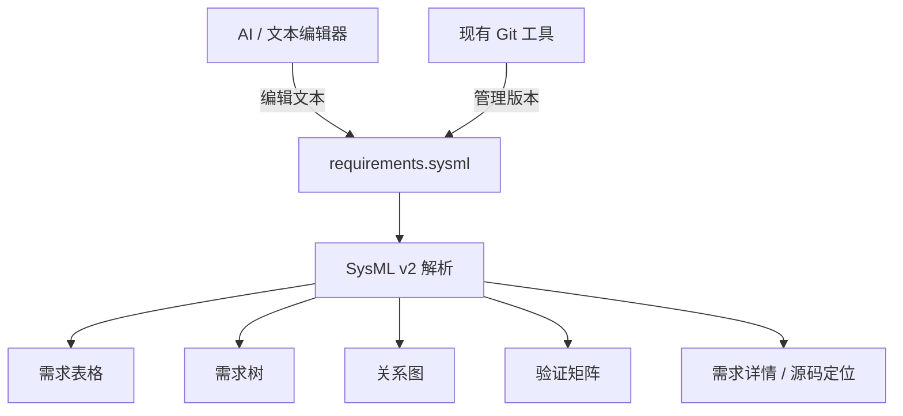

# 机器人需求与验收定义：业务流程与 SysML 浏览器方案

调研日期：2026-09-17　｜　版本：V0.2　｜　适用范围：机器人研发、样机制造与小批交付

本文细化 [机器人设计到制造全流程工具链总体规划](机器人设计到制造全流程工具链_调研与总体规划.md) 的第一个环节，说明怎样从一个模糊的机器人想法形成可交给机械、电气、控制、仿真、制造和测试环节的设计输入。

本环节的业务定位是：**把“想做什么机器人”转换为“各专业据此设计什么、受什么约束、最后怎样判断设计成功”**。单个 SysML v2 文本文档是需求事实源，AI 使用业务技能直接编辑文本，现有 Git 工具负责版本；本软件只把不便阅读的纯文本渲染成表格、需求树、关系图和验证矩阵，类似浏览器渲染 HTML。

本文结合金刚项目现状提出实施建议，但不替金刚补写或批准产品需求。文中的数值化机器人需求均标为“示例”时才可使用；正式阈值必须由产品目标、风险分析、实测能力和责任人评审确定。标准摘要用于范围筛选，正式合规或认证工作必须取得适用标准全文，并结合销售地区、产品类别和使用场景重新判定。

## 1. 这个环节在机器人设计业务中干什么

用户开始时通常只有一句话，例如“做一台能在室内遥控行走的小型机器鸭”。这句话不能直接驱动 CAD、执行器选型、电路设计或控制训练。业务人员与 AI 需要把它逐步展开成六类可执行信息：

| 业务结果 | 需要回答的问题 | 对后续设计的价值 |
|---|---|---|
| 产品任务 | 谁在什么环境中使用机器人完成什么任务 | 决定机器人形态、工作空间、交互方式和自主程度 |
| 系统边界 | 机器人包含什么，控制端、充电器和场地是否属于系统 | 避免机械、电气、软件各自假设不同产品范围 |
| 能力与性能 | 要完成哪些动作，负载、速度、续航、精度和响应达到什么程度 | 给方案论证、器件选型、尺寸和功率预算提供输入 |
| 约束与风险 | 成本、尺寸、材料、供应、环境、法规和危险边界是什么 | 排除不可行方案，派生安全状态和保护要求 |
| 验收合同 | 在什么条件下，用什么方法和数据判断达到要求 | 让仿真、样机和测试围绕同一目标工作 |
| 版本与变更影响 | 当前设计针对哪个产品变体，需求变化会影响哪些资产 | 防止 CAD、模型、策略和实物版本错配 |

这个环节的完成标志不是“写完一份需求文档”，而是下游团队能够领取一组有版本、可追溯、可验证的设计输入，并清楚看到仍未决定的参数、风险和责任人。

### 1.1 谁浏览这些需求

| 角色 | 浏览时关注什么 | 浏览器应呈现什么 |
|---|---|---|
| 产品发起人 | 用途、用户、价格和交付目标是否表达清楚 | 产品目标、主场景、门槛、目标和未决项 |
| 系统设计负责人 | 将任务转成能力、边界、接口和专业分配 | 系统视图、需求树、分配关系、冲突与影响分析 |
| 机械/电气/控制工程师 | 领取本专业的明确输入，回填方案和能力 | 专业筛选视图、设计输入包、待定项和变更提议 |
| 测试/质量人员 | 可测性、判据、资源和证据是否完整 | 验收矩阵、测试条件、覆盖和证据状态 |
| 项目负责人/评审者 | 判断当前是否足以开始设计或进入下一阶段 | 决策摘要、风险、差异、批准和基线 |
| AI 助手 | 读取当前需求及关系，为用户生成或修改文本 | 直接编辑 SysML 文本；不依赖浏览器提供 AI 功能 |

小团队中一个人可以承担多个角色。业务责任、AI 使用规则和审批流程不由浏览器实现。

## 2. 用户怎样从零定义一台机器人

下面是业务与 AI 从零定义机器人的流程。浏览器在每一步负责呈现当前结果，不负责驱动流程或编辑内容。

| 步骤 | 业务人员做什么 | AI 如何协助 | SysML 中形成的内容 | 进入下一步的条件 |
|---|---|---|---|---|
| 1. 创建项目 | 选择机器人类型、研发阶段、目标市场和参考项目 | 建立文件骨架，列出需确认的关键问题 | 项目卡、产品类型、术语和初始假设 | 产品对象和责任人明确 |
| 2. 描述用户与任务 | 用自然语言、图片或资料说明机器人为什么存在 | 访谈式追问操作者、环境、频率、成功结果和失败后果 | 产品简述、利益相关方和核心任务 | 至少一个主场景有开始、过程和结果 |
| 3. 展开场景 | 补充正常、边界、故障、维护和运输场景 | 生成候选异常分支，发现遗漏和冲突 | 场景卡、状态、环境参数和任务流程 | 关键生命周期场景已覆盖 |
| 4. 确定系统边界 | 选择机器人、控制端、供电、场地和外部设备的归属 | 从资料识别潜在组件与接口，生成边界草案 | 系统边界、产品变体和外部接口 | 系统内外责任明确 |
| 5. 形成能力与指标 | 对每个场景定义必须表现出的能力和门槛 | 把模糊词转成待确认指标，提示量纲、工况和依据 | 系统需求、约束、TBD/TBR 和优先级 | 关键能力有条件和可观察结果 |
| 6. 分配专业设计 | 分配给机械、电气、控制、软件、制造或多专业 | 提议分解与接口，检查冲突和未分配项 | 专业设计输入包、接口需求和预算项 | 每条关键需求有负责专业 |
| 7. 设计验收方法 | 选择检查、分析、演示或试验，补全判据 | 生成测试草案、数据字段和设备需求 | 验收矩阵、验证用例和可测性需求 | 每条强制需求有验证计划 |
| 8. 评审并发布 | 浏览差异、风险和未决项，批准或退回修改 | 生成评审摘要和影响说明，不代替签署 | 需求基线、决策记录和下游领取包 | 强制缺项关闭或获条件批准 |

发布基线后，专业团队回填方案和实测能力，系统负责人比较“设计能力”和“需求门槛”，必要时修改 SysML 文本并通过 Git 提交新版本。

### 2.1 金刚示例用户旅程

以“原生十二轴机器鸭在室内硬质平地遥控行走”为例：

1. 用户选择“足式机器人—样机阶段”，引用现有金刚资料。
2. AI 读取项目索引，汇总已有型号、CAD、MJCF、策略和验证报告，把不一致项列为问题，不直接认定哪个版本正确。
3. 用户确认开机、站立、前进、转向和停止等主任务，补充低电、通信中断与跌倒恢复。
4. AI 在 SysML 文本中形成十二轴产品边界，并提示确认控制端、充电设备和测试地面是否属于交付范围。
5. AI 将“走得稳、及时停住”改写为带工况和待定门槛的候选需求，由用户填写或批准门槛。
6. 系统将质量/包络分给机械，功耗/电池分给电气，动作周期/安全状态分给控制，场景参数和评价指标分给仿真测试。
7. AI 在 SysML 中建立 Verification Case；浏览器渲染验收矩阵。现有 CPU 验证登记为范围受限的历史证据，真机项保持未验证。
8. 评审者在浏览页面批准 V1 基线，各专业从自己的视图领取设计输入。

## 3. 本环节怎样支撑后续机器人设计

需求不能只停留在纯文本。浏览器把同一 SysML 模型渲染为不同专业易读的输入视图。

| 下游环节 | 浏览器呈现的输入 | 设计过程回写到 SysML 的内容 | 重点浏览关系 |
|---|---|---|---|
| 系统方案 | 任务、能力、边界、变体、成本/质量/功率预算 | 架构备选、权衡、组成与接口 | 关键能力是否有方案承担，预算是否闭合 |
| 机械设计 | 包络、质量、自由度、工作空间、负载、地面与维护场景 | CAD 修订、材料、质量、行程、限位和接口 | 包络/质量/行程是否越界，需求是否分配到部件 |
| 电气设计 | 续航、峰值/平均功率、执行器与传感器、通信和保护 | 电源树、器件、接口、线束和电气预算 | 电压/电流/热/接口与故障保护是否满足约束 |
| 控制与软件 | 模式、状态转换、响应时间、安全状态、观测/动作和日志 | 控制架构、协议、策略兼容性和诊断 | 状态/故障行为是否完整，版本和动作维数是否匹配 |
| 仿真与训练 | 场景参数、指标、约束、扰动和失败判据 | 模型假设、训练任务、覆盖与能力边界 | 仿真声明是否超出模型有效范围，指标是否对应需求 |
| 制造与装配 | 材料/工艺约束、关键特性、替代料、装配与维护要求 | EBOM/MBOM、工艺、检验点和实装偏差 | 制造包是否覆盖关键特性，替代项是否触发复验 |
| 测试与交付 | 被测配置、条件、判据、方法、样本和证据要求 | 规程、原始数据、报告、偏离和签署 | 证据是否对应正确配置，是否足以关闭需求 |

专业工程师看到的是“与我有关的设计输入”，系统负责人看到跨专业关系，产品负责人看到任务和能力是否闭环。这些视图都来自同一个 SysML 文本文档。

## 4. 软件产品形态：像浏览器渲染 HTML

`requirements.sysml` 是文本源文件，作用类似 HTML 源码；需求浏览器负责读取并渲染，不负责创建、编辑、审批、版本管理或执行 AI。AI、文本编辑器和 Git 都是浏览器之外的现有工具。

### 4.1 核心浏览视图

| 视图 | 渲染内容 | 浏览操作 |
|---|---|---|
| 需求表格 | ID、标题、正文、分类、状态、责任人、变体和验证状态 | 排序、筛选、搜索、分页、定位源码 |
| 需求树 | 需要、系统需求、子系统需求和接口需求的层级 | 展开/折叠、上下游跳转 |
| 追溯关系图 | derives、satisfy、verify、allocate 等关系 | 按关系类型过滤、查看相邻节点 |
| 需求详情 | 单条需求的属性、来源、约束、上下游和外部引用 | 引用跳转、复制 ID、打开外部 URI |
| 场景视图 | 参与者、环境、主流程、异常流程及关联需求 | 按场景浏览关联需求 |
| 验证矩阵 | 需求、Verification Case、方法、判据和证据引用 | 按覆盖状态、方法和专业筛选 |
| 专业视图 | 分配给机械、电气、控制、仿真、制造或测试的需求 | 按专业和产品变体筛选 |
| 源码视图 | 当前元素对应的 SysML 文本和行号 | 只读查看、复制、跳转 |

所有视图都由当前 SysML 文本即时派生，不保存第二份需求数据。源文件变化时重新解析和刷新页面。

## 5. 单个 SysML v2 需求文档

每个机器人项目在本环节只维护一个 `requirements.sysml`。文件内部用 package 或命名空间组织内容，而不是拆成多套格式：

| 文件内逻辑分区 | 保存内容 |
|---|---|
| Project | 产品名称、类型、阶段、变体、责任人和术语 |
| StakeholdersAndNeeds | 利益相关方、原始需要、来源和决策权 |
| Scenarios | 正常、边界、故障、维护和运输场景 |
| Requirements | 利益相关方需求、系统需求、接口需求和专业分配 |
| Verification | Verification Case、方法、判据及外部测试/证据 URI |
| Decisions | 假设、TBD/TBR、方案决定、偏离和批准信息 |

需求 ID、状态、优先级、适用变体、责任人、来源和业务分类通过 SysML v2 元素、关系及项目自定义 metadata 表达。CAD、仿真模型、测试日志、图片和视频仍由各自工具管理，需求文件只保存其稳定 URI、版本和哈希。

Git commit 是精确版本，Git tag 表示批准基线；不再额外维护基线清单文件。浏览器中的需求树、场景页、追溯矩阵、专业输入和验收页都是 `requirements.sysml` 的派生视图，不另存一套业务数据。

### 5.1 AI、技能和 Git 在软件之外

AI 可以像编辑 HTML 一样直接编辑 SysML 文本；机器人需求分类、提问方式和检查规则由 AI 使用的技能提供；Git 通过现有命令行或客户端管理版本。浏览器不封装这些能力，只在文件保存后重新渲染。

## 6. 软件与业务知识的边界

### 6.1 软件只负责浏览

软件本体只需要：

- 读取一个本地或指定地址的 SysML v2 文本文档。
- 解析需求、属性、metadata、package 和关系。
- 将解析结果渲染为表格、需求树、关系图、详情和验证矩阵。
- 提供筛选、搜索、展开、关系跳转、源码定位和外部链接跳转。
- 监听或手动刷新文件变化，并显示无法解析的位置和原因。

软件不提供文件编辑器、AI 接口、补丁管理、审批工作流、Git 操作、需求质量检查器、技能运行时、数据库或写回能力。

### 6.2 业务知识属于 AI 技能

业务技能定义“这个领域应该问什么、生成什么、怎样检查”，其输出仍写入同一个 `requirements.sysml`：

| 技能类别 | 负责的业务知识 | 示例 |
|---|---|---|
| 机器人通用需求技能 | 需求分类、通用术语、基础访谈问题和专业分配建议 | 功能、性能、安全、环境、接口、可靠性、制造、维护 |
| 机器人形态技能 | 某种机器人特有的场景、参数和缺项检查 | 足式的步态/跌倒，机械臂的工作空间/负载，轮式的导航/坡度 |
| 安全与合规技能 | 危险类别、风险提问、标准适用性提示和安全需求模板 | 夹挤、失控运动、电池、热、急停和残余风险 |
| 专业设计输入技能 | 将系统需求映射为专业工程师需要的输入 | 机械包络/载荷，电气功率/接口，控制周期/安全状态 |
| 验证策划技能 | 验证方法、判据完整性、测试资源和证据规则 | 检查、分析、演示、试验及证据适用性 |
| 需求质量技能 | 领域化的完整性、一致性和可验证性检查 | 模糊词、缺工况、缺单位、变体错配、未分配和不可测 |

技能向 AI 提供提示词、参考资料、SysML 模板片段、metadata 定义和检查规则。AI 直接修改 `requirements.sysml`；浏览器只显示修改后的结果，不加载或执行技能。

## 7. 怎样衡量浏览器是否有用

| 指标 | 定义 |
|---|---|
| 渲染正确性 | SysML 中的需求、属性和关系在各视图中完整且一致 |
| 可定位性 | 用户能从表格、树或关系图定位到目标需求及对应源码 |
| 视图覆盖 | 表格、需求树、关系图、详情、场景、验证矩阵和专业视图可用 |
| 刷新一致性 | 外部编辑 SysML 后，刷新即可显示新内容且没有旧缓存数据 |
| 大文件性能 | 目标规模下的首次加载、筛选、搜索和关系展开时间 |
| 可读性 | 非 SysML 专家能够从视图理解需求层级、状态和验证覆盖 |
| 错误可见性 | 文本无法解析时能指出文件位置和基础错误信息 |

这些指标只评价浏览器。需求内容质量、AI 生成效果和 Git 流程由相应技能及外部工具评价。

## 8. 支撑业务的工程规则

以下章节记录实现上述业务流程所需的需求工程、验收、SysML 和工具细节。它们是软件规则和底层能力的依据，用户界面不应要求普通用户逐条学习这些方法。

### 8.1 这一环节建立什么工程闭环

需求与验收定义不是在项目开始时写一次功能清单，而是建立一个贯穿全生命周期的工程契约：

> 谁在什么环境中，用机器人完成什么任务；必须达到什么可测结果；不能出现什么不可接受风险；最终用什么对象、方法、条件和证据判断通过。

需求定义做得不好，后续最常见的结果是：CAD“完成”但无法确认结构是否满足任务，训练奖励提高但不等于真机可用，仿真测试通过却没有覆盖电池衰减、跌倒和通信异常，样机可以演示却无法形成一致的验收结论。

本环节至少要建立五条闭环：



ISO/IEC/IEEE 29148 将需求工程视为发现、获取、开发、分析、验证、确认、沟通、记录和管理需求的跨学科工作；它同时区分利益相关方需要、系统需求及其信息项。[ISO/IEC/IEEE 29148:2018](https://www.iso.org/obp/ui?_escaped_fragment_=iso%3Astd%3Aiso-iec-ieee%3A29148%3Aed-2%3Av1%3Aen)。ISO/IEC/IEEE 15288:2023 提供系统全生命周期过程框架，但不强制特定开发方法，因此本方案可以用于迭代研发，也可以用于阶段式研发。[ISO/IEC/IEEE 15288:2023](https://www.iso.org/standard/81702.html)。

## 9. 先统一四组容易混淆的概念

### 9.1 需要、需求、设计决定、工作任务

| 对象 | 回答的问题 | 示例 | 是否进入需求基线 |
|---|---|---|---|
| 利益相关方需要 | 用户为什么需要它 | “希望机器鸭能在室内陪伴并受控行走” | 作为需要/目标保存，不直接当技术验收条款 |
| 系统需求 | 系统必须具备什么结果或约束 | “机器人在规定地面与电量条件下，应按命令完成指定距离行走” | 是，必须具备唯一 ID 和验收方法 |
| 设计决定 | 准备用什么方案满足需求 | “采用十二个 HD-1910 执行器” | 记录到架构/设计；只有外部约束要求该方案时才是需求 |
| 工作任务 | 团队需要完成什么活动 | “测量舵机盲孔深度” | 放入任务/问题系统，并关联其关闭的 TBD/TBR |

把设计方案误写成需求会过早锁死方案；把任务写成需求会让验收矩阵充满无法描述产品合格性的条目；把愿望直接当需求则缺少可测条件。

### 9.2 需求验证、产品验证、产品确认与验收

| 概念 | 本方案中的含义 | 典型问题 | 发生时间 |
|---|---|---|---|
| 需求验证 | 检查需求本身是否写得合格 | 是否清楚、完整、一致、可行、可验证、可追溯 | 需求形成和每次变更时 |
| 产品验证 | 用客观证据证明实现符合已批准需求 | 是否按规格做对了 | 设计、集成和测试期间 |
| 产品确认（Validation） | 在代表性使用场景中证明产品满足真实用途和利益相关方期望 | 做的是不是正确的产品 | 原型、系统集成和实物运行期间 |
| 验收 | 由指定决策方依据约定范围、证据和偏离规则作出接受/拒绝决定 | 这个版本或这台机器能否交付/进入下一阶段 | 阶段门、设计定型、批次或单机交付时 |

NASA 的系统工程资料将产品验证概括为满足规定需求，将产品确认关联到使用概念和真实用途，并给出试验、分析、检查、演示四类基本验证方法。[NASA 产品验证](https://www.nasa.gov/reference/5-3-product-verification/)。验收是在项目治理中使用这些证据作出的决定，不能用一次“成功演示”代替全部需求的产品验证与确认。

### 9.3 目标值、门槛值和设计余量

- **门槛值**：低于或超出该边界就不合格，应直接进入验收判定。
- **目标值**：希望达到的竞争力或优化方向，未达到不一定拒收。
- **设计值**：团队为满足门槛所选择的内部工作值。
- **余量**：设计/实测结果与门槛之间的差，用于吸收制造差异、测量误差、环境变化和老化。

工具中必须分字段记录，不能把“目标速度 0.3 m/s”写成看似强制、实际又不按它拒收的条款。

### 9.4 设计鉴定、生产验收和运行确认

| 层次 | 对象 | 目的 | 示例 |
|---|---|---|---|
| 设计验证/鉴定 | 设计修订和代表性样机 | 证明这个设计具备规定能力和环境适应性 | 最大载荷、全工况、多次行走、故障注入 |
| 生产验收 | 每批或每台实物 | 发现制造、装配、元件和标定偏差 | 外观、尺寸、通电、电流、关节方向、短程动作 |
| 场景确认/交付验收 | 完整系统与真实使用者/环境 | 证明真实任务可完成并可被用户接受 | 代表性人员按操作说明完成端到端任务 |

同一条系统需求可能需要设计鉴定证据和较轻量的逐台验收检查。工具链应记录适用层次和抽样规则。

## 10. 业务流程对应的 11 项工程活动

### 10.1 W1：定义系统边界、产品形态与验收对象

先写清楚系统所包含的机械、电气、固件、运行时、策略、充电/供电设备、控制端、随附工具和文档，以及不包含的外部设施。对金刚尤其要明确验收对象是十轴 OwnDuck、十轴 Microduck 改造版、原生十二轴 Microduck，还是某个新的派生型号。

必须回答：

- 验收针对“设计修订”“一台样机”“一个制造批次”还是“软件/策略发布包”。
- 机器人配置、可选件和替代件怎样标识；策略与哪种关节顺序和执行器配置兼容。
- 外部操作者、地面、无线网络、充电器、球或其他任务物体是否属于测试系统。
- 哪些结果属于研发演示，哪些能够支持制造或交付放行。

输出：系统边界图、产品配置表、验收对象定义、术语表、适用版本规则。

### 10.2 W2：识别利益相关方及其决策权

至少覆盖最终用户、操作者、研发、制造/装配、测试、维修、采购、供应商、场地所有者和法规/认证相关方。每类人关心的内容不同：用户关注任务成功和体验，制造关注公差与可装配性，维修关注诊断和拆换，安全责任人关注危险与残余风险。

建立 RACI 或更简单的四列责任表：提出者、技术澄清者、批准者、验收签署者。需求作者不应默认拥有最终验收权；供应商资料也不是自动批准的项目需求。

输出：利益相关方清单、访谈计划、需求批准权和偏离批准权。

### 10.3 W3：建立使用概念与任务场景

用场景而不是孤立功能开始。每个场景至少描述：参与者、前置状态、环境、触发、主流程、异常流程、结束状态和可观察结果。

机器人场景集至少包括：

1. 开箱、运输和存储。
2. 充电/更换电池、开机、自检、连接控制端。
3. 正常任务，包括静止、启动、停止、转向、运动或操作。
4. 边界工况，包括低电量、不同地面、轻微扰动、通信延迟。
5. 可合理预见的误用，包括错误命令、错误放置、接触障碍物。
6. 故障和恢复，包括通信中断、传感器异常、执行器过温/欠压、跌倒。
7. 维护、标定、固件/策略更新和恢复出厂。
8. 退役和电池/电子件处置。

输出：ConOps/使用概念、任务分解、状态与模式表、异常场景库。NASA 的 V&V 指南也将产品确认与 ConOps 和集成运行场景直接关联。[NASA 系统工程手册附录](https://www.nasa.gov/reference/system-engineering-handbook-appendix/)。

### 10.4 W4：获取并澄清需要

建议同时使用访谈、现场观察、竞品/上游项目分析、原型演示、问卷、历史缺陷和任务走查。每次获取活动保存原始记录和解释后的需要，避免只保留整理者的结论。

每项需要都追问：

- 为什么需要，缺失时最坏后果是什么。
- 在什么条件下、由谁使用、使用频率多高。
- “快、稳、轻、安全、易用”分别意味着什么可观察结果。
- 哪些是假设，哪些有厂家资料或实测证据。
- 优先级是强制门槛、重要目标还是期望项。

输出：原始声音记录、需要清单、冲突项、假设、待定项和决策日志。

### 10.5 W5：识别法规、标准、合同和内部约束

先分类产品，再选标准。一个足式陪伴机器人、工业机械臂、个人护理机器人、医疗机器人和玩具的适用要求并不相同。建议建立“适用性判定表”，字段包括标准/法规、版本、适用理由、排除理由、强制性、责任人、全文位置和落实需求。

通用候选和机器人类别候选如下：

| 范围 | 可用于初筛的依据 | 对需求与验收的作用 |
|---|---|---|
| 系统需求工程 | [ISO/IEC/IEEE 29148:2018](https://www.iso.org/obp/ui?_escaped_fragment_=iso%3Astd%3Aiso-iec-ieee%3A29148%3Aed-2%3Av1%3Aen)、[ISO/IEC/IEEE 15288:2023](https://www.iso.org/standard/81702.html) | 需求过程、信息项和生命周期框架 |
| 通用机械风险 | [ISO 12100:2010](https://www.iso.org/standard/51528.html) | 危险识别、风险评估、风险降低及记录；ISO 页面显示现行版已进入修订流程 |
| 安全相关控制系统 | [ISO 13849-1:2023](https://www.iso.org/standard/73481.html) | 安全相关控制系统设计方法；具体安全功能及所需等级仍来自风险评估和产品标准 |
| 工业机器人 | [ISO 10218-1:2025](https://www.iso.org/standard/73933.html) 及对应集成部分 | 工业机器人本体与应用集成的安全要求；不覆盖所有服务/公众场景 |
| 个人护理机器人 | [ISO 13482:2014](https://www.iso.org/standard/53820.html) | 移动服务、身体辅助和人员承载机器人的危险与风险降低；ISO 页面提示修订即将替代，实施时复核版本 |
| 工业机械臂性能 | [ISO 9283:1998](https://www.iso.org/standard/22244.html) | 工业操作机器人性能指标和试验方法 |
| 轮式服务机器人 | [ISO 18646-1:2016](https://www.iso.org/standard/63127.html)、[ISO 18646-2:2024](https://www.iso.org/committee/5915511/x/catalogue/) | 室内轮式运动与导航性能的规范/评价方法 |
| 服务机器人操作 | [ISO 18646-3:2021](https://www.iso.org/committee/5915511/x/catalogue/) | 操作性能指标与相关试验方法 |
| 足式机器人性能 | [ISO 18646-5:2026](https://www.iso.org/standard/86850.html) | 足式运动性能的规范与评价，可用于样品、鉴定或验收；标准明确不用于安全需求 V&V |
| 测试结果可信度 | [ISO/IEC 17025 介绍](https://www.iso.org/publication/PUB100424.html) | 外部实验室能力、校准和可信结果的参考框架 |

这张表不是适用标准清单。正式项目还需按销售地核对法律法规、国家/行业标准，以及无线、电池、充电器、电磁兼容、材料、网络安全、隐私、玩具或医疗等专门要求。医疗和人员承载等高风险用途必须单独立项，不能沿用普通研发样机流程。

输出：适用文件清单、适用性/偏离矩阵、合规负责人、需要购买或澄清的标准列表。

### 10.6 W6：开展危险分析并派生安全需求

安全需求不是在普通需求完成后加一句“系统应安全”。应先定义预期用途、合理可预见误用和全生命周期，再识别机械夹挤、跌倒/抛射、热、电池、触电、失控运动、通信/软件故障、误识别、人机接触和维护等危险。

每条不可接受风险应有：危险场景、原因、后果、初始风险、降低措施、派生安全需求、验证方法、残余风险和使用信息。风险降低优先级应在项目安全计划中固定。ISO 12100 提供机械风险评估和降低的基本方法，并要求记录与验证该过程；具体产品仍需应用对应 Type-C 或行业标准。[ISO 12100](https://www.iso.org/standard/51528.html)。

输出：危险日志、风险评估、风险控制需求、安全功能清单、残余风险和说明书输入。

### 10.7 W7：形成分层、可验证的需求

建议层级如下：

```text
业务/任务目标
└── 利益相关方需要与使用场景
    └── 系统需求（整机可观察结果）
        ├── 子系统需求（机械、电气、嵌入式、控制、制造）
        ├── 接口需求
        └── 测试/生产使能需求（夹具、诊断、可测点）
```

系统需求优先描述外部可观察行为和约束，分配到子系统后才出现必要的实现边界。每个低层需求至少追溯一个上层需要/风险/标准条款；每个上层强制需求至少有一个实现分配和一个验证关系。

机器人需求分类检查表：

| 类别 | 需要回答的问题 |
|---|---|
| 任务与功能 | 支持哪些模式、命令、状态转换和异常恢复 |
| 运动与操作性能 | 速度、停止、转向、越障、姿态、精度、重复性、负载 |
| 感知与自主 | 检测范围、误检/漏检、定位、延迟、降级行为、数据集适用范围 |
| 人机交互 | 控制、提示、可理解性、可达性、误操作和接触 |
| 安全 | 安全状态、限位、急停/断能、故障响应、温度、电池和残余风险 |
| 可靠性与耐久 | 任务成功率、循环、连续运行、故障定义、恢复与寿命 |
| 环境 | 地面、坡度、温湿度、照明、灰尘、网络、电磁、运输和储存 |
| 机械与物理 | 尺寸、质量、重心、接口、公差、材料、外观和可维护空间 |
| 电气与通信 | 电压、电流、功率、保护、带宽、周期、时延、丢包和协议版本 |
| 软件与数据 | 启停、版本兼容、更新、日志、诊断、数据保留、权限与恢复 |
| 制造与质量 | 材料、关键特性、工艺能力、追溯、替代料、首件和逐台检查 |
| 维护与交付 | 装配、标定、拆换时间、工具、备件、说明书和培训 |
| 成本与商业边界 | 目标成本、采购约束、知识产权/许可和供应风险 |

输出：利益相关方需求规格、系统需求规格、接口需求、派生需求与追溯关系。

### 10.8 W8：为每条强制需求同步设计验收策略

需求写出来时就选择验证方法，而不是等样机完成后再想怎么测。四类基本方法：

| 方法 | 适用情况 | 机器人示例 | 证据 |
|---|---|---|---|
| 检查 Inspection | 外观、标识、尺寸、材料记录、文档、配置 | 核对执行器型号、螺钉防松标记、版本清单 | 检验表、照片、量具/配置记录 |
| 分析 Analysis | 难以直接穷举、需组合低层证据、仿真或计算 | 功率预算、结构载荷、碰撞空间、覆盖率统计 | 分析报告、模型、输入数据与复算记录 |
| 演示 Demonstration | 只需观察能力存在，不依赖精确数据判定 | 操作者完成标准开机和恢复流程 | 受控演示记录、检查表、视频 |
| 试验 Test | 需要在规定激励下采集定量数据 | 速度、停止距离、续航、控制周期、跌倒检测 | 程序、原始数据、校准记录和报告 |

NASA 要求验证矩阵对每个强制需求记录来源和验证方法，并保存客观关闭证据。[需求验证矩阵](https://www.nasa.gov/reference/appendix-d-requirements-verification-matrix/)。仿真属于分析证据时，应明确模型适用范围和实物相关性，不能默认取代实物试验。

输出：需求验证矩阵（RVM）、场景确认矩阵、初版 V&V 计划、测试资源和可测性需求。

### 10.9 W9：把“可通过”写成完整的验收判据

一个可执行判据至少含九个要素：

1. **被测对象**：型号、修订、序列号/样机阶段、软硬件和策略版本。
2. **初始状态**：电量、温度、标定、姿态和预处理。
3. **环境与测试面**：尺寸、材料、坡度、摩擦/光照/网络等必要条件。
4. **输入与操作步骤**：命令、载荷、扰动、操作员资质和重复次数。
5. **测量量和单位**：传感器、采样率、坐标系、时间基准和单位。
6. **统计量**：单次值、均值、分位数、成功率、置信区间或最坏值。
7. **判定阈值**：门槛、容差、测量不确定度如何处理。
8. **失效与无效试验规则**：跌倒、保护触发、仪器故障、重试和异常数据处理。
9. **证据与签署**：原始数据、自动报告、视频/照片、复核人和批准人。

NIST 的机器人性能工作强调将任务分解为能力和子任务，再定义性能度量和测量方法；标准化方法的价值在于不同时间、地点和机器之间可比较，而不是只得到一次演示视频。[NIST 机器人性能框架](https://www.nist.gov/programs-projects/performance-assessment-framework-robotic-systems)、[NIST 地面机器人测试](https://www.nist.gov/el/intelligent-systems-division-73500/standard-test-methods-response-robots/ground-robot-tests)。

输出：可执行测试规格、测试夹具/仪器清单、数据字典、判定脚本需求和结果模板。

### 10.10 W10：验证需求集并冻结基线

需求评审至少检查：

- 单条是否必要、原子、清晰、正确、可行、可验证、无不必要实现约束。
- 数值是否有单位、方向、坐标系、容差、工况和统计定义。
- 全集是否完整、一致、无冲突，接口两端是否对得上。
- 每条是否有来源、理由、责任人、验证方法和下游分配。
- TBD/TBR 是否有关闭动作、责任人和期限。
- 所需测试设备、场地、样机数量和预算是否可获得。
- 风险控制需求和强制条款是否不可被普通优先级裁掉。

NASA 的需求写作检查清单强调一条需求只表达一个思想、使用一致术语、避免“适当、快速、友好、鲁棒”等不可验证词，并要求性能值带容差。[NASA 需求写作清单](https://www.nasa.gov/reference/system-engineering-handbook-appendix/)。

基线不是把文件改名为 Final，而是记录唯一版本、批准者、日期、需求集合哈希、未关闭项和允许的适用范围。未解决的安全关键 TBD 不得通过基线评审；一般 TBR 只有在影响和关闭计划可接受时才能条件通过。

输出：需求质量报告、评审问题清单、批准记录、需求基线和未关闭项台账。

### 10.11 W11：变更、偏离和验收关闭

需求变更后进行影响分析：受影响的架构、CAD、BOM、仿真参数、训练策略、固件、测试方案、制造批次和已交付实物。状态至少区分：草稿、评审中、已批准、已实现待验证、已验证、已确认、拒绝、废弃。

需求未满足时不能直接把状态改为通过，应走三种受控路径：

- 修复产品并重新验证；
- 修改需求并重新批准，说明对用户、风险和已完成工作的影响；
- 形成一次性偏离/豁免，注明适用版本/序列号、风险、补偿措施和批准人。

输出：变更单、影响分析、复验范围、偏离/豁免记录、验收结论和证据包。

## 11. 需求条目的最小数据模型

只用“编号＋一句话＋优先级”不足以支撑机器人验收。建议每条需求至少包含下列字段：

| 字段组 | 字段 | 说明 |
|---|---|---|
| 身份 | `uid`、标题、类型、层级 | ID 永久稳定，标题可修改 |
| 内容 | 正文、理由、来源 | 正文只写一个强制结果，理由不混入判定 |
| 范围 | 产品变体、配置、模式、生命周期阶段 | 避免十二轴要求被十轴错误继承 |
| 条件 | 前置状态、环境、触发、输入 | 条件是正文或结构化字段的一部分 |
| 数值 | 指标、比较符、门槛、单位、容差/余量 | 原始数据保持 SI 或明确换算 |
| 治理 | 优先级、状态、责任人、批准人、基线 | 安全/法规来源与普通产品优先级分开 |
| 不确定项 | TBD/TBR、假设、关闭动作、期限 | 不允许无负责人无限期保留 |
| 追溯 | 上层需要、风险、标准、下游分配 | 支持双向覆盖与影响分析 |
| 验证 | 方法、层次、阶段、测试用例、通过判据 | 需求批准前至少具有计划 |
| 证据 | 报告、原始数据、对象哈希、结果和签署 | 证据不可只是一段人工结论 |

建议关系类型：`derives_from`、`refines`、`allocated_to`、`mitigates`、`constrained_by`、`verified_by`、`validated_by`、`satisfied_by`、`conflicts_with`、`supersedes`。

### 11.1 需求句式

中文可采用：

> 在【条件/触发】下，【系统/子系统】应【可观察行为】，达到【量化门槛和单位】，并在【时间/状态】内【结束或响应】。

若行为、性能和故障响应包含多个独立判定，拆成多条需求，通过共同场景关联。不得仅依靠正文自然语言解析数值；关键门槛同时保存结构化字段。

### 11.2 示例：把模糊愿望变为可验收需求

下例只演示写法，数值并非金刚批准需求。

| 版本 | 内容 | 问题或改进 |
|---|---|---|
| 模糊需要 | 机器鸭要走得稳、能及时停住 | “稳”“及时”无法判定，未说明地面、电量和命令 |
| 场景化需要 | 用户在室内硬质平地遥控机器鸭低速行走，松开前进命令后不应继续接近障碍物 | 建立了使用场景，仍需技术门槛 |
| 示例系统需求 A | 在规定测试地面、规定电量范围和标准站立初态下，机器人接收 `vx=0.2 m/s` 命令后，应在规定评价窗口内达到正向速度门槛 | 仍需在测试规格中定义窗口、测量坐标和统计方法 |
| 示例系统需求 B | 在相同行走条件下将速度命令置零后，机器人应在规定距离/时间内进入静止状态，且不得触发跌倒判据 | “规定”值必须在批准前替换为项目门槛 |
| 示例安全需求 | 通信超过规定超时时间未更新时，控制系统应进入经风险分析定义的安全状态，并记录故障原因 | 安全状态和超时来自风险分析，不由测试人员临时决定 |

现有 [十二轴 v5 CPU 验证报告](../../Jingang/workspace/validation/native12_v5_final5000/验证报告.md) 中的速度、转向和停止结果可以作为需求讨论与能力基线的输入；报告本身明确限定为名义参数、标准平地、单次确定性测试，因此不能反向把已实现数值直接升级为正式验收门槛。

## 12. 验收矩阵的最小结构

建议把需求主体与测试步骤分开管理，通过 ID 连接。验收矩阵至少包含：

| 字段 | 作用 |
|---|---|
| 需求 ID / 版本 | 指向被验证的批准需求 |
| 验证层级 | 部件、子系统、整机、生产单机、现场系统 |
| 方法 | 检查、分析、演示、试验或组合 |
| 测试/分析规程 ID | 指向可复现步骤，不在矩阵中堆叠全部过程 |
| 被测配置 | 型号、硬件、固件、策略、参数和序列号 |
| 环境与设备 | 地面、温湿度、仪器、夹具和校准状态 |
| 判据 | 指标、门槛、统计量、次数、不确定度规则 |
| 证据 ID | 原始数据、日志、报告、照片/视频和文件哈希 |
| 结果 | 通过、失败、条件通过、无效、未执行 |
| 异常/偏离 | 关联缺陷、重试、偏离或豁免 |
| 复核与批准 | 执行者、独立复核者、日期和签署 |

需求覆盖率应至少分开计算：有来源、有下游分配、有验证计划、有执行证据、已通过。只统计“已关联测试用例”会掩盖测试尚未执行或证据已因版本变化失效的问题。

## 13. 机器人验收测试设计的关键规则

### 13.1 测试条件必须与声明范围一致

若需求声称“室内平地”，就要定义测试地面的材料、平整度和范围；若声称“低电量仍可运行”，就要定义电池状态、负载和温度。声明范围可以先窄，但必须真实，不应把一次实验室结果写成任意环境能力。

### 13.2 使用稳定坐标系、单位和时间基准

速度、方向、姿态和关节值应明确世界/机体/关节坐标、轴正方向、角度/弧度、采样频率、时间同步和滤波。ROS 项目可参考 [REP-103 单位约定](https://github.com/ros-infrastructure/rep/blob/master/rep-0103.rst) 和 [REP-105 坐标框架](https://github.com/ros-infrastructure/rep/blob/master/rep-0105.rst)，但项目仍需冻结自己的关节及传感器映射。

### 13.3 单次成功不能证明稳定能力

根据失效代价选择重复次数、样机数、随机种子、操作员和环境组合。成功率要求要同时定义一次“成功”的判据和统计置信规则；可靠性要求要定义任务周期、故障、维修和删失数据。文档不预设统一样本量，因为 3D 打印原型、生产单机和安全相关功能的证据强度不同。

### 13.4 测量系统属于验收的一部分

记录仪器量程、分辨率、采样率、校准状态、算法版本和不确定度；阈值接近测量能力时，先改进测量方案或明确判定保护带。外部正式检测机构可参考 ISO/IEC 17025 能力要求，内部测试也应至少保存可追溯校准与方法验证记录。[ISO/IEC 17025 介绍](https://www.iso.org/publication/PUB100424.html)。

### 13.5 自动判定和人工观察分开

自动脚本输出计算指标和规则结果；人工记录声音、磨损、线缆干涉等尚未结构化的观察。任何人工覆盖自动结果都要写明原因和批准人。视频是有用证据，但不代替时间同步的原始遥测。

### 13.6 仿真、台架和整机证据分层

- 仿真适合早期覆盖、边界探索、参数敏感性和难以安全复现的故障。
- 单部件/台架适合执行器、电源、通信、传感器和控制周期测试。
- 整机实物负责装配耦合、真实接触、线束、热、磨损和最终任务表现。
- 现场确认负责代表性用户、环境、操作流程和系统外部接口。

每条需求预先指定允许哪类证据关闭。未经模型相关性论证，不用仿真结果单独关闭实物安全和制造验收项。

## 14. SysML 在本环节的定位

### 14.1 结论：适合建立工程语义，不宜单独承担完整流程

SysML 可以用于“需求与验收定义”，而且对机器人这类机、电、软、控耦合系统很有价值。它最适合把自然语言需求与系统边界、结构、接口、行为、参数约束和验证方案放在同一个模型中，回答“谁满足这条需求、由哪个验证用例证明、变化会影响什么”。OMG 对 SysML v2 的定位也明确包含 requirements、behavior、structure、analysis 和 verification，并提供文本与图形语法以及标准 API。[OMG SysML v2 概览](https://www.omg.org/sysml/sysmlv2/)、[SysML 2.0 规范](https://www.omg.org/spec/SysML/2.0/Language/PDF)。

SysML 不替代以下工作：利益相关方访谈和现场观察、ConOps 叙述、法规原文与适用性判断、需求批准/电子签署、详细测试步骤、测试执行、原始遥测和实物批次证据。模型中的 `verify` 关系只表示计划或关系；只有绑定到明确配置、实际结果和批准记录后，需求才能关闭。

| 本环节内容 | SysML 适用性 | 建议表达或归属 |
|---|---|---|
| 系统边界、外部参与者、使用场景 | 高 | 用系统/部件、端口、动作及文本说明描述边界与交互 |
| 系统、子系统与接口需求 | 高 | Requirement Definition/Usage，保留稳定 `requirement_id`、正文、约束和来源链接 |
| 机械、电气、软件/控制结构与分配 | 高 | Part、Port、Interface，以及 `satisfy` 关系 |
| 状态、动作、异常与恢复路径 | 高 | Action、State、Transition，关联触发的需求和验证用例 |
| 质量、功率、时延和精度约束 | 高 | Attribute、Constraint、Quantity/Unit；数值来源和测量不确定度仍需证据 |
| 验证计划与覆盖关系 | 高 | Verification Case 与 `verify` 关系，标明检查、分析、演示或试验方法 |
| 需求评审、批准、TBD/TBR、偏离 | 中 | 用 metadata 表达业务状态，Git 保存变更历史，浏览器只呈现这些信息 |
| 测试步骤、运行日志、视频、原始数据 | 低 | 保存在测试与证据系统，SysML 只保存稳定 ID、适用配置和结果链接 |

### 14.2 为什么优先 SysML v2

OMG 已发布 SysML 2.0 正式规范。相比 SysML v1.x，v2 具有更一致的语言语义、规范化文本表示、图形表示、标准 API/服务，以及更直接的需求和验证建模能力；规范中的 Requirement Definition/Usage、`satisfy`、Verification Case 和 `verify` 能覆盖本环节的核心关系，数量与单位库也适合机器人参数。[OMG SysML 规范页](https://www.omg.org/spec/SysML/)、[SysML v2 Release 仓库](https://github.com/Systems-Modeling/SysML-v2-Release)。

| 选择 | 优点 | 局限 | AIDC 建议 |
|---|---|---|---|
| SysML v2 | 标准语义更完整；文本和图形双表示；标准 API；需求—设计—验证关系更自然 | 工具生态和工程实践仍在快速演进；不同实现的交换能力需要实测 | 新建 PoC 首选，锁定规范、Pilot 和模型库版本 |
| SysML v1.6/v1.7 | 商用及部分开源工具经验更多；图形建模资料较成熟 | 以 UML Profile 为基础；文本与 API 标准化较弱；迁移到 v2 不是无损转换 | 已有 v1 资产时维持；不建议为新项目先建一套 v1 再迁移 |
| Capella/Arcadia | 功能、逻辑和物理架构方法完整 | 不是 SysML 实现；概念和交换不能按 SysML 直接处理 | 可作为另一条 MBSE 路线评估，不与“SysML 工具”混称 |

### 14.3 单一事实源与外部引用

`requirements.sysml` 是本环节唯一需求事实源，保存需要、场景、需求、边界、接口、行为约束、专业分配、Verification Case、状态和决策。AI 和文本编辑器直接修改该文件，浏览器只读解析，不在数据库或其他格式中复制需求正文。

Git 保存文件历史、评审分支和批准 tag。测试系统、CAD、仿真、BOM 等系统继续管理自己的大型制品和执行数据，SysML 文件通过稳定 URI、版本和哈希引用它们。业务完整性检查由 AI 技能负责，浏览器只显示模型中已有的信息和基础解析错误。



### 14.4 开源工具现实与选型

| 工具 | 当前可用能力 | 关键限制 | 建议用途 |
|---|---|---|---|
| [SysML v2 Pilot Implementation](https://github.com/Systems-Modeling/SysML-v2-Pilot-Implementation) | OMG Systems Modeling 社区的参考编辑器/执行环境；配套规范示例和模型库 | 持续增量发布并跟随新版本演进，不应未经验证就作为生产级唯一仓库 | **首选语义与互操作 PoC**；固定版本，验证文本模型、示例、API 和导出 |
| [SysML v2 API and Services](https://github.com/Systems-Modeling/SysML-v2-API-Services) | 标准 API 的参考服务，REST/HTTP，可研究仓库和工具集成 | 仓库明确称 proof-of-concept pilot implementation；生产运维、权限、备份和迁移需自建验证 | 用于 AIDC 适配器实验，不直接作为正式服务承诺 |
| [Gaphor](https://docs.gaphor.org/en/latest/models/sysml.html) | 轻量图形建模、脚本/Jupyter；已实现部分 SysML 1.6 | 当前是 v1.6 子集，不能据此声称支持 SysML v2；v2 支持仍在推进 | 快速画图或 v1 教学备选，不作为 v2 事实源 |
| [Eclipse Papyrus](https://projects.eclipse.org/projects/modeling.papyrus) | Eclipse/EMF 上的 UML/SysML 建模生态 | 版本、SysML 插件组合和 v2 支持程度必须在选定版本上核验 | 已有 Eclipse/EMF 能力时评估 v1 模型维护，不作为首个 v2 PoC 默认项 |

正式规范已稳定并不代表所有开源实现都已达到生产成熟度。AIDC 应把“语言选择”和“仓库/编辑器选择”分开，在 PoC 中保存纯文本模型、版本清单和可重复导出，避免模型只能由单一桌面工具读取。

### 14.5 金刚 SysML 小试点

在四周需求 PoC 内增加一个受控的小试点，不建立全机器人数字孪生：

- 只建“原生十二轴平地遥控行走”的系统边界、机器人/控制端/电源三个一级组成、关节控制接口、站立—行走—停止—故障四组行为。
- 在 `requirements.sysml` 中直接建立 10–20 条关键需求，至少覆盖速度、停止、姿态/跌倒、通信异常、电池边界和关节配置兼容。
- 为每条需求建立 `satisfy` 分配或说明暂未分配；为待验需求建立 Verification Case 与测试脚本/规程 ID。
- 演练一次“关节顺序变化”和一次“停止时限变化”，检查结构、行为、需求和验证用例的影响是否可追溯。
- 输出文本模型、可读图、关系清单和工具版本清单；不以图画得完整作为成功标准。

SysML 试点通过标准：所有需求 ID 唯一；模型中没有悬空的 `satisfy`/`verify`；验证用例能定位外部测试规程；修改需求或接口后能生成影响清单；干净环境能从指定 Git commit 重新加载同一模型和浏览视图。

## 15. 浏览器能力需求

### 15.1 MVP 只是 SysML 需求浏览器

MVP 应具备：

1. 打开并解析一个 `requirements.sysml`。
2. 渲染需求表格、需求树、关系图、详情和验证矩阵。
3. 按场景、分类、专业、变体、状态和验证覆盖进行筛选。
4. 在视图之间导航，并能定位到 SysML 源码行和外部 URI。
5. 文件变化后手动或自动刷新。
6. 解析失败时显示位置和错误原因。

### 15.2 候选工具比较

| 工具 | 对浏览器的价值 | 关键限制 | 本项目建议 |
|---|---|---|---|
| [SysML v2 Language](https://www.omg.org/spec/SysML/2.0/Language/PDF) | 统一表达需要、需求、结构、行为、约束和验证关系，文本格式适合 AI 编辑 | 需要自定义项目 metadata 和业务浏览方式 | **唯一需求文件格式** |
| [SysML v2 Pilot Implementation](https://github.com/Systems-Modeling/SysML-v2-Pilot-Implementation) | 可验证文本语法、语义、模型库和示例 | 参考实现持续演进，不直接作为最终用户产品 | 用作解析、语义和兼容性参考 |
| [SysML v2 API and Services](https://github.com/Systems-Modeling/SysML-v2-API-Services) | 提供标准 API 的参考实现，可研究元素查询和关系导航 | 属于 PoC，不能直接假设生产成熟度 | 为需求浏览器 API 设计提供参考 |
| [Git](https://git-scm.com/docs) | 在浏览器之外管理 SysML 文本版本 | 不属于浏览器能力 | 继续使用现有 Git 工具，不在本软件中封装 |

技术验证集中在 SysML v2 文本能否稳定解析并派生一致、易读的浏览视图。

### 15.3 推荐的 MVP 组合



推荐首期主线：**单个 `requirements.sysml`＋只读 Web 需求浏览器**。AI、文本编辑器、业务技能和 Git 均在浏览器外部使用。

## 16. AIDC 需要实现的浏览器

| 浏览器组件 | 功能 |
|---|---|
| 文件加载器 | 读取本地或指定地址的 `requirements.sysml`，监听或手动刷新 |
| SysML Parser | 解析 package、需求、属性、metadata、关系和源码位置 |
| 只读视图模型 | 将解析结果转换为表格、树、图和矩阵所需结构 |
| 浏览页面 | 呈现表格、需求树、关系图、详情、验证矩阵和专业筛选 |
| 导航与搜索 | 筛选、搜索、关系跳转、源码定位和外部 URI 跳转 |
| 错误页面 | 显示无法解析的行列、消息和仍可浏览的内容 |

浏览器不实现任何写操作。机器人分类、安全规则、专业映射和验证建议由外部 AI 技能处理。

## 17. 评审门与交付物

### 17.1 三个阶段门

| 阶段门 | 进入条件 | 通过条件 | 主要参与者 |
|---|---|---|---|
| G1 需要与场景评审 | 初步边界、利益相关方和原始需要已收集 | 核心任务、异常场景、产品类别和冲突已明确 | 产品、用户代表、系统、安全、制造/维修 |
| G2 系统需求评审 | 系统需求、风险、标准适用性和初版验证矩阵齐备 | 强制需求质量合格；接口一致；安全关键 TBD 关闭；验收资源可获得 | 系统、机械、电气、软件/控制、测试、安全 |
| G3 验收准备评审 | 设计/样机配置确定，规程、夹具、仪器和脚本就绪 | 每项待验需求有有效规程、判据、对象和证据路径；已知偏离已批准 | 测试、质量、系统、产品/客户代表 |

### 17.2 本环节的最小交付物

交付物只有一个 `requirements.sysml` 及其 Git commit/tag。文件内包含项目、需要、场景、需求、接口、验证、决策等逻辑分区；浏览页面、矩阵和评审报告随时从该文件生成，不作为第二份事实源。外部测试证据、CAD 和仿真制品通过 URI、版本和哈希引用。

## 18. 针对金刚的首个 PoC

建议用“原生十二轴平地遥控行走”做需求浏览器 PoC。先由 AI 和业务技能在浏览器外生成一个 `requirements.sysml`，浏览器只验证能否把它清楚地呈现给产品、系统、专业设计和测试人员。

### 18.1 PoC 范围

- 固定一个 `robot_variant_id` 和 CAD/MJCF/策略基线。
- 只覆盖开机与站立、前进/后退、左右转、停止、跌倒判定、通信/推理异常、低电/供电边界、关节兼容和基本维护。
- 将现有测试结果导入为“历史证据候选”，先判断适用性，不自动标记正式通过。
- 在同一个 `requirements.sysml` 中建立约 20–40 条需求及其场景、分配和验证关系。
- 实现需求表格、需求树、关系图、需求详情、验证矩阵和专业筛选。
- 用外部 AI 修改一次 SysML 文本，验证浏览器刷新后正确呈现。

### 18.2 两周实施建议

| 周 | 工作 | 可检查结果 |
|---|---|---|
| 第 1 周 | 确定需支持的 SysML v2 子集，准备金刚示例文件，实现解析、只读索引、表格和详情 | 能打开 `requirements.sysml`，显示需求、属性、源码位置和解析错误 |
| 第 2 周 | 实现需求树、关系图、验证矩阵、专业筛选、搜索和文件刷新 | 完整浏览器演示、外部编辑刷新测试、性能与可读性结果 |

工期是假设有产品、机械、电气、控制和测试代表参与的规划估算；若产品用途和硬件规格尚未确定，优先关闭这些决策，不用增加需求数量掩盖不确定性。

### 18.3 PoC 成功标准

- 一个 `requirements.sysml` 能生成需求表格、需求树、关系图、详情、验证矩阵和专业视图。
- 任一需求都能在视图之间跳转，并定位到对应 SysML 源码。
- 机械、电气、控制和测试人员可筛选各自关心的需求。
- 外部 AI 修改并保存文件后，刷新能呈现新内容，没有第二份数据需要同步。
- 文本存在语法错误时，浏览器显示行列和错误消息，不改写源文件。
- 目标规模下的首次加载、搜索和关系展开满足交互使用要求。
- 浏览器全程只读，不提供任何隐藏写入路径。

## 19. 常见失败模式

| 失败模式 | 后果 | 预防规则 |
|---|---|---|
| 从已有设计反推全部需求 | 把偶然实现能力当产品价值，无法比较替代方案 | 需要和场景先于技术条款；反推内容标明来源和状态 |
| “尽可能快/轻/稳” | 无法验收且会造成无止境优化 | 拆成门槛、目标和取舍权重 |
| 一条需求包含多个独立义务 | 一部分通过、一部分失败时状态不清 | 原子化并用同一场景/父项聚合 |
| 只有测试名，没有完整判据 | 测试完成后仍需争论是否通过 | 需求批准时同步写判据九要素 |
| 只测正常路径 | 故障、边界和误用未覆盖 | 场景库必须含异常、恢复和合理可预见误用 |
| 仿真通过直接等同真机通过 | 忽略模型误差、制造差异、热和线束 | 在矩阵中限制证据层级并要求相关性依据 |
| 所有需求优先级都很高 | 无法取舍，安全与法规项被普通功能淹没 | 强制来源与商业优先级分字段管理 |
| 文件名带 Final 就作为基线 | 版本和证据范围不可审计 | 唯一基线 ID、清单哈希、批准记录 |
| 用 issue 关闭代表需求满足 | 完成了任务但没有客观证据 | 任务状态、需求状态和验收结果分开 |
| 软件内置足式机器人分类和规则 | 每增加机器人类型都要修改产品代码 | 业务分类、提问和检查规则放入技能 |
| 浏览器数据库复制 SysML 需求正文 | 文件与页面数据漂移 | 索引可重建，浏览器不写入任何业务数据 |
| 使用供应商宣称但未锁定完整型号 | 仿真、供电和采购建立在错误参数上 | 型号、资料版本、实测/推算/占位证据等级 |

## 20. 建议结论

这一环节的核心工程产物是一个 `requirements.sysml`，其中包含相互关联的使用场景、系统需求、风险/约束和验收计划。软件产品只是该文本文档的可视化浏览器。

对 AIDC，建议先建设以下最小闭环：

1. 使用单个 `requirements.sysml` 作为唯一需求事实源。
2. AI 使用机器人领域技能直接编辑 SysML 文本；技能和 AI 不集成进浏览器。
3. Git 继续由现有工具管理，不在浏览器中封装。
4. 浏览器只实现解析、表格、需求树、关系图、详情、验证矩阵、筛选、搜索和源码定位。
5. 以金刚需求文件验证“外部编辑文本—刷新浏览器—查看新视图”的最小闭环。

该方案把内容生产与内容浏览彻底分开：AI 擅长编辑文本，浏览器擅长把文本转换为人容易理解的页面。

## 21. 资料依据与边界

- 需求工程过程与数据项：[ISO/IEC/IEEE 29148:2018](https://www.iso.org/obp/ui?_escaped_fragment_=iso%3Astd%3Aiso-iec-ieee%3A29148%3Aed-2%3Av1%3Aen)、[ISO/IEC/IEEE 15288:2023](https://www.iso.org/standard/81702.html)。
- 需求质量、验证方法、矩阵和 V&V 计划：[NASA Systems Engineering Handbook 附录](https://www.nasa.gov/reference/system-engineering-handbook-appendix/)、[NASA 产品验证](https://www.nasa.gov/reference/5-3-product-verification/)。
- 机器人标准状态与范围：[ISO/TC 299 项目目录](https://www.iso.org/committee/5915511/x/catalogue/)。标准正文多为付费内容，本文只使用官方公开摘要和目录。
- 机器人性能方法：[ISO 18646-5:2026](https://www.iso.org/standard/86850.html)、[NIST 机器人性能评估框架](https://www.nist.gov/programs-projects/performance-assessment-framework-robotic-systems)。
- SysML：[OMG SysML v2 概览](https://www.omg.org/sysml/sysmlv2/)、[SysML 2.0 语言规范](https://www.omg.org/spec/SysML/2.0/Language/PDF)、[SysML v2 Release](https://github.com/Systems-Modeling/SysML-v2-Release)、[Pilot Implementation](https://github.com/Systems-Modeling/SysML-v2-Pilot-Implementation)、[API and Services](https://github.com/Systems-Modeling/SysML-v2-API-Services)、[Gaphor SysML 文档](https://docs.gaphor.org/en/latest/models/sysml.html)、[Eclipse Papyrus](https://projects.eclipse.org/projects/modeling.papyrus)。
- 本地案例：[金刚总览](../../Jingang/README.md)、[十二轴检查与导出说明](../../Jingang/apps/models/CAD/Microduck_Final/12轴检查与导出说明.md)、[十二轴 v5 CPU 验证](../../Jingang/workspace/validation/native12_v5_final5000/验证报告.md)、[CAD-2 布置评审](../../Jingang/docs/自研机器鸭_CAD2_部件布置评审.md)。

本文没有进行标准符合性审计、工具安装 PoC 或金刚需求评审。工具版本、字段表达能力和互操作性需要在实施阶段锁定版本后验证。
