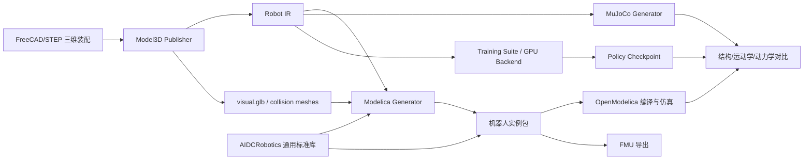

# AIDCRobotics 机器人标准库与三维模型到 Modelica 工具设计

## 1. 目标与边界

本项目交付两个相互独立、通过稳定契约协作的产品：

1. **AIDCRobotics 机器人通用标准库**：提供机器人机械、电气、执行器、传感器、接触、控制和仿真接口的标准 Modelica 组件、数据类型、命名约定与一致性测试。后续不同型号机器人直接组合和参数化这些标准组件，不重复实现基础模型。
2. **三维模型到 Modelica 转换工具**：建设 `modelica-publisher`，使不同型号机器人在完成三维装配和必要的物理标注后，可以自动生成引用 AIDCRobotics 的、可浏览、可编译、可仿真、可导出 FMI 的 Modelica 工程。

标准库可以脱离生成器手工使用，生成器也只面向标准库公开接口生成代码。具体机器人不得把通用执行器、接触或传感器方程复制进实例包。

工具的产品输入是符合 [AIDC 机器人装配发布包规范 1.0](./AIDC机器人装配发布包规范.md) 的最小装配目录。它以 `assembly.manifest.json` 为唯一入口，根目录三份 Robot IR 是结构与设备事实源，`geometry/` 只保留 `physics.json` 实际引用的逐刚体网格；完整 GLB、独立运动学、配置和报告均留在构建缓存。Modelica、MuJoCo 和三维浏览器从同一 Robot IR 派生。原生 STL 入口只用于固定或浮动单刚体测试。

首期支持树形刚体机器人：固定、转动和移动关节，浮动或固定基座，刚性接触，电机/舵机、电池和 IMU。柔性体、流体、缆绳和任意网格连续碰撞留作扩展。

## 2. 总体架构



建议分为七个独立模块：

1. `model3d-publisher`：读取 FreeCAD/STEP，输出几何和基础运动学。
2. `robot-ir`：统一事实源、JSON Schema、版本迁移和校验器。
3. `aidc-robotics-modelica`：可独立发布、版本化和复用的机器人通用 Modelica 标准库。
4. `modelica-generator`：从 Robot IR 生成机器人实例包。
5. `modelica-native-geometry`：可选 C ABI 几何与接触运行时。
6. `aidc-robotics-conformance`：标准库、生成模型和第三方组件的一致性测试套件。
7. `aidc-robotics-training`：训练契约、CPU/GPU 仿真适配、向量环境、训练/评估、Modelica Worker 和策略发布套件。

## 3. Robot IR

Robot IR 由 `physics.json`、`devices.json` 和 `interfaces.json` 三份事实源组成。现有 `aidc.model3d.package/0.1` 和独立运动学文件只作为发布器迁移输入，不进入最终装配包。

### 3.1 必填信息

| 分组 | 字段 |
|---|---|
| 身份与追溯 | modelId、revision、CAD URI/hash、发布器版本、单位和坐标系 |
| 刚体 | bodyId、父体、参考位姿、质量、质心、完整惯量张量 |
| 关节 | jointId、类型、父子体、关节坐标系、轴、零位、初始值、位置/速度/力矩限值 |
| 几何 | 显示资产、碰撞资产、资产坐标变换、缩放、hash、凸包策略 |
| 接触 | 碰撞组、排除对、摩擦、恢复、刚度/阻尼或正则化参数 |
| 执行器 | 类型、关联关节、命令类型、传动比、转子惯量、阻尼、扭矩速度包络 |
| 电源 | 标称电压、内阻、容量、限流、转换器效率和截止条件 |
| 传感器 | 类型、安装体、安装位姿、轴向、输出顺序、噪声、偏置和延迟 |
| 接口 | 动作和输出名称、顺序、单位、采样周期、符号方向和缩放 |
| 初始状态 | 基座位姿、关节位置/速度、命名姿态 |

### 3.2 数据分层

- `assembly.manifest.json`：模型身份、源发布器以及交付文件摘要，不重复保存结构。
- `physics.json`：坐标约定、刚体树、关节几何、质量惯量、接触、姿态和几何引用。
- `devices.json`：执行器、电源和传感器。
- `interfaces.json`：控制、观测和 FMI 接口契约。
- `generation.lock.json`：仅存在于生成后的 Modelica 工程，记录生成器和输出摘要，不属于装配输入包。

每个关节、刚体、设备和网格必须使用稳定 ID；名称只用于显示，禁止作为唯一关联依据。

## 4. Modelica 标准组件库

库名为 `AIDCRobotics`。它本身是主要交付物之一，目标是形成机器人领域可复用的 Modelica 建模标准，而不只是当前转换工具的内部模板。实例机器人包只包含参数、连接、设备选择和图标，不复制组件实现。

### 4.1 标准库目标

- 为轮式、腿式、机械臂、移动操作机器人和复合机器人提供共同的建模基础。
- 统一坐标系、单位、四元数顺序、关节正方向、命令和状态变量语义。
- 统一机械、电气、热、控制和传感器模型之间的连接接口。
- 支持从理想模型逐步替换为高保真执行器、传动、电池、接触和传感器模型。
- 保证模型可在 OpenModelica 中编译、仿真并导出 FMI；兼容性测试可扩展到其他 Modelica 工具。
- 允许厂商和项目扩展，同时保持公共接口和基础行为兼容。
- 使用语义化版本和弃用周期，避免机器人实例随库升级无提示失效。

### 4.2 标准分层

| 层级 | 内容 | 稳定性要求 |
|---|---|---|
| Core | 单位、坐标、枚举、记录、连接器、错误状态 | 最高，主版本内保持兼容 |
| Physical | 刚体、关节、传动、接触、电气和热组件 | 方程行为有基准测试 |
| Device | 电机、舵机、电池、IMU、编码器等设备模板 | 参数化型号不得改变接口 |
| Robot | 腿、轮组、机械臂、躯干等可复用子系统 | 可通过 `replaceable/redeclare` 扩展 |
| Integration | 命令、状态、诊断、FMI 和训练接口 | 字段顺序、单位、采样语义固定 |
| Examples | 单关节、机械臂、轮式车、双足/多足样例 | 用于教学和一致性回归 |

### 4.3 机器人能力 Profile

标准库通过 Profile 描述一种机器人至少需要哪些接口，而不是为每种型号建立一套互不兼容的基类：

- `ArticulatedRobot`：关节树、命令、状态、限位和诊断。
- `FloatingBaseRobot`：六自由度基座和惯性状态。
- `LeggedRobot`：足端 frame、地面接触和支撑状态。
- `WheeledRobot`：轮地接触、转向和里程计。
- `Manipulator`：末端 frame、负载和工具接口。
- `BatteryPoweredRobot`：直流母线、电池状态和功率遥测。
- `ImuEquippedRobot`：标准 IMU 安装 frame 与测量接口。

一个机器人可以组合多个 Profile。Profile 规定接口和验收行为，不限定内部实现。

### 4.4 兼容与扩展规则

- 公共类型和连接器位于 `AIDCRobotics.Interfaces`，不得依赖具体机器人包。
- 标准参数全部带 `quantity/unit/displayUnit`，禁止依赖无单位裸数表达物理量。
- 公共数组必须同时发布稳定名称顺序；不能以 Modelica 声明顺序作为隐含协议。
- 厂商型号位于 `AIDCRobotics.DeviceData.<Vendor>`，数据记录与方程模型分离。
- 扩展组件必须通过相应 partial model 和 conformance tests。
- 主版本升级才允许破坏接口；次版本只能增加兼容能力；修订版本只修正实现。
- 每个发布版本提供 `package.mo`、文档、示例、测试结果和兼容性矩阵。

```text
AIDCRobotics/
├─ Core/                # 版本、单位约定、公共记录和诊断
├─ Mechanics/
│  ├─ Bodies/          # 刚体、浮动基座、CAD惯量体
│  ├─ Joints/          # Revolute/Prismatic/Fixed及限位、摩擦、回差
│  ├─ Contacts/        # 点、球、盒、足底面片、网格代理接触
│  └─ Frames/          # 坐标变换和约定
├─ Actuators/
│  ├─ Ideal/
│  ├─ Servo/           # 位置舵机、扭矩速度包络、热模型
│  └─ Transmission/    # 齿轮、弹性、回差
├─ Electrical/
│  ├─ Batteries/
│  └─ Buses/
├─ Sensors/
│  ├─ IMU/
│  └─ Joint/
├─ Interfaces/         # TorqueCommand、PositionCommand、RobotState
├─ Profiles/           # 关节、浮动基座、腿式、轮式、机械臂等能力契约
├─ DeviceData/         # 按厂商组织的纯参数记录
├─ Visualization/      # 图标、简化三维形状和颜色
├─ NativeGeometry/     # C外部函数封装
├─ Conformance/        # 标准一致性测试模型
├─ Examples/           # 各类机器人的最小完整样例
└─ Utilities/
```

库优先复用 Modelica Standard Library 的 `MultiBody`、`Rotational`、`Electrical` 和 `Blocks`。生成器通过 `replaceable model`/`redeclare` 选择执行器和接触实现，使同一个机器人实例可切换理想执行器、HD-1910、简化接触或网格接触。

标准库首个稳定版的最低覆盖范围为：刚体树、固定/转动/移动关节、固定/浮动基座、限位/阻尼/摩擦/回差、理想与受限执行器、直流母线和电池、IMU 与编码器、基础接触、统一命令/状态/诊断接口以及 FMI 映射。

## 5. C/C++ 几何运行时

### 5.1 适合放入 C 层

- STL/GLB/STEP 派生网格读取和缓存。
- 凸包、VHACD 分解、AABB/OBB 和包围体生成。
- 最近点、穿透深度、接触法向及候选接触点计算。
- BVH 宽相位和网格距离查询。
- 离线质量属性复核。

### 5.2 保留在 Modelica 层

- 多体运动方程和约束。
- 接触力本构、摩擦状态和能量计算。
- 执行器、电气、电池、热和控制方程。
- 传感器输出、事件、初始化和 FMI 变量。

### 5.3 C ABI 原则

- 使用稳定的纯 C ABI；内部可以用 C++/OpenCascade/FCL。
- 网格通过 Modelica `ExternalObject` 创建一次并缓存，仿真步内不得重复读文件。
- 查询函数使用固定尺寸数组和整数句柄，不返回动态分配内存。
- 明确线程安全、确定性、错误码、单位和坐标约定。
- 支持 Windows/Linux，并随 FMU 打包动态库和几何资源。
- 不在外部函数中保存连续动力学状态；状态仍由 Modelica 求解器管理。

建议的最小接口：

```c
typedef void* AidcMeshHandle;

AidcMeshHandle aidc_mesh_load(const char* path, const double scale[3]);
void aidc_mesh_destroy(AidcMeshHandle mesh);
int aidc_mesh_distance(
    AidcMeshHandle a, const double pose_a[7],
    AidcMeshHandle b, const double pose_b[7],
    double* distance, double point_a[3], double point_b[3], double normal[3]);
int aidc_mesh_contacts(
    AidcMeshHandle a, const double pose_a[7],
    AidcMeshHandle b, const double pose_b[7],
    int capacity, double contacts_xyz_normal_depth[]);
```

## 6. 生成流程

1. **导入与冻结**：读取 FCStd/STEP，确定坐标系、单位和源 hash。
2. **结构提取**：取得装配树、刚体划分、关节轴和父子变换；缺失标注时报错，不自动猜测。
3. **物理提取**：读取材料/密度或显式质量属性，验证惯量正定性和平行轴变换。
4. **几何派生**：生成显示 GLB、碰撞凸包和网格 manifest。
5. **IR 合并**：合并执行器、电池、传感器和接口模板，生成并校验 Robot IR。
6. **代码生成**：生成 Modelica 包、组件放置、连接、图标、实验设置和 `model-project.json`。
7. **编译校验**：OMC `checkModel`、初始化、短时仿真和 FMU 导出。
8. **交叉验收**：同一 Robot IR 同时生成 MuJoCo 和 Modelica，在公共场景中比较结果。
9. **发布**：输出不可手改的生成包、lock 文件、机器可读验收摘要和可选 FMU。

生成文件应带明确标记。用户参数通过单独的 `UserOverrides.mo` 或 IR overlay 保存，重新生成时不覆盖人工配置。

## 7. 输出工程

```text
<robot>-modelica/
├─ model-project.json
├─ modelica/
│  └─ <RobotPackage>/
│     ├─ package.mo
│     ├─ Types.mo
│     ├─ Data.mo
│     ├─ Bodies.mo
│     ├─ Robot.mo
│     ├─ Experiments.mo
│     └─ Resources/
│        ├─ meshes/
│        └─ Library/
├─ robot-ir/
│  ├─ physics.json
│  ├─ devices.json
│  ├─ interfaces.json
│  └─ generation.lock.json
├─ overrides/
│  └─ UserOverrides.mo
└─ results/
```

## 8. 分阶段实施

### P0：标准基础与契约（已完成）

- 建立 `AIDCRobotics.Core`、`Interfaces`、版本策略和命名规范。
- 完成 `physics/devices/interfaces` JSON Schema 及 Robot IR 校验器。
- 建立标准库 conformance tests 和最小单关节示例。

退出条件：公共连接器和数据记录冻结；标准库可独立安装和使用；OpenModelica 编译、仿真和 FMI 冒烟测试通过。

实施基线：`AIDCRobotics 0.1.0`、`aidc.robot.physics/0.1`、`aidc.robot.devices/0.1`、`aidc.robot.interfaces/0.1`。验收入口为 `npm run verify:modelica:p0-robotics`，机器可读结果记录在 `modelica-browser/results/p0-robotics-summary.json`。验收结果：Robot IR 示例包含 2 个刚体、1 个关节和 3 个设备；0.5 N·m 输入下单关节终态为 0.249999998 rad，理论值为 0.25 rad；原生 OMC 与 FMI 2.0 ME+CS 最大终态绝对误差为 6.58×10⁻⁹。

### P1：标准机械与设备库（已完成）

- 完成刚体、固定/浮动基座、固定/转动/移动关节及关节非理想特性。
- 完成通用执行器、电机/舵机、电池、IMU 和关节传感器模板。
- 建立设备数据目录，首个具体型号为 HD-1910。
- 完成 `ArticulatedRobot`、`FloatingBaseRobot`、`BatteryPoweredRobot` 和 `ImuEquippedRobot` Profile。

退出条件：手工使用标准库即可重建现有 T2 单关节模型，且动态响应处于既定误差门槛内。

实施基线：`AIDCRobotics 0.2.0`。`Mechanics` 已提供显式质量属性刚体、固定/浮动基座、固定/转动/移动关节、摩擦阻尼限位和回差；`Actuators` 已提供理想转矩、受限直流电机和受限位置舵机；`Electrical`、`Sensors`、`DeviceData` 与 `Profiles` 已分别提供电池母线、关节/IMU 模板、HD-1910 参数以及四类能力契约。验收入口为 `npm run verify:modelica:p1-robotics`，机器可读结果记录在 `modelica-browser/results/p1-robotics-summary.json`。

P1 验收逐类检查 17 个标准组件和 Profile，电池限流、压降及 IMU `wxyz` 顺序 conformance 模型通过。使用标准库 `LimitedPositionServoAxis` 重建 T2 的 30° HD-1910 阶跃工况，在 0～3 s、0.002 s 输出间隔的 1506 个采样行上，对关节角、速度、温度、能量、电流、电压、转矩和功率等 13 个变量做全轨迹比较，最大绝对误差为 8.99×10⁻¹¹，低于 1×10⁻⁹ 门槛。

### 实施记录管理

阶段目标、变更范围、验收方法、实测数据和阶段边界统一维护在本实施文档中，不再为 P0、P1 等阶段生成独立 Markdown 执行报告。自动化验收只在 `modelica-browser/results/` 保存便于 CI 和工具读取的 JSON 摘要及仿真产物；后续阶段完成时更新对应阶段条目和本节所引用的验收数据。

### P2：三维模型转换垂直切片（已完成）

- 从 Robot IR 自动生成单刚体、单转动关节和一个标准设备实例。
- 生成参数、连接、图标、实验设置和 `model-project.json`。
- 建立生成锁文件、诊断定位和用户覆盖机制。

退出条件：除用户覆盖文件外，生成目录可删除后完全重建；结果与手工标准库模型一致。

实施基线：`aidc-modelica-generator 0.1.0`、模板 `p2-v1`。生成器入口为 `modelica-browser/tools/modelica_generator.py`，从通过语义校验的 `physics.json`、`devices.json` 和 `interfaces.json` 读取单关节 Robot IR，生成轻量机器人实例包。生成包只声明参数、组件选择和连接，机械与执行器方程继续引用 `AIDCRobotics 0.2.0`；工程契约为依赖增加受限相对 `path`，运行器只允许加载 AIDC 工作区内的包文件，避免复制标准库或加载工作区外任意文件。

生成结果位于 `modelica-browser/generated/p2-single-joint`，包含 `model-project.json`、Modelica 根包、Robot IR 输入快照、`generation.lock.json`、生成诊断和独立的 `overrides/user-overrides.json`。Modelica 包实例化 1 个 `RigidBody3D`、1 个 `RevoluteJoint3D`、1 个 `IdealTorque` 标准设备以及关节损耗组件，同时生成参数、连接、组件图标、连接图和实验设置。锁文件记录四项输入摘要、标准库源码摘要、生成器/模板版本、输出文件摘要和整体生成摘要；错误通过源文档和 JSON Pointer 定位。

验收入口为 `npm run verify:modelica:p2-generator`，机器可读结果记录在 `modelica-browser/results/p2-generator-summary.json`。验收将用户转矩覆盖值改为 0.08 N·m，仅保留覆盖目录并删除其他生成内容后重新生成，覆盖文件字节保持不变，前后生成摘要一致。生成模型与手工使用 AIDCRobotics 搭建的基准在 0～2 s、0.001 s 输出间隔的 2004 个采样行上逐点比较关节角、关节速度和施加转矩，最大绝对误差为 0。对于 P2 不支持的移动关节，诊断精确定位到 `physics.json#/joints/0/type`。

### P3：树形多刚体生成（已完成）

- 支持固定/浮动根、任意树形 Revolute/Prismatic/Fixed。
- 生成质量惯量、关节限位、组件图标、连接图和命名姿态。
- 用 Microduck Native12 作为首个全机器人样例。

退出条件：13 刚体、12 关节、质量、质心、惯量和关键位姿逐项通过结构验收。

实施基线：`aidc-modelica-generator 0.2.0`、模板 `p3-v1`。Robot IR 物理契约增加固定/浮动根和初始根位姿；生成器按稳定 body/joint ID 构建任意父子树，输出 `RigidBody3D`、关节安装变换以及 Fixed、Revolute、Prismatic 标准组件。根初始旋转通过标准 `FixedJoint3D` 显式映射，避免把四元数约定隐含在生成模板中。所有机械连接都带端点连接和 `Line` 注解；标准机械组件补齐类型图标、端口位置和可选范围。生成目录额外保存 `robot-ir/generated-structure.json`，逐体记录质量、质心、惯量和实例名，逐关节记录父子关系、安装位姿、轴、限位及实例名。

首个完整样例位于 `modelica-browser/packages/robot-ir/examples/microduck-native12`，其 `build_bundle.py` 从已评审的 Native12 CAD 对齐数据可重复生成三份 Robot IR。产物位于 `modelica-browser/generated/microduck-native12`，包含浮动基座、13 个刚体、12 个转动关节、12 个执行器通道和完整 Modelica 工程入口。验收入口为 `npm run verify:modelica:p3-generator`，机器可读结果统一记录在 `modelica-browser/results/p3-tree-generator-summary.json`，不另建阶段报告。

P3 验收逐项比对 13 个刚体的质量、质心和六项惯量、12 个关节的类型、父子关系、安装位姿、轴和限位；总质量为 0.6608121798488 kg。OMC 完成 Native12 的 0～0.02 s 仿真，`stand` 命名姿态对 trunk、左右足和 head 的最大位置误差为 0，12 个关节初始坐标最大误差为 0。另一个 4 刚体固定根混合树同时覆盖 Revolute、Prismatic、Fixed 并通过 OMC 编译仿真；删除生成内容后重建摘要一致，用户覆盖文件保持不变。

### P4：接触与 C 运行时（已完成）

- 先支持球、盒、胶囊和足底多点代理。
- 再实现 BVH 网格查询 ExternalObject 和离散接触点输出。
- 提供 MuJoCo 与 Modelica 公共落地、滑移、碰撞场景。

退出条件：接触点、法向、穿透量、力和能量误差满足门槛，动态库可随 FMU 发布。

实施基线：`AIDCRobotics 0.3.0`、`modelica-native-geometry 0.1.0`。Modelica 层新增点、球、轴对齐盒、胶囊和平面接触，以及四点足底面片；统一输出接触点、法向、带符号距离、穿透量、三轴接触力、弹性能和耗散功率。法向力采用幂次刚度加压缩方向阻尼，切向力采用速度正则化库仑摩擦。接触力和连续状态均留在 Modelica 求解器中。

C 层提供稳定纯 C ABI，支持 OBJ、二进制 STL 和 ASCII STL 一次加载、Opaque Handle 生命周期、确定性中值分割 BVH、最近点/距离查询，以及固定容量的 `[x,y,z,nx,ny,nz,depth]` 离散接触记录。Modelica 通过 `NativeGeometry.MeshHandle extends ExternalObject` 缓存网格；查询期间不读取文件、不保存连续动力学状态，也不修改共享数据。Windows 动态库、静态链接库、头文件和测试几何统一放在标准库 `Resources` 中；`package_native_fmu.py` 将动态库、ABI 头文件、几何资源和带摘要的清单写入 FMU。

验收入口为 `npm run verify:modelica:p4-contact-runtime`，机器可读结果统一记录在 `modelica-browser/results/p4-contact-runtime-summary.json`。C ABI 验收读取 12 三角形 OBJ 与 1 三角形二进制 STL，构建 7 节点 BVH；两个 0.1 m 立方体的距离结果为 0.02 m，重叠穿透量为 0.02 m。公共落地、滑移、碰撞几何场景与 MuJoCo 比较后，最大穿透误差为 1.0×10⁻⁷ m、接触点误差为 5.0×10⁻⁸ m、法向误差为 0；Modelica 接触法向力误差为 0，弹性能误差为 1.39×10⁻¹⁷ J。FMI 2.0 ME+CS 包包含 Windows 原生动态库、头文件和几何资源，并由 FMPy 独立执行确认原生运行时版本码 100。

### P5：标准库与生成器产品化（已完成）

- CLI：`aidc-modelica generate/validate/compare/package`。
- 增量生成、schema 迁移、诊断定位、缓存和 CI。
- 接入 Model3D Viewer 与 Modelica Browser，一键从已发布三维模型创建工程。
- 发布 AIDCRobotics 版本包、API 文档、Profile、示例和兼容性矩阵。

退出条件：第二种机器人无需新增标准组件或生成器分支即可成功生成和仿真；如需新设备，只增加符合标准接口的数据记录或可替换组件。

实施基线为 `aidc-modelica 0.1.0`、`aidc-modelica-generator 0.3.0` 和 `AIDCRobotics 0.3.0`。统一产品入口为 `tools/aidc_modelica.py`，PowerShell 包装入口为 `scripts/aidc-modelica.ps1`，提供以下稳定命令：

```text
aidc-modelica validate <robot-ir|modelica-project> [--migrate]
aidc-modelica generate <assembly-package|robot-ir|test-stl> <project> [--profile auto|p2|p3] [--stl-unit mm|m] [--density kg/m3] [--root-type fixed|floating] [--migrate] [--force]
aidc-modelica compare <run-or-csv> <run-or-csv> [--variable NAME] [--abs-tol N] [--rel-tol N]
aidc-modelica package <project> <output.aidcmpkg> [--include-results]
```

`generate` 的首选输入是装配发布包目录。生成器先校验 `assembly.manifest.json` 与包内全部文件摘要，再从包根目录读取 `physics.json`、`devices.json` 和 `interfaces.json`。装配包不区分半成品成熟度：三份 IR、物理参数、设备和接口不完整时不创建正式包。为了兼容底层工具和测试，生成器也可直接接收 Robot IR 目录或原生 STL。STL 入口只生成单刚体测试 IR。自动 Profile 选择只依据 Robot IR 拓扑；请求摘要覆盖三份 IR、实际引用的几何、用户覆盖、生成选项、生成器版本和标准库内容。

Robot IR `0.0` 到 `0.1` 的迁移集中在 `robot_ir_migrations.py`，显式 `--migrate` 才会执行，并返回逐文档、逐 JSON Pointer 的变更记录。验证和生成错误统一返回机器可读诊断，schema 错误包含源文件与 JSON Pointer。`compare` 支持生成结构和 OMC CSV 时序；`package` 生成确定性 `.aidcmpkg`，将 AIDCRobotics 依赖内置并重写为工程内相对路径，解压到 AIDC 工作区外仍可验证。

第二验收机器人为 `aidc.reference.arm5`：固定基座、5 个刚体、4 个转动关节、4 个标准扭矩执行器，结构和用途均不同于 Microduck。它通过同一 P3 路径生成、OMC 编译和仿真，生成器源码没有型号判断，也没有新增标准组件。AIDCRobotics 发布包包含 Modelica 源码、原生几何运行时、API、Profiles 和兼容性矩阵，并采用固定 ZIP 元数据实现重复构建 hash 一致。

CI 入口为 `npm run ci:modelica`；P5 独立验收入口为 `npm run verify:modelica:p5-productization`。机器可读结果统一记录在 `results/p5-productization-summary.json`，生成工程位于 `generated/reference-arm5`，可移植工程包和标准库版本包位于 `dist/`。不创建单独的阶段执行文档。

### P6：模型生成与仿真闭环验收

执行决策（2026-10-10）：P6 暂不实施训练接口、GPU 编译器、VectorEnv、任务奖励、PPO 或策略发布。当前阶段先证明 P0～P5 已形成可从 Robot IR 重建、编译、运行、打包、迁移并复现结果的完整闭环。Modelica GPU 编译与双模型训练架构独立记录在 [Modelica GPU 编译与双模型架构方案](./Modelica_GPU编译与双模型架构方案.md)，该文档当前是后续研究输入，不是 P6 交付承诺。

#### P6.1 验收对象

闭环同时使用两种结构明显不同的机器人：

- `aidc.microduck.native12`：浮动基座、13 刚体、12 转动关节和 12 个执行器；
- `aidc.reference.arm5`：固定基座、5 刚体、4 转动关节和 4 个执行器。

两者必须使用同一个 Robot IR 校验器、同一个生成器、同一个工程运行器和同一个打包器；标准库与生成器不得出现型号判断。

#### P6.2 闭环路径

```text
Robot IR + geometry
  -> schema and semantic validation
  -> deterministic Modelica generation
  -> model-project validation
  -> OMC check/build
  -> native simulation and versioned run artifacts
  -> portable .aidcmpkg
  -> extract outside AIDC workspace
  -> validate and simulate again
  -> compare original and portable trajectories
  -> machine-readable acceptance summary
```

闭环验收使用现有公开 CLI 和工程运行器，不建立只为测试存在的第二条生成或仿真路径。原工程和便携工程必须从相同输入生成，并使用相同模型类、求解设置和 AIDCRobotics 版本。

#### P6.3 验收内容

| 层级 | 检查 |
|---|---|
| 输入 | 三份 Robot IR 文档通过 schema、引用、刚体树、惯量、单位和接口校验 |
| 生成 | 清理输出后可重建；第二次生成命中缓存；generation/request digest 一致 |
| 结构 | 根类型、刚体、关节、设备、总质量和稳定 ID 与 Robot IR 一致 |
| 编译 | 两个工程均由项目固定的 OMC 和 MSL 版本检查并生成可执行程序 |
| 仿真 | 初始化、求解和结果评估完成；时间轴单调、关键输出有限且仿真到目标终点 |
| 制品 | run manifest 包含输入 hash、工具版本、求解设置、日志和结果 hash |
| 便携 | `.aidcmpkg` 内置 AIDCRobotics 和所需资源，在 AIDC 工作区外解包后仍可验证和运行 |
| 复现 | 原工程与便携工程的变量集合、采样时间和完整轨迹在冻结容差内一致 |
| 通用性 | 两个机器人走完全相同的命令和代码路径，生成器无型号分支 |

#### P6.4 本阶段不实施

- `training-interface.json`、训练 task 和域随机化 schema；
- MuJoCo、MuJoCo Warp 或其他 GPU 后端适配；
- GPU Modelica Profile、GPU IR 和代码生成；
- VectorEnv、设备端 reset/observation/reward；
- PPO、checkpoint、训练监控和多 GPU；
- Modelica Worker 池、策略异步验证和策略 promotion manifest。

这些内容只有在闭环验收通过并单独批准 GPU 编译方案后才能进入实施计划。

#### P6.5 制品与执行入口

- 自动入口：`npm run verify:modelica:p6-closed-loop`；
- 统一 CI：`npm run ci:modelica`；
- 机器可读结果：`results/p6-closed-loop-summary.json`；
- 便携工程：`dist/microduck-native12-p6.aidcmpkg` 与 `dist/reference-arm5-p6.aidcmpkg`；
- 仿真证据保存在各验收工程的标准 `results/<run-id>/` 中。

不新建 P6 阶段执行报告；执行状态、证据摘要和边界统一回写本实施文档。

#### P6.6 退出条件

P6 完成需要同时满足：

- 两个验收机器人从干净输入完成校验、生成、OMC 编译和原生仿真；
- 生成工程被打包后可在 AIDC 工作区外独立校验、编译和仿真；
- 原工程与便携工程完整轨迹比较通过，且证据包含输入、源码、工具链、求解设置和结果 hash；
- 重复生成的 digest 稳定，用户覆盖文件不被生成器改写；
- 标准库、生成器和验收脚本不包含机器人型号专用分支；
- `results/p6-closed-loop-summary.json` 为 `passed: true`，统一 CI 全部通过。

训练相关的分析不再作为 P6 退出条件。后续是否修改 OMC 或建设独立 GPU 编译器，以独立方案中的 G0 决策门重新立项。

#### P6.7 执行结果

**执行进展（2026-10-10）：P6 模型生成与仿真闭环验收已通过。** 自动入口 `npm run verify:modelica:p6-closed-loop` 在统一 CI 中用 68.03 s 完成两个机器人从 Robot IR 到工作区外便携复跑的全部链路，`trainingInterfaceImplemented` 明确为 `false`。

- Microduck Native12：浮动基座、13 刚体、12 关节和 12 执行器；OMC 1.27.1 生成 22 个采样点、3735 个变量，终点 0.02 s；原工程与便携工程完整轨迹最大绝对误差为 0；便携包 SHA-256 为 `197d0cc9b458acfde8af7141aa23cc20f69e996a8bb8d4db3698b5be73bc375f`。
- Reference Arm5：固定基座、5 刚体、4 关节和 4 执行器；生成 22 个采样点、1253 个变量，终点 0.02 s；原工程与便携工程完整轨迹最大绝对误差为 0；便携包 SHA-256 为 `4c03fb38881be4f9424701c235ca6bb8d6870651fff41888da713d3c877e8c21`。
- 两个工程的重复生成均命中缓存，generation/request digest 保持一致，用户覆盖文件未被改写，便携包重复构建 hash 一致。
- OMC CSV 在仿真终点保留一次同时间事件样本；验收保留该标准结果语义，检查时间不得回退、必须从起点推进至目标终点，并在原工程与便携工程中逐样本比较。

机器可读证据统一记录在 `results/p6-closed-loop-summary.json`，未创建单独阶段执行报告。

## 9. 验收矩阵

| 层级 | 自动检查 |
|---|---|
| 来源 | 输入 hash、生成器版本、模板版本和 lock 可复现 |
| Schema | 引用完整、稳定 ID 唯一、单位和坐标约定一致 |
| 结构 | 刚体/关节/组件数量和父子关系一致 |
| 质量 | 总质量、质心、各体惯量及正定性 |
| 运动学 | 零位及随机姿态下关键 frame 位姿 |
| 动力学 | 自由落体、单关节阶跃、能量和动量 |
| 接触 | 高度、法向、摩擦、滑移、落地冲量和自碰撞 |
| 设备 | 扭矩速度包络、电流、电压、SOC、IMU 轴向 |
| 接口 | 动作/观测名称、顺序、单位、采样周期和符号 |
| 工具链 | OMC 编译、仿真、FMU 导出、浏览器索引和跨平台运行 |
| 闭环 | 相同输入/策略下 Modelica、GPU 后端、可选 MuJoCo 和实测误差 |

## 10. 首期决策

1. Robot IR 是生成器内部的统一事实源；原生 STL 可由产品入口自动转换为单刚体 Robot IR，但不能单独表达多刚体机器人的关节和设备语义。
2. 在现有 Model3D 契约上扩展物理和设备契约，不另建不兼容格式。
3. AIDCRobotics 是独立产品和机器人通用标准；标准库、生成器与机器人实例分离，生成器只生成参数和连接。
4. P0/P1 不依赖外部 C 库，先用 MSL 和代理接触完成稳定流水线。
5. C 运行时从 P3 引入，只解决标准库不擅长的网格几何查询。
6. Modelica 与 GPU 训练后端从同一 IR 生成，Modelica 是高保真发布门槛；MuJoCo 作为可选迁移和参考后端。
7. 第二种机器人是通用性验收对象，禁止在标准库或生成器中加入 Microduck 专用分支。

## 11. 项目完成判据

项目完成需要同时满足两类目标：

### AIDCRobotics 标准库

- 至少覆盖关节机器人、浮动基座腿式机器人以及一种轮式或机械臂机器人。
- 相同 Profile 的不同机器人使用相同命令、状态和诊断接口。
- 通用组件不依赖具体机器人名称、关节数量或 CAD 文件。
- 标准库拥有独立版本、文档、示例、conformance tests 和发布包。
- 使用者能够不经过转换工具，直接用标准组件搭建机器人模型。

### 三维模型转换工具

- 输入合规 Robot IR 和三维资产即可生成 Modelica 工程。
- 生成结果引用 AIDCRobotics，不内嵌通用组件实现。
- 同一输入和工具版本生成字节稳定或语义稳定的结果，并记录完整 hash。
- 至少两种结构明显不同的机器人无需修改生成器即可生成、编译和仿真。
- 输出通过结构、质量、运动学、动力学、接口和工具链验收矩阵。

